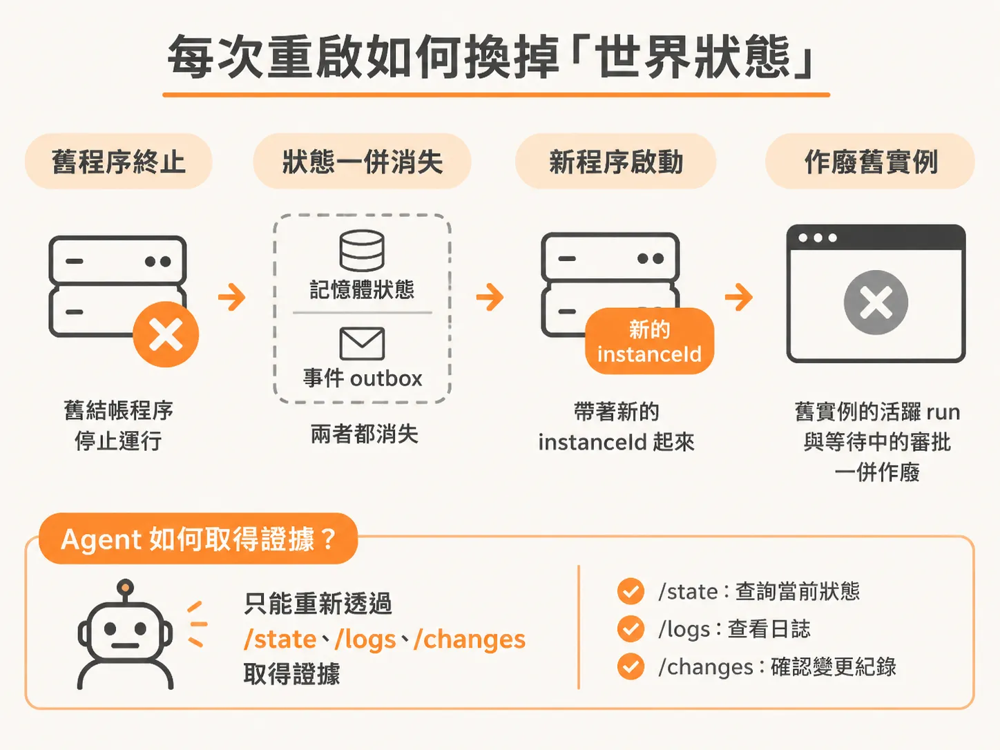
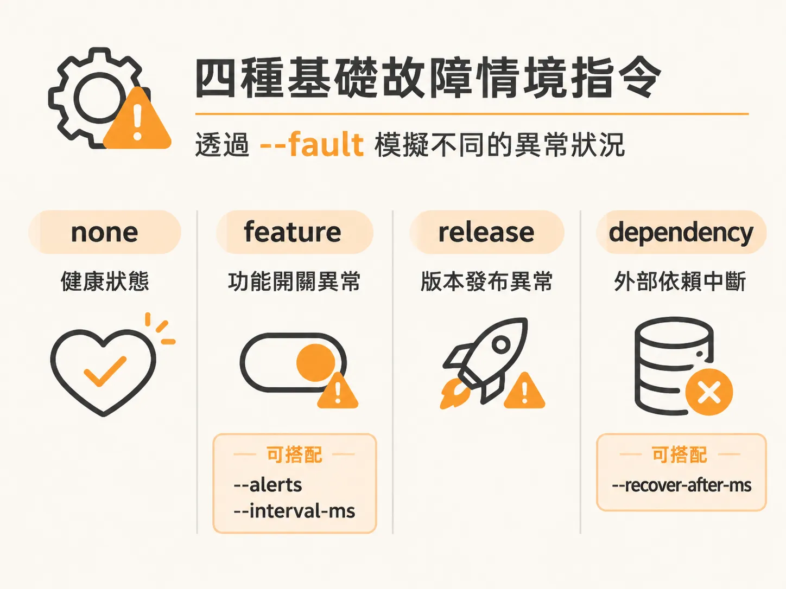
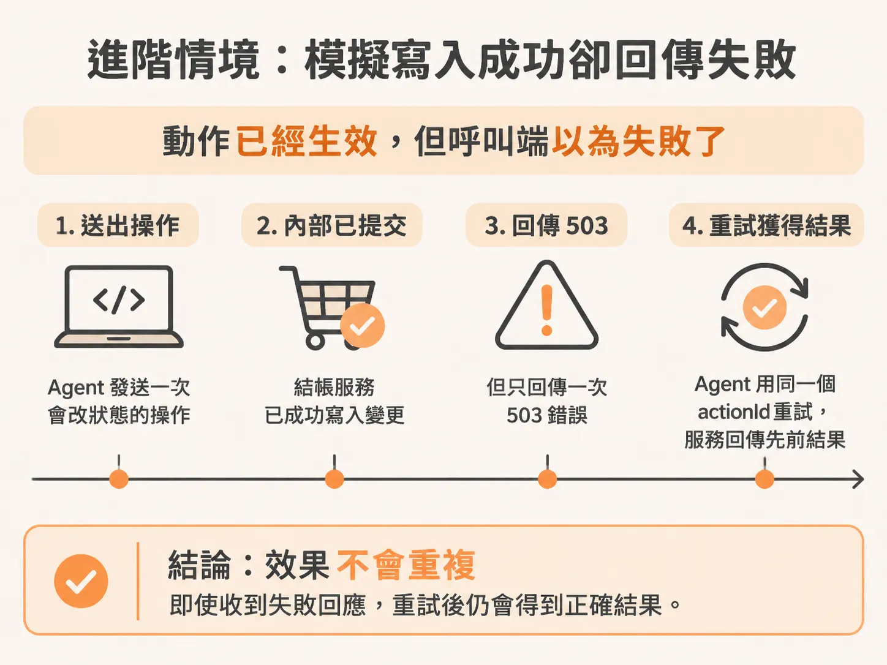

# 用啟動旗標建立四種故障情境

三個程序都啟動、埠位也確認乾淨之後，才有條件刻意製造故障。要測試自動化維運 Agent 如何排查與修復系統，最麻煩的往往不是寫修復邏輯，而是如何穩定重現真實世界裡的各種故障。

本專案提供了一個輕量級的結帳模擬服務（checkout service），它獨立運行在終端機（terminal 3），監聽 port 3004。你可以透過命令列傳入 `--fault` 與相關參數，隨時切換出健康的服務、壞掉的功能開關、異常發布，或是外部依賴中斷等情境。

## 每次重啟如何換掉「世界狀態」

在了解各種故障旗標之前，必須先理解結帳服務的狀態管理機制：**結帳服務的所有狀態與事件發送清單（outbox）完全存放在記憶體中**。



這意味著：
1. **重啟即重設**：只要在終端機按下 `Ctrl-C` 終止程序再重新執行，舊有的記憶體狀態就會徹底抹除。
2. **全新實例 ID**：每次啟動都會產生一組全新的 `instanceId`。
3. **覆蓋舊事件**：Operator API 收到新實例的事件時，會將其視為新的執行週期，直接取代（supersede）舊實例的活躍事件（active runs）以及等待中的審批請求（pending approvals）。
4. **外部黑箱**：Agent 與 Operator API 事先不知道你是用哪一個啟動旗標開啟服務的，它們完全依賴呼叫 `/state`、`/logs` 與 `/changes` 等端點來收集現況證據。

因為 port 3004 只能被一個程序佔用，進行任何故障演練時，請確保終端機 3 只有一個結帳程序正在執行（終端機 1 與 2 保持運行即可）。

## 四種基礎故障情境指令

`--fault` 參數支援四種基礎模式：`none`、`feature`、`release` 與 `dependency`。



### 1. 正常健康狀態（none）

若要讓結帳服務回到一切正常的初始狀態，使用 `none`：

<!-- derived -->
```bash
npm run dev:checkout -- --fault none
```

此時服務不會主動發出異常警報，各項狀態檢查均維持正常。

### 2. 功能開關異常（feature）

模擬新功能推出（feature rollout）後引發的異常：

<!-- derived -->
```bash
npm run dev:checkout -- --fault feature --alerts 3 --interval-ms 1000
```

這裡搭配了兩個輔助參數：
- `--alerts 3`：指定服務觸發時連續發送 3 次警報事件。
- `--interval-ms 1000`：每次發送警報的間隔時間為 1000 毫秒（1 秒）。

在 Agent 的修復流程中，這類故障通常需要透過 `disable_feature` 操作來使服務恢復健康。

### 3. 版本發布異常（release）

模擬程式碼版本部署（faulty release）後導致的服務降級：

<!-- derived -->
```bash
npm run dev:checkout -- --fault release
```

面對這類故障，維運 Agent 通常需要比對變更紀錄並執行 `rollback_release` 才能解除警報。

### 4. 外部相依服務中斷（dependency）

模擬資料庫或下游第三方 API 連線異常（dependency outage）：

<!-- derived -->
```bash
npm run dev:checkout -- --fault dependency --recover-after-ms 30000
```

搭配的關鍵參數是 `--recover-after-ms`：
- 設定為 `30000` 時，相依服務會在 30 秒後自行修復（self-recover），適合用來測試 Agent 是否能識別「瞬時故障」並在服務自癒後正常收尾。
- 若設定為 `0`（`--recover-after-ms 0`），相依服務將一直維持故障狀態，直到你手動重啟結帳程序為止。

## 進階情境：模擬寫入成功卻回傳失敗

在分散式系統中，最棘手的問題往往是「動作已經生效，但呼叫端以為失敗了」。你可以透過 `--lose-next-action-response` 旗標來模擬這個邊界狀況：



<!-- derived -->
```bash
npm run dev:checkout -- --fault feature --lose-next-action-response
```

加上此旗標後，當 Agent 第一次對結帳服務發出具有修改性質的修復操作（如停用功能或回滾）時，結帳服務會在內部成功提交變更，但故意回傳一次 HTTP 503 錯誤。這能暴露出「副作用已產生」與「呼叫端未收到確認」之間的落差（side-effect / acknowledgement gap），測試 Agent 是否具備重試時攜帶相同 `actionId`（冪等性設計）的防護能力。
