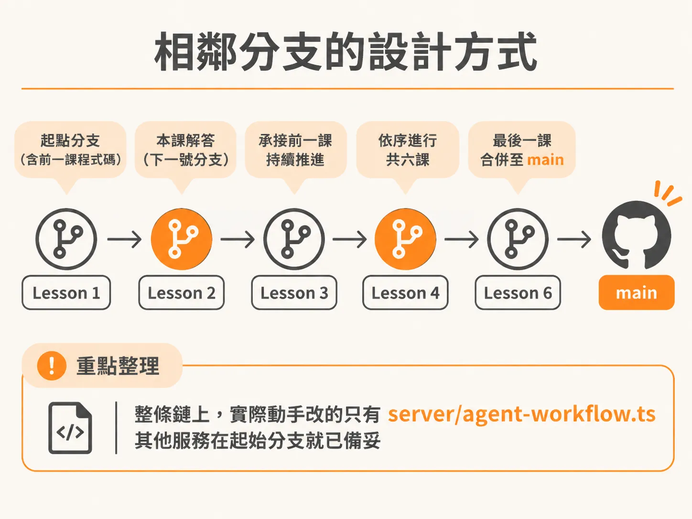
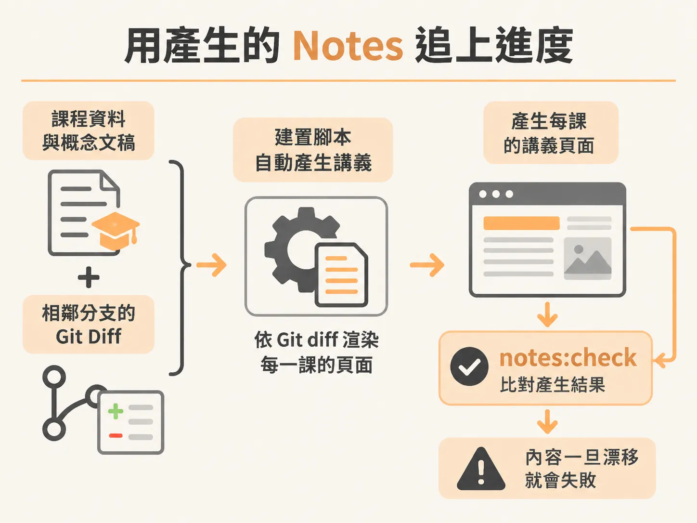
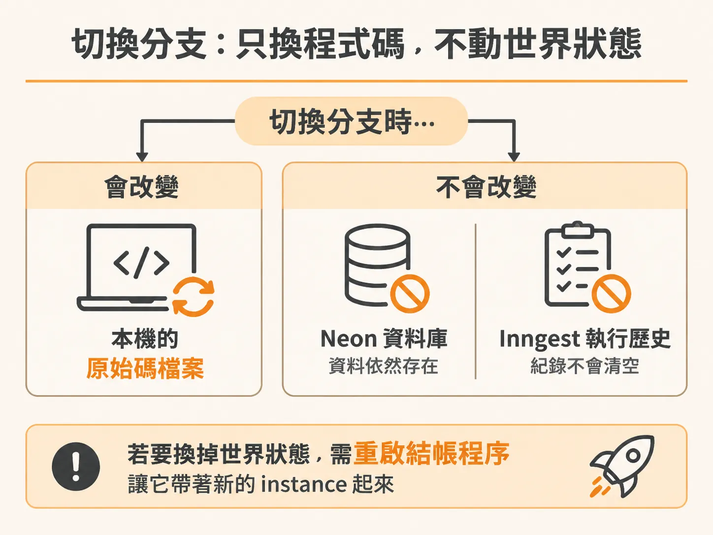

# 分支如何運作

故障情境能穩定重現之後，剩下的就是按部就班走完六個課程單元。在跟著課程實作背景代理人（background agent）的工作流時，難免會遇到手動輸入跟不上、除錯卡關，或是想直接驗證標準解法的情境。這套專案的分支設計並非各自獨立的實驗專案，而是利用 Git 分支前後銜接的特性，讓你在任何課堂節點都能隨時切換、補上進度，並維持一致的程式碼規範。

## 相鄰分支的設計方式

課程中的六個實作單元採用相鄰分支（adjacent branches）推進。每個單元的起點分支包含上一課完成的程式碼，而下一號分支就是當前單元的完整解答，最後一課的解答則合併在 `main` 分支。



所有現場實作的修改都集中在 `server/agent-workflow.ts`，其餘的結帳服務（checkout service）、操作儀表板、事件接收機制與資料庫連線都已在初始分支準備就緒。分支的對應關係如下：

* **第 1 課（Goal and loop）**：起點為 `lesson-1`，解法在 `lesson-2`
* **第 2 課（Durable steps）**：起點為 `lesson-2`，解法在 `lesson-3`
* **第 3 課（Wait for events）**：起點為 `lesson-3`，解法在 `lesson-4`
* **第 4 課（Human approval）**：起點為 `lesson-4`，解法在 `lesson-5`
* **第 5 課（Safe retries）**：起點為 `lesson-5`，解法在 `lesson-6`
* **第 6 課（Help and handoff）**：起點為 `lesson-6`，解法在 `main`

## 用產生的 Notes 追上進度

如果你落後了，有幾種方式可以追上：

1. **直接切換分支**：跳過當前實作，直接 checkout 到解答分支開始下一課。
2. **對照講義筆記（notes）**：閱讀講義中的 diff 區塊，手動補齊或請 Coding Agent 協助套用變更。

專案中的講義筆記並不是另外手寫的教學文件，而是透過建置腳本比對相鄰分支的 Git diff 自動產生。綠色 `+` 代表新增，紅色 `-` 代表刪除，並附帶位置提示（cues），確保講義與分支程式碼完全一致：



<!-- source: sources/background-agent/20261105/scripts/build-notes.mjs#L1-L132 -->

````javascript
import { execFileSync } from 'node:child_process'
import { readFileSync, writeFileSync, mkdirSync } from 'node:fs'
import { dirname, join } from 'node:path'
import { fileURLToPath } from 'node:url'

const root = dirname(dirname(fileURLToPath(import.meta.url)))
const { lessons, editCues } = JSON.parse(
  readFileSync(join(root, 'scripts/lesson-data.json'), 'utf8'),
)
const check = process.argv.includes('--check')
const teachingFiles = ['server/agent-workflow.ts']

function diffBlocks(start, solution) {
  const diff = execFileSync(
    'git',
    ['diff', '--unified=3', start, solution, '--', ...teachingFiles],
    {
      cwd: root,
      encoding: 'utf8',
    },
  )
  const blocks = []
  let file = ''
  let hunk = null

  function saveHunk() {
    if (hunk?.length) blocks.push({ file, lines: hunk })
  }

  for (const line of diff.split('\n')) {
    if (line.startsWith('diff --git ')) {
      saveHunk()
      file = line.split(' b/')[1]
      hunk = null
    } else if (line.startsWith('@@ ')) {
      saveHunk()
      hunk = []
    } else if (
      hunk &&
      /^[ +-]/.test(line) &&
      !line.startsWith('+++ ') &&
      !line.startsWith('--- ')
    ) {
      hunk.push(line.replace(/[ \t]+$/, ''))
    }
  }
  saveHunk()
  return blocks
}

function renderLesson(lesson, number) {
  const blocks = diffBlocks(lesson.start, lesson.solution)
  const cues = editCues[number]
  if (blocks.length !== cues.length) {
    throw new Error(
      `Lesson ${number}: ${blocks.length} code edits but ${cues.length} location cues`,
    )
  }

  const concept = readFileSync(
    join(root, `scripts/lesson-prose/${String(number).padStart(2, '0')}.md`),
    'utf8',
  ).trim()
  const lines = [
    `# ${String(number).padStart(2, '0')} · ${lesson.title}`,
    '',
    `Start: \`${lesson.start}\` · Finished solution: \`${lesson.solution}\``,
    '',
    `**Outcome:** ${lesson.promise}`,
    '',
    '## The engineering idea',
    '',
    concept,
    '',
    '## See it in the lab',
    '',
    lesson.opening,
    '',
    '## Live coding',
    '',
    lesson.edit,
    '',
    'These code blocks show the exact changes between the start and solution branches. Unprefixed context stays, green `+` lines are added, and red `-` lines are removed.',
    '',
  ]

  blocks.forEach(({ file, lines: diff }, index) => {
    const cue = cues[index]
    lines.push(`### Edit ${index + 1} · \`${file}\``, '')
    lines.push(cue, '', '```diff', ...diff, '```', '')
  })

  lines.push(
    'Run `npm run format`, `npm run lint`, and `npm run typecheck` after all edits. The intermediate file may not typecheck while a larger handler replacement is in progress.',
    '',
    '## Verify',
    '',
    lesson.verify,
    '',
    '## Break it on purpose',
    '',
    lesson.experiment,
    '',
    '## Engineering challenge',
    '',
    lesson.challenge,
    '',
    '## Catch up',
    '',
    `Your solution is \`${lesson.solution}\`. Check your work with \`git status --short\`. If you need to switch with unfinished edits, save them first with \`git stash push -u -m "lesson ${number} progress"\`, then \`git switch ${lesson.solution}\`. A branch switch changes code, not PostgreSQL, checkout process state, or Inngest history. Restart checkout with a fresh fault flag for the next drill.`,
    '',
    `**Common mistake:** ${lesson.mistakes}`,
    '',
    `**Optional extension:** ${lesson.extension}`,
    '',
  )
  return lines.join('\n')
}

lessons.forEach((lesson, index) => {
  const output = join(root, 'lessons', lesson.slug, 'index.md')
  const rendered = renderLesson(lesson, index + 1)
  if (check) {
    if (readFileSync(output, 'utf8') !== rendered)
      throw new Error(`Lesson notes are out of sync: ${output}`)
  } else {
    mkdirSync(dirname(output), { recursive: true })
    writeFileSync(output, rendered)
  }
})

if (check) console.log('All six lesson pages match their sources and branch checkpoints.')
````

當分支程式碼有更新時，維護者會執行 `npm run notes:generate` 重新產生課堂說明，並透過 `npm run notes:check` 檢查檔案是否有漂移（drift）。

## 切換分支與儲存暫存進度

在切換分支之前，若你的工作目錄有未完成的修改，請先將它們存入 Git stash，以免變更被覆蓋或阻止切換：

<!-- derived -->
```bash
git stash push -u -m "lesson progress"
git switch lesson-2
```

切換分支時必須牢記一件事：**Git 分支切換只會改變本機的原始碼檔案，不會重設 Neon 資料庫內的資料，也不會清空 Inngest 的執行歷史紀錄。**



工作流的執行狀態與程序狀態獨立於 Git 之外。因此在進行下一輪演練時，建議重啟一個乾淨的結帳程序（checkout instance），以確保能清楚觀察到新的事件與問題排除過程。

## 改動後的程式碼驗證

每當你完成一段程式碼編輯，或從筆記套用變更後，務必執行檢查流程。本專案使用 Oxfmt 規範，程式碼格式採用單引號且不加分號。

在進行較大的處理常式（handler）替換時，中間過程的型別檢查可能會暫時報錯，但在所有編輯完成後，請依序執行以下指令：

<!-- derived -->
```bash
npm run format
npm run lint
npm run typecheck
```

* `npm run format`：自動依 Oxfmt 規則排版程式碼。如果只想檢查排版是否符合標準而不改動檔案，可使用 `npm run format:check`。
* `npm run lint`：檢查語法與潛在邏輯錯誤。
* `npm run typecheck`：執行 TypeScript 型別檢查，確保代理人工作流與周邊模組的型別定義相容。

通過這三道檢查後，再搭配新的結帳程序測試系統行為，就能確保你的實作既符合當前課程預期，又具備穩定的程式碼品質。
