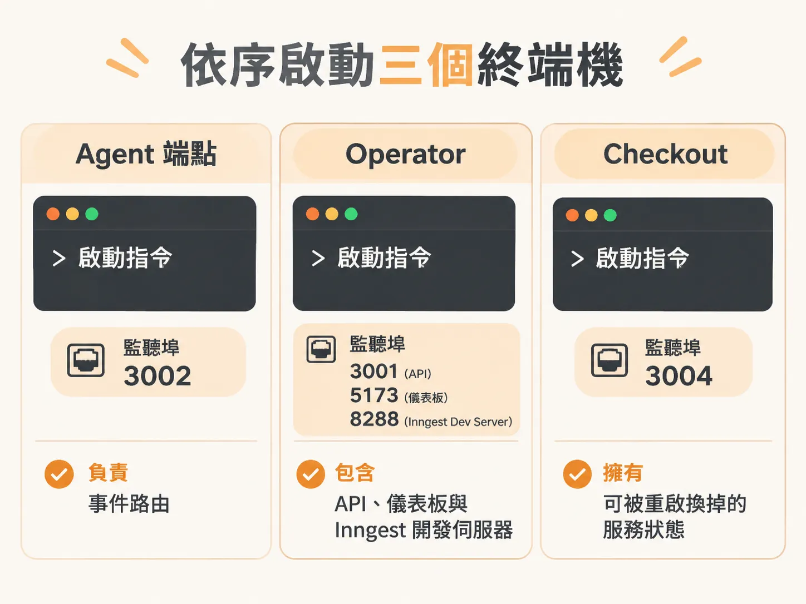
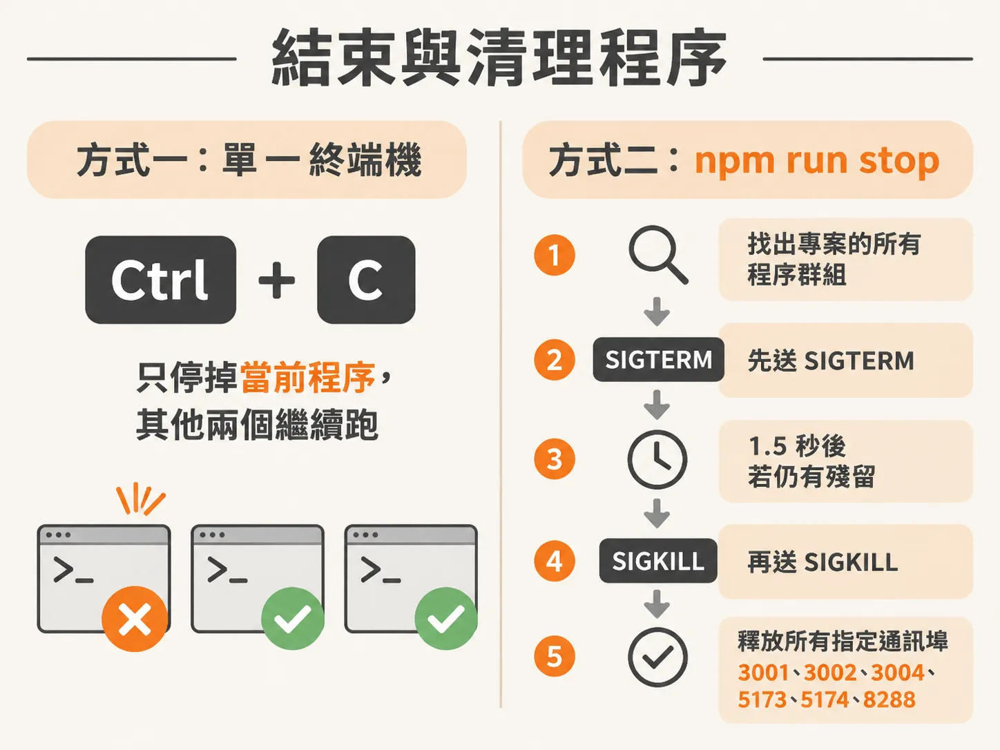

# 在三個終端機啟動系統

環境預檢通過、資料庫也 seed 完成後，就可以把系統真正跑起來了。開發與測試背景 Agent 系統時，整套架構通常由多個獨立服務協同運作：負責決策與背景排程的 Agent、提供操作面板與管理 API 的 Operator，以及模擬外部業務邏輯的結帳服務（Checkout）。

為了方便觀察日誌與獨立演練各服務的重啟行為，這套環境需要在三個分開的終端機視窗中依序啟動。

## 依序啟動三個終端機

請打開三個終端機分頁或視窗，依序執行以下指令：



### 終端機 1：Agent 端點

<!-- derived -->

```bash
npm run dev:agent
```

這個程序負責 Agent 端點，監聽在 `127.0.0.1:3002`。它本身是一個 API 路由與 Inngest 的事件處理器，負責接收事件並驅動後續步驟。

啟動時，終端機日誌會印出目前使用的 OpenAI 模型名稱。你也可以隨時透過 `http://127.0.0.1:3002/api/health` 檢查服務狀態與模型設定。在後續做耐用重啟（durable restart）演練時，只需在此終端機按 `Ctrl-C` 停止並重啟 Agent，其他服務保持連線。

若要進行重啟演練，可加上等待時間變數延遲處理：

<!-- derived -->

```bash
AGENT_SETTLE_DELAY=20s npm run dev:agent
```

### 終端機 2：Operator API、儀表板與 Inngest

<!-- derived -->

```bash
npm run dev
```

這個終端機一口氣管理三個重要元件，擁有的通訊埠與狀態如下：

- **Operator API**（`127.0.0.1:3001`）：負責後台操作邏輯的 API 伺服器。
- **Operator UI 儀表板**（`127.0.0.1:5173`）：前端管理面板，瀏覽器打開此網址即可操作。
- **Inngest Dev Server**（`127.0.0.1:8288`）：負責協調 durable execution 與背景任務的排程伺服器，可打開此網址查看事件追蹤（traces）。

### 終端機 3：結帳模擬服務（Checkout）

<!-- derived -->

```bash
npm run dev:checkout
```

這個終端機啟動模擬的結帳服務（Checkout service），監聽在 `127.0.0.1:3004`。

初始狀態下它是一個運作正常的健康服務。當課程需要注入錯誤情境時，只需在終端機 3 按 `Ctrl-C` 停掉服務，加上故障旗標重啟即可（終端機 1 與 2 保持運作）：

<!-- derived -->

```bash
npm run dev:checkout -- --fault feature
```

如果需要閱讀課程說明文件，可以在額外的第四個終端機執行 `npm run docs`，文件伺服器會跑在 `http://127.0.0.1:5174`。

## 服務與通訊埠對照

| 終端機 | 啟動指令 | 服務名稱 | 監聽位址 | 擁有的職責與狀態 |
| --- | --- | --- | --- | --- |
| 1 | `npm run dev:agent` | Agent endpoint | `127.0.0.1:3002` | 處理 Agent 決策與 Inngest 事件路由；可單獨重啟 |
| 2 | `npm run dev` | Operator API<br>Operator UI<br>Inngest Dev Server | `127.0.0.1:3001`<br>`127.0.0.1:5173`<br>`127.0.0.1:8288` | 管理後台 API、前端儀表板與任務排程追蹤平台 |
| 3 | `npm run dev:checkout` | Checkout service | `127.0.0.1:3004` | 模擬結帳業務邏輯；可單獨注入故障旗標 |
| 4（選用） | `npm run docs` | Lesson notes | `127.0.0.1:5174` | 課程講義與筆記頁面 |

## 通訊埠衝突防護

啟動指令內建了檢查腳本。如果偵測到指定通訊埠已被佔用，程序會直接報錯並退出，而不會默默換到其他隨機通訊埠，避免儀表板或排程器連線錯亂。

<!-- source: sources/background-agent/20261105/scripts/check-ports.mjs#L1-L71 -->

```javascript
import { connect, createServer } from 'node:net'

const names = {
  3001: 'operator API',
  3002: 'agent endpoint',
  3004: 'checkout service',
  5173: 'dashboard',
  5174: 'lesson notes',
  8288: 'Inngest Dev Server',
}

function hostPortIsFree(port, host) {
  return new Promise((resolve, reject) => {
    const server = createServer()
    server.once('error', (error) => {
      if (error.code === 'EADDRINUSE') resolve(false)
      else reject(error)
    })
    server.listen(port, host, () => server.close(() => resolve(true)))
  })
}

function hostPortAcceptsConnections(port, host) {
  return new Promise((resolve, reject) => {
    const socket = connect({ port, host, timeout: 500 })
    socket.once('connect', () => {
      socket.destroy()
      resolve(true)
    })
    socket.once('error', (error) => {
      if (['ECONNREFUSED', 'EADDRNOTAVAIL', 'ENETUNREACH'].includes(error.code)) resolve(false)
      else reject(error)
    })
    socket.once('timeout', () => {
      socket.destroy()
      resolve(true)
    })
  })
}

async function portIsFree(port) {
  for (const host of ['127.0.0.1', '::1']) {
    try {
      if (await hostPortAcceptsConnections(port, host)) return false
      if (!(await hostPortIsFree(port, host))) return false
    } catch (error) {
      if (error.code !== 'EAFNOSUPPORT' && error.code !== 'EADDRNOTAVAIL') throw error
    }
  }
  return true
}

for (const value of process.argv.slice(2)) {
  const port = Number(value)
  if (!Number.isInteger(port) || port < 1 || port > 65535) {
    console.error(`Invalid port: ${value}`)
    process.exitCode = 1
    continue
  }
  try {
    if (!(await portIsFree(port))) {
      console.error(
        `Port ${port} is already in use (${names[port] ?? 'workshop service'}). Stop the existing workshop process before starting another copy.`,
      )
      process.exitCode = 1
    }
  } catch (error) {
    console.error(`Cannot check port ${port}: ${error.message}`)
    process.exitCode = 1
  }
}
```

如果看到通訊埠被佔用的錯誤訊息，請先關閉舊的終端機程序，再重新啟動。

## 結束與清理程序

在日常演練中，如果你只是要測試特定服務重啟（例如單獨重啟 Agent 或注入 Checkout 故障），請在該程序的終端機按下 `Ctrl-C` 即可，其餘終端機保持運作。

當練習結束、要把所有通訊埠徹底清空時，macOS 與 Linux 使用者可以在專案目錄下執行：



<!-- derived -->

```bash
npm run stop
```

這項指令會找出專案建立的所有程序群組，先以 `SIGTERM` 要求正常結束，若 1.5 秒後仍有殘留則強制發送 `SIGKILL`，確保 3001、3002、3004、5173、5174 與 8288 等埠全數釋放。

<!-- source: sources/background-agent/20261105/scripts/stop.mjs#L1-L73 -->

```javascript
import { execFileSync } from 'node:child_process'
import { realpathSync } from 'node:fs'

if (process.platform === 'win32') {
  console.error(
    'This stop command requires macOS or Linux. On Windows, press Ctrl-C in each workshop terminal.',
  )
  process.exit(1)
}

const root = realpathSync(process.cwd())
const workshopCommand =
  /(?:^|\s)(?:server\/(?:operator|agent)\.ts|service\/checkout\.ts)(?:\s|$)|\/node_modules\/\.bin\/(?:vite|vitepress)(?:\s|$)|^inngest dev -u http:\/\/127\.0\.0\.1:3002\/api\/inngest(?:\s|$)/

function commandOutput(command, args) {
  return execFileSync(command, args, { encoding: 'utf8' })
}

function processCwd(pid) {
  try {
    const line = commandOutput('lsof', ['-a', '-p', String(pid), '-d', 'cwd', '-Fn'])
      .split('\n')
      .find((item) => item.startsWith('n/'))
    return line ? realpathSync(line.slice(1)) : null
  } catch {
    return null
  }
}

function workshopGroups() {
  const ownGroup = Number(commandOutput('ps', ['-p', String(process.pid), '-o', 'pgid=']).trim())
  const groups = new Set()
  for (const line of commandOutput('ps', [
    '-axww',
    '-o',
    'pid=',
    '-o',
    'pgid=',
    '-o',
    'command=',
  ]).split('\n')) {
    const match = line.trim().match(/^(\d+)\s+(\d+)\s+(.+)$/)
    if (!match) continue
    const [, pidText, groupText, command] = match
    const group = Number(groupText)
    if (group === ownGroup || !workshopCommand.test(command)) continue
    if (processCwd(Number(pidText)) === root) groups.add(group)
  }
  return groups
}

function signal(groups, name) {
  for (const group of groups) {
    try {
      process.kill(-group, name)
    } catch (error) {
      if (error.code !== 'ESRCH') throw error
    }
  }
}

const groups = workshopGroups()
if (!groups.size) {
  console.log('No workshop services are running.')
} else {
  signal(groups, 'SIGTERM')
  await new Promise((resolve) => setTimeout(resolve, 1500))
  const remaining = workshopGroups()
  if (remaining.size) signal(remaining, 'SIGKILL')
  console.log(
    'Stopped the workshop services. Ports 3001, 3002, 3004, 5173, 5174, and 8288 are available.',
  )
}
```

在 Windows 環境下，`npm run stop` 不支援跨行程清理，請直接回到各個終端機視窗，逐一按下 `Ctrl-C` 中斷執行。
