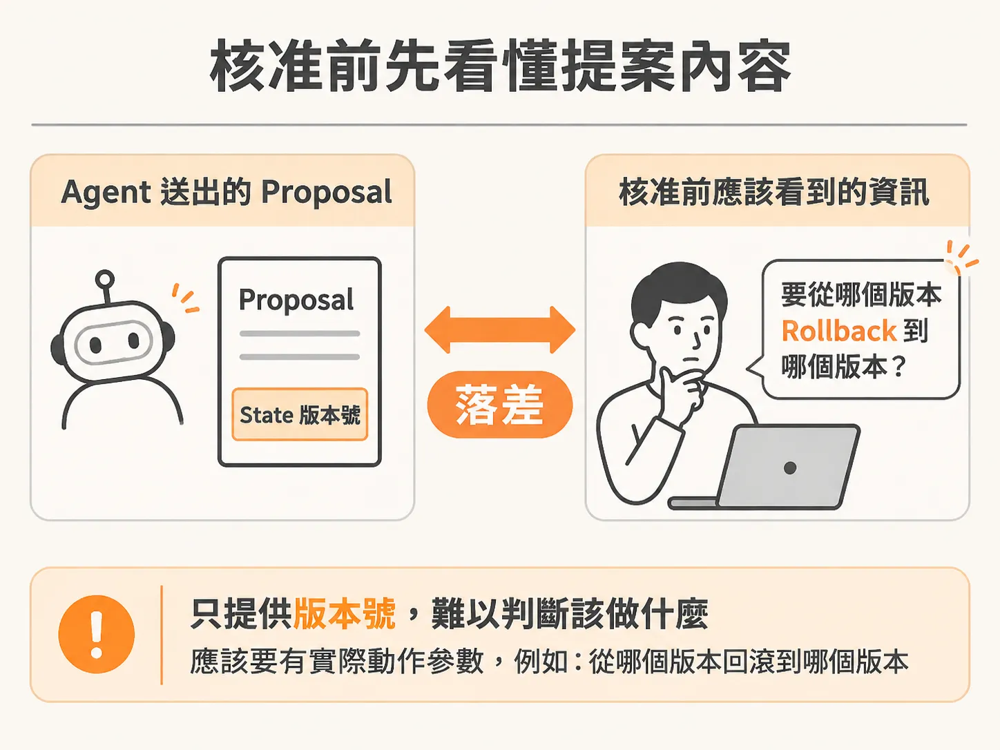
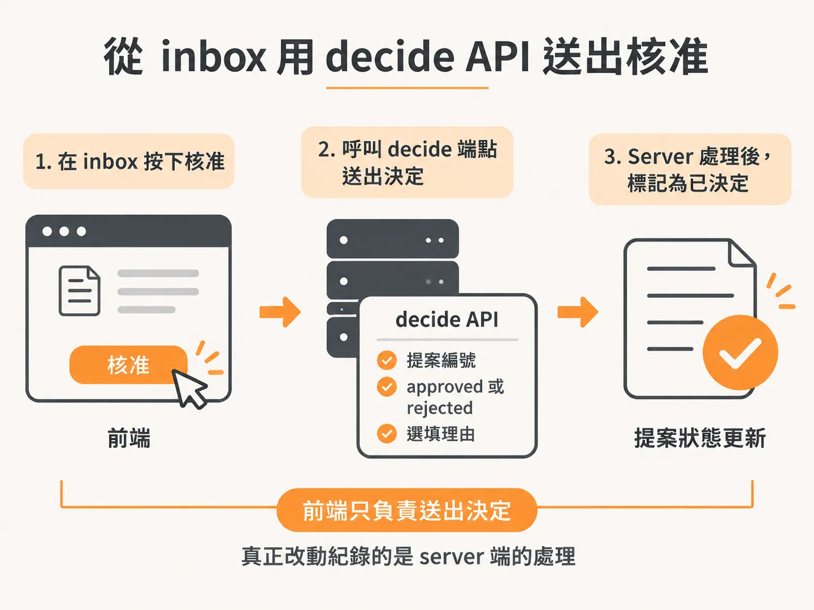
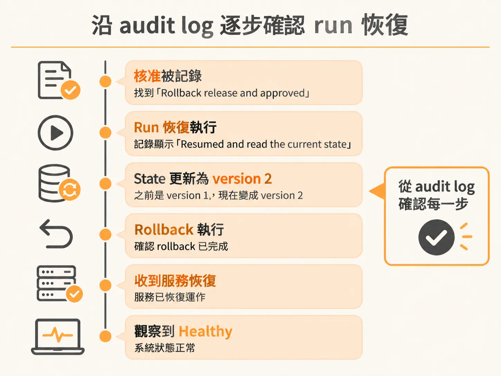

# 從 inbox 核准 rollback，沿 decide API 與 audit log 確認 run 恢復

想像這個情境：你的 background agent 正在處理一次線上事故。它發現目前的 release 有問題，於是提案要 rollback release。畫面上出現一行訊息：「I propose rollback release. Please review the exact action before I proceed.」你要做兩件事：核准這個提案，然後確認核准之後 run 真的恢復、state 真的被更新。

## 核准前先看提案內容

收到提案時，第一件事是看 agent 提交的 action 明細。這份示範裡的 tools 是假工具，所以提案沒有附上任何實際參數。唯一帶的參數只是「你看到的 state 版本號」，也就是提案發出時當下生效的 state 版本。對人來說，這個版本號本身毫無意義，看到大概只會想「這是什麼？」



這點在正式系統裡必須修正。你會想看到的是「要從哪個版本 rollback 到哪個版本」這類實際參數，也就是 action 應該有真正的輸入欄位。目前示範中的所有 action 都沒有輸入欄位，所以介面上那塊是空的。

## 用 decide API 送出核准

介面上的 Approve 按鈕背後，是打向 server 的 decide 端點：



<!-- source: sources/background-agent/20261109/supplement/web/src/App.tsx#L460-L543 -->

```tsx
                          <p>
                            {message.action === 'request_help'
                              ? String(message.input.question || 'What should I do next?')
                              : `I propose ${label(message.action)}. Please review the exact action before I proceed.`}
                          </p>
                          {message.action !== 'request_help' && (
                            <div className='action-detail'>
                              <span>PROPOSED TOOL INPUT</span>
                              <pre>{pretty(message.input)}</pre>
                            </div>
                          )}
...
                            onClick={() =>
                              void act(
                                '/api/approvals/decide',
                                {
                                  approvalId: message.id,
                                  decision: 'approved',
                                  reason: (answers[message.id] ?? '').trim() || undefined,
                                },
                                'Response sent.',
                              )
                            }
```

翻到 server 這邊，這個端點是 `POST /api/approvals/decide`，它會解析三個欄位：`approvalId`（要決定的提案編號）、`decision`（只能是 `approved` 或 `rejected`）、以及選填的 `reason`（最長 1000 字）：

<!-- source: sources/background-agent/20261109/supplement/server/operator.ts#L34-L49 -->

```typescript
app.get('/api/runs/:runId/activity', async (request, response) => {
  const runId = id.parse(request.params.runId)
  await getRun(runId)
  response.json(await activityForRun(runId))
})

app.post('/api/approvals/decide', async (request, response) => {
  const input = z
    .object({
      approvalId: id,
      decision: z.enum(['approved', 'rejected']),
      reason: z.string().max(1000).optional(),
    })
    .parse(request.body)
  response.json(await decideProposal(input.approvalId, input.decision, input.reason))
})
```

在示範裡，直接輸入 approve 送出去，提案立刻被 resolve。介面上顯示你核准了這個 action。

## 到 audit log 確認每一步

核准送出後，回到 audit log 就能看到記錄。往前找，會看到「Rollback release and approved」——你的核准確實被記錄下來了。接著往下看，還有「Resumed and read the current state」：run 恢復執行後重新讀了一次 state，而 state 更新了。此次呼叫 rollback 之前 state 是 version 1，記錄顯示 it got updated to version 2。



這是個好跡象：state 從 version 1 變成 version 2，證明呼叫那個 rollback action 確實改變了 state，而不是只寫了一條紀錄就結束。

## 看 run 恢復執行的完整過程

從 state 內容可以看到當時的狀況：release is V2 bad，server degraded 依舊。所以 agent 決定呼叫實際的 rollback of the release。紀錄裡可以看到回傳值——它確實 rollback 了，接著還收到「service has recovered」的事件。

中間有一段等待，因為程式裡安排了 sleep，所以要稍微等一下。等待結束後 run 恢復了。恢復時 agent 又讀了一次 state，此時 state 仍然是 version 2。

接著 agent 執行 observe 來確認現況——果然，服務已經 healthy 了，一切正常。沒有其他事要做了，run 就此完成。

那個等待的行為值得留意：就算在那裡等 20 小時，run 也只是繼續等下去；等上一年，它還是照樣等。這種「聽到驗證結果之前先擱置」的機制，究竟是 framework 的一部分，還是可以自行實作的功能——看完完整流程後，這是值得思考的問題。

## 按部就班自己驗證一次

把上面這條路走通之後，建議完整重現一次：先讓 release 故障成立，在 inbox 核准 rollback，同一個 incident 會恢復執行、執行 rollback、觀察到 healthy state、然後完成。這就是這個流程的驗證標準。

也建議再做一次對照組：把核准換成 Deny。這次 run 應該會向上呈報（escalate），而 release 維持原樣不被改動。Approved 和 rejected 都測過，你就能確認 decide API 的兩種決定都往正確的方向走。
