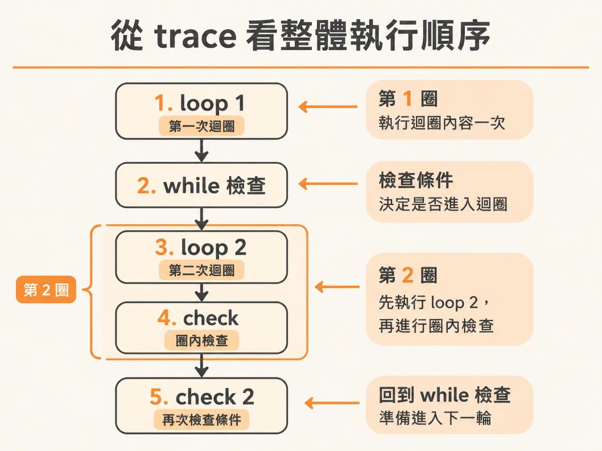
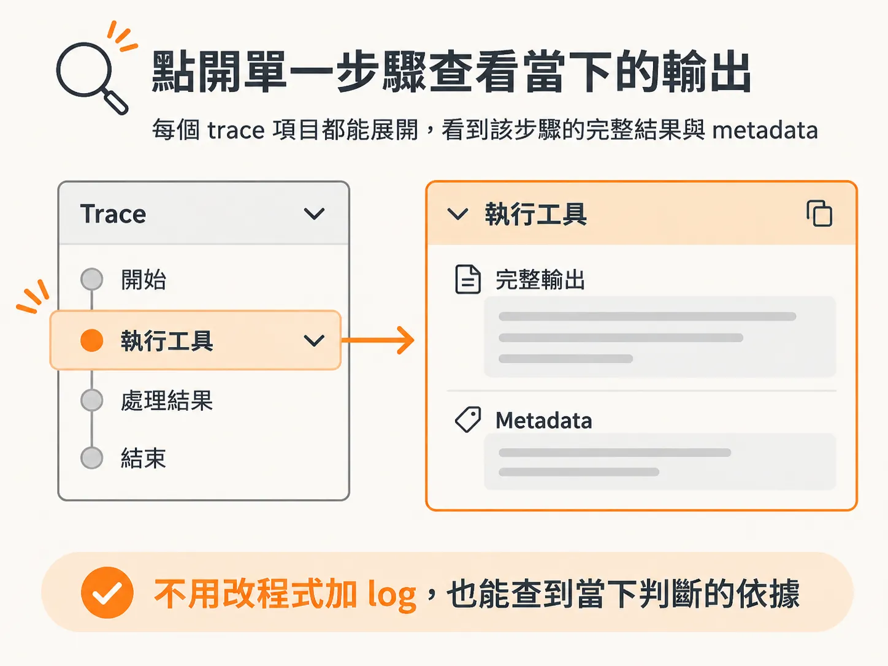

# 用 Inngest Trace 讀懂多次迴圈的執行軌跡

replay 與版本重驗的邏輯說得通，最後缺的是一個實務問題：怎麼在執行紀錄裡把這些迴圈真的看出來。寫過有條件判斷的背景工作流程，你大概遇過這個困擾：程式碼裡有 while 迴圈，迴圈裡又有檢查步驟，實際執行時到底是怎麼一層層跑過去的？想畫時序圖來呈現，conditional 邏輯卻讓圖變得超複雜，畫到一半就放棄了。

用 Inngest 這類系統，最直接的答案是：直接看 Inngest 本身提供的執行紀錄。

## 從 trace 頁面開始看

打開 Inngest，找到最新一次的執行紀錄，trace 頁面會把整個流程的每一步攤開在你眼前。你會看到系統觀察狀態的動作，也會看到每個迴圈怎麼往前推進。

關鍵在於步驟的命名。步驟一開始就編好號，trace 讀起來會非常順。例如第一次迴圈就是 loop 1；進到第二次迴圈時，會先看到 while 檢查，接著是 loop 2、迴圈裡的 check，再回到 while 檢查，然後是 check 2。這種「先檢查條件、執行一次迴圈內容、再檢查」的重複模式，就是 while 迴圈在 trace 上最典型的樣子。

這也是當初命名步驟時要特意加上編號的原因。有了編號，每個 trace 項目都能對回程式碼裡的特定迴圈，多次循環之後也不會迷失。

## 數一下總共跑幾圈

這種 trace 還有一個好處：總共跑了幾次迴圈，一眼就能數出來。以上面那個流程為例，最後一共跑了三次迴圈才到達結束點，而不是一眼看不出來的「跑了幾次都OK」。

只要在 trace 上把編號從 1 數到最後一圈，執行情況就一目了然。

## 點進去看每一步的輸出

光看步驟名稱還不夠。每個 trace 項目都可以點開。點開之後能看到該步驟的完整輸出，包括這個步驟送出來的所有內容，還有伴隨的 metadata 相關資訊。

也就是說，當你懷疑「第二次迴圈的檢查為什麼判定要再跑一圈」時，直接點開那個 while check 的步驟，它當時送出去的資料就在那裡，不用自己加 log 重新跑一次。

## 不用自己做視覺化工具

想自己畫時序圖或做個除錯面板當然可以，但那些條件邏輯會讓圖變得很難維護。Inngest 通常是最好的選擇：它已經把狀態觀察、迴圈編號、步驟輸出和 metadata 都記錄好了，你需要的只是打開 trace 頁面，逐圈逐點去看。
