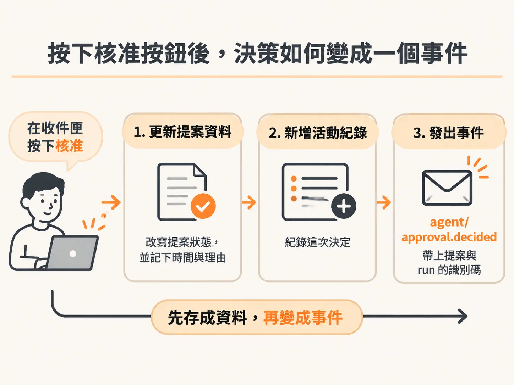
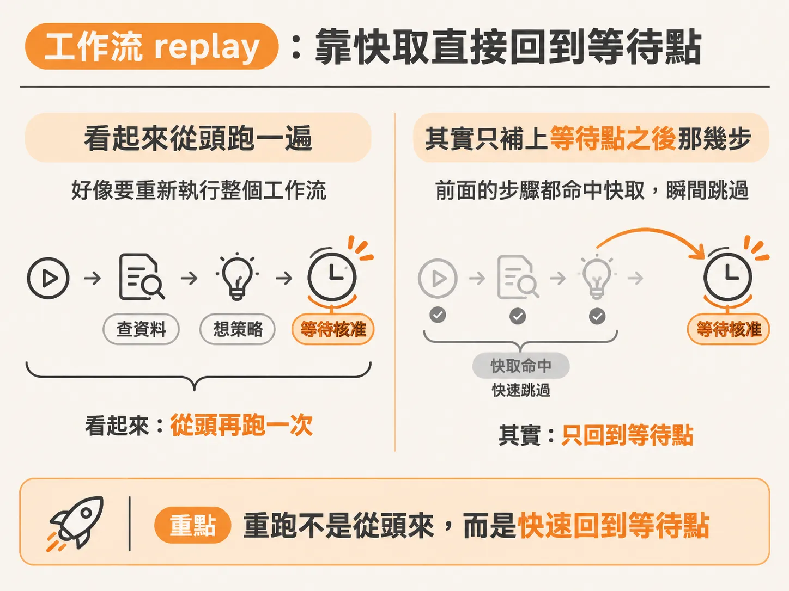
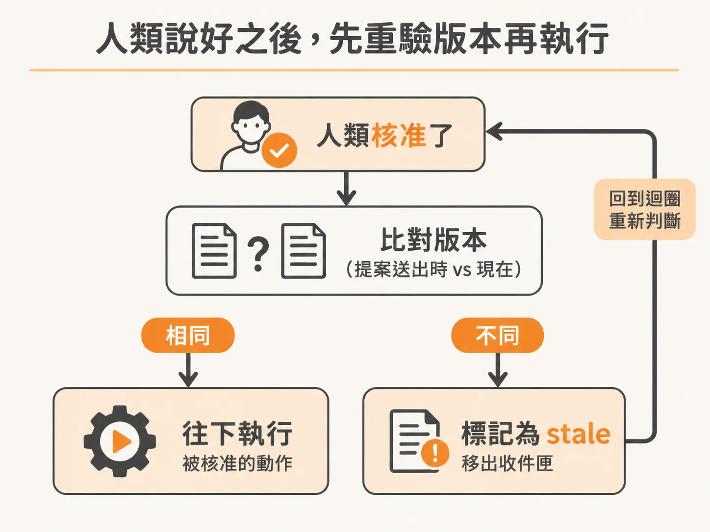

# 從按下核准按鈕那一刻說起：沿 approval.decided 事件追工作流

知道 run 停在哪裡之後，就能接著追按下按鈕之後發生什麼事。想像 AI agent 送出一個動作提案，等人類在收件匣裡點核准或拒絕。按鈕按下去之後，工作流要怎麼「醒過來」繼續跑？如果人類核准了，但服務的狀態已經變了，核准還算數嗎？沿著 `agent/approval.decided` 這個事件，可以把整條後續流程——replay、快取快轉、版本重驗、stale 分支——從頭到尾追一遍。

## 人類的決策如何變成一個事件

人類在收件匣按下核准（或拒絕）時，系統不是直接呼叫 agent，而是把決定寫進資料庫，再發出一個事件。送出決定的程式會更新提案狀態、記下決定時間與理由，然後發出名為 `agent/approval.decided` 的事件，帶上 `proposalId`、`environmentId` 和 `runId`。



<!-- source: sources/background-agent/20261109/supplement/server/agent-data.ts#L247-L268 -->

```typescript
  const [updated] = await db
    .update(approvals)
    .set({ status, reason, decidedAt: new Date() })
    .where(and(eq(approvals.id, proposalId), eq(approvals.status, 'pending')))
    .returning()
  if (!updated) return getProposal(proposalId)
  await logAgentActivity(
    proposal.environmentId,
    proposal.runId,
    'human',
    proposal.action === 'request_help'
      ? status === 'approved'
        ? 'Human answered help request'
        : 'Human could not help'
      : `${proposal.action.replaceAll('_', ' ')} ${status}`,
    { proposalId, reason },
  )
  try {
    await inngest.send({
      name: 'agent/approval.decided',
      data: { proposalId, environmentId: proposal.environmentId, runId: proposal.runId },
    })
```

整套機制的關鍵就在這裡：人類點按鈕只是一個動作，真正驅動工作流的是這個事件。

## 工作流 replay：快取讓它直接回到等待點

事件發出去之後，整個工作流會「再跑一次」。但不是從頭重做。到目前為止的每一步都已經被快取（cached），所以這次重跑會用最快的速度把先前步驟快轉過去，幾乎直接跳回原本等待的那個位置。它不用重新查資料庫、不用重新想策略，只是為了在事件系統裡重新標記自己「還活著、還在等」。



被叫醒之後，工作流回到程式碼繼續往下走：去資料庫看看人類說了什麼。

<!-- source: sources/background-agent/20261109/supplement/server/agent-workflow.ts#L158-L170 -->

```typescript
        let proposal = await step.run(`read-human-${cycle}`, () => getProposal(proposalId))
        let check = 0
        while (proposal.status === 'pending') {
          check++
          await step.waitForEvent(`wait-for-human-${cycle}-${check}`, {
            event: 'agent/approval.decided',
            if: `async.data.proposalId == "${proposalId}"`,
            timeout: '10s',
          })
          proposal = await step.run(`reconcile-human-${cycle}-${check}`, () =>
            getProposal(proposalId),
          )
        }
```

這段程式碼先用 `getProposal` 讀提案。只要狀態還是 `pending`，就停在一個 `waitForEvent` 上，等的事件正是 `agent/approval.decided`，並且限定要對應到這個提案（用 `proposalId` 比對），最多等 10 秒。事件一進來，下一次的 `getProposal` 就會讀到新的狀態，`while` 迴圈才會跳出。

事件觸發時的整段 replay，就是在這個等待點上接回來的：前面全部快取命中，它立刻恢復在這裡，然後才「去資料庫看人類怎麼說」。

## 人類說不：記錄下來，然後讓整個工作流停下

此刻已經不在 `while` 迴圈裡，流程往下走分支判斷。第一個分支是：人類沒有核准。

這時就記錄這次執行（run），把它標為 escalated——白話說就是「上呈留紀錄」。意思是：人類說不，接下來該做什麼也沒有答案，所以直接結束。`return` 的作用就是讓整個工作流停止。

<!-- source: sources/background-agent/20261109/supplement/server/agent-workflow.ts#L171-L184 -->

```typescript
        if (proposal.status !== 'approved') {
          await step.run(`stop-after-human-${cycle}`, () =>
            setRun(runId, 'escalated', `Human decision: ${proposal.status}`),
          )
          return
        }
        if (policy === 'help') continue
        const fresh = await step.run(`recheck-approved-state-${cycle}`, () =>
          agentState(environmentId, runId),
        )
        if (fresh.world.version !== input.expectedVersion) {
          await step.run(`invalidate-approval-${cycle}`, () => staleProposal(proposalId))
          continue
        }
```

只要提案狀態不是 `approved`，就寫一筆 escalation 紀錄，附上人類的決定，然後直接 `return`——工作流到此結束，後面什麼都不會再發生。

## 人類說好：先別急著執行，先重驗版本

第二個分支是：人類核准了。核准了，聽起來可以放行了吧？其實還要再過一關。



送出提案當下的服務狀態，和現在的狀態可能已經不一樣。也許在那個時間點這個動作是合理的，但現在重新想一遍，它已經不該再執行。所以程式會先去看服務目前的實際狀態。

對 `policy` 是 `help` 的提案，直接 `continue` 回迴圈頂端，不需要這層檢查。其他提案則要重驗：重新查一次 agent 的當前狀態，抓出 `fresh.world.version` 跟當初送出提案時記下的 `input.expectedVersion` 比對。

版本相同——世界沒變過，核准仍然有效，流程繼續往下執行那個被核准的動作。

版本不同——事情就有變化。這正是 `continue` 上場的地方：我們在 `for` 迴圈裡，`continue` 的意思就是回到迴圈頂端、把這件事再想一次。兩個狀態已經不相等，自從核准以後有東西變動了，這個動作多半已經不成立，得重新考慮。所以整個迴圈重頭開始，提案會被標成 stale（過期作廢），自動從那個人的收件匣裡消失，然後流程重新出發。

標記 stale 的具體動作：把提案狀態改成 `stale`，理由寫上「在這個動作執行前，狀態已經改變」，並記錄一筆 activity——「核准過的動作變成 stale 了」。

<!-- source: sources/background-agent/20261109/supplement/server/agent-data.ts#L275-L288 -->

```typescript
export async function staleProposal(proposalId: string) {
  const proposal = await getProposal(proposalId)
  await db
    .update(approvals)
    .set({ status: 'stale', reason: 'State changed before this action ran', decidedAt: new Date() })
    .where(eq(approvals.id, proposalId))
  await logAgentActivity(
    proposal.environmentId,
    proposal.runId,
    'human',
    'Approved action became stale',
    { proposalId },
  )
}
```

## 把整條線收攏

把這條事件之河重新走一遍：

1. 工作流跑到需要人類決定的地方，查出提案、停在 `waitForEvent` 上等 `agent/approval.decided`。
2. 人類在收件匣按下按鈕，決定寫進資料庫，事件發出。
3. 事件觸發工作流整段重跑；前面所有步驟都被快取，所以幾乎瞬間快轉到等待點，用新的 `getProposal` 結果跳出 `while`。
4. 沒核准 → `setRun` 記為 escalated、`return`，整個工作流停止。
5. 核准了 → 重驗當前狀態版本。版本還對得上就往下執行；對不上就 `staleProposal` 讓提案作廢、退出收件匣，然後 `continue` 回到迴圈頂端重新思考。

這個設計的價值在於：人類的決定不會被硬塞成一個函式呼叫，而是變成一個事件。工作流交給快取與 replay 去處理「等待」與「恢復」，程式碼看起來像一個普通的迴圈，卻能橫跨長時間的人類審批，還能在最後一刻確認「核准當下的世界」和「即將執行的世界」是同一個。
