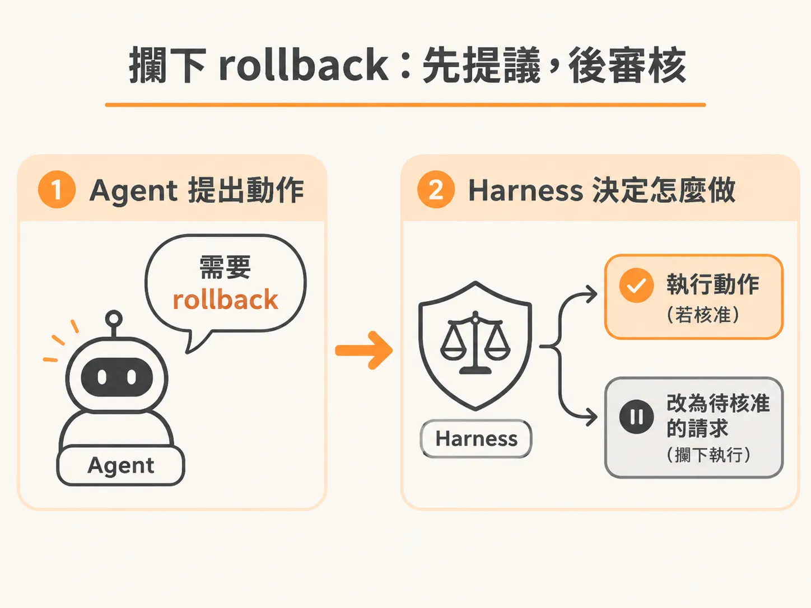
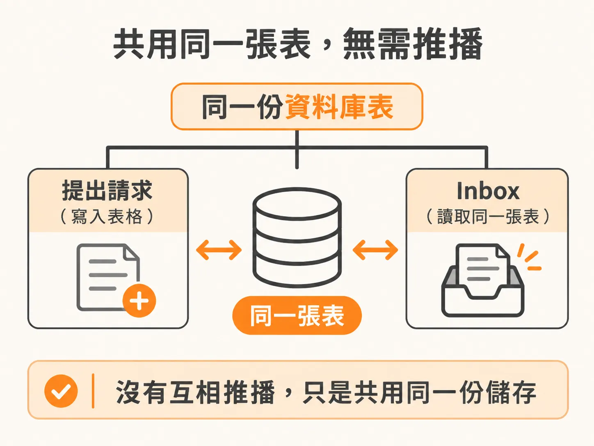

# 跑一次 release fault：親眼看 harness 擋下 rollback、在 inbox 留下一筆待核准的 proposal

先想像一個情境：你寫了一個會自己處理事故的 agent，但它現在有個問題——發現 deploy 壞了，它就自己動手 rollback，完全沒問過你。這次要做的很簡單：實際跑一次 release fault，看著 agent 想要 rollback、harness 在最後一關把它擋下來，然後你的 inbox 出現一筆等你核准的 proposal。跑完這一次，你就會知道整條 human-in-the-loop 的流程是怎麼接起來的。

## 先把環境開起來

先到 code 這邊，把 dev agent 啟動。

啟動之後先確認狀態——這一輪沒有 break，很好。中間把該停的停掉、該重新啟動的再啟動一次，確認環境是乾淨的，沒有 break，可以開始了。

接下來跑 `fault release` 這條指令，執行下去。看起來沒問題。

## 回到 app 看：inbox 已經有東西了

跑完之後回到 app——喔，已經收到一筆了。

就在剛剛，有新東西送進 inbox。打開看之前，可以先做一件事：驗證這筆東西是從哪來的。可以看到它剛剛跑的那個 run，就是這個 run，它真的才剛做完、點開來看的就是它。

這個 run 是這樣的：上一個範例裡沒有放 sleep 讓它慢下來，但因為這次 checkout 了新的 branch，branch 裡有 sleep，所以 run 途中它是在睡覺的。不過睡完之後，它還是會走到那個狀態——它覺得：「對，我需要做 rollback。」

## harness 在這裡擋下來

這個場景之前就看過了：agent 判斷自己需要 rollback。但這次它被 harness 擋在 harness 這一層，harness 的反應是：rollback 需要核准。

所以 harness 就把這個 approval request 送出去了。

為什麼知道它一定會這樣做？因為這段 code 就是自己剛寫的。明明白白寫了：如果你手上拿到這個東西，你就必須送出一個 approval request——也就是這個 proposed action 會把一筆 request 寫進 database。

而 inbox 會去撈 database 裡所有的 proposed actions，這就是 inbox 看到它的方式。

## 它不是「傳送」，是「存檔」

重點來了：其實沒有把 approval request 送到哪裡去。

我們只是把它存進 database，然後 inbox 自己去把它抓起來。inbox 就是在撈那一張 table。

所以整個機制說穿了就是：proposed action 進資料庫，inbox 讀同一張表，兩邊就接上了。

## 然後就是等

現在整個流程停在什麼狀態？就是等著聽回覆。

agent 現在只在做這件事——等回覆，而且它會一直停在這裡，因為 database 裡出現了一筆還沒被 resolved 的東西。

要怎麼解掉？可以直接在 inbox 這邊把它 resolve 掉。

## 在 lab 裡重現

想自己跑一次的話：用 `--fault release` 啟動 checkout。agent 會找到一個可能有問題的 deployment，但這個版本它會選擇 escalate 而不是自己 rollback。人類應該可以在 inbox 裡看到完整的 proposed action，以及預期要回到的 service 版本。

看到那筆待核准的提案之後，下一步就是親手按下按鈕。
