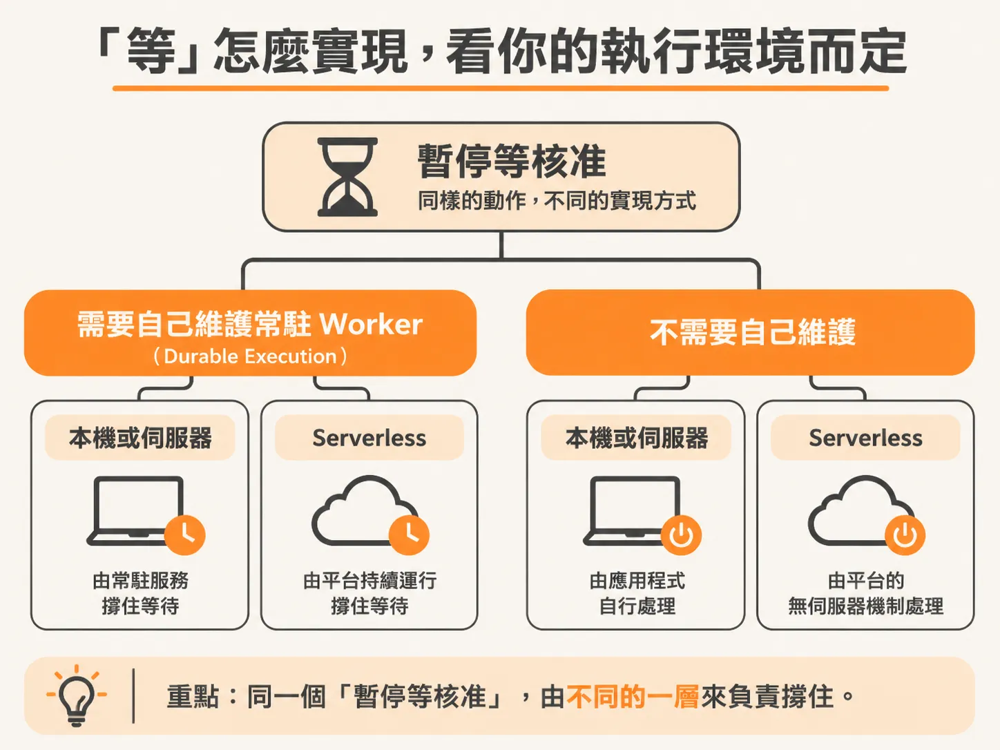
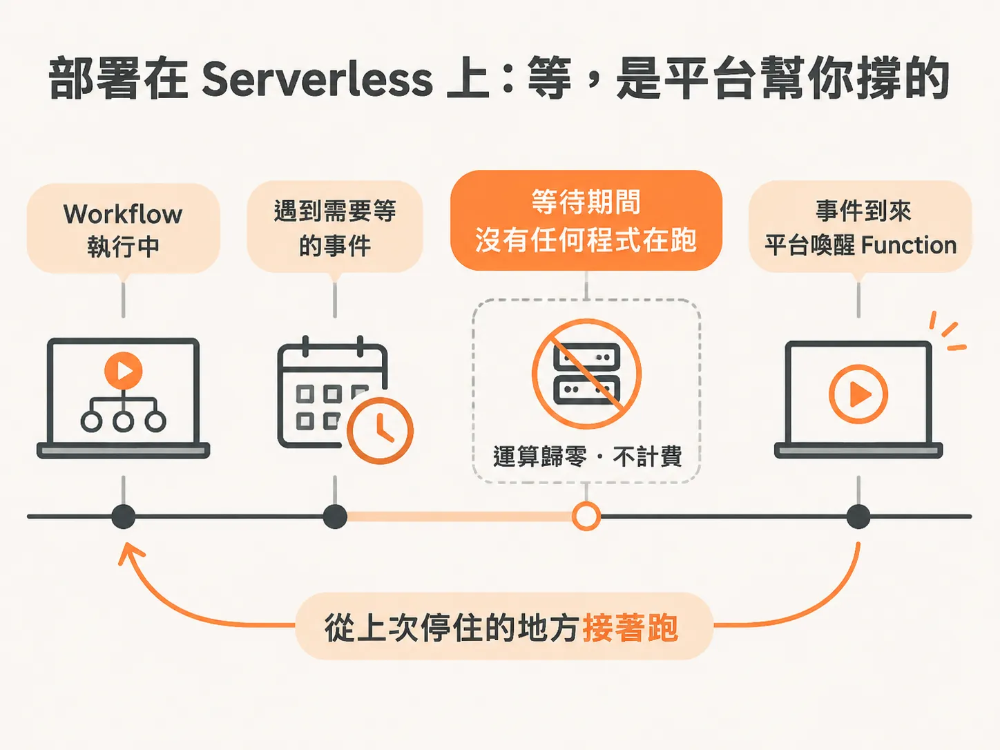

# Agent 等你核准的期間，程式到底在哪裡？

核准與拒絕兩條路都走過了，但還有一件事沒解釋：在你按按鈕之前，那個 run 到底停在哪裡。想像一個背景 agent 正在替你處理部署。它查完 log、做完分析，判定這次 release 有問題，需要你決定要不要 rollback。這時它停下來，把問題丟進你的收件匣，然後等著。可能等十分鐘，也可能等你開完會、吃完飯才回來。

問題來了：程式是怎麼「等」的？它不是卡住，也不是壞掉，而是可以無限期停在那一行，直到事件到來才繼續。這是怎麼做到的？

## 人在迴圈裡，本來就是流程的一部分

模型可以察覺一次 release 看起來有問題，但「察覺」和「有權限回滾」是兩回事。agent 負責做完調查，到了需要人判斷的時間點就來找人。human-in-the-loop 不是事後補上去的失敗保險；對很多有用的 agent 來說，等待人的判斷本來就是流程中段的一部分。

可以把 agent 的收件匣想成「沒人看管的工作回頭找人」的地方。一個收件項目要說清楚：agent 想做什麼、為什麼、它預期的確切狀態是什麼、請求什麼時候過期。人可以在不開著對話視窗的情況下核准、拒絕，或補充資訊。agent 在人離開時等著，人在有足夠 context 時回應。這就是背景 agent 能放大產能、又不要求放棄控制權的原因。

## 等待的機制，取決於 runtime 和部署環境

那「無限期等待」本身是怎麼實現的？答案不是單一套做法，而是取決於 durable execution（持久化執行）方案和部署環境。

首先要區分 serverless 和非 serverless。再來，不同的持久化執行工具設計也不同：像 Temporal 這種需要自己跑 worker 的，和像 Inngest 這種不需要的，做法就不一樣。真正決定用什麼手段等待的，是 runtime 和執行環境的組合。

## 在本機：用 while 迴圈模擬「凍結」

以本機環境為例：一個 Node.js script，跑在自己的電腦上。

本機上沒有基礎設施幫忙把程式凍結起來，所以得自己寫 while 迴圈來模擬「compute 被凍結」——程式停在那裡，什麼都不做，直到事件發生才往下走。這是個 trick，沒有平台支援時的手動替代品。

## 部署到 serverless：等待是基礎設施給你的

但把同樣的 workflow 部署到像 Vercel 這種平台的話，根本不需要自己寫這段程式碼。

因為「停下來」這件事已經內建在基礎設施裡。不用寫程式讓 workflow 停下來，平台直接給你。serverless 上尤其如此：serverless function 跑你的 workflow，一旦碰到該停止等待的事件，function 就直接關閉。此時運算量真的是零——沒有任何東西在跑，也沒有任何東西在燒錢或佔資源。等事件到來，平台再次喚起 workflow，從上次停的地方繼續。

本機因為一直跑著一個 server，行程活著，才得用 while 迴圈那個 trick 把它「停住」。這不是設計上的差別，而是環境造成的差別。

## 等待的方式是兩個變數的組合

run 為什麼能無限期等待？因為 durable execution 把「執行到一半的狀態」保留下來，讓程式可以在某個事件點上真正停止，而不是佔著資源空轉。至於這個停止是怎麼發生的，取決於兩件事：

一是用哪種風味的 durable execution——需要 worker 的（如 Temporal），還是不需要的（如 Inngest）。二是部署到什麼環境和平台——本機的 Node.js 環境得靠 while 迴圈模擬凍結，serverless 平台則把「關機等你」內建成基礎設施，compute 歸零，等事件回來再繼續。

搞清楚這兩個變數，就能判斷自己的 agent 在等待人類核准時，是靠平台免費提供的暫停，還是得像在本機那樣，自己寫程式把 compute 停下來。
