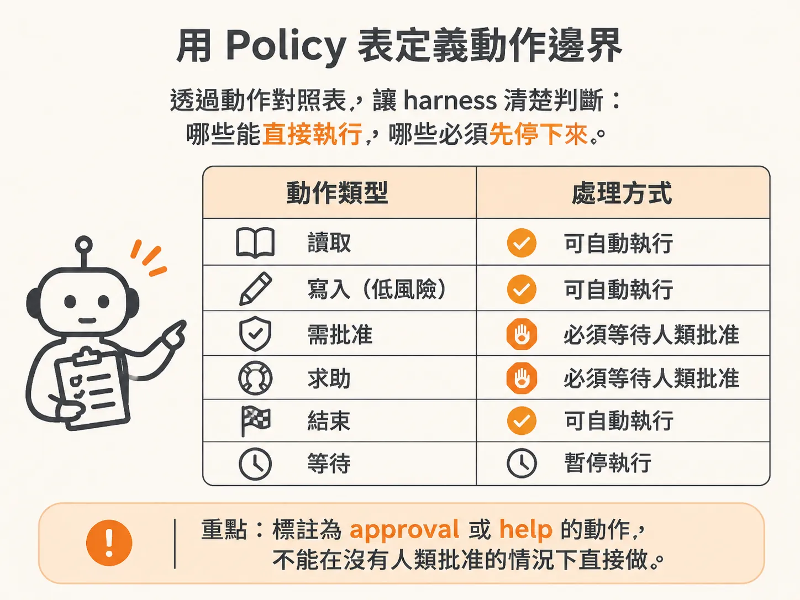
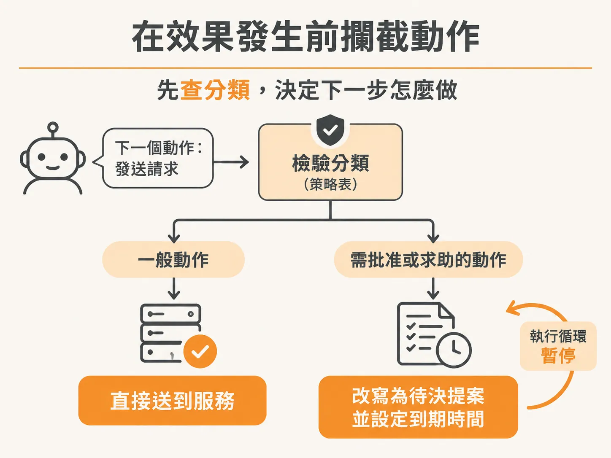
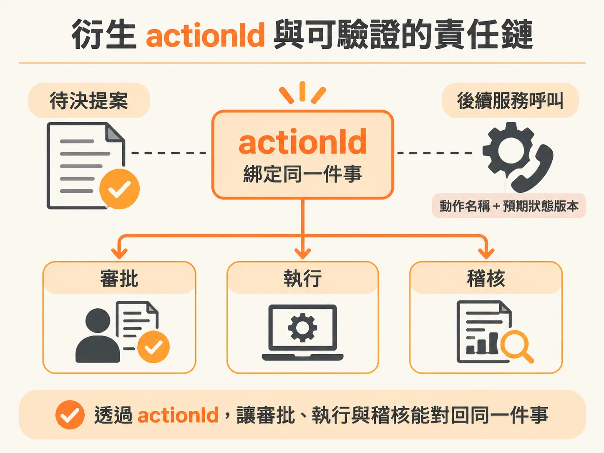

# 這件事不能沒有批准就做

把收件匣的分類講清楚之後，最後要把它落成程式碼。讓背景運作的 AI Agent 自行診斷問題、甚至自動修復線上服務，聽起來很誘人；但如果 Agent 一發現異常就自作主張執行版本回滾（rollback），任何維運團隊都會感到恐慌。

大型語言模型本身對現實世界的系統狀態沒有責任感，它產出的只是一段「我建議執行這項操作」的文字推論。真正與外部系統溝通、決定這項操作能不能發生的，是包裹在外的控制架構（harness）。要在副作用真正發生之前守住系統的控制權威，harness 必須建立三道防線：明確的策略表（policy）、嚴密的動作攔截，以及可追蹤的動作識別碼（actionId）。

## 用 Policy 表集中定義動作邊界

最容易出錯的做法，是把「能不能執行」寫在 Prompt 裡要求模型自己遵守，或者讓目標微服務自己去猜 Agent 的權限。合適的做法是在 harness 中建立一張靜態的策略對照表，依據動作性質給予明確的分類。

<!-- source: sources/background-agent/20261105/server/tool-policy.ts#L1-L15 -->

```typescript
import type { ActionName } from '../shared/types'

// The harness reads policy metadata; it does not branch on checkout fault flags.
export const actionPolicy: Record<
  ActionName,
  'read' | 'write' | 'approval' | 'help' | 'terminal' | 'wait'
> = {
  inspect_logs: 'read',
  inspect_changes: 'read',
  disable_feature: 'write',
  rollback_release: 'approval',
  request_help: 'help',
  complete: 'terminal',
  wait: 'wait',
}
```

在這份策略表中，讀取日誌（`inspect_logs`）屬於唯讀的 `read`；停用特定功能開關（`disable_feature`）屬於一般的 `write`；而像版本回滾（`rollback_release`）這種具備重大破壞力或業務影響的動作，則明確標註為 `approval`。

策略表的責任是劃分界線：只要屬於一般的讀取或低風險寫入，harness 可以允許自動執行；但只要標註為 `approval` 或 `help`，就代表這件事「不能在沒有人類批准的情況下直接做」。



## 在效果發生前攔截動作

當模型給出下一個動作的決策時，harness 不能直接把請求打向業務服務。在實際發送任何 HTTP 請求之前，harness 會先檢驗該動作在策略表中的分類。



如果該動作需要審批，harness 會立刻暫停執行循環，將這個動作轉換為待審批提案（proposal）寫入資料庫，並將當前任務狀態切換為等待中。

<!-- source: sources/background-agent/20261105/server/agent-data.ts#L156-L288 -->

```typescript
export async function recordToolAction(
  environmentId: string,
  runId: string,
  actionId: string,
  name: ActionName,
  input: Record<string, unknown>,
  result: Record<string, unknown>,
) {
  await db
    .insert(actions)
    .values({ id: actionId, environmentId, name, input, result })
    .onConflictDoNothing()
  await logAgentActivity(environmentId, runId, 'act', `${name.replaceAll('_', ' ')} returned`, {
    actionId,
    input,
    result,
  })
}

export async function proposeAction(
  environmentId: string,
  runId: string,
  actionId: string,
  action: ActionName,
  input: Record<string, unknown>,
) {
  const [proposal] = await db
    .insert(approvals)
    .values({
      id: randomUUID(),
      environmentId,
      runId,
      actionId,
      action,
      input,
      status: 'pending',
      expiresAt: new Date(Date.now() + 10 * 60_000),
    })
    .returning()
  await setRun(
    runId,
    action === 'request_help' ? 'needs_help' : 'needs_approval',
    action === 'request_help'
      ? 'Waiting for an answer'
      : `Waiting for ${action.replaceAll('_', ' ')} approval`,
  )
  await logAgentActivity(
    environmentId,
    runId,
    'human',
    action === 'request_help'
      ? 'Asked a human for help'
      : `Requested approval for ${action.replaceAll('_', ' ')}`,
    { proposalId: proposal.id, ...input },
  )
  return proposal
}

export async function getProposal(proposalId: string) {
  const [proposal] = await db.select().from(approvals).where(eq(approvals.id, proposalId)).limit(1)
  if (!proposal) throw new Error('Approval request not found')
  if (proposal.status === 'pending' && proposal.expiresAt.getTime() < Date.now()) {
    const [expired] = await db
      .update(approvals)
      .set({ status: 'expired', decidedAt: new Date() })
      .where(eq(approvals.id, proposalId))
      .returning()
    return expired
  }
  return proposal
}

export async function decideProposal(
  proposalId: string,
  status: 'approved' | 'rejected',
  reason?: string,
) {
  const proposal = await getProposal(proposalId)
  if (proposal.status !== 'pending') return proposal
  const run = await getRun(proposal.runId)
  if (['completed', 'cancelled', 'failed', 'escalated', 'superseded'].includes(run.status)) {
    const [stale] = await db
      .update(approvals)
      .set({ status: 'stale', reason: 'Incident is no longer active', decidedAt: new Date() })
      .where(eq(approvals.id, proposalId))
      .returning()
    return stale
  }
  if (proposal.action === 'request_help' && status === 'approved' && !reason?.trim()) {
    throw new Error('An answer is required before the agent can continue')
  }
  const [updated] = await db
    .update(approvals)
    .set({ status, reason, decidedAt: new Date() })
    .where(and(eq(approvals.id, proposalId), eq(approvals.status, 'pending')))
    .returning()
  if (!updated) return getProposal(proposalId)
  await logAgentActivity(
    proposal.environmentId,
    proposal.runId,
    'human',
    proposal.action === 'request_help'
      ? status === 'approved'
        ? 'Human answered help request'
        : 'Human could not help'
      : `${proposal.action.replaceAll('_', ' ')} ${status}`,
    { proposalId, reason },
  )
  try {
    await inngest.send({
      name: 'agent/approval.decided',
      data: { proposalId, environmentId: proposal.environmentId, runId: proposal.runId },
    })
  } catch (error) {
    console.warn('Approval saved; wake event failed and the run will reconcile on timeout', error)
  }
  return updated
}

export async function staleProposal(proposalId: string) {
  const proposal = await getProposal(proposalId)
  await db
    .update(approvals)
    .set({ status: 'stale', reason: 'State changed before this action ran', decidedAt: new Date() })
    .where(eq(approvals.id, proposalId))
  await logAgentActivity(
    proposal.environmentId,
    proposal.runId,
    'human',
    'Approved action became stale',
    { proposalId },
  )
}
```

透過 `proposeAction`，原本即將打向系統的動作被凍結成一筆紀錄，設定了過期時間與關聯的 `actionId`，並等待人類透過介面決定核准或拒絕。如果線上事件在人類做出決定前就已經結束、失敗或被取消，harness 還會透過 `decideProposal` 或 `staleProposal` 將其標記為陳舊（stale），防止過時的危險動作被延遲觸發。

## 衍生 actionId 與可驗證的責任鏈

要在生產環境中讓團隊信任背景運作的 Agent，透明度是唯一的基礎。如果無法清楚交代「哪一個動作、在什麼時間、因為什麼原因被發起與執行」，系統的信任度基本上是零。

因此，harness 在做出決策的當下，就會為該動作衍生出一個唯一的 `actionId`（例如 UUID）。

這個 `actionId` 具備雙重任務：



1. **審批與審計溯源**：在提議階段，`actionId` 就與提案綁定，記錄在活動日誌中，讓後續的人類審批者知道自己正在審查哪一次決策。
2. **防禦性執行**：當動作獲得批准或本身不需要審批時，harness 呼叫外部業務端點（例如結帳服務的 `operations` 路由）時，會將 `actionId`、動作名稱以及預期狀態版本（`expectedVersion`）一同傳遞過去。

業務端點收到請求時，不僅能將這個 `actionId` 寫入業務稽核紀錄，也能比對狀態版本；即使 Agent 的執行流程有任何重試或延遲，也不會重複執行相同的動作，或是把變更套用在非預期的舊狀態上。

模型負責給出建議，但 harness 決定這件事能不能成真。把權威牢牢鎖在 harness 的策略表與攔截器中，副作用才不會脫離掌控。
