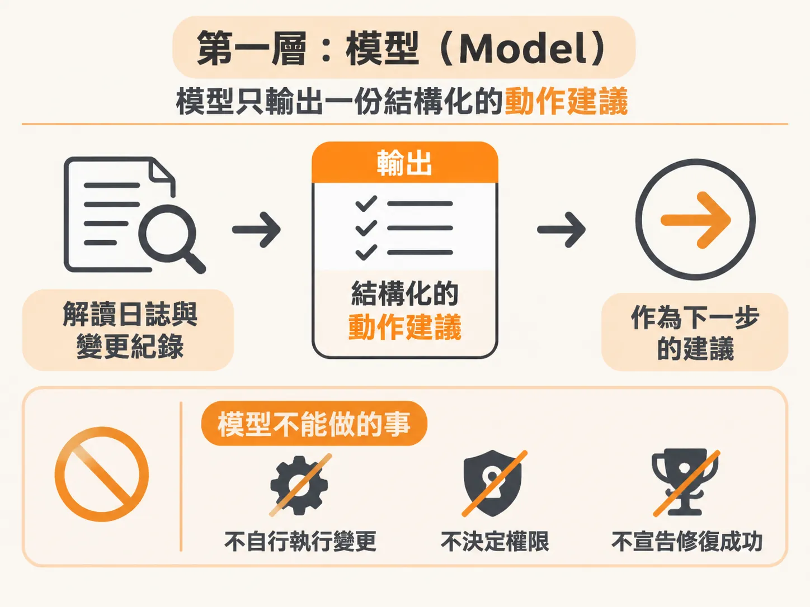
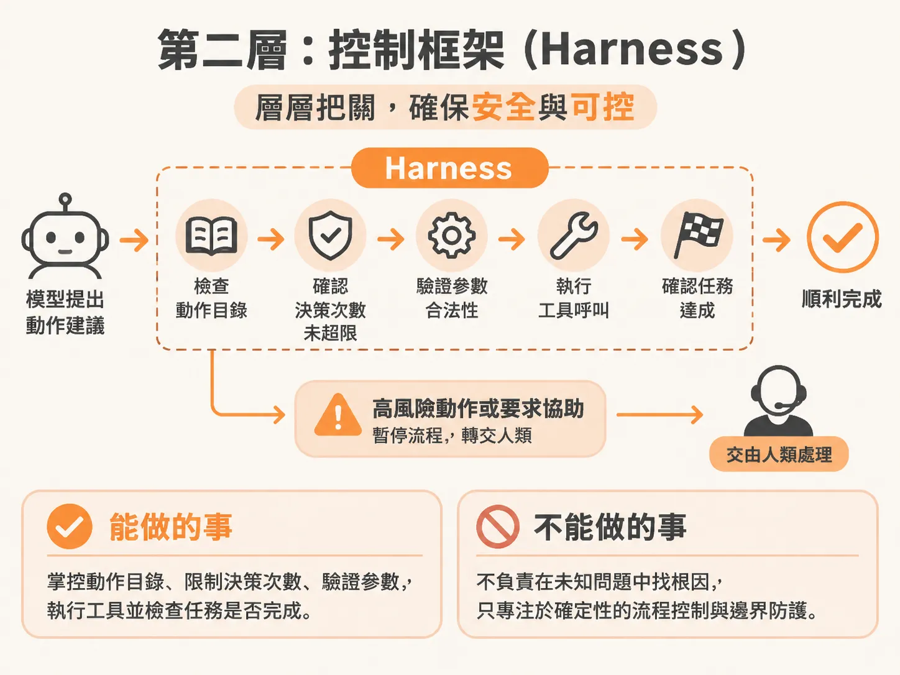
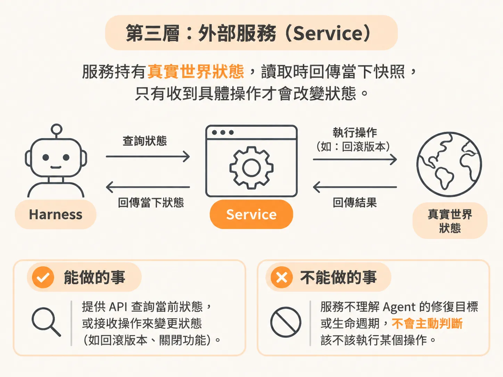
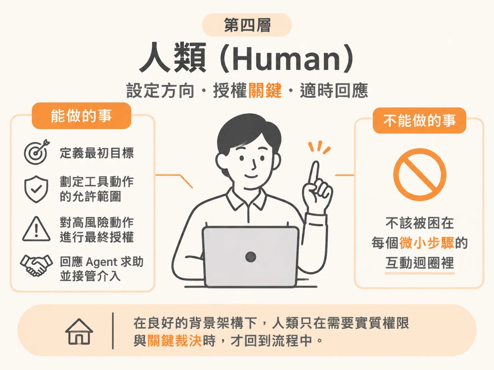

# 誰有權威？

世界狀態可以被讀寫之後，下一個問題是誰有權按下那個寫入。在對話介面的 Agent 裡，人類隨時坐在螢幕前。模型每呼叫一個工具、執行一段程式碼，畫面都可以跳出確認視窗問你：「要不要放行？」

但背景代理人（Background Agent）不同。它的生命週期超越了一次對話：結帳系統報警，觸發了一次修復任務，Agent 在背景自行運作，而你可能已經下班離開電腦。這時如果還把「判斷是否需要審批」的責任寫在提示詞裡，要模型「遇到危險動作記得先問人」，系統隨時會出事。模型會幻覺，它當然也會在「該不該申請權限」這件事上產生幻覺。

要在背景安全運行代理人，不能依賴模型的自律，而必須清楚劃分四層權威：模型、Harness、Service 與人類。

## 第一層：模型（Model）

模型負責在充滿不確定性的情境下提供推理能力。

* **能做的事**：解讀日誌與變更紀錄等證據，在沒有預設固定腳本的情況下，從允許的動作清單中挑選下一步，輸出結構化的動作建議。
* **不能做的事**：模型不能自行執行任何變更，不能決定自己擁有多少權限，更不能裁定自己是否已經「修復成功」。一個格式正確的 JSON 動作請求只是一份建議，不代表授權，也不代表實際發生的影響。

## 第二層：控制框架（Harness）

Harness 是包在模型外圍的確定性執行環境，負責用硬性程式碼維持邊界。

* **能做的事**：掌控可用的動作目錄（action catalog）、限制決策次數上限（decision limit）、驗證模型給出的參數是否合法、執行工具呼叫，以及檢驗任務是否真正達成結束條件。當模型提議高風險動作或要求協助時，由 Harness 暫停流程並轉發給人類。
* **不能做的事**：Harness 不負責在模糊的未知問題中通靈尋找根因，它依賴模型做出決策判斷，自己只專注於確定性的流程控制與邊界防護。

## 第三層：外部服務（Service）

外部服務（例如結帳服務）代表了系統的真實世界狀態（World State）。

* **能做的事**：提供 API 供外部查詢當前狀態，或接收具體操作來變更內部狀態（例如回滾版本、關閉特定功能開關）。真實世界有沒有恢復正常，完全由服務當下回應的狀態決定。
* **不能做的事**：服務本身不理解 Agent 的修復目標或生命週期。它不會主動告訴 Harness「該不該執行某個操作」，只忠實呈現被操作後的結果。

## 第四層：人類（Human）

人類是系統的最終委託者與最高仲裁者。

* **能做的事**：定義最初的目標、劃定工具動作的允許範圍、對高風險動作進行最終授權，並在 Agent 卡住發出求助請求時接管介入。
* **不能做的事**：在良好的背景架構下，人類不應該被困在每個微小步驟的互動迴圈裡。背景代理人的價值，正是讓人離開螢幕，只在需要實質權限與關鍵裁決時才回到現場。

這四層分工確立了一條基本原則：政策必須寫在 Harness 的程式碼裡強制執行，而不是寫在 Prompt 裡拜託模型遵守。真實世界由 Service 說了算，決定權由 Harness 與人類把關，模型只負責在給定的邊界內提出下一步的假設。
