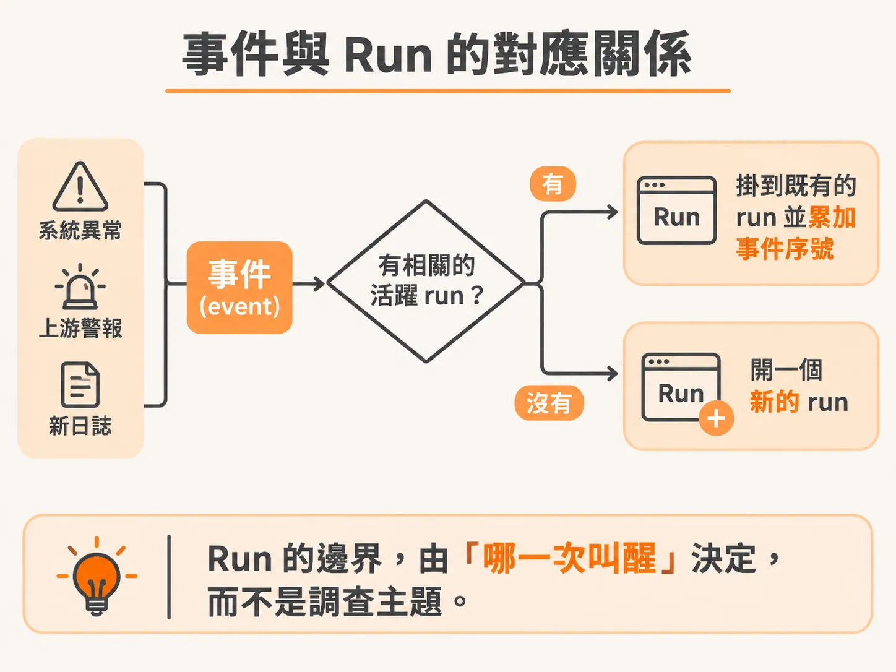
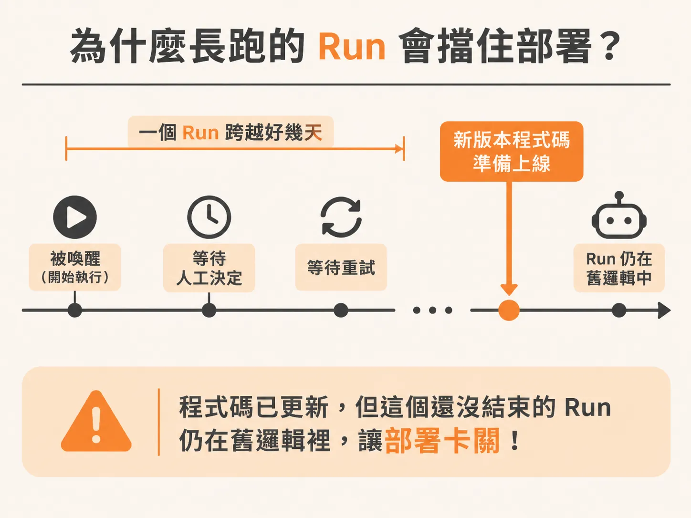
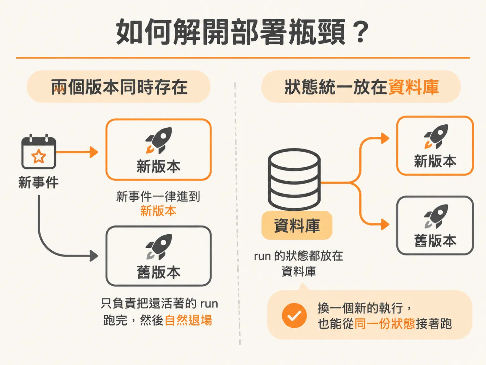

# 一次 Run 就是被一個事件叫醒

兩個存放區的分工確定後，最後要問的是：一次 run 的邊界到底在哪裡。在設計背景執行的 AI Agent 時，許多人常把「一次問題排查（investigation）」與「一次執行（run）」混為一談。實際上，一次調查可能要跨越幾天甚至幾週，中途會斷斷續續收到各種告警與監控數據。

如果把整場調查硬綁成單一流程，系統很快就會變得脆弱。最清晰的模型是：把 run 當成「Agent 被某個事件叫醒」的最小執行單位。

## 事件與 Run 的對應關係

Agent 平常處於休眠狀態。當系統發生異常、上游發出警報或有新日誌進來，這些都是事件（event）。每次事件叫醒 Agent，就觸發了一次 run。



這時系統必須做一個決定：這個事件該開啟一個全新的 run，還是掛到既有的 run 底下？如果上游系統已經將事件分群或歸類為同一件事故（incident），這個事件就可以附加到既有的 run 繼續推進；如果沒有關聯，就必須建立新的 run。

在資料庫設計上，事件與 run 的結構如下：

<!-- source: sources/background-agent/20261105/server/schema.ts#L51-L90 -->

```typescript
export const events = pgTable('events', {
  id: uuid('id').primaryKey(),
  environmentId: uuid('lab_id')
    .notNull()
    .references(() => environments.id),
  runId: uuid('run_id').references(() => runs.id),
  instanceId: text('instance_id'),
  type: text('type').notNull(),
  data: jsonb('data').$type<Record<string, unknown>>().notNull(),
  createdAt: timestamp('created_at', { withTimezone: true }).notNull().defaultNow(),
})

export const actions = pgTable('actions', {
  id: text('id').primaryKey(),
  environmentId: uuid('lab_id')
    .notNull()
    .references(() => environments.id),
  name: text('name').notNull(),
  input: jsonb('input').$type<Record<string, unknown>>().notNull(),
  result: jsonb('result').$type<Record<string, unknown>>().notNull(),
  createdAt: timestamp('created_at', { withTimezone: true }).notNull().defaultNow(),
})

export const runs = pgTable('runs', {
  id: uuid('id').primaryKey(),
  environmentId: uuid('lab_id')
    .notNull()
    .references(() => environments.id),
  eventId: uuid('event_id'),
  instanceId: text('instance_id'),
  eventSequence: integer('event_sequence').notNull().default(0),
  goal: text('goal').notNull(),
  goalCondition: jsonb('goal_condition').$type<GoalCondition>(),
  status: text('status').notNull(),
  iteration: integer('iteration').notNull().default(0),
  waitReason: text('wait_reason'),
  report: text('report'),
  startedAt: timestamp('started_at', { withTimezone: true }).notNull().defaultNow(),
  updatedAt: timestamp('updated_at', { withTimezone: true }).notNull().defaultNow(),
})
```

`runs` 資料表記錄了 Agent 當前的目標（`goal`）、目前狀態（`status`）與迭代輪數（`iteration`），而 `events` 則透過外鍵 `run_id` 關聯到對應的 run。

處理進站事件的邏輯會根據目前的健康狀態與進行中的 run，決定要開新 run 還是更新既有 run：

<!-- source: sources/background-agent/20261105/server/incident-data.ts#L19-L156 -->

```typescript
export async function ingestServiceEvent(input: ServiceEventInput) {
  const environment = await ensureEnvironment()
  const world = await getLatestState()
  if (world.instanceId !== input.instanceId)
    throw new Error('Event belongs to an older checkout service instance')

  const outcome = await db.transaction(async (tx) => {
    await tx
      .select({ id: environments.id })
      .from(environments)
      .where(eq(environments.id, environment.id))
      .for('update')
    const [prior] = await tx.select().from(events).where(eq(events.id, input.id)).limit(1)
    if (prior) {
      const [run] = prior.runId
        ? await tx.select().from(runs).where(eq(runs.id, prior.runId)).limit(1)
        : []
      return {
        runId: prior.runId,
        dispatch: run ? (run.eventId === input.id ? 'opened' : 'updated') : null,
        superseded: [] as string[],
      }
    }

    const old = await tx
      .select()
      .from(runs)
      .where(
        and(
          eq(runs.environmentId, environment.id),
          inArray(runs.status, ACTIVE),
          or(isNull(runs.instanceId), ne(runs.instanceId, input.instanceId)),
        ),
      )
    for (const run of old) {
      await tx
        .update(runs)
        .set({
          status: 'superseded',
          waitReason: 'Checkout service restarted with fresh state',
          updatedAt: new Date(),
        })
        .where(eq(runs.id, run.id))
      await tx
        .update(approvals)
        .set({ status: 'stale', reason: 'Checkout service restarted', decidedAt: new Date() })
        .where(and(eq(approvals.runId, run.id), eq(approvals.status, 'pending')))
      await tx.insert(timeline).values({
        id: randomUUID(),
        environmentId: environment.id,
        runId: run.id,
        kind: 'agent:terminal',
        message: 'Run superseded by service restart',
        detail: { newInstanceId: input.instanceId },
      })
    }

    let [run] = await tx
      .select()
      .from(runs)
      .where(
        and(
          eq(runs.environmentId, environment.id),
          eq(runs.instanceId, input.instanceId),
          inArray(runs.status, ACTIVE),
        ),
      )
      .orderBy(desc(runs.startedAt))
      .limit(1)
    let dispatch: 'opened' | 'updated' | null = run ? 'updated' : null
    const healthy =
      (world.state.health as Record<string, unknown> | undefined)?.status === 'healthy'
    if (!run && input.type !== 'service.started' && !healthy) {
      ;[run] = await tx
        .insert(runs)
        .values({
          id: randomUUID(),
          environmentId: environment.id,
          eventId: input.id,
          instanceId: input.instanceId,
          eventSequence: 1,
          goal: configuredGoal(),
          goalCondition: DEFAULT_CONDITION,
          status: 'running',
        })
        .returning()
      dispatch = 'opened'
    } else if (run) {
      await tx
        .update(runs)
        .set({ eventSequence: sql`${runs.eventSequence} + 1`, updatedAt: new Date() })
        .where(eq(runs.id, run.id))
    }
    await tx.insert(events).values({
      id: input.id,
      environmentId: environment.id,
      runId: run?.id,
      instanceId: input.instanceId,
      type: input.type,
      data: input.data,
    })
    await tx.insert(timeline).values({
      id: randomUUID(),
      environmentId: environment.id,
      runId: run?.id,
      kind: 'event',
      message: `${input.type} event`,
      detail: { eventId: input.id, data: input.data, instanceId: input.instanceId },
    })
    if (dispatch === 'opened' && run) {
      await tx.insert(timeline).values({
        id: randomUUID(),
        environmentId: environment.id,
        runId: run.id,
        kind: 'agent:start',
        message: 'Incident opened; agent run started',
        detail: { goal: run.goal, eventId: input.id },
      })
    }
    return { runId: run?.id ?? null, dispatch, superseded: old.map((item) => item.id) }
  })

  for (const runId of outcome.superseded)
    await inngest.send({ name: 'agent/run.cancelled', data: { runId } })
  if (outcome.runId && outcome.dispatch) {
    await inngest.send({
      id: `${input.id}:incident`,
      name: outcome.dispatch === 'opened' ? 'incident/opened' : 'incident/updated',
      data: {
        runId: outcome.runId,
        environmentId: environment.id,
        instanceId: input.instanceId,
        eventId: input.id,
      },
    })
  }
  return { eventId: input.id, runId: outcome.runId, dispatch: outcome.dispatch }
}
```

當新事件進入 `ingestServiceEvent` 時，系統先檢查同一個環境與服務實例下是否已有活躍（active）的 run。如果已有 run 在處理，就累加 `eventSequence` 並發送 `incident/updated`；如果沒有活躍的 run 且服務狀態不健康，才插入一筆新的 `runs` 紀錄並發送 `incident/opened`。如果服務重啟，舊的 run 則會直接被標記為 `superseded`（被取代）。

## 為什麼長跑的 Run 會擋住部署？

當 Agent 具備耐用執行（durable execution）能力時，run 的生命週期往往拉得很長。一次排查可能包含等待人工作決策、等待重試或等待第三方服務回覆，中途甚至會暫停數天。

這會帶來一個棘手的部署問題：如果 Agent 正在線上長跑，而工程團隊這時要更新 workflow 程式碼，那這些進行中的 run 該怎麼辦？



這就像是在執行資料庫遷移（migration）。如果新的程式碼改動了 workflow 的執行步驟或狀態結構，正在執行的長跑任務一旦走到新步驟，就可能因為記憶體狀態或欄位不符合預期而崩潰，或者行為失控。新程式碼無法直接套用到走到一半的舊邏輯上，這會直接擋住日常的程式碼發布。

## 如何解開部署瓶頸？

要讓程式碼隨時可以部署，通常有兩種策略：



1. **工作流程版本控制（Versioning）**：讓系統同時支援多個版本的 workflow 執行。新進來的事件一律交給新版本的程式碼啟動 run，而舊版本的程式碼則繼續在背景運作，直到進行中的 run 自然結束後退出。
2. **依賴資料庫快照的可攜性（Portability）**：Agent run 的所有狀態、決策與歷史紀錄都完整存入資料庫，而不是留存在特定伺服器的記憶體中。當需要升級時，舊 run 可以被乾淨暫停或標記終止；若需要接續，新 workflow 只要從資料庫載入快照，就能在完全相同的狀態下起跑。

將 run 定義為被事件叫醒的單位，並讓狀態全數沉澱到資料庫，長跑的 Agent 才能既耐用又具備彈性，不再成為阻礙系統部署的絆腳石。
