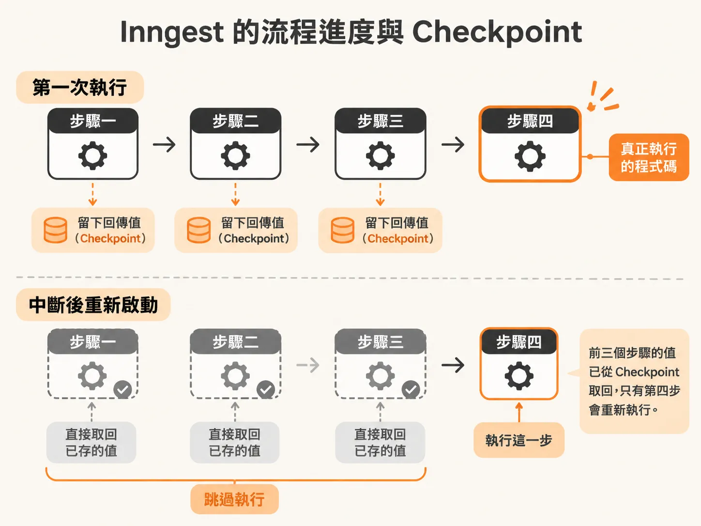
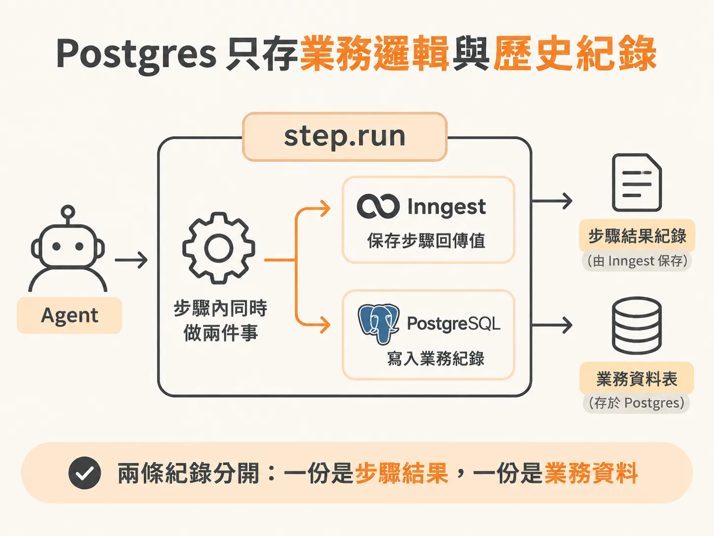
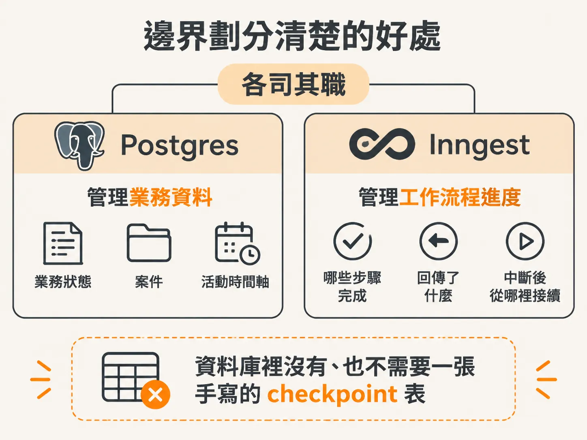

# 我們只存跟業務邏輯有關的東西

分開了三種狀態之後，下一個問題就是它們各自住哪裡。開發長時間執行的背景 Agent 時，最容易讓人困惑的問題之一就是：「狀態到底該存哪裡？」

當 Agent 需要觀察系統、呼叫模型決策、執行動作，甚至遇到錯誤重試，很多人直覺會在資料庫裡建好幾張表，專門記錄當前跑到第幾步、上一步回傳了什麼、當機時要從哪裡接續執行。但手寫這些檢查點（checkpoint）與狀態機邏輯，不僅容易出錯，也會讓業務程式碼變得十分臃腫。

其實狀態可以清楚拆成兩半：工作流程的進度與 checkpoint 交給 Inngest，業務實體與給人看的歷史紀錄留給 Postgres。

## Inngest 負責流程進度與 Checkpoint

在持久化執行（durable execution）架構下，Inngest 專門保管工作流程狀態（workflow state）。

如果把整個 Agent 的迴圈塞在單一函式裡，當它查了日誌、問了模型、甚至改了系統設定，此時 Node.js 程序若意外中斷，系統重試時就只能整段從頭來過。更糟的是，重新呼叫一次模型，可能給出完全不同的決策。

把流程切成有名字的步驟後，Inngest 會在每個 `step.run` 執行成功時，自動把該步驟的回傳值持久化儲存下來。這就是現成的 checkpoint。當函式中斷重啟時，Inngest 會重新跑過程式碼，但跳過已經完成的步驟，直接拿出上次存好的回傳值，一路快轉到第一個尚未完成的步驟繼續。



<!-- source: sources/background-agent/20261105/server/agent-workflow.ts#L58-L97 -->

```typescript
export const incidentAgent = inngest.createFunction(
  {
    id: 'incident-agent',
    name: 'Checkout incident agent',
    triggers: { event: 'incident/opened' },
    retries: 2,
    cancelOn: [{ event: 'agent/run.cancelled', match: 'data.runId' }],
    // This limits executing steps, not the number of waiting incidents.
    concurrency: { limit: 1, key: 'event.data.environmentId' },
    onFailure: async ({ error, event }) => {
      const original = event.data.event as { data?: { runId?: string } }
      if (original.data?.runId) await setRun(original.data.runId, 'failed', error.message)
    },
  },
  async ({ event, step }) => {
    const { environmentId, runId, instanceId } = event.data
    const run = await getRun(runId)
    if (
      run.instanceId !== instanceId ||
      ['completed', 'failed', 'cancelled', 'escalated', 'superseded'].includes(run.status)
    )
      return

    for (let cycle = 1; cycle <= 24; cycle++) {
      const current = await getRun(runId)
      if (['completed', 'failed', 'cancelled', 'escalated', 'superseded'].includes(current.status))
        return
      const state = await step.run(`observe-state-${cycle}`, () => agentState(environmentId, runId))

      if (goalSatisfied(state, run.goalCondition)) {
        const report = await step.run(`write-report-${cycle}`, () => writeReport(run.goal, state))
        await step.run(`complete-run-${cycle}`, () => setRun(runId, 'completed', null, report))
        return { report }
      }

      const decision = await step.run(`choose-action-${cycle}`, () => chooseAction(run.goal, state))
      await step.run(`set-iteration-${cycle}`, () => setIteration(runId, cycle))
      await step.run(`record-decision-${cycle}`, () =>
        recordDecision(environmentId, runId, cycle, decision.action, decision.reason),
      )
```

在上面的流程中，狀態觀察、模型決策、寫入報告都被拆成獨立的步驟邊界。模型回傳的決策被記在 `choose-action` 的 step 結果裡，即使之後程序重跑，也不會重新發送請求改寫之前的決定。

<!-- source: sources/background-agent/20261105/server/agent-workflow.ts#L187-L216 -->

```typescript
      const result = await step.run(`execute-action-${cycle}`, () =>
        executeAction(
          environmentId,
          runId,
          actionId,
          decision.action,
          policy === 'read' ? undefined : state.world.version,
        ),
      )
      if (result.stale === true) {
        await step.run(`stale-action-${cycle}`, () =>
          logAgentActivity(
            environmentId,
            runId,
            'act',
            'Action rejected because service state changed',
            result,
          ),
        )
        continue
      }
      await step.run(`settle-status-${cycle}`, () =>
        setRun(runId, 'waiting', 'Waiting briefly before observing the effect'),
      )
      await step.sleep(`settle-${cycle}`, process.env.AGENT_SETTLE_DELAY ?? '1s')
    }

    await step.run('stop-at-limit', () => setRun(runId, 'escalated', 'Decision limit reached'))
  },
)
```

每個步驟跑完，Inngest 就記錄一次進度。我們完全不需要自己在程式裡寫「儲存當前 step 編號」或「恢復中斷」的邏輯。

這對開發體驗也有直接好處。在本地開發時打開 Inngest 儀表板，能清楚看到 Agent 是在哪個步驟觀察、何時決策、何時執行或暫停，排查問題一目了然。

## Postgres 只存業務邏輯與歷史紀錄

Inngest 只在乎為了讓流程正確恢復（resume）所需的回傳值，它並不理解你的業務邏輯，也不會幫你建構管理後台需要的資料結構。

因此，所有跟業務邏輯有關的事情，依然由我們自己在 Postgres 處理：

- 結帳系統當前的狀態與 incident 案件。
- 專屬業務資料庫的執行狀態（例如將 run 標記為 completed 或 failed）。
- 給人類管理者檢視的活動時間軸（timeline）。

<!-- source: sources/background-agent/20261105/server/agent-log.ts#L1-L41 -->

```typescript
import { randomUUID } from 'node:crypto'
import { desc, eq } from 'drizzle-orm'
import { db } from './db'
import { timeline } from './schema'

type AgentActivityPhase =
  | 'start'
  | 'observe'
  | 'resume'
  | 'loop'
  | 'predict'
  | 'act'
  | 'pause'
  | 'human'
  | 'terminal'

export async function logAgentActivity(
  environmentId: string,
  runId: string,
  phase: AgentActivityPhase,
  message: string,
  detail: Record<string, unknown> = {},
) {
  await db.insert(timeline).values({
    id: randomUUID(),
    environmentId,
    runId,
    kind: `agent:${phase}`,
    message,
    detail,
  })
}

export async function activityForRun(runId: string) {
  return db
    .select()
    .from(timeline)
    .where(eq(timeline.runId, runId))
    .orderBy(desc(timeline.createdAt))
    .limit(200)
}
```

當 Agent 決定記錄一次決策、在資料庫寫入一筆新的觀察紀錄，或是因為版本過期而留下活動日誌時，這些操作會被包在 `step.run` 裡呼叫，資料則老老實實地寫進 Postgres 的資料表。



## 邊界劃分清楚的好處

這樣的劃分讓兩套系統各司其職：



- **Postgres 存業務狀態與歷史**：產品邏輯需要查詢的資料、報表、後台儀表板要呈現的時間軸，全在關聯式資料庫裡，保有完整的資料模型與查詢能力。
- **Inngest 存 step 結果**：哪些步驟完成、回傳了什麼資料、當機後如何無痛接關，全部交由執行框架處理。

你不必在資料庫裡為了「程式中斷要從哪裡重跑」而手刻 checkpoint 表格。業務程式碼專注於處理業務邏輯，復原與重試交給底層的流程引擎，整個系統自然變得單純許多。
