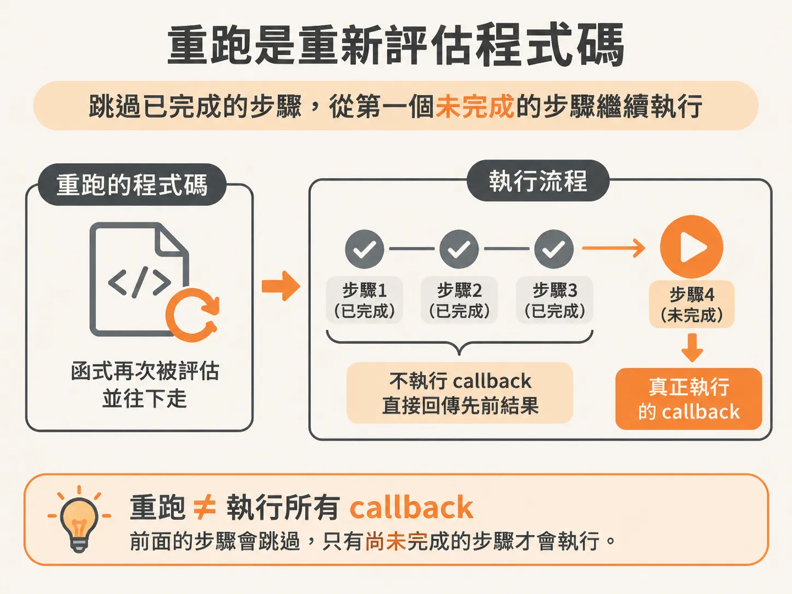
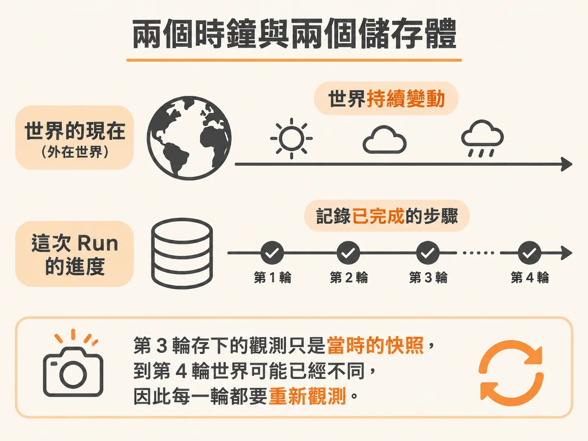
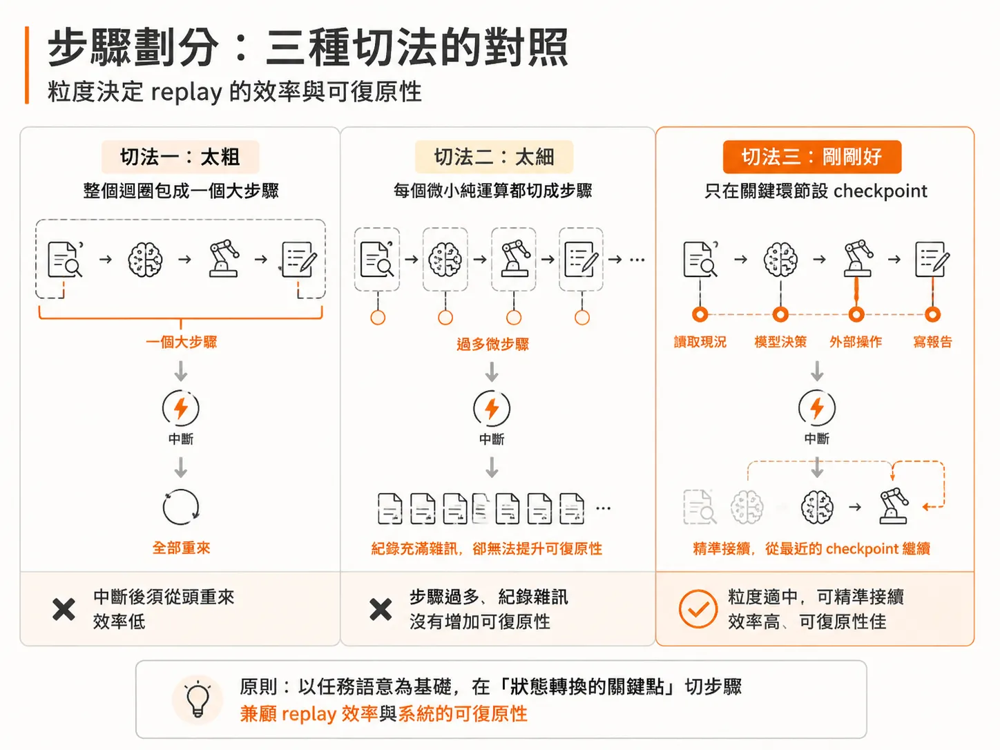

# Replay 不是接回一個掛起的堆疊

前面談的權威與批准，最後都得落在一個耐久執行環境裡。許多人第一次接觸 Durable Execution（持久化執行）時，常會直覺以為它的運作方式就像作業系統把行程（process）掛起：當程式需要暫停或重試時，系統把記憶體裡的堆疊（call stack）凍結存檔，等喚醒時再原封不動接回去繼續往下跑。

但像 Inngest 這類框架並不是這樣運作的。在重試或喚醒時，整個函式本體會從頭「重跑一遍」（replay）。

### 重跑是重新評估程式碼，跳過已完成的步驟

當背景行程掛掉、重啟，或是等候時間結束時，框架會重新呼叫該函式。函式裡的 JavaScript 會再次被評估並往下走。

不同之處在於，每個成功執行過的 `step.run` 都已經在外部記錄了結果。重跑時，只要遇到已完成的步驟，框架就不會執行該步驟的 callback，而是直接回傳之前存下來的結果；程式會一路跳過這些已完成的步驟，直到抵達第一個尚未執行的步驟，才真正呼叫 callback。

這意味著：

* **函式層級的程式碼會重複執行**：寫在 step 外面的 JavaScript 邏輯，每次 replay 都會重跑一次。如果只是拿一般區域變數來拼湊 step 名稱沒問題，但如果拿來放業務狀態，重啟時就會遺失。
* **外部副作用必須包在具名 step 內**：任何會對外在世界造成改變的操作（例如發出 API 請求、修改設定），如果沒放在 step 裡面，每次 replay 都會被重新觸發一次。

### 第一次執行是動態的，Replay 是確定性的

在打造 AI Agent 時，模型呼叫往往具有隨機性。如果我們在重跑時重新問一次模型，即使給它完全相同的觀察結果，新的模型版本或隨機參數也可能讓它選出完全不同的動作。

一旦模型選擇的分支變了，後續步驟的歷史紀錄就接不上了。

因此，決策本身必須被獨立包成一個步驟（例如 `choose-action-*`）並記錄下來。在第一次執行時，模型可以自由動態選擇路徑；但一旦選擇被存進歷史，replay 就必須嚴格遵從當初記下來的決定，確保重構出來的執行路徑完全一致。在迴圈中，我們還需要加上迴圈編號（`cycle`），確保每次決策與動作的步驟 ID 都是唯一的，避免歷史紀錄產生混淆。

### 兩個時鐘與兩個儲存體

要理解整個架構，必須分清楚兩件事：**世界的現在**與**這次 Run 的進度**。

系統中其實存在兩種儲存體，回答著不同的問題：

1. **外在世界的狀態（資料庫或服務現況）**：回答的是「現在的事實是什麼？（What is true now?）」
2. **Workflow 的步驟歷史**：回答的是「這次 run 已經做過了什麼？當時看到了什麼？（What did this run already do?）」

假設你在第 3 輪迴圈存下了一個觀測步驟 `observe-state-3`，它代表的是 Agent 在第 3 輪當下看到的證據，而不是外在世界在第 4 輪的保證。真實世界的服務隨時可能改變，所以每一輪迴圈都必須重新建立新的觀測步驟去讀取現況。

若沒有把先前的動作歷史餵給模型，模型只看目前的服務狀態，就很容易陷入鬼打牆，不斷重複執行相同但無效的動作。唯有同時掌握「世界現在長怎樣」與「這次執行已經做過哪些嘗試」，Agent 才能在嘗試失敗後做出正確的判斷，例如轉向尋求人工協助。

### 劃分步驟邊界

既然 replay 是透過已儲存的 step 來跳過進度，步驟劃分的粒度就很重要：

* 如果把整個迴圈包在單一的大 step 裡，只要行程中斷，所有操作都得全部重來，外部服務可能早就被改過，但 workflow 卻毫無紀錄。
* 如果把每一行純運算都拆成獨立 step，只會讓追蹤紀錄充滿雜訊，浪費儲存空間，對復原沒有實質幫助。

合理的邊界是將「崩潰重啟後必須知道結果」的環節設為 checkpoint：讀取現況、模型決策、執行外部操作，以及更新狀態報告。這樣既能清楚解釋 Agent 剛剛做了什麼，也能確保行程掛掉時，進度可以精確且安全地接續下去。
