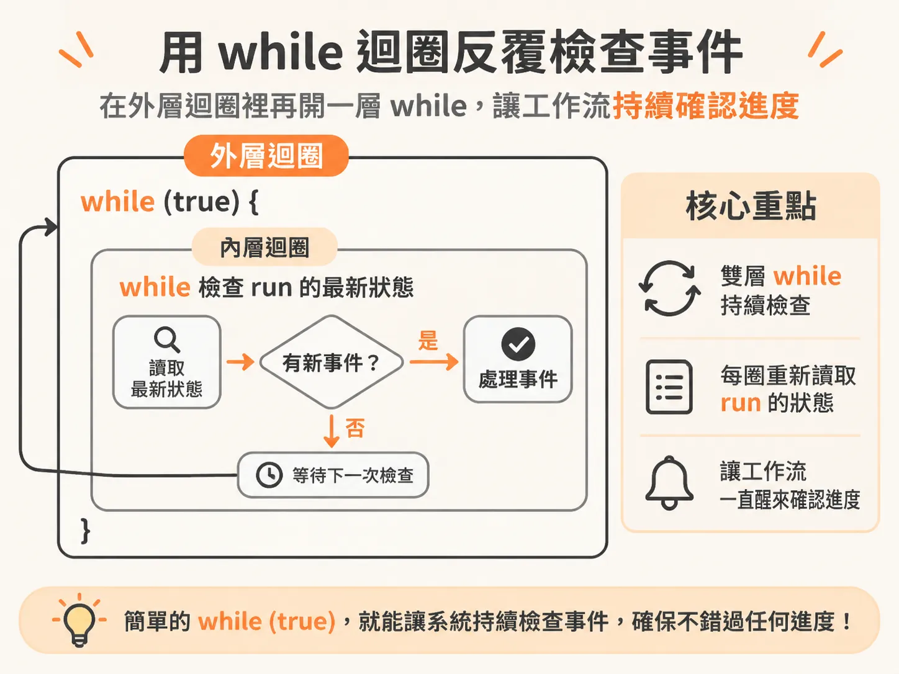
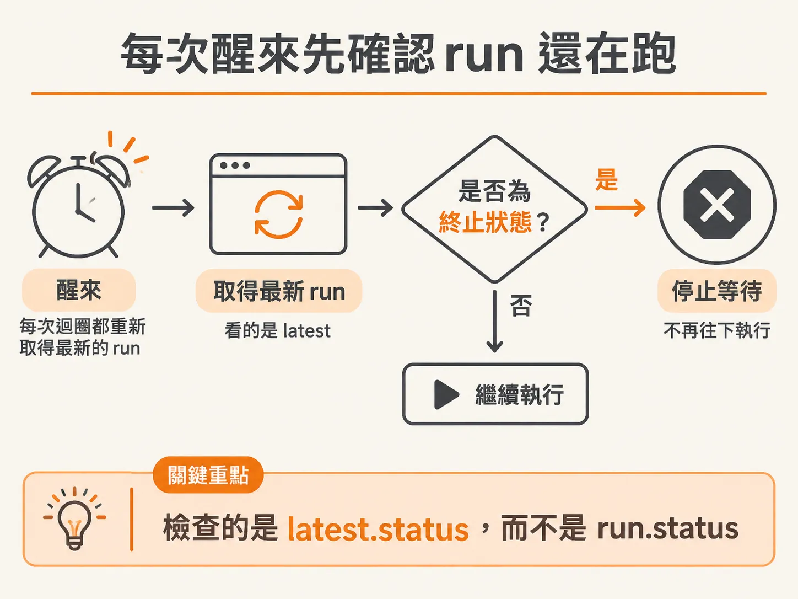
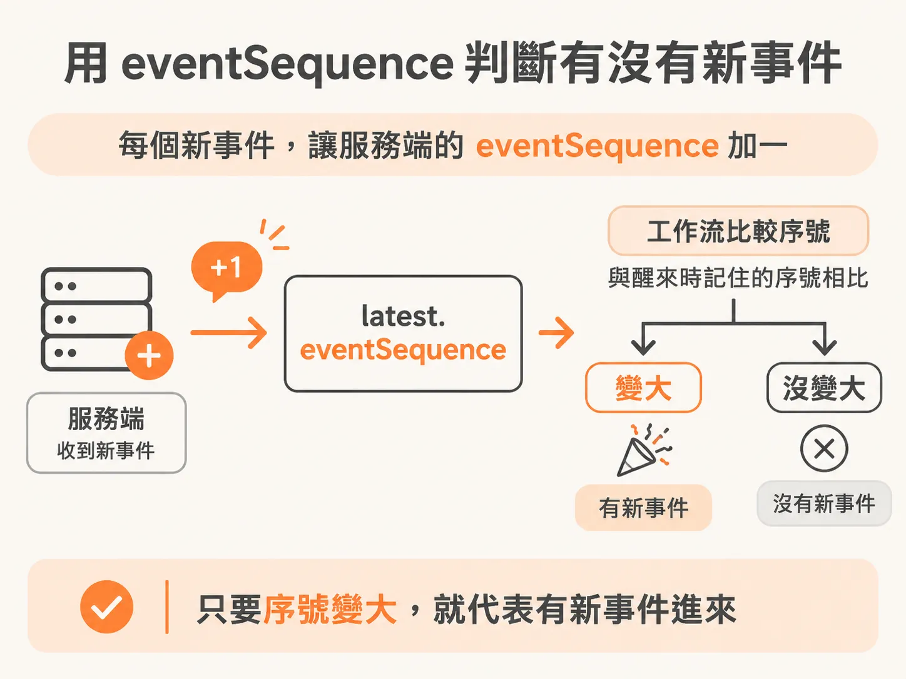
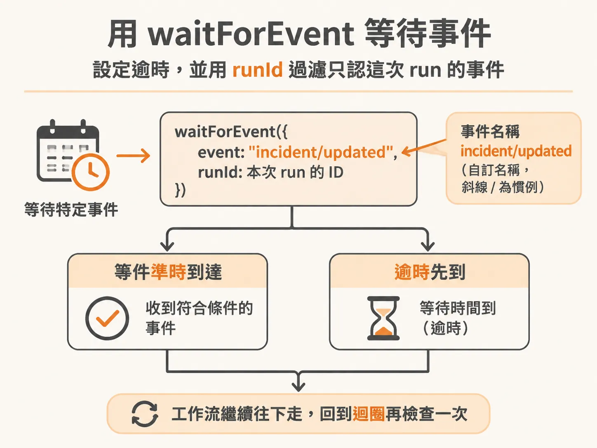

# 讓工作流乖乖等事件：用 while 迴圈與 eventSequence 寫出等待邏輯

知道 `waitForEvent` 的語意之後，就能回來把等待邏輯寫完整了。想像你的背景工作流正在跑一個長任務，服務端會陸續發出更新事件。你不知道事件什麼時候來，也不知道目前那筆 run 是不是還活著——它可能在背景被取消、被取代，或者早就跑完了。這種時候不能傻傻地假設一切安好，得主動去「看」，而且每醒來一次就要重新看一次。

現在要實作的，就是這段等待邏輯。做事的方法不只一種，沒有絕對的對錯，我們先照一個直覺上合理的方式寫，之後再來談可以怎麼優化。

## 先準備一個檢查用的變數

在進入等待之前，先宣告一個變數 `check`，初始值設為 0。它的用途是記住「目前是第幾次檢查」。

`check` 之所以存在，是因為馬上會進入另一層迴圈。外面已經有一層用 `cycle` 記住的游標，而這個內層 while 迴圈也需要自己的游標。每一圈內層迴圈就是一次「check」——意思很單純，每轉一圈，就是在檢查一次有沒有新事件。

## 用 while true 開一個檢查迴圈

接著寫一個 `while (true)`。其實不是非這樣寫不可，但先用大家最熟悉的形式，好理解就好。



迴圈內第一件事，是讀取最新的 run 狀態：

<!-- derived -->
```typescript
let check = 0
while (true) {
  const latest = await step.run(
    `read-event-sequence-${cycle}-${check}`,
    () => getRun(runId),
  )
  // ...
}
```

注意 `check` 也被放進了 step 名稱裡。每次迴圈轉一圈，`check` 都會變化，所以每一圈都會得到一個不重複的 step 名稱。

## 每次醒來，先確認 run 還有效

拿到最新的 `latest` 之後，做的事情和先前相同：如果 run 已經處於某些終止狀態，就直接結束。這裡看的對象是 `latest.status`，而不是 `run.status`——因為輪詢的是「現在」這筆 run，不是一開始那筆。



完整寫起來像這樣：

<!-- source: sources/background-agent/20261109/supplement/server/agent-workflow.ts#L118-L133 -->

```typescript
        let check = 0
        while (true) {
          const latest = await step.run(`read-event-sequence-${cycle}-${check}`, () =>
            getRun(runId),
          )
          if (['cancelled', 'superseded', 'failed'].includes(latest.status)) return
          if (latest.eventSequence > state.eventSequence) break
          check++
          await step.waitForEvent(`wait-for-service-${cycle}-${check}`, {
            event: 'incident/updated',
            if: `async.data.runId == "${runId}"`,
            timeout: '10s',
          })
          // The timeout also reconciles an event that arrived just before the wait.
        }
```

這段邏輯的意思是：如果正在輪詢的 run，已經因為其他原因被取消、取代、或失敗了，那就不要再做任何事，直接停止。

## 為什麼每次都要重驗？

你可能會問：剛剛不是已經檢查過了嗎？為什麼每圈都要再驗一次？

原因在於這一切都是非同步的。可能在不同的執行個體上，有另一個用相同 ID 的工作流正在跑，而它可能已經把事情做完了。這不是請求回應（request-response）模型，而是分散式運算——你根本不知道背景發生了什麼。

狀態隨時可能在你腳下偷偷改變。你開始跑的時候一切正常，但等到你走到這一步，它可能早就變了。所以每走一步之前都要確認一次，確定它還在。這樣做有點麻煩，但不做的話，你會出很多 bug——真的很多。

## 比對 eventSequence，判斷有沒有新事件

確認 run 還活著之後，就能心安地判斷事件了。這裡登場的是 `latest.eventSequence`。這個名字就跟字面一樣：它追蹤的是服務發出的一連串事件，看看事件序列有沒有前進。



判斷方式很直接：

<!-- source: sources/background-agent/20261109/supplement/server/agent-workflow.ts#L124-L124 -->

```typescript
if (latest.eventSequence > state.eventSequence) break
```

只要伺服器那邊的事件序號大於我們手上記住的序號 `state.eventSequence`，就代表在這期間有新事件進來，可以 `break` 跳出 `while (true)` 迴圈繼續前進。

那序號是怎麼被推進的？在服務端，同一個 run 收到新事件時，會把 `eventSequence` 加一：

<!-- source: sources/background-agent/20261109/supplement/server/incident-data.ts#L90-L111 -->

```typescript
      (world.state.health as Record<string, unknown> | undefined)?.status === 'healthy'
    if (!run && input.type !== 'service.started' && !healthy) {
      ;[run] = await tx
        .insert(runs)
        .values({
          id: randomUUID(),
          environmentId: environment.id,
          eventId: input.id,
          instanceId: input.instanceId,
          eventSequence: 1,
          goal: configuredGoal(),
          goalCondition: DEFAULT_CONDITION,
          status: 'running',
        })
        .returning()
      dispatch = 'opened'
    } else if (run) {
      await tx
        .update(runs)
        .set({ eventSequence: sql`${runs.eventSequence} + 1`, updatedAt: new Date() })
        .where(eq(runs.id, run.id))
    }
```

所以這邊的比對，其實是在偵測這個加一有沒有發生。

## 等：waitForEvent 加上 10 秒 timeout

如果序號還沒變，代表還沒有新事件，這時就輪到 `check++` 把圈數往上加，然後停留在等待：

<!-- source: sources/background-agent/20261109/supplement/server/agent-workflow.ts#L125-L130 -->

```typescript
check++
await step.waitForEvent(`wait-for-service-${cycle}-${check}`, { ... })
```

`waitForEvent` 接收一個物件，裡面要說明你在等什麼事件。這裡等的事件叫 `incident/updated`。這只是自己取的名字，框架本身不會產生這些事件，斜線 `/` 只是建議的命名慣例，照著用就好。



比較有趣的是 `if` 條件。`if` 接收一個字串，字串裡寫的 JavaScript 會被解讀執行。字串裡的 `async` 指的是這個事件附帶的資料——可以把它想成一個 handle，握著這個事件上送來的資料。所以這裡判斷的是 `async.data.runId`，經過雙層字串插值之後，看它是不是等於我們手上的 `runId`。只有符合的事件才會喚醒我們。

最後加上 `timeout: '10s'`。十年不對，是十秒。也就是說，十秒之內如果 `incident/updated` 帶著同樣的 runId 進來，我們就繼續往下走；不然十秒一到，也照樣往下走。基本上就是暫停十秒看看發生什麼事——看到動靜就動，什麼都沒看到也照樣動。

有點像一個帶條件的 `setTimeout`，同時在監聽事件。

## 為什麼不直接 step.sleep 十秒？

你可能想說：在 `while (true)` 裡不能用 `setTimeout`，那用 `step.sleep` 睡十秒再說？可以，效果有點像：睡十秒，然後去某個地方查看看有沒有 `incident/updated` 帶著這個 runId 進來。但前提是你得有一個事件儲存區（event store）可以查。

問題是這樣一來，你得等滿十秒才會去查。而事件可能在十秒之前就來了。

所以 `waitForEvent` 一個優化。十秒在調查情境下算不上什麼久，但換成三十分鐘的等待就完全不同了——你不會想要睡滿三十分鐘才去看一眼事件。與其「等到 timeout 再去查事件」，你會想直接等事件，時間到再作罷。等太久之後，可能會出問題。

說這麼多，重點還是那句：做法不只這一種，這裡只是其中一種寫法。

## 等完之後：回到外層迴圈

`waitForEvent` 結束後，用 `continue` 回到外層迴圈，整個等待流程就接起來了：檢查狀態、比對序號、等事件、再回外層。

## 順手清掉不再需要的分支

把這些接起來之後，編輯器立刻亮了起來——TypeScript 真的很好用。它告訴我們，原本有一段判斷分支已經不需要了。

因為上面的新邏輯已經處理了同樣的狀況，那段舊的 decision 分支可以直接刪掉。某種程度上這就是強型別帶來的好處：不必自己判斷哪段程式碼成了死碼，編譯器會替你找出來。

這也是寫別人的 repo 時常有的感謝時刻——有人把 Type 定義得清清楚楚，你接手時只需要在心裡說一聲謝謝。那些願意認真寫 Type 的人，值得尊敬；但說真的，沒有人想當那個從頭把所有 Type 補好的人。

等待邏輯到這裡就成形了。接下來換上真的故障，看看同一個 run 會不會等、會不會醒、最後能不能把事故收掉。
