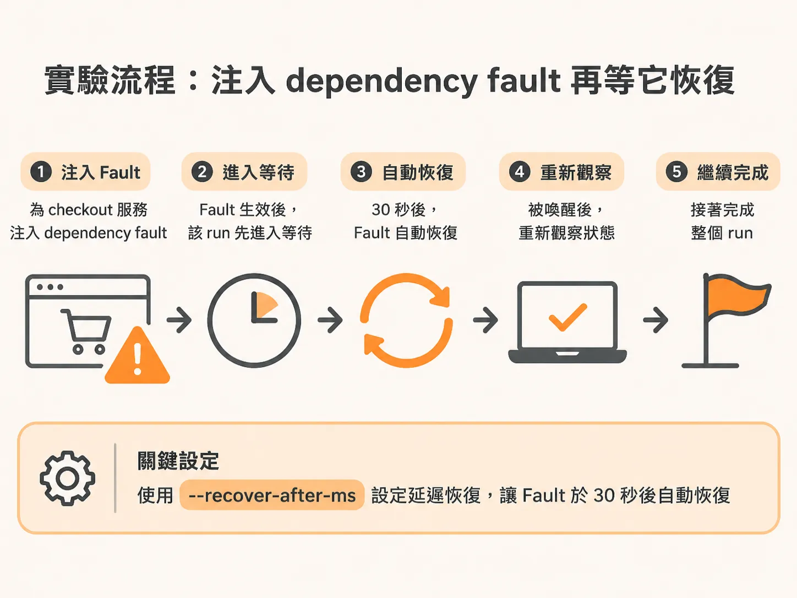
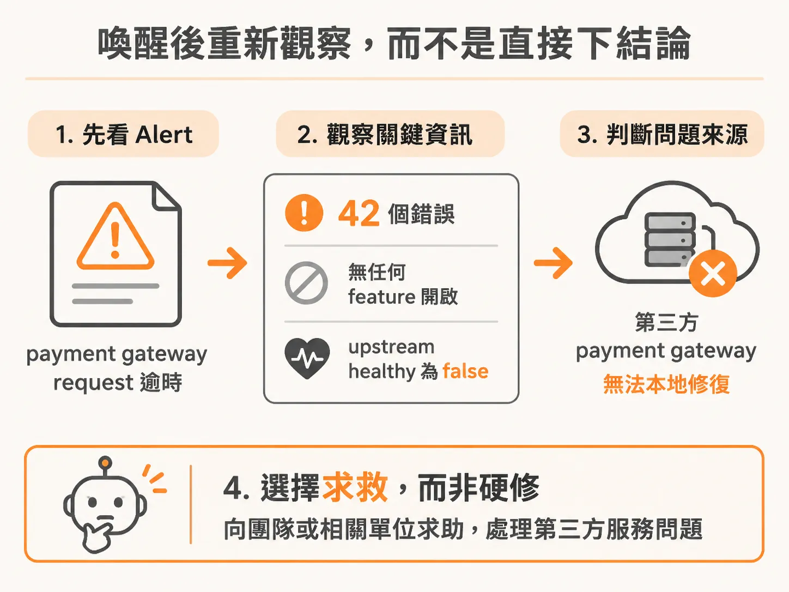
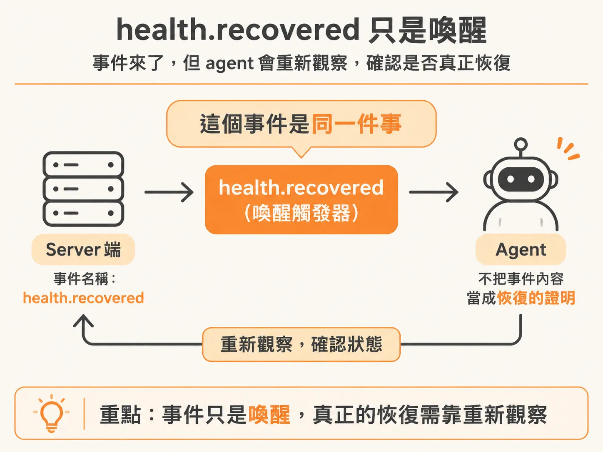
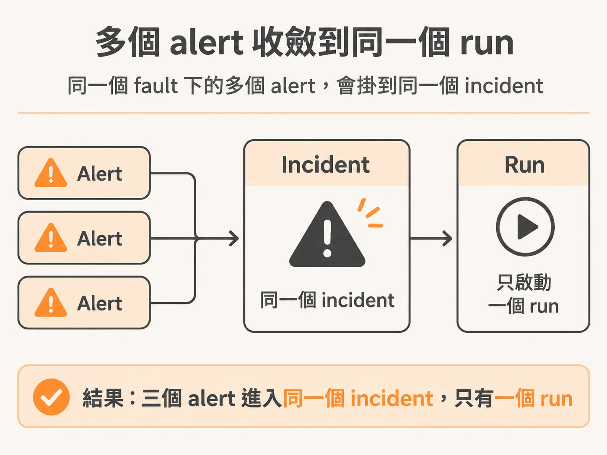
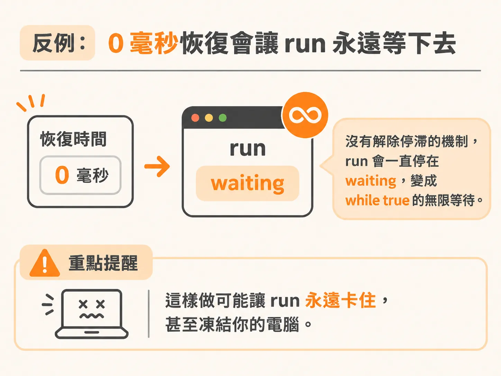

# 讓同一個 run 等待、醒來、重新觀察、再完成：dependency fault 實測

等待邏輯寫好了，接著要驗證它真的會動。想像你寫了一個背景 agent，負責盯著 checkout 服務。現在 Checkout 的上游依賴掛了，agent 自己修不了，那它該怎麼辦？做法是用一個帶「延遲恢復」的 dependency fault，實際驗證 agent 會等、會醒、會重新觀察狀態、最後把 run 完整跑完。

## 實驗怎麼跑

做法是啟動一個 fault，並設定它是「延遲恢復」。指令就是：帶著 `--recover-after-ms` 相關 flags，跑 checkout 搭配 fault dependency，30 秒後恢復。



啟動順序是這樣的：先跑 `npm run dev agent` 把 API 開起來，接著啟動 app，把 ingest 之類的全部帶起來。這裡得小心順序——「這些 port，別給我出包啊」。

然後跑 service，這次帶上 fault dependency、30 秒後恢復的設定。跑到 app 那邊看，才剛過來，run 就已經暫停了，肉眼可見地正好在這個瞬間 pause。

有趣的是，這個 run 不是傻等。它 pause 之後，主動求救了。

## 它看到的狀態

先看 alert 內容。這個 alert 說的是：payment gateway request 逾時、出現了一些錯誤，然後拿到 state。42 個錯誤、沒有任何 feature 開啟、`upstream healthy` 是 false。`upstream healthy` false 就是說，我們用的某個第三方服務壞掉了。



Agent 迴圈跑完之後下的結論是：「Checkout 的退化是起因於一個不健康的上游 payment gateway，這在本地修不了。要我怎麼辦？」它自己什麼都做不了——這不是我們的服務，它只看得到 checkout 服務。得有別人來處理，所以它求救了。它提出的問題是：「請調查並恢復 payment gateway，等它恢復健康時通知我們，我們才能驗證 checkout 的恢復。」

## 求救訊號可以接到任何介面

把那段問句直接丟到 Slack——那真的可以就是一則 Slack 訊息，沒有任何東西阻止你這樣做。找到那個服務的團隊、找到這個 agent 的負責人、或任何能回答這個問題的人，把這條線接起來，當對方回覆時，回覆就會變成一個事件送回給這個 agent。要用什麼介面都可以。

但因為 help 還沒 ready——這是字面上的事實，根本還沒蓋——所以它還是 pause 在那裡。Pause 的原因就寫著放進去的字串：「help is not ready yet」。它就坐在那裡，本來會等上 10 秒，除非先等到那個事件。

## 醒來的那個事件

那個事件來了。事件的原始內容看不到，因為它在 server 端，但要知道的是：這個 `health.recovered` 事件就是它等的那一個。兩個是同一個事件——只不過是假 server 在送事件，而在這邊看到的樣子是另一種型態。Server 端的事件用點號命名，ingest 事件裡帶有斜線，但它們是同一件事，對應到同一套東西。



checkout 服務端是這樣把恢復事件發出來的：

<!-- source: sources/background-agent/20261109/supplement/service/checkout.ts#L95-L108 -->

```typescript
function emit(type: string, data: Record<string, unknown>) {
  const event = { id: randomUUID(), serviceId: 'checkout', instanceId, type, data }
  pendingEvents.set(event.id, event)
  void deliverEvents()
}

function recover(reason: string) {
  if (activeFault === 'none') return
  activeFault = 'none'
  state = { ...state, health: { status: 'healthy', errorRate: 1 } }
  version++
  recordLog('info', `Checkout recovered after ${reason}`)
  emit('health.recovered', { summary: `Checkout recovered after ${reason}`, version })
}
```

事件進來之後，訊息是「Checkout recovered after upstream dependency recovered」。收到。然後 resume。它會自己 resume，因為那個事件進來了，事件一到，它就「好，沒事了」，恢復執行，然後走到下一行程式碼，也就是 continue。

## 重新觀察，然後完成

它在 continue 之後回到那個 for 迴圈的頂端——注意，是 for 迴圈，不是 while 迴圈，while 迴圈已經出來了，for 迴圈裡還有沒跑完的——回到 for 迴圈頂端，做什麼？拿目前的 run，做那些檢查。它觀察了最新的狀態：「讓我看看狀態。哦，現在健康了，`upstream healthy` 是 true，我們可以過關了。」

這個「重新觀察」之所以能成立，是因為 agent 讀狀態的方式是透過 HTTP 去問 checkout process，而不是共享服務的記憶體，也不是拿事件 payload 當狀態快照：

<!-- source: sources/background-agent/20261109/supplement/server/observe.ts#L1-L17 -->

```typescript
import { z } from 'zod'

export const checkoutServiceUrl = process.env.CHECKOUT_SERVICE_URL || 'http://127.0.0.1:3004'

const snapshotSchema = z.object({
  instanceId: z.string().uuid(),
  version: z.number().int(),
  state: z.record(z.string(), z.unknown()),
})

// The agent reads the checkout process over HTTP. It does not share the
// service's memory or use an event payload as a state snapshot.
export async function getLatestState() {
  const response = await fetch(`${checkoutServiceUrl}/state`)
  if (!response.ok) throw new Error(`Checkout state request failed: ${response.status}`)
  return snapshotSchema.parse(await response.json())
}
```

Run completed。它做得滿聰明的，正做到了該做的事。

## 幫它回顧這條路徑

它求救，是因為：這是一個上游依賴，我手上沒有任何工具能跟它互動，這不是我的責任，而且你之前告訴過我——需要幫忙就去求助。所以它就去求助了。它本來會在那裡等 10 秒，其實可能會無限期等下去，因為我們沒有解掉「如果一直都沒有事件的話會怎樣」這件事，help 也沒實作。它就只是坐在那裡，沒事可做。

換個說法：它的結論到達了我想要的終點，只是走的路我沒料到。但我不太在意，因為我們確保過——整個 harness 只允許 agent 做我們同意的事。所以即使它走了一條不同的路，我當下想的是「沒料到你會求救」，但回頭一想：對啊，你不求救才奇怪吧。你應該求救的。因為我根本沒給你 runbook 說「嘿，看到第三方上游的這種事件，就等 10 秒」。我沒這樣交代過，你憑什麼那樣做？

換成你是值日 on-call 的人好了。你遇到一個 runbook 裡完全沒寫過的情境，但你知道可以找任何人求助，也知道事態可能嚴重——我希望你會做的就是立刻伸出手去要幫忙、愈快愈好，因為目標是盡快回到綠燈。它就是這樣做的。反過來，如果當初在 runbook 裡寫了「看到上游事件，先等至少 30 秒再求救會比較安全」，它很可能就照辦，乖乖說「那我就等吧」。

它沒辦法自己挑要等多久，因為時間是 hard code 進去的。但可以這樣改：做一個 action，讓它可以給我們一個想要的等待長度，動態決定。不過那樣就得加上對應的檢查——好，但不能超過 60 秒，或你想要的任何限制，這個檢查一定要做。

還有個插曲：它坐在那裡，等著有人在 Slack 上回覆——雖然 help 工具根本還沒做——這時來了一個新 event。它一看：「哦等等，不用了，沒事了，我好了。」就是這樣。

## 多個 alert 不該開多個 run

同一個 fault 底下再用 `-3` 送多個 alert 進來，它們應該掛到同一個 incident 上，而不是開出 3 個 run。實測結果正是如此：incident opened、agents started，因為真的收到了新 alert，但它們進了同一個 incident，不是各自生一個 run。



## 怎麼把它弄壞：0 毫秒恢復

如果你想把它弄壞，可以把恢復時間設成 0 毫秒。這樣它不會因為任何理由往前推進——我們沒有實作任何「解除停滯」的機制。它會坐在那裡，什麼事也沒有，因為我們幫不了它：那個功能還沒蓋，也沒有事件會進來。你等於卡在一個本質上 while true 的東西上。所以也許別這樣做——我懷疑它會把你的電腦凍住。我不知道，總之別做。for 迴圈那個是跑得動的版本；0 ms 這條就純粹用來觀察 run 永遠停在 waiting，這就是弄壞它的方法。



## 這一切跟 LLM 無關

對這個流程有什麼問題嗎？有一點值得強調：我們剛剛完全沒有碰到任何 LLM 相關的東西。跟 AI 沒關係。第一課 ship 出去的那幾行 AI 程式碼，到現在還是同一套，一次都沒改過。這全部都是 harness，是包在 AI 周圍的程式碼。LLM 本身就那 4 行程式碼，之後再也不會碰，跟所有控制它的東西相比根本不值一提。少了這整套 harness，LLM 什麼都不是。
