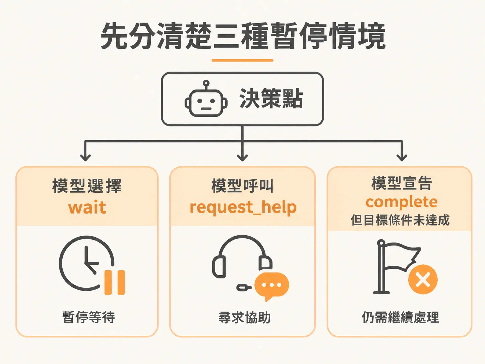
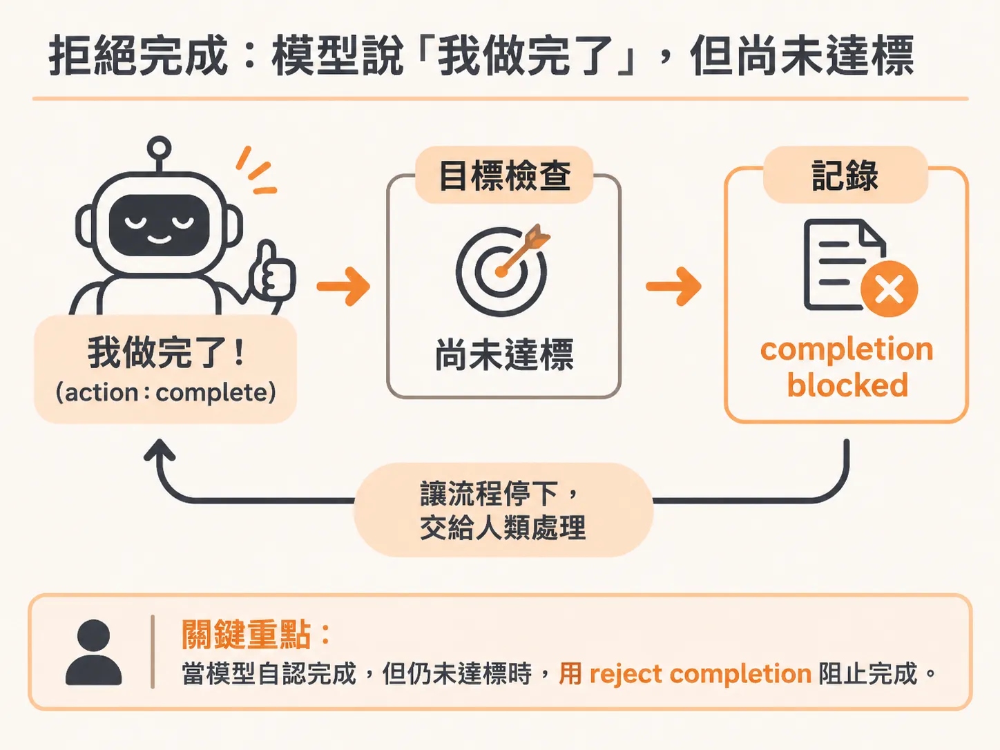
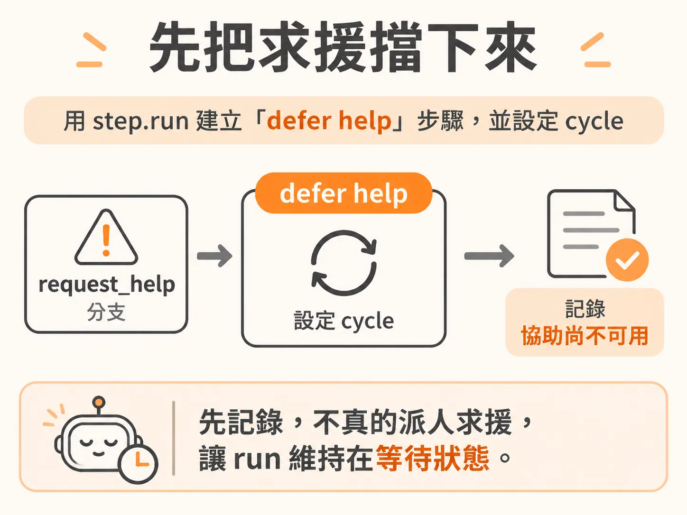
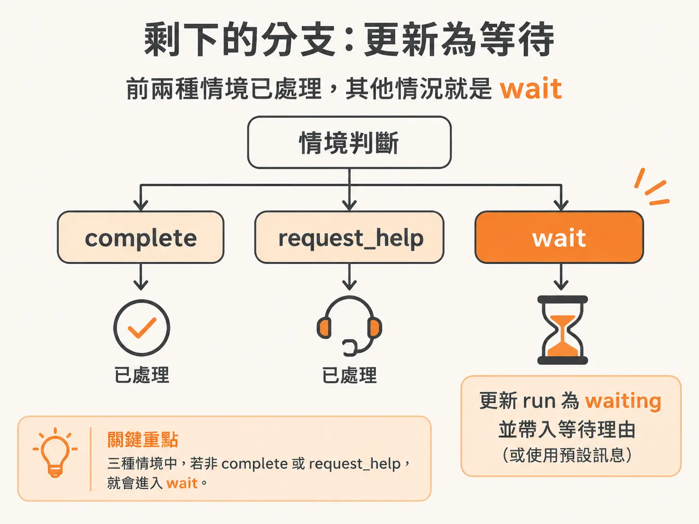

# 幫 Agent 建立暫停分支：wait、request_help 與被擋下的 complete

「等」的選擇權既然交回給代理，接著就要處理它停下來的那一刻。背景 Agent 的迴圈跑到一半，可能會遇到一些「不能繼續往下走」的狀況：模型說它在等外部事件、它需要人類幫忙，或是它宣稱任務完成了但目標條件還沒達成。這些狀況都應該讓整個 run 暫停下來，而不是硬著頭皮繼續迴圈。現在就把這個暫停邏輯寫進程式碼。

## 先把三種暫停情境找出來

要修的那段判斷：原本的條件是 `decision.action` 等於 `wait`，或是等於 `complete` 並且 run 帶有 goal condition（這個條件原本只是讓整個流程有辦法收尾的第二個分支）。這段還是要保留。

接著把所有需要暫停流程的情境列一列，其實就三種：



1. `decision.action === 'wait'`：模型明確說它在等，這個最直接。
2. `decision.action === 'request_help'`：模型請求協助，這時也該停下來。
3. `decision.action === 'complete'` 且有 goal condition：模型說做完了，但目標條件還在。

三種情況的本質都一樣——先等一下。但「等」其實有不同的版本：

- 對 `complete` 來說，「等」的意思是「我們結束了」。
- 對 `request_help` 來說，「等」的意思是「我得組一則訊息、送到某個人手上求援」。
- 對真正的 `waiting` 來說，就是單純地在等。

所以要分別定義這幾種「等」各自要做什麼，然後等那些事情發生。

## 先宣告整個暫停區塊

因為這三種情境的行為不同，在這個大條件裡面再依 action 分別處理。

## complete：拒絕模型的「我做完了」

如果 action 是 `complete`，第一件事是用 `step.run` 記錄一件事，叫做 **reject completion**（拒絕完成）。為什麼要這樣？因為模型說「嘿，我做完了」，但系統這裡有一個事先定義好的、確定性的 goal condition。也就是說，雖然模型自認做完，harness 認為它還沒做完——要強迫它承認「你還沒好，繼續做」。



背後的邏輯是：如果模型真的還沒做完，在上面的 goal check 就會被擋下來。假設這個 goal checking function 是完美無誤的，模型不可能繞過它。所以如果模型走到這一步還說自己完成，那它一定是錯的。結論就是：繼續做。

這一步一樣帶 cycle，拿到要呼叫的函式，然後記錄 agent 活動：照慣例帶上 environment ID 與 run ID。phase 這邊開始用 `human`（因為這種時刻其實要靠人介入），訊息就寫「completion blocked by configured goal condition」，也就是完成被設定的目標條件擋住了。現在的狀態有點僵局：模型覺得做完，系統說沒做完，那就停在這裡，該由人類來解決、去把問題查清楚。

這裡還有另一種做法：不擋下來，改成寫一個 continue，讓迴圈再跑一輪——模型會重新讀自己的回應，想說「我以為做完了，原來還沒，那繼續做吧」。這樣寫也行。但這是個讓人類介入的好機會，停下來比較合適。

## request_help：先把求援延後

接下來處理 `request_help`。這裡用 `step.run` 建一個名為 **defer help** 的步驟，同樣帶 cycle。之所以叫「defer」（延後），是因為現在還不真的實作「派人求援」這件事，先只做記錄。



記錄內容照樣走 `logAgentActivity`：environment ID、run ID，phase 一樣用 `human`，訊息寫「help is not available yet」（協助還沒就緒）。之後再補上就好。另外把一個 payload 帶上，欄位叫 `question`，值放 decision 上那個 `detail` 屬性——那原本就是拿來放額外資訊的，直接塞進去。這樣即使還沒實作「真的去問人」的功能，光看 log 也能知道它本來想問什麼，看得見整個狀況的來龍去脈。

流程語意上：模型選 `wait`，代表它此刻沒有合理的主行動可做，但這個選擇不會終止整個 run；harness 會持續一個 waiting 狀態。模型也可能在同樣的系統性阻塞下改選 `request_help`。在這個檢查點，記錄的是「人類協助目前不可用」，而不是假裝那個問題已經送到某個人手上。

## wait：剩下的那個分支

再來寫真正的「等」。

想想條件結構就知道：情境總共就三種——wait、complete、request help。complete 已處理，request_help 已處理，那走出去剩下的一定是 wait，可以直接執行步驟，不需要再寫一個 if。



這個步驟叫 `step.run('wait-status-...')`，一樣帶 cycle。它做的事情是用 `setRun` 更新這個 run：

<!-- source: sources/background-agent/20261109/supplement/lessons/03-events-and-waiting/index.md#L42-L75 -->

```diff
      if (
        decision.action === 'wait' ||
        decision.action === 'request_help' ||
        (decision.action === 'complete' && run.goalCondition)
      ) {
        if (decision.action === 'complete') {
          await step.run(`reject-completion-${cycle}`, () =>
            logAgentActivity(
...
        if (decision.action === 'request_help') {
          await step.run(`defer-help-${cycle}`, () =>
            logAgentActivity(environmentId, runId, 'human', 'Help is not available yet', {
              question: decision.detail,
            }),
          )
        }
        await step.run(`wait-status-${cycle}`, () =>
          setRun(
            runId,
            'waiting',
...
          ),
        )
```

把 run 的狀態設成 `waiting`，run ID 對上。裡面那個訊息是個巢狀三元判斷：如果 action 是 `request help`，就說 help 還沒就緒（不過如果整個迴圈設計正確，其實不該出現這個情況）；如果 action 是 `wait`，就放 `decision.reason`（模型自己給的等待理由）；都不是的話，fallback 到「recovery 尚未就緒」，只是個保險文案。

這一步其實只是在「準備等」——先更新 run 的活動狀態與目前要做什麼。

## 把 run 標成 waiting 之後

狀態也標好了，接下來才是真的去等。最清楚的理解方式，是直接把 Inngest 的 docs 拉出來看——先拋開我們這套脈絡，光看文件會更好懂。

在 Inngest 裡，等待事件的做法是在原有的 `step.run` 之外，改用 **`step.waitForEvent`**：不執行程式碼，而是註冊「等某個事件到來」。這就是整個暫停機制的核心——run 被標成 `waiting`，然後掛上一個持久化的等待，等外部事件（像是這個 incident 的更新）喚醒它再往下走。這個工具值得單獨看清楚，先把它當成一個獨立概念，再回來接上這條等待邏輯。
