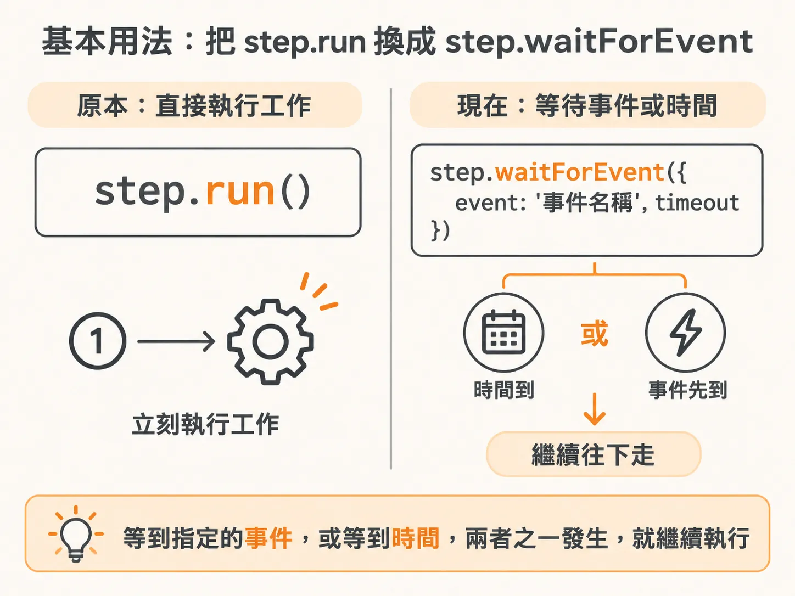
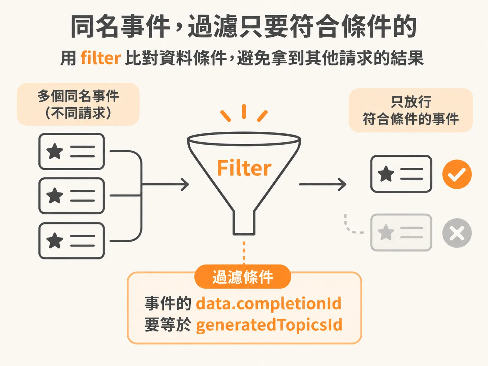
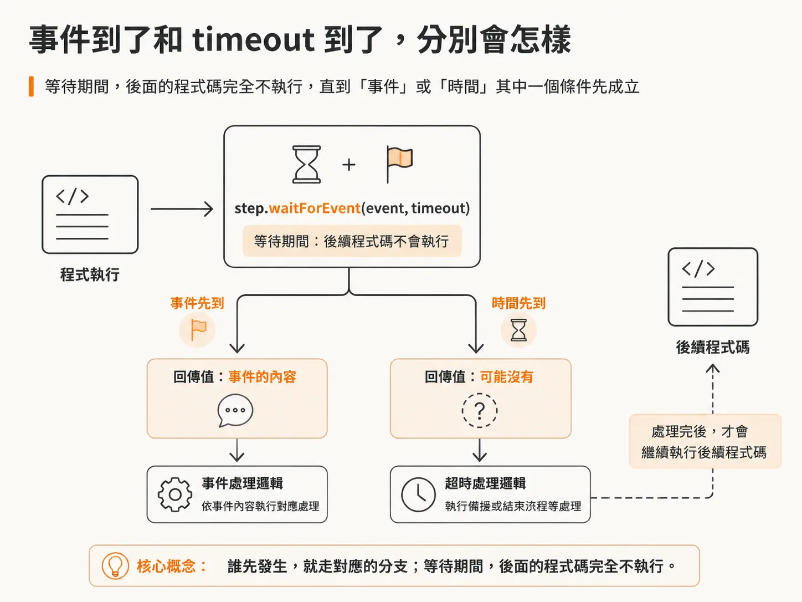
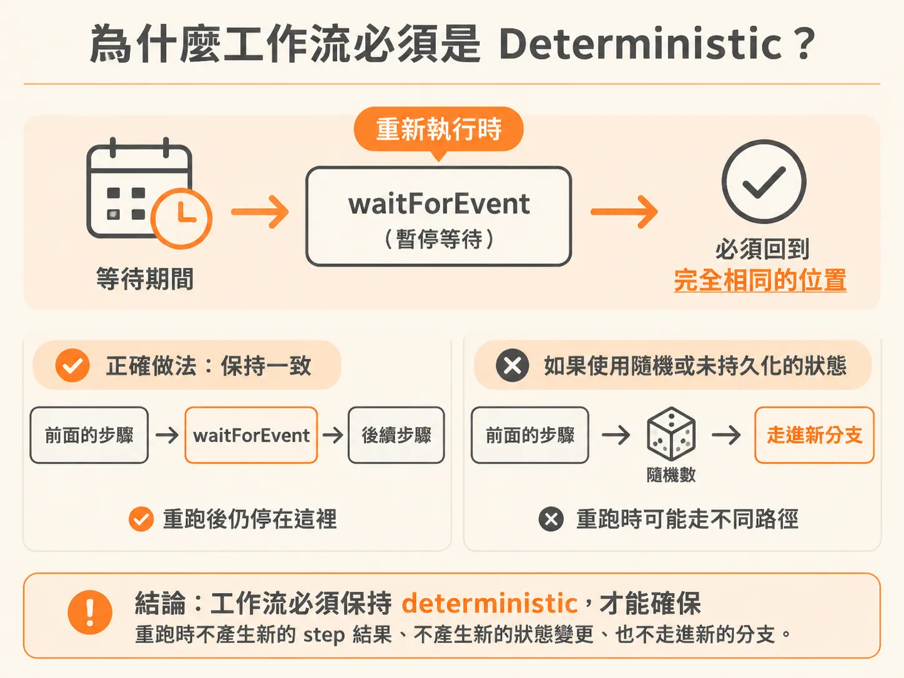

# step.waitForEvent：讓工作流停在某一步，等事件來或等時間到

想像你在寫一個工作流：使用者送出請求之後，要等另一個服務回傳結果；如果三天內沒等到，就走備案。一般寫法是開一個伺服器，讓 function 掛在那邊等——但這樣 function 會一直佔著資源。

Inngest 的 `step.waitForEvent` 提供了另一種做法。寫起來像一般的 JavaScript，但這段程式碼實際上可以「凍結」起來，等條件成立再繼續。

## 基本用法：把 step.run 換成 step.waitForEvent

寫 step 時，你原本是用 `step.run()`，現在只要換成 `step.waitForEvent()`。



它做的事是：給定一個要等待的 event 名稱，然後說「這個 event 來了，或 timeout 到了，兩者其中之一先發生就繼續」。timeout 在這個例子裡是三天。

<!-- derived -->
```ts
const onboardingComplete = await step.waitForEvent(
  "wait-for-onboarding",
  {
    event: "app/onboarding.completed",
    timeout: "3d",
    if: "async.data.completionId == event.data.generatedTopicsId",
  }
);
```
<!-- derived -->

## filter：不是這個 event 就忽略

上面那個 `if` 條件基本上就是一個 filter。條件是「事件的 `data.completionId` 要等於先前產生出來的 `generatedTopicsId`」。



意思是：只聽 data 符合這個條件的 event，其他同名的 event 一律忽略。這樣才不會收到別的請求發出的同名事件，拿錯了結果。

## timeout 之後會發生什麼

`waitForEvent` 之後可以接條件判斷。比如「如果 onboarding 尚未完成」——也就是沒收到 event，這一段只會在三天過去之後才執行，這時就做想要的備案處理。

關鍵在這裡：在 `step.waitForEvent` 之後的程式碼，除非其中一個條件先成立，否則完全不會被執行——要看的是時間先到，還是 event 先進來。



條件成立時，那個變數會被填入結果。可能是 event 本身；如果根本沒發生而走到 timeout，它就是不存在。所以邏輯很簡單：變數不在，就做「沒等到」該做的事；變數在，就繼續原本要做的事。

這段程式碼看起來就像一般的 JavaScript，但它實際上被凍結起來——在這個例子裡最長三天。

## 為什麼工作流必須是 deterministic（確定的）

問題來了：如果這三天之內，這段程式碼因為某些原因被重新執行了一次，結果必須完全落在和之前一模一樣的地方——就停在 `waitForEvent` 這裡，不能產生新的 step 結果、不能產生新的狀態變更、也不能走進新的分支。



為什麼不能有新的分支？舉個會壞掉的例子：如果你在工作流裡寫了 `Math.random()`，像這樣：

<!-- derived -->
```ts
const number = Math.random();
if (number > 0.5) {
  // 做某件事
}
```
<!-- derived -->

重新執行時隨機數字變了，就可能走進和上次不同的路徑。這樣整個「凍結等事件」的機制就完全失效了。

所以規則是：**control flow** 和 **工作流的頂層程式碼**都必須是 deterministic 的——同樣的輸入，永遠走到同樣的位置。

## 它不是暫停執行，而是「硬卡住」

可以把這整件事想成一個 `async await`，只是它等的東西可以是一年那麼久。但它跟平常在伺服器上寫的不一樣。

如果在一般的 server function 裡這樣等，那個 function 會慢慢 wind down、就這樣停掉，call stack 就結束了。`waitForEvent` 不是這樣：它不是把 call stack suspend 起來，而是接下來的程式碼**什麼都不評估**，因為它被硬卡住（hard block）在「其中一個條件先成立」這件事上。

## 它底下其實就是條件儲存 + 再觸發

看這段程式碼被「翻譯」之後的樣子，其實就是一個由 Inngest 儲存起來的條件，等 event 進來時被更新——而這個 event 同時也是把這個 function 喚醒的 trigger。

你寫的其實只是：「我要這個工作流在三天之後跑，或在這個事件發生時跑。」就這樣。

這跟前面一直在做的事是同一件：工作流可以像 render 一樣一次又一次地跑。如果這是一個 React function，這就只是再觸發一次 render cycle——要嘛是那個事件進來了（本來就會收到服務發的事件，早就知道怎麼處理事件了），要嘛是一個 cron job 到了時間把它再跑一次。

看起來好像很神奇，但拆開來真的就這兩件事：**cron job 再叫這個 function 一次，或 event 再叫這個 function 一次。** 沒有別的。

## 補充：timeout 不是「決策」

在實際的系統裡，當工作流進到等待狀態，系統會把 waiting 狀態持久化起來，並註冊一個 durable 的 `waitForEvent`，等待這個事件的更新。timeout 到了的時候，那是一個「reconciliation tick」——對帳用的重新觸發點——而不是模型做出來的決策。要不要繼續、走哪條路，仍然由你寫在工作流裡的確定性的 control flow 說了算。
