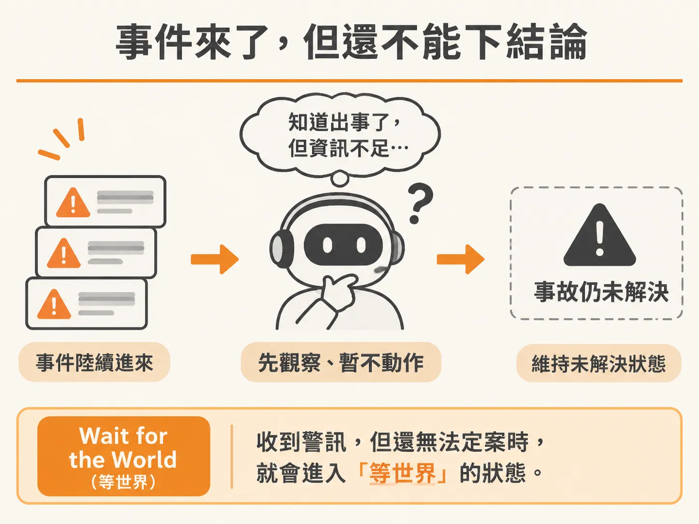
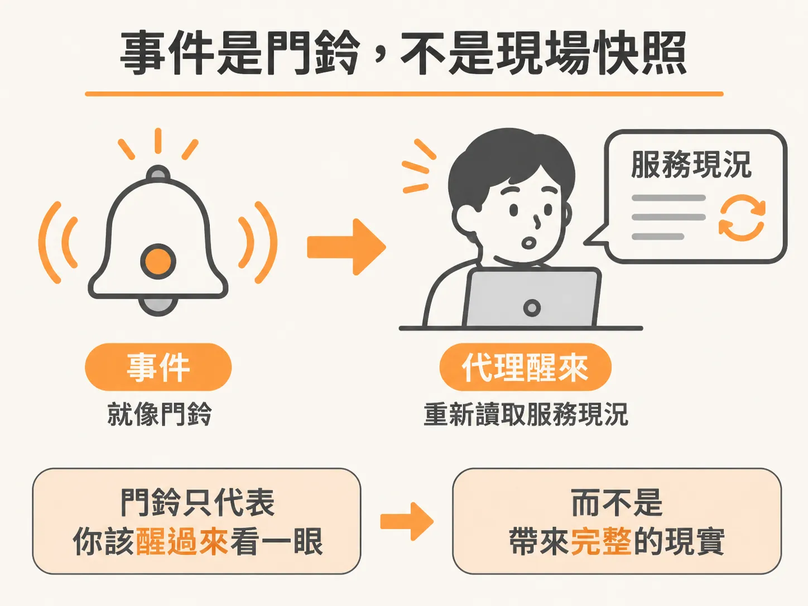
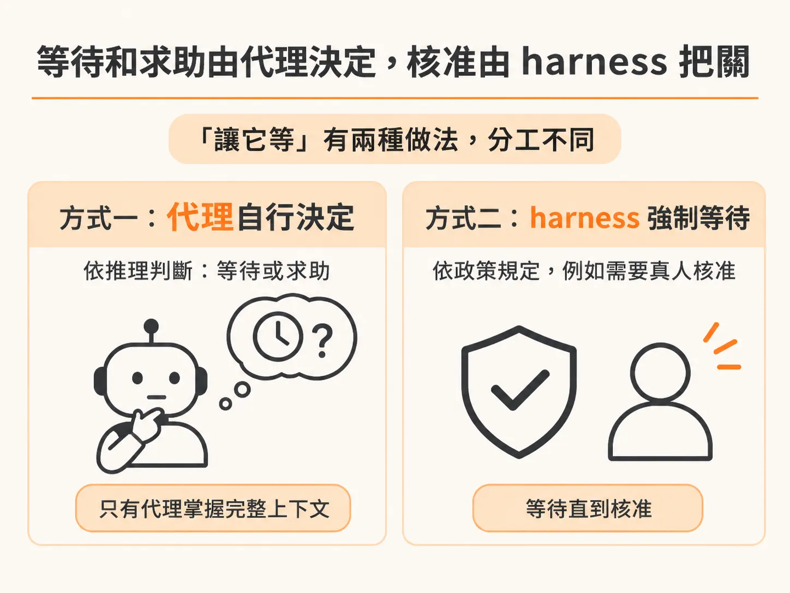
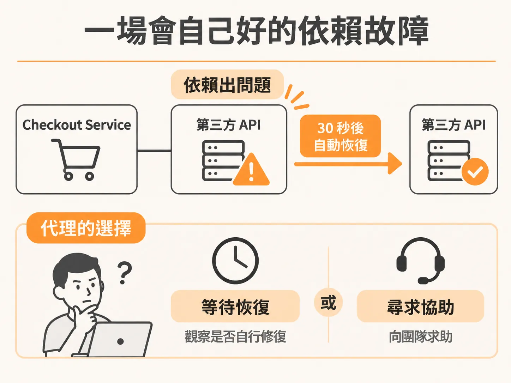

# 讓代理自己決定什麼時候等：Wait for the World

## 沒辦法立刻處理的狀況

想像你的代理正在值班，監控某個服務。事件陸續進來，代理知道出事了，但手邊資訊不足，還沒辦法繼續查下去。這種「先收到警訊、但還無法定案」的狀態，就叫做「Wait for the World（等世界）」，產出結果是一個尚未解決的 incident（事故）。

具體會長什麼樣？舉幾個例子：

- 「我看到一些錯誤進來了，但目前看起來不嚴重，我再等一下，看會不會有更多訊息。」
- 「這個錯誤我以前看過，可以先忽略；但如果五分鐘內又看到另一個錯誤一起進來，那就是大事了。」

你可以給代理任意一套這樣的判斷策略，重點是，這些策略是「先觀察、再行動」，而不是看到事件就衝。

這邊還沒給代理 runbook（標準處理手冊）這類脈絡，也沒教它遇到某種狀況該怎麼處理。它現在是靠模型自己的智能在做判斷。要把系統建得更完整，可以準備不同的 runbook 當作上下文供給它，甚至把某些 runbook 直接寫成 workflow，讓它更清楚「先看到這個錯、再看到那個錯」的時候該怎麼辦。

但不管有沒有 runbook，現實中很多情境都是這樣：代理（甚至人類值班的人員）會說，「好，我確認收到這個降級事件、這個警報了，但在拿到更多資訊、或看到另一件事發生之前，我先不動作，只掛著看。」harness 也要能做到這件事，所以這就是要加的能力。

## 世界不會等代理跑完迴圈

處理背景代理時，有一個重要的事實：世界不會等代理跑完一圈才繼續。連環事件不會乖乖排隊：依賴的服務可能在代理閒置時自己恢復；幾個不同的警報，有可能其實描述的是同一場 outage（服務中斷）。

所以你可以把每個事件想成「門鈴」，而不是「房間本身」。門鈴響了，只代表你該醒過來看一眼，它不是全部的現實。

用結帳系統來說明整個流程：checkout process 發出一個訊號，API 持久化這個事件並把它歸到當前的事故底下，代理醒來、然後重新去讀 checkout process 的現況。注意：代理不會把事件 payload 當成一份完整的快照照單全收。它只是一個事件，不是事情的全貌。

代理醒了、看了，如果沒有完整的圖像，就會說：「這裡沒有我能做的事，我需要看到更多。」然後回去睡，繼續觀察局勢。

要做的，就是把「選擇等待」這個能力交給模型，就像你自己也會選擇等待、想看看後續發展一樣。讓模型也擁有這份自由。

## 等待和求助屬於代理，核准屬於 harness

不過「讓它等」有兩種截然不同的做法，必須分清楚。

**有一種等待，是 harness 強制代理等的。** harness 的某些功能就會做這件事：比如需要真人核准的時候，harness 會直接把代理攔下來。這是政策，可以確定性地執行——只要政策裡寫了「這一步需要 approval」，harness 就能照規則讓它等。這沒問題。

**但另一種等待，只能由代理自己決定。** 因為代理推理出來的結論，可能就是「我需要等」。而這件事沒辦法由 harness 確定性地判斷——harness 沒有讀那些日誌、沒有做那些工具呼叫，只有代理做過。不可能寫出一條針對「還不存在的資料」的政策。資料還沒發生，政策就無從寫起，所以只有代理自己能判斷這種情況。同樣的道理也適用於「求助」：只有代理掌握了完整的上下文，所以只有它能說出「我需要幫忙」。

所以區分標準很簡單：**讓代理說「我需要幫忙」或「我要等一下」，這些都是非破壞性的動作**，它們不會改壞任何東西，所以放心把這些工具交給代理沒問題。**但絕對不能把「決定要不要請求核准」的自由交給代理**——這種決定必須留在 harness 層級處理。

這條界線，就是整件事的核心。

## 測試場景：一次可自行恢復的依賴故障

那麼怎麼驗證這件事？測試計畫是這樣的：讓 checkout service 再出一次故障，但這次是**依賴型故障**——也就是說，出問題的不是 checkout service 本身，而是它依賴的東西。而且這個故障會在三十秒後自己恢復。

不過先不急著跑，把 harness 建好再說。

目標很明確：希望代理做出「等」或「求助」的決定，因為它真的還不知道該怎麼辦、沒有足夠的資訊可以採取行動。它應該走到一個「我沒辦法做出明確動作」的路口，然後說：「我想我該在這裡求助」，或者「我想我該等一下，看看會怎樣」。能不能真的觸發這種行為，到時候見真章。

為什麼這個測試場景特別適合？因為整個故障的來源是：checkout server 之所以崩潰，是因為它去呼叫一個正在崩潰的第三方 API。代理看到這種情況，很可能會想等它自己恢復——畢竟那不是自己能改的東西。

這時代理面前有幾條路：

- **該找人幫忙嗎？** 它可能想：「這是第三方依賴，我什麼都做不了，也許該請人來處理。」
- **還是單純等恢復？** 錯誤訊息可能帶有 throttle 標頭。如果你了解 API 的限流機制是怎麼運作的：它像一個隊列，你在一定時間內打了太多次，就會被限流；過一陣子再打，又能通了。這種時候，「等」就是唯一該做的事——等到第三方依賴的限流自己解除。

類似的情境還有很多很多。代理在很多時候合理的反應就是：「我想，我可能先等一等。」要做的，就是不要用 harness 強制它做別的選擇。

下一步就是把這三條暫停路徑寫進迴圈，再看「等」本身要怎麼實作。
