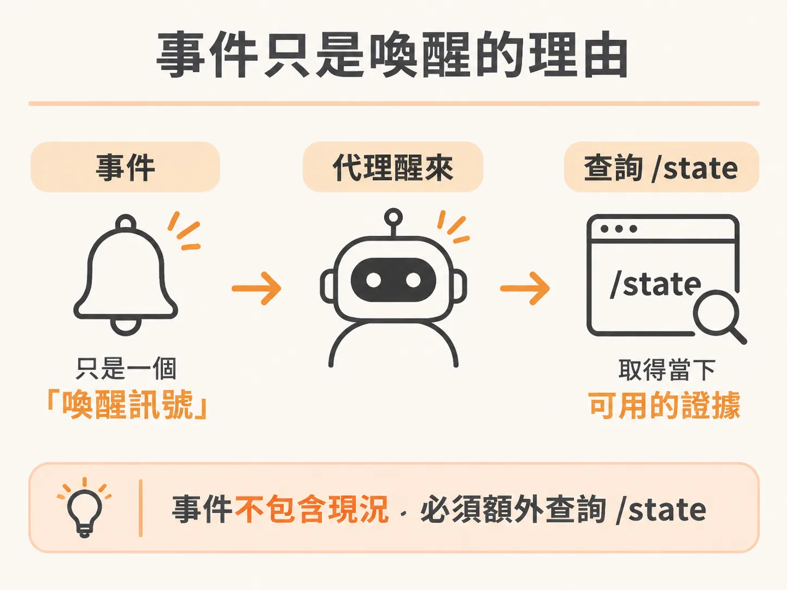
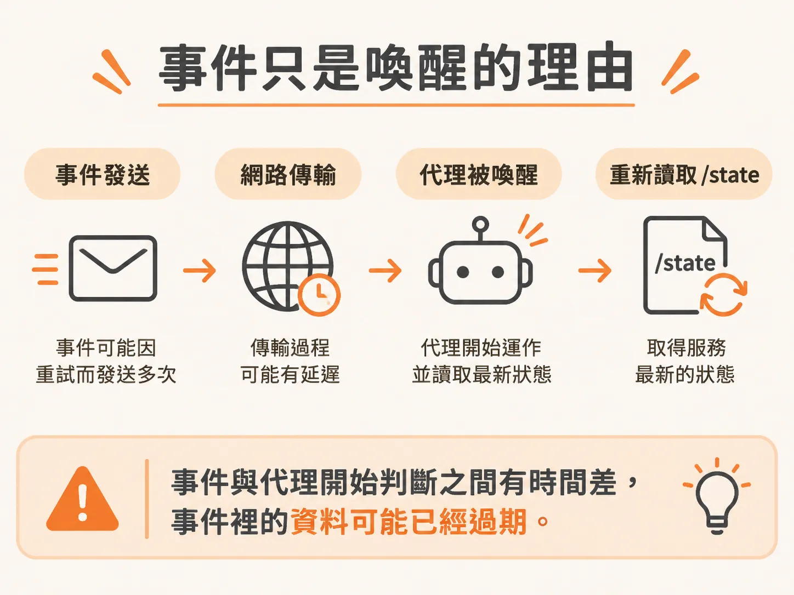

# 事件只是喚醒的理由

前一個節點把工具、決策上限與完成判定收進 harness，但 harness 要判斷，得先有可信的世界狀態。在自動化維運架構中，當系統發生異常，服務通常會主動推送警報或事件給代理（Agent）。這時很容易產生一個直覺的誤解：既然事件封包裡面已經帶有錯誤類型與當下的資料，代理是不是只要讀取事件內容，就能直接判斷問題並執行對應的處置？

答案是否定的。在健全的架構設計中，事件並不是完整的現況報告，它純粹只是一個「喚醒訊號」。



以結帳服務為例，當服務內部偵測到異常時，會將事件記錄下來並持續重試發送，直到維運系統確認收到為止：

<!-- source: sources/background-agent/20261105/service/checkout.ts#L73-L99 -->

```typescript
async function deliverEvents() {
  if (delivering) return
  delivering = true
  try {
    for (const event of pendingEvents.values()) {
      try {
        const response = await fetch('http://127.0.0.1:3001/api/service/events', {
          method: 'POST',
          headers: { 'Content-Type': 'application/json' },
          body: JSON.stringify(event),
        })
        if (response.ok) pendingEvents.delete(event.id)
        else console.warn(`Event ${event.id} delivery returned ${response.status}; retrying`)
      } catch {
        /* The operator API may not be up yet. Keep the same event ID for retry. */
      }
    }
  } finally {
    delivering = false
  }
}

function emit(type: string, data: Record<string, unknown>) {
  const event = { id: randomUUID(), serviceId: 'checkout', instanceId, type, data }
  pendingEvents.set(event.id, event)
  void deliverEvents()
}
```

發送的事件內容包含固定的事件編號（`id`）、服務名稱（`serviceId`）、執行個體編號（`instanceId`）、事件類型與夾帶資料。維運 API 收到之後會把事件持久化儲存，並為該服務執行個體開啟或喚醒一個調查流程（Run）。隨後抵達的相關警報，也會加入同一個流程中。

然而，代理被這個事件「喚醒」之後，不能只依據事件裡的資料做決定。因為事件發送可能經過重試，網路傳輸也可能有延遲；當代理真正開始運作時，服務的狀態可能已經改變，甚至可能早已被其他操作修復或重啟。



因此，代理醒來之後的第一件事，是主動透過 HTTP 回頭向服務查詢最新的即時狀態：

<!-- source: sources/background-agent/20261105/service/checkout.ts#L116-L121 -->

```typescript
app.get('/health', (_request, response) =>
  response.json({ ok: true, instanceId, fault, pendingEvents: pendingEvents.size }),
)
app.get('/state', (_request, response) => response.json({ instanceId, version, state }))
app.get('/logs', (_request, response) => response.json({ logs: logs.slice(-20) }))
app.get('/changes', (_request, response) => response.json({ changes: changes.slice(-20) }))
app.post('/operations', (request, response) => {
  const input = z
    .object({
      actionId: z.string().min(1),
      name: z.enum(['inspect_logs', 'inspect_changes', 'disable_feature', 'rollback_release']),
      expectedVersion: z.number().int().optional(),
    })
    .parse(request.body)
```

在服務提供的端點中，`/state` 曝露了目前記憶體中真正的狀態版本與內容。代理必須重新讀取 `/state`，拿到當下的最新證據，才能評估當前的真實情況並做出決策。

這也說明了為什麼服務一旦重啟，未完成的流程就會直接被作廢。因為結帳服務的狀態是保存在記憶體中，每一次重啟都會建立一個全新的執行個體與全新的狀態。上一任執行個體留下的舊觀察紀錄與待核准操作，不能直接套用在新實例上。

把事件當作「該起床看一眼」的理由，把 `/state` 當作「實際看到的證據」。分清楚這兩者的角色，代理才不會拿著過期的線索去修復已經改變的現場。
