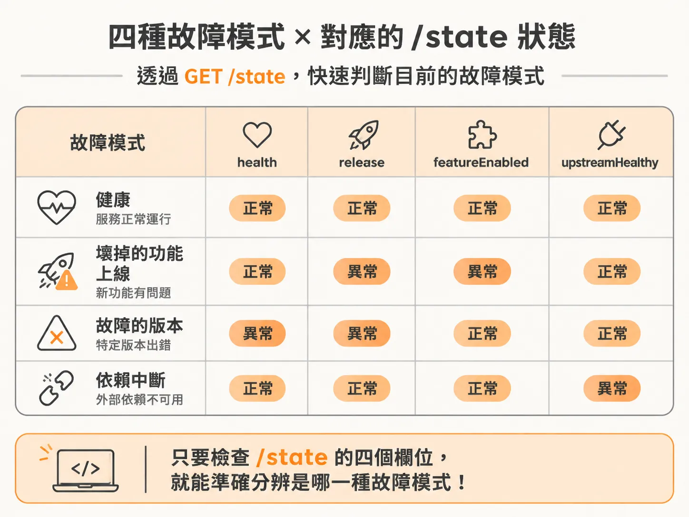
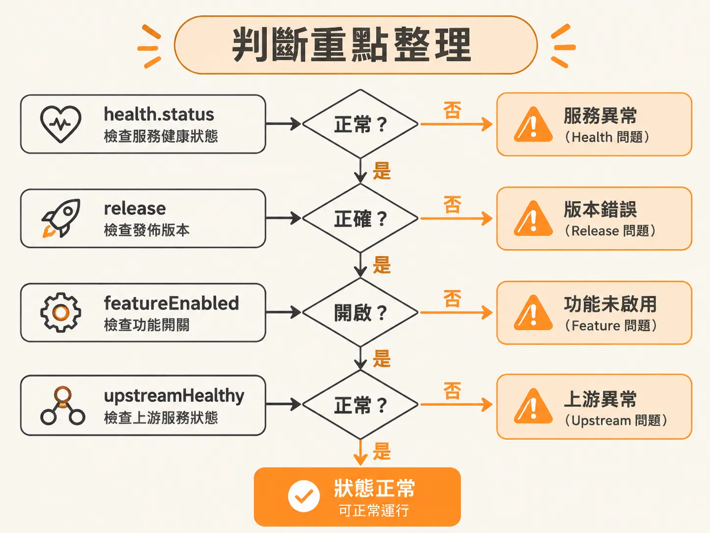

# 健康、壞掉的功能上線、故障的版本、依賴中斷

知道事件只是喚醒訊號之後，下一個問題是醒來到底要看什麼。當結帳服務（checkout service）發出警報時，運維 Agent 與維運人員並不知道服務啟動時帶了哪一個 `--fault` 參數。所有外部觀察都只能仰賴服務暴露的端點。呼叫 `GET /state` 會取得當前的狀態物件，透過當中的四個核心欄位，就能準確判斷出目前的故障模式。



結帳服務定義的狀態結構如下：

<!-- source: sources/background-agent/20261105/service/checkout.ts#L5-L12 -->

```typescript
type Fault = 'none' | 'feature' | 'release' | 'dependency'
type ServiceState = {
  service: 'checkout'
  health: { status: 'healthy' | 'degraded'; errorRate: number }
  release: string
  featureEnabled: boolean
  upstreamHealthy: boolean
}
```

每當服務以特定模式啟動時，它會在記憶體中根據該模式設定預設狀態：

<!-- source: sources/background-agent/20261105/service/checkout.ts#L36-L48 -->

```typescript
const instanceId = randomUUID()
let activeFault = fault
let version = 1
let state: ServiceState = {
  service: 'checkout',
  health: {
    status: fault === 'none' ? 'healthy' : 'degraded',
    errorRate: fault === 'none' ? 1 : 42,
  },
  release: fault === 'release' ? 'v2-bad' : 'v1-stable',
  featureEnabled: fault === 'feature',
  upstreamHealthy: fault !== 'dependency',
}
```

### 1. 健康狀態（Healthy，`fault: 'none'`）

在沒有故障的正常情況下：
- `health.status` 為 `'healthy'`，`health.errorRate` 為基準值 `1`。
- `release` 為正常版本 `'v1-stable'`。
- `featureEnabled` 為 `false`。
- `upstreamHealthy` 為 `true`。

此時日誌只會記錄一般資訊：

<!-- source: sources/background-agent/20261105/service/checkout.ts#L59-L64 -->

```typescript
const faultLog: Record<Fault, string> = {
  none: 'Checkout is operating normally',
  feature: 'Checkout express feature raised an error during payment confirmation',
  release: 'Checkout v2 request failures began after deployment',
  dependency: 'Payment gateway requests are timing out',
}
```

### 2. 壞掉的功能上線（Broken Feature Rollout，`fault: 'feature'`）

當啟動參數指定為功能故障時，問題來自於新啟用的功能旗標（feature flag）：
- `health.status` 變為 `'degraded'`，`errorRate` 飆升至 `42`。
- `release` 依然停留在原本穩定的 `'v1-stable'`。
- `featureEnabled` 變成 `true`。
- `upstreamHealthy` 仍為 `true`。

當 `featureEnabled` 為 `true` 且狀態降級時，代表系統部署的版本沒有更動，而是新功能開關引發了錯誤。

<!-- source: sources/background-agent/20261105/service/checkout.ts#L110-L112 -->

```typescript
recordLog(fault === 'none' ? 'info' : 'error', faultLog[fault])
if (fault === 'release') recordChange('Deployed checkout v2-bad')
if (fault === 'feature') recordChange('Enabled checkout express feature')
```

### 3. 故障的版本（Faulty Release，`fault: 'release'`）

如果問題出在新版本部署：
- `health.status` 為 `'degraded'`，`errorRate` 為 `42`。
- `release` 欄位變成 `'v2-bad'`。
- `featureEnabled` 為 `false`。
- `upstreamHealthy` 為 `true`。

只要看到 `release` 指向 `'v2-bad'`，就能直接確認是剛部署的程式碼版本有問題，而不是功能開關或外部依賴造成。

### 4. 依賴中斷（Dependency Outage，`fault: 'dependency'`）

當外部付款閘道等下游服務出現問題時：
- `health.status` 為 `'degraded'`，`errorRate` 為 `42`。
- `release` 仍然是穩定的 `'v1-stable'`。
- `featureEnabled` 為 `false`。
- `upstreamHealthy` 變成 `false`。

此時自身服務版本與功能設定都沒有異動，但因為上游或外部相依服務無法正常回應，導致結帳流程逾時失敗。

### 判斷重點整理

診斷時可以依序檢查以下欄位：



1. **先看 `health.status`**：若為 `'healthy'`，即為正常狀態。
2. **若為 `'degraded'`，檢查 `release`**：若為 `'v2-bad'`，即為故障版本。
3. **若版本仍為 `'v1-stable'`，檢查 `featureEnabled`**：若為 `true`，代表是壞掉的功能上線。
4. **若功能未啟用，檢查 `upstreamHealthy`**：若為 `false`，代表是外部依賴中斷。

在自動化監控與維運代理人的設計中，這類狀態常會對應為目標條件（goal condition），透過指定欄位路徑與預期值來檢查整體環境狀態：

<!-- source: sources/background-agent/20261105/shared/types.ts#L12-L13 -->

```typescript
export type WorldState = Record<string, unknown>
export type GoalCondition = { path: string; equals: string | number | boolean } | null
```
