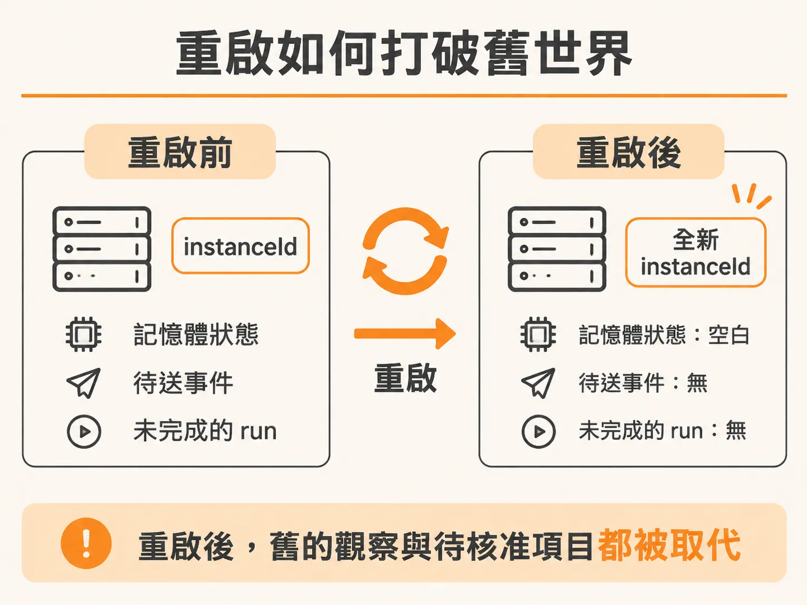
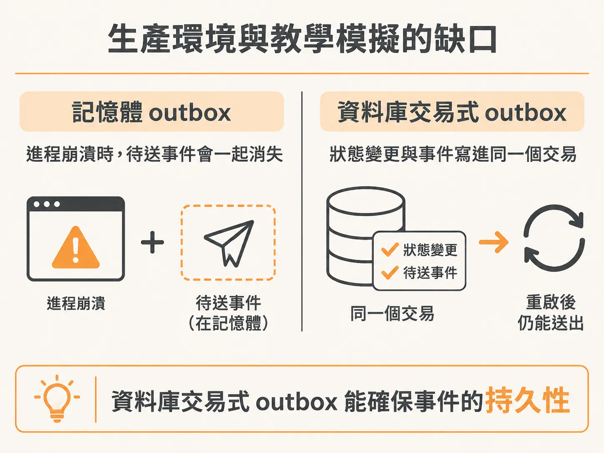

# 重啟就是把世界重設

前面談的版本防護，都建立在「還是同一個世界」這個前提上。在除錯或維運系統時，很多人把「重啟」當成一種無害的恢復手段：清掉暫存、重開連線，然後繼續原本的工作。但如果在架構設計上，服務的狀態完全沒有被外部儲存保存，那麼每次按下重啟，其實不是讓舊系統恢復運作，而是徹底抹除過去，換成一個全新的世界。

模擬服務 `checkout` 在每次啟動時，第一件事就是生成一個全新的識別碼：

<!-- source: sources/background-agent/20261105/service/checkout.ts#L36-L36 -->

```typescript
const instanceId = randomUUID()
```

這個 `instanceId` 代表了當前進程的生命週期邊界。隨之建立的所有狀態，也全都只存活在記憶體裡：

<!-- source: sources/background-agent/20261105/service/checkout.ts#L39-L57 -->

```typescript
let state: ServiceState = {
  service: 'checkout',
  health: {
    status: fault === 'none' ? 'healthy' : 'degraded',
    errorRate: fault === 'none' ? 1 : 42,
  },
  release: fault === 'release' ? 'v2-bad' : 'v1-stable',
  featureEnabled: fault === 'feature',
  upstreamHealthy: fault !== 'dependency',
}

const logs: Array<{ at: string; level: string; message: string }> = []
const changes: Array<{ at: string; message: string }> = []
const outcomes = new Map<string, { fingerprint: string; result: Record<string, unknown> }>()
const pendingEvents = new Map<
  string,
  { id: string; serviceId: string; instanceId: string; type: string; data: Record<string, unknown> }
>()
let delivering = false
```

不論是服務本身的健康度、錯誤率、變更紀錄，還是等待送出的事件隊列 `pendingEvents`，全都只是 JavaScript 執行環境中的變數。

### 記憶體中的事件發送機制

當服務遇到問題需要通報給維運代理（Agent）時，它會透過記憶體內的 outbox 機制派發事件：

<!-- source: sources/background-agent/20261105/service/checkout.ts#L73-L99 -->

```typescript
async function deliverEvents() {
  if (delivering) return
  delivering = true
  try {
    for (const event of pendingEvents.values()) {
      try {
        const response = await fetch('http://127.0.0.1:3001/api/service/events', {
          method: 'POST',
          headers: { 'Content-Type': 'application/json' },
          body: JSON.stringify(event),
        })
        if (response.ok) pendingEvents.delete(event.id)
        else console.warn(`Event ${event.id} delivery returned ${response.status}; retrying`)
      } catch {
        /* The operator API may not be up yet. Keep the same event ID for retry. */
      }
    }
  } finally {
    delivering = false
  }
}

function emit(type: string, data: Record<string, unknown>) {
  const event = { id: randomUUID(), serviceId: 'checkout', instanceId, type, data }
  pendingEvents.set(event.id, event)
  void deliverEvents()
}
```

這段邏輯在進程還活著的時候相當穩定：每個事件都有固定不變的 `event ID`，只要 Operator API 還沒回應或暫時無法連線，服務就會把事件留在 `pendingEvents` 內重複嘗試。接收端的 Operator API 即使收到重複投遞的相同 ID，也不會重複開立事件單（incident）。

但是，這種「可靠」僅限於進程存活期間。

### 重啟如何打破舊世界

一旦 `checkout` 服務重啟，所有還沒發送成功的 `pendingEvents` 就會立刻蒸發。更關鍵的是，新啟動的進程拿到了全新的 `instanceId`。



對於負責監控與修復的 Agent 來說，事件只是一個喚醒它的訊號。Agent 被喚醒後，會主動發送 HTTP 請求讀取 `/state` 來確認當前證據，並針對該服務實例維護一個 active run。如果此時服務發生重啟，前一個實例留下來未完成的 run、舊的觀測數據，以及等待人工核准的審批項目（pending approvals），都會直接被新實例取代（superseded）。

舊世界裡的觀察與審查，不能直接套用在新世界裡，因為新進程已經是從零開始的乾淨狀態。

### 生產環境與教學模擬的缺口

這種將所有狀態和事件 outbox 放在記憶體裡的作法，能夠清楚呈現「實例邊界」（instance boundary），讓人一眼看出進程生命週期對維運流程的影響。

然而，在生產環境中，這種做法無法提供資料持久性（durability）：



1. **缺少事務性 Outbox（Transactional Outbox）**：真實的生產服務在變更業務狀態時，必須把對應的事件與狀態變更包在同一個資料庫交易（transaction）中寫入硬碟。否則只要伺服器斷電或崩潰，未送出的事件就會永久遺失，造成監控與稽核斷層。
2. **缺少身分驗證**：模擬環境中事件是直接往本機未授權的端點傳送；真實系統之間的事件傳遞與狀態查詢，都必須依賴嚴格的身分驗證機制（authenticated calls）。

把世界重設只適合在沙盒中驗證邏輯。面對真正的線上系統，服務重啟不能成為狀態遺失的藉口，狀態變更與事件交付必須具備可靠的持久化保障。
