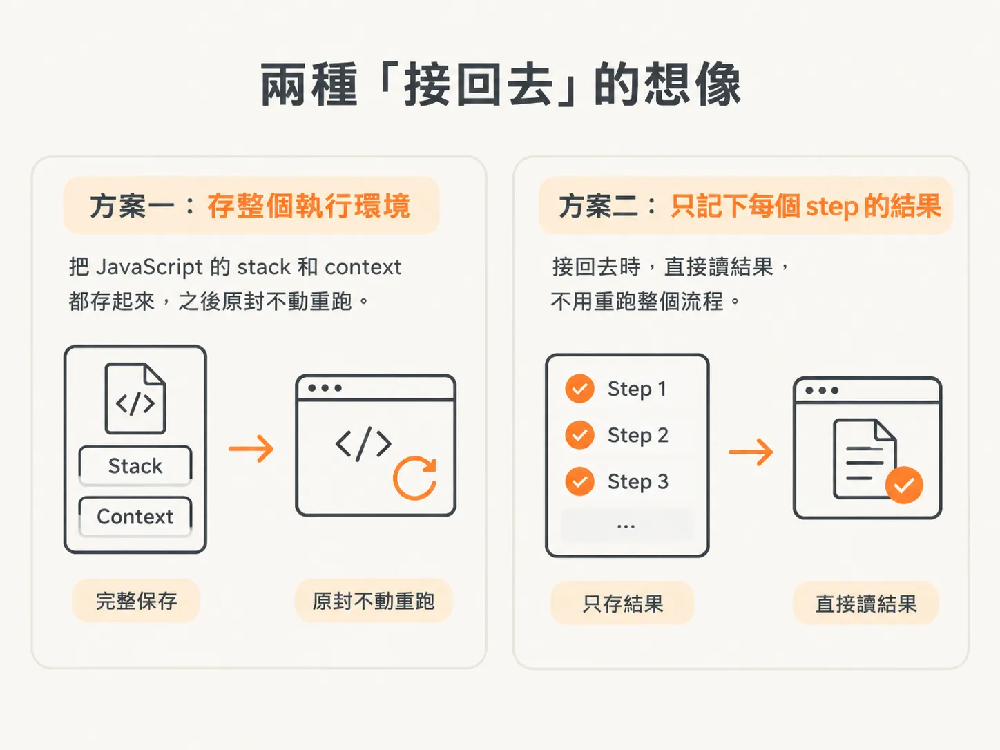
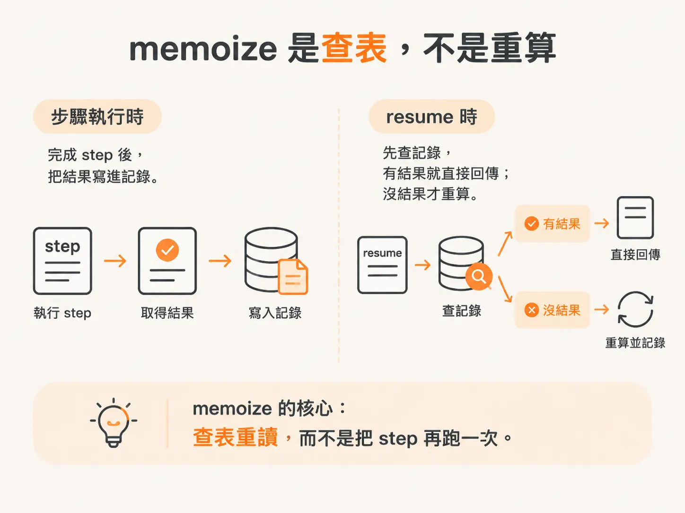
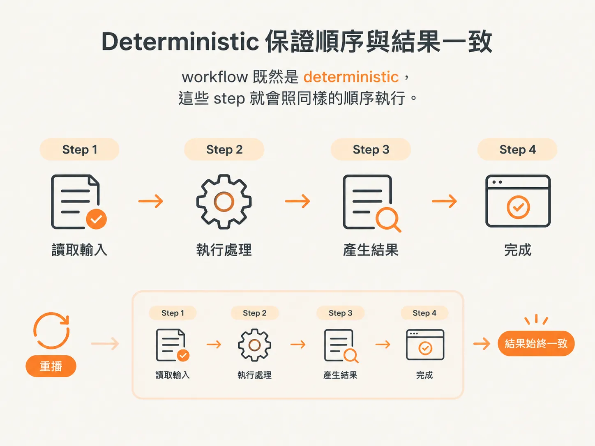

# resume 的真相：memoize 結果，不是重播 JS stack

上一篇把 loop 拆成 step，為的就是斷掉之後能接回來。接下來要問的是：那個「接回來」實際上怎麼運作？

你寫了多年 JavaScript，第一次聽到「resume」時，腦中大概會浮現這個畫面：

runtime 把執行到一半的 stack、變數和 context 全部存起來，之後再原封不動地接著跑。

這樣想很合理，因為在 JavaScript 裡，這是最直覺的「接回去」方式。

但 durable execution 裡的 resume 不是這個意思，沒有那麼深，也沒有那麼複雜。

真正的做法字面上就是這樣：每一個 step 都會被 memoized。

memoize 就是先把某個 function 的結果記下來。下次遇到相同的輸入，直接回傳記下來的結果，不必重算。

在這裡，每個 step 執行完，系統就記下它的結果。之後再遇到同一個 step，有記錄就直接用，不用再跑一次。

就這樣。

那麼，「重播」為什麼可靠？

關鍵在於 workflow 必須是 deterministic（具確定性）：同樣的輸入永遠得到同樣的輸出，不會因為當下的時間、亂數，或某個會變動的狀態而改變。

workflow 既然是 deterministic，這些 step 就會照同樣的順序執行。

所以，帶著幾個已經完成的 step 去重播，最後拿到的還是同一個結果。重播幾次都一樣。

這也是 workflow 必須 deterministic 的原因：它不能建立在會動態變化的東西上。

說到底，這跟 JavaScript 的 stack 無關，也不是 runtime 在背後玩了什麼花樣。

它做的事很單純：把每個 function 的結果 memoize 起來，再依序重播。
