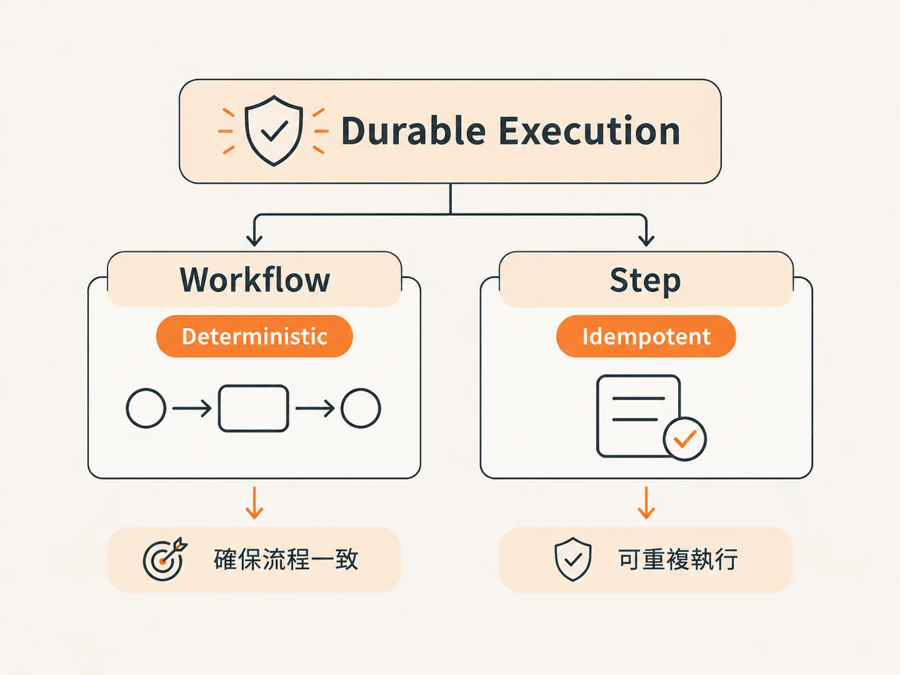
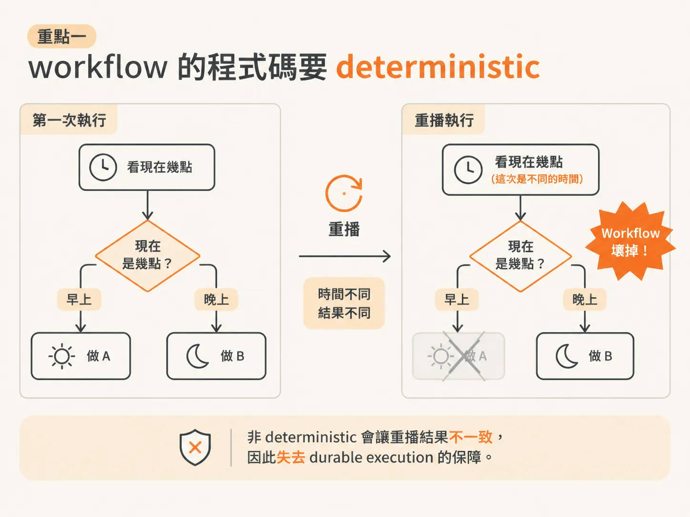
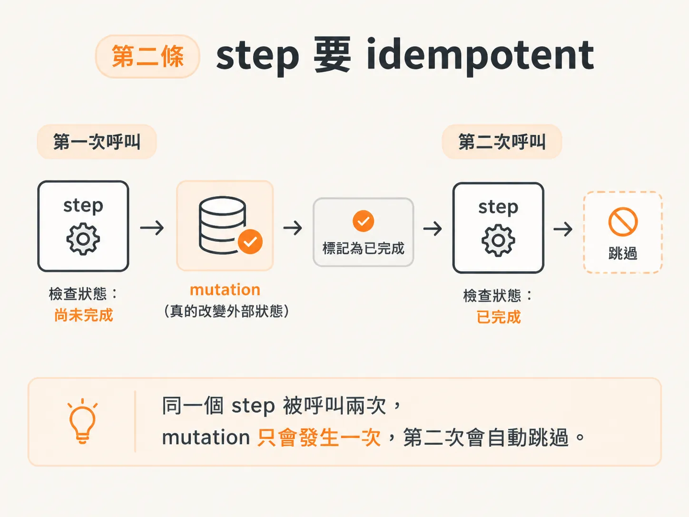
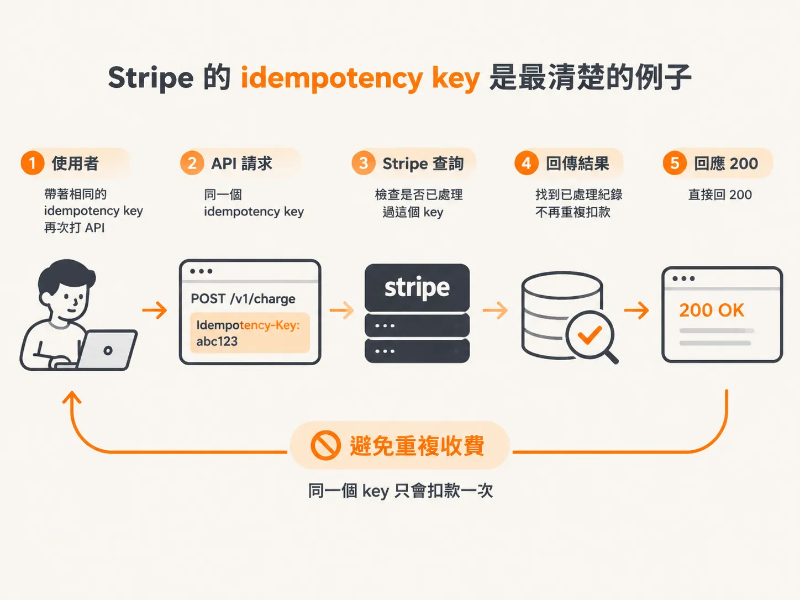

# 兩條規則：workflow deterministic、step idempotent

上一篇講到，resume 就是重讀 memoize 的結果，而它的前提是 workflow 每次跑都一樣。把這個前提變成可以照著做的規則，就是這一篇的兩條。

在 durable execution 這一層動手時，你大概會把邏輯拆成兩層：**workflow** 和 **step**。

拆完之後剩下兩條規則：一條管 workflow，一條管 step。

## 第一條：workflow 的程式碼要 deterministic

Workflow 的程式碼，指的是 `createFunction` 裡面所有**不在 step 裡**的部分，這些都必須 deterministic。

Deterministic 的意思是：**同樣的輸入，不管執行幾次，都會得到一樣的結果。**

反過來說，這一層不能出現「現在幾點，就做某件事」這種邏輯。

因為每次執行時的當下時間都可能不同，這種寫法就不 deterministic；等到重播（replay），結果可能完全不一樣，整個 workflow 就壞了，durable execution 給的那層保障也跟著沒了。

Inngest 這類工具甚至會幫你檢查。寫了不 deterministic 的東西，系統可能直接報錯。

同樣的道理，你也不能在 workflow 這一層隨機抽兩次：這樣一來，你永遠沒辦法重跑 workflow 還拿到和上次一樣的結果，所以這種寫法通常不被允許。

## 第二條：step 要 idempotent

Step 這邊反過來，要 idempotent，也就是**冪等性**。

白話一點：假設某個 step 要做一次 mutation（真的去改外部狀態，例如寫資料庫或送訊息），那就算它被呼叫兩次，也不該真的執行兩次 mutation。

它應該知道這件事已經做過，第二次被呼叫時就跳過。

## Stripe 的 idempotency key 是最清楚的例子

你在 Stripe 建立一筆購買、呼叫它的 API 時，Stripe 會回傳一個 idempotency key。下次你可以帶著同一個 key 再呼叫一次，Stripe 就會去查：

「這個請求我們已經做過了，不會再做第二次。」

然後直接回 200。

所以這次呼叫仍然成功，只是 mutation 不會再發生一次。你總不會希望因為 server 重播了某個操作，或不小心多呼叫一次，就向同一個人收兩次錢。

所以 step 多少要有一點 idempotent，重播時才不會讓同一個 mutation 再跑一遍。

## 換一個工具，這套規則也一樣

這套規則不只適用於 Inngest。

如果你用 Temporal，概念完全一樣，只是它把 step 叫 activities。Vercel 那邊則是用 decorator，例如 `use workflow` 這種寫法。

名稱不同，本質上是同一件事：有一個 workflow，裡面再拆成一個個 step。

作者大概用過十種這類工具，做的事都差不多：

- workflow 必須 deterministic。
- step 應該具備 idempotent。
- 其他規則大同小異，只是語法和實作方式換了。

所以別被特定工具的語法綁住，這套觀念換到哪種架構上都成立。Cloudflare 也有類似的方案，做得還不錯。
