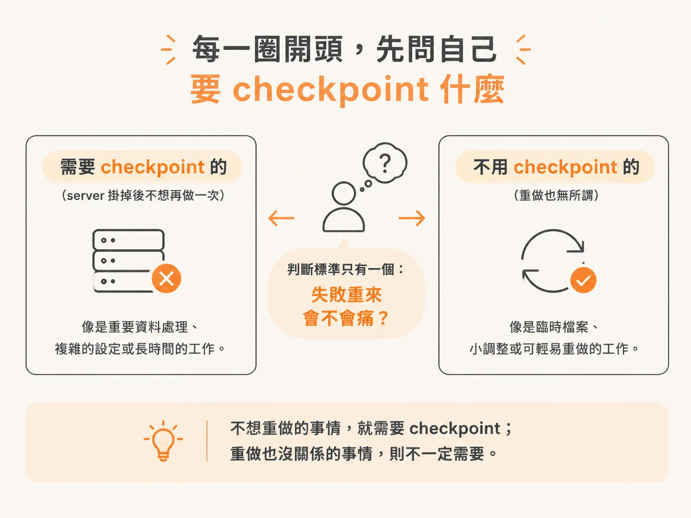
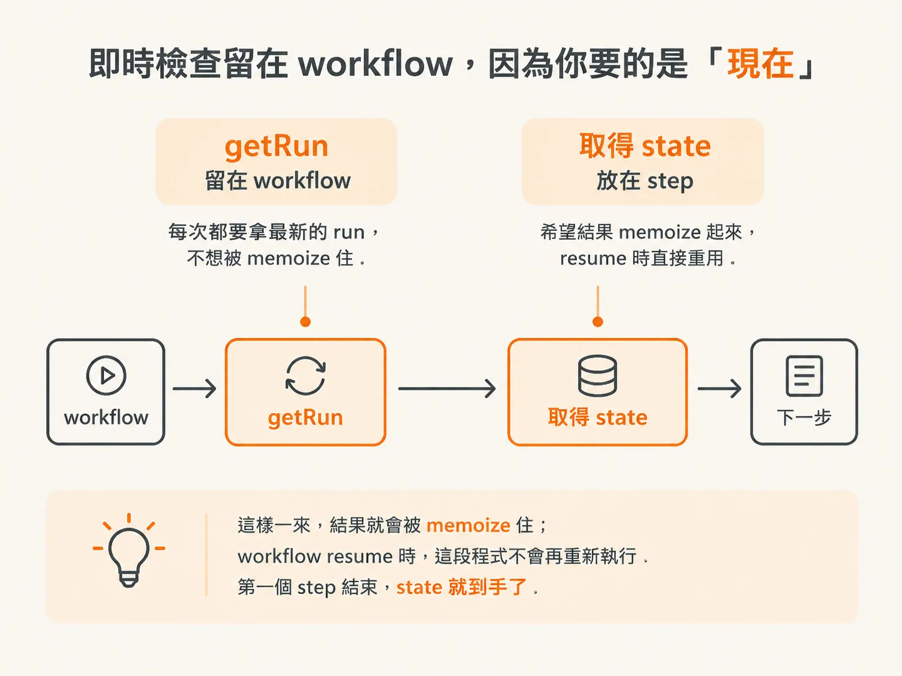
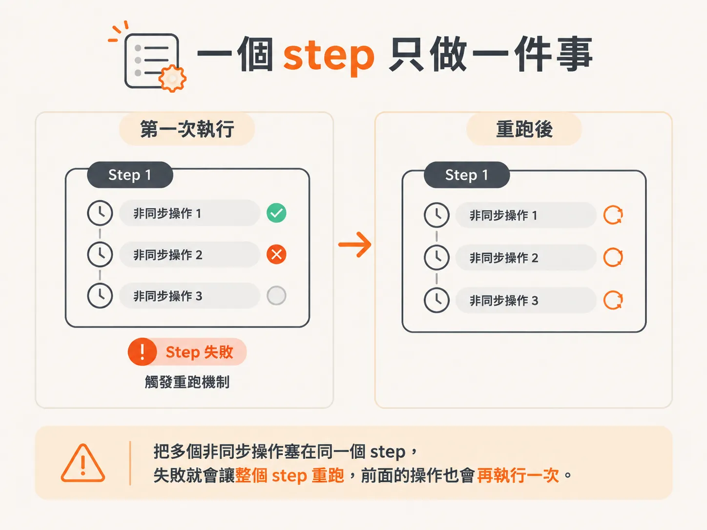

# 哪些該進 step、哪些留在 workflow：單一職責

前幾篇你已經知道：把 loop 拆成一個個 step，失敗時就不必整段重做；而 resume 的做法，是把 step 的結果 memoize（記下來重複使用），之後重新讀取，而不是重播整段 JavaScript stack。

現在的問題是：到底哪些事情該放進 step？

手上有一堆非同步操作，總不能全部塞在一起。這篇要談的，就是該怎麼畫出這條界線。

## 每一圈開頭，先問自己要 checkpoint 什麼

有了 loop 之後，每一圈開始時，我們要先問：哪些事情需要被 checkpoint？

問題可以這樣問：

**如果 server 掛掉，哪些事情是我不想再做一次的？**

不想重做的事情，就需要 checkpoint；重做也沒關係的事情，則不一定需要。



## 即時檢查留在 workflow，因為你要的是「現在」

先看取得目前的 run：

<!-- derived -->
```js
await getRun(...)
```

你可能會覺得這件事應該放進 step，但我刻意不這麼做。原因是我不想要它被 memoized。我希望每次拿到的都是最新 run，而不是讀取快取。

我想知道的是「今天的 run 長什麼樣子」。在這個情境和這段程式碼裡，實際差異可能不大，但既然我不希望結果被快取，就把它留在 workflow 裡。

接著，每一圈都要再檢查一次：目前的 run 是不是已經停在某個終止狀態？如果是，就直接 `return`。只要 run 已經結束，我連下一步都不想繼續做。

第一次進入 workflow 時，這個判斷一定是 `false`，不可能觸發。因為如果一開始就是終止狀態，前面的檢查早就會先攔下來。

但 agent 做完一個動作、發生某件事之後，run 的狀態可能變成 `completed`。因此，下一圈開始時就必須再次檢查。

如果沒有這段程式，我們只會在 run 剛開始時檢查一次，後面就不再理會狀態。可是我們想要的是每一輪都檢查，所以要把它放在每一圈的開頭。

## 取得 state，是第一個 step

接下來要檢查 goal 是否達成，但先等等：我們還沒取得 state。

<!-- derived -->
```js
const state = ...
```

這會是我們的第一個 step。取得 state 這件事，我希望它的結果被 memoize 住：既然拿過了，就留著不要再跑一次。

因此，我們使用 `step.run`，把這個 step 命名為 `observe-state`，並帶上目前的 cycle。這樣之後在 Inngest 或其他工具裡查看時，就能知道這是「第幾圈觀察到的 state」。

callback 本身很簡單，只要回傳 `agentState` function，並傳入 `environmentId` 和 `runId`。

這樣一來，結果就會被 memoize 住；workflow resume 時，這段程式不會再重新執行。第一個 step 結束，state 就到手了。



## 哪些東西該進 step

接著要檢查 goal 是否達成。這個檢查我不放進 step，因為我希望每一圈都重新檢查，不想讓它被快取；否則檢查可能只會執行一次，之後就不再更新。

這裡有個大原則：大部分非同步操作都會放進 step，只有少數例外。

像 `getRun` 其實也可以放進 step，但我認為放不放，結果可能沒有太大差異，所以兩種方式都可以。

不過，像剛才的取得 state，結果可能隨著 cycle 改變，因此我會把它放進 step。

所以，只要是非同步操作，我大多會放進 step；而且一個 step 通常只做一件事，不要把太多事情塞在一起。

## 一個 step 只做一件事

當然也有例外。你可以在一個 step 裡放多個非同步操作，但前提是：其中任何一個失敗時，整個 step 重跑、所有操作重新執行，你都能接受。

反過來說，如果你在同一個 step 裡做了 38 個非同步操作，第 2 個失敗了，但你不希望第 1 個再跑一次——因為它可能會產生副作用——那第 1 個操作就應該有自己的 step。

不要把這些操作全部塞在同一個 step 裡：只要 step 失敗、retry policy 觸發重跑，第一個非同步操作也會跟著再跑一次。



所以我的結論是：把非同步操作放進 step，而且讓每個 step 維持單一職責，只做一件事。

只有在這些非同步操作彼此有關，而且即使全部重跑也無所謂時，才適合把它們放在同一個 step 裡。

這就是我的判斷方式。之後再依照應用程式的需求，決定哪些事情要拆開，哪些可以合併。
