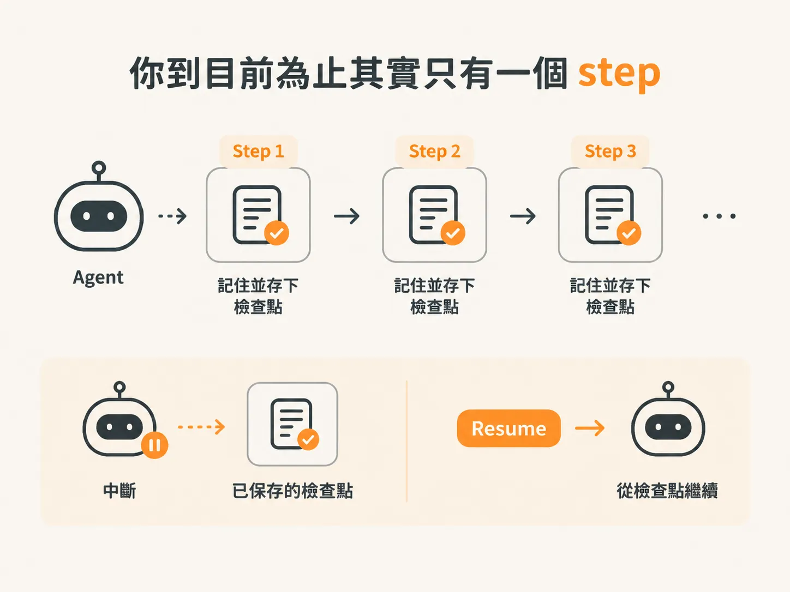
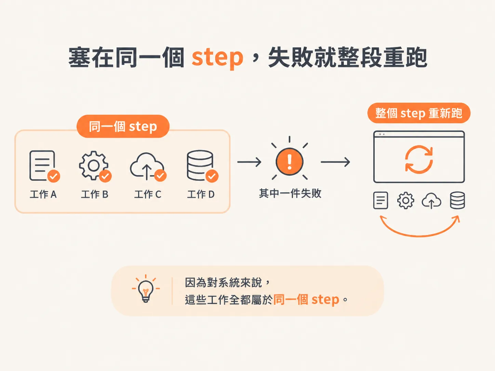
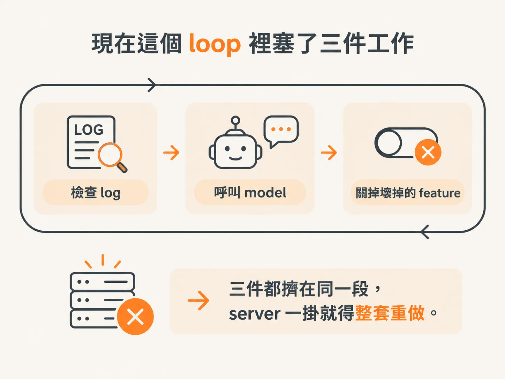
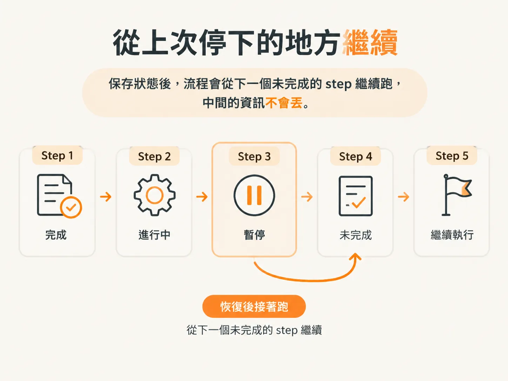

# 為什麼要把 loop 拆成 step：一個失敗不能整段重做

你的 agent 到目前為止，其實只有一個 step。

你大概不會特別注意到這件事，因為它跑起來就像一條連續的 loop：看到狀況、呼叫 model、採取行動，一輪接一輪。

但只要開始想「它掛掉之後要怎麼接回來」，就會碰到一個問題：你只有一個 step。

## 你到目前為止其實只有一個 step

每一個 step，都是 agent 擁有 durable 能力的地方。

這裡的「durable」是說：流程中斷了，做完的部分也不會丟掉，之後還能接著跑。

step 會被 memoized，也就是記住、存下來。所以流程能從中斷的地方 resume，不必每次都從頭開始。

所以 step 不只是把程式碼分成幾段，它更像是 agent 能安全停下來、之後再接回去的檢查點。

## 塞在同一個 step，失敗就整段重跑

麻煩的地方是，所有工作塞在同一個 step 裡，只要需要重做或恢復其中一件事，整個 step 就得重跑一次。

因為對系統來說，這些工作全都屬於同一個 step。

這就是為什麼要把流程拆開：某個地方失敗時，前面已經完成的工作才不會被迫全部重來。

## 現在這個 loop 裡塞了三件工作

目前 agent 的 loop 裡放著 goal，所有工作也都在裡面完成：

1. inspect logs，也就是去看 log。
2. 呼叫 model。
3. 把壞掉的 feature 關掉。

這三件事（看 log、問 model、關掉 feature）全都綁在同一段流程裡。

假設 server 在這個 step 做完之前就掛掉，要恢復時就得把整套工作重做一遍。

這不是我們想要的結果。

## 拆成各自的 step，從上次停下的地方繼續

做法是把這些工作拆成各自獨立的單位，也就是一個一個的 step。

這樣一來，不管是 outage，還是基礎設施出問題需要 resume，我們都能直接回到上次停下的地方，讓 workflow 從下一個還沒完成的 step 繼續跑。

而且 state 存下來之後，流程可以接著跑，一點資訊都不會丟，就像它從來沒失敗過一樣。

像 Inngest 這樣的工具，就是為了讓這件事變簡單。
