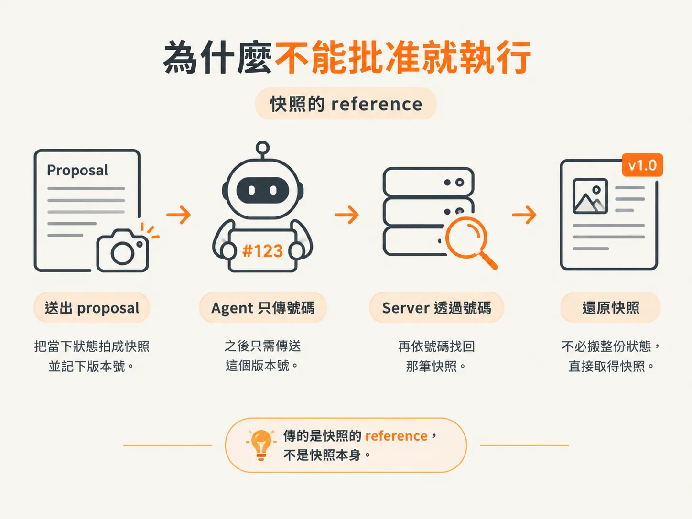
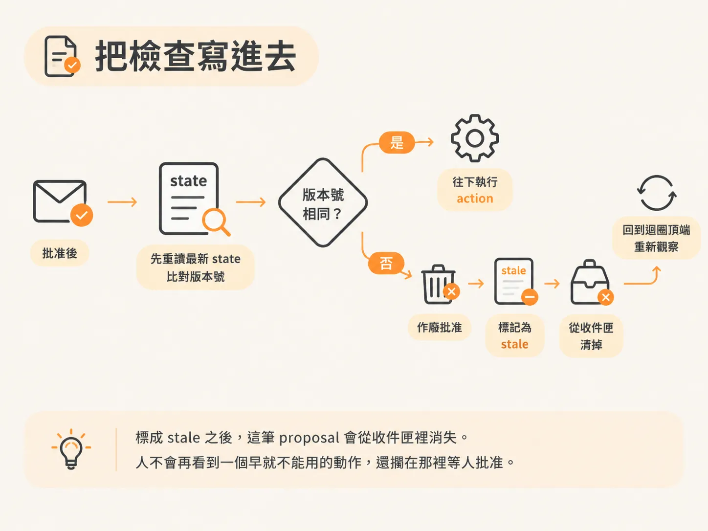
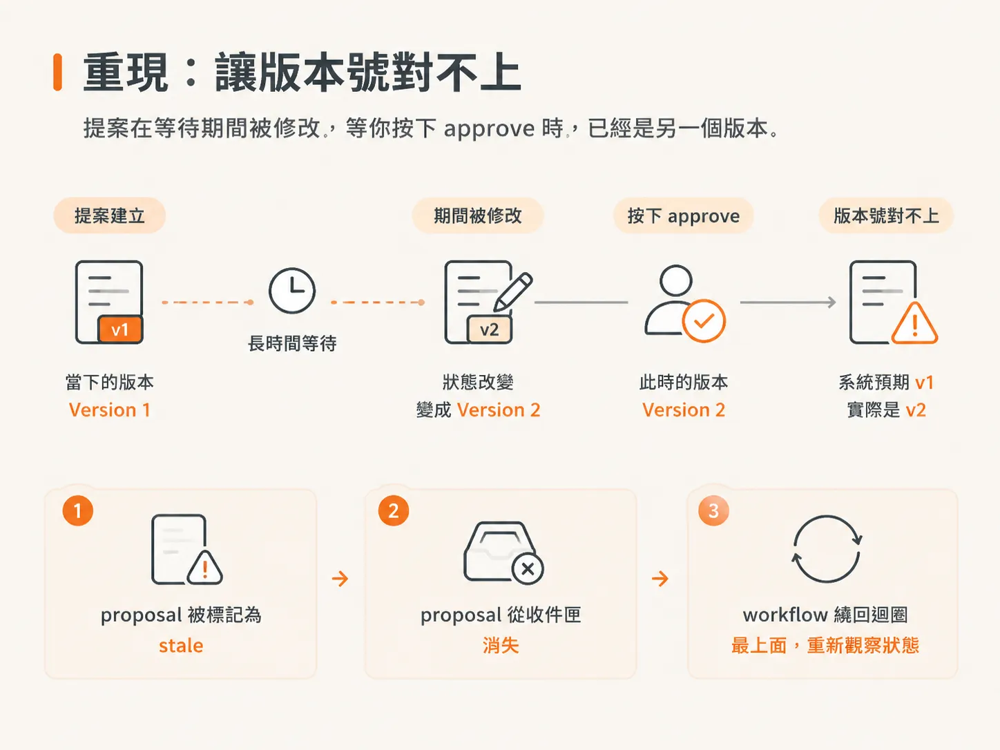
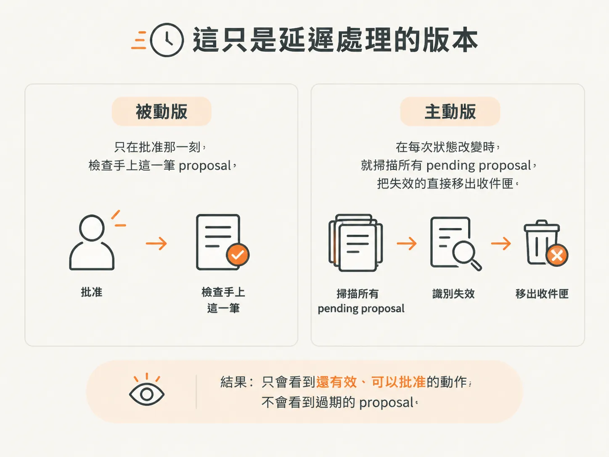

# 弄壞它：批准期間 state 漂移 → stale proposal

上一步，你已經把 approval request 寫進資料庫。人從收件匣按下批准，workflow 就會醒來。最直覺的寫法是：醒來、讀到 approved、執行那筆 action，收工。

這一節要把這個直覺弄壞。

因為 approval 是非同步的。送出 proposal 的當下，狀態可能是 ABC；等人真的按下按鈕，三個禮拜已經過去，狀態早就變成 XYZ。

那份「當初看起來很合理的下一步」，現在可能已經不是該做的事。照著三個禮拜前的判斷硬跑，結果可能完全不一樣。

## 為什麼不能批准就執行

用轉帳最容易看出問題。

提案送出的時候，帳戶裡的錢綽綽有餘；等你終於批准，餘額可能已經不夠了。如果執行前不重新查餘額，就等於直接透支。

rollback 這類 action 也一樣。所以流程不能是「approved 就直接往下跑」，中間要多一道檢查：

> 真正執行之前，狀態還是不是原本那個？

這道檢查要拿什麼來比？直接比對完整狀態太重，所以在送出提案時，先把手上的狀態拍成快照存進資料庫。等真的要執行時，再比對「現在」和「當初」是不是同一個。

在這個假 server 裡，每次狀態改變都會在資料庫記下一筆 snapshot，配上一個新的 version。所以 agent 不用把整份 snapshot 傳來傳去，只要傳一個版本號，server 再用這個號碼去找真正的快照。

傳的是快照的 reference，不是快照本身。



## 把檢查寫進去

批准之後，先不要執行。開一個 step 重新讀取最新的 state，再拿這次 workflow 啟動時收到的 input 版本來比對。

<!-- derived -->
```ts
const fresh = await step.run("recheck approved state", async () => {
  return getState({ environmentId, runId })
})

if (fresh.world.version !== inputVersion) {
  await step.run("invalidate approval", async () => {
    await staleProposal(proposalId)
  })
  continue
}
```

比的是 `fresh.world.version` 和 input 版本是否相同。

不一樣就別執行，改成讓 approval 失效，再用 proposal ID 把這筆 proposal 在資料庫裡標成 stale。

標成 stale 之後，這筆 proposal 會從收件匣裡消失。人不會再看到一個早就不能用的動作，還擱在那裡等人批准。



## 重現：讓版本號對不上

happy path 很容易重現。你送出一個 release fault，接著批准 rollback；workflow 醒來、完成比對，確認版本一致後執行 action。

source 的示範就是這樣：approve 之後 resume，state 原本是 version 1，執行完變成 version 2，表示這個 action 確實改動了 state。

真正要弄壞的，是中間那段等待：讓 state 在你按下批准之前先變了。

做法不複雜。先送出 proposal，確認當下的 version，然後別急著批准。先拖一段時間，讓狀態漂移，再回去按批准。

這時候，`fresh.world.version` 已經不是 proposal 送出時那個號碼。結果不會是「執行」，而是三件事接連發生：

1. proposal 被標成 stale。
2. proposal 從收件匣消失。
3. workflow 繞回迴圈最上面，重新觀察狀態。



這條分支值得親手跑一次，因為它和平常寫程式的直覺相反。

在同步程式裡，「使用者按下按鈕」和「讀取狀態」幾乎是同一瞬間的事；在這裡，中間可能隔著好幾天，而這段空白裡，狀態不會乖乖待著。

## 為什麼是 continue，不是 return

回到迴圈最上面的那一步，用的是 `continue`，不是 `return`。

`continue` 是重新查看狀態、拿最新的資料，再決定下一步。

重新想過之後，如果還是認為這個動作該做，它會再選一次、再送一次 proposal，等人下一次批准。

這比拿著過期狀態硬跑、再祈禱它會成功好得多。source 講得很直接：現在所有東西都是非同步的，你必須用這種方式思考。

## 最後一步：把舊的 return 拿掉

還有一個容易漏掉的收尾：原本那個 `return` 要拿掉。

拿掉之後，流程才會真的往下走。只有通過「已批准，而且 state 還是最新的」這一關，才會落到執行那一行，真的把 action 跑起來。

檢查放在執行之前，執行程式碼放在檢查之後。整個設計的重點就在這個順序。

## 這只是延遲處理的版本

這一版的定位是延遲處理：檢查發生在批准的那一刻，不是狀態改變的那一刻。

更主動的做法相反：每次狀態改變，就掃描所有 pending 的 proposal，看它們還算不算數，失效的直接從收件匣清掉。

這樣一來，人只會看到還有效、可以批准的動作，不會看到過期的 proposal。source 說這是他自己會採用的版本，但課程裡沒有實作，留給你試。


