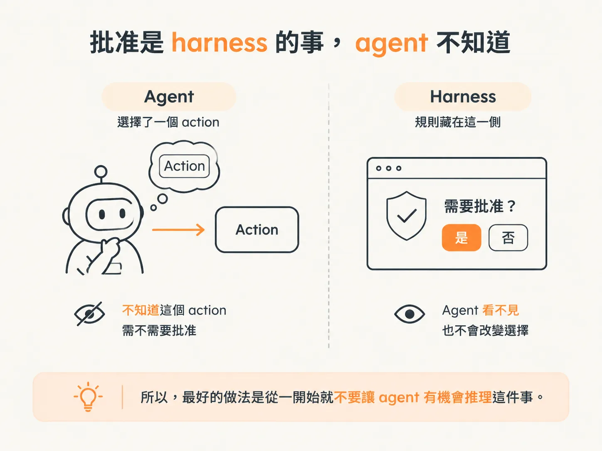
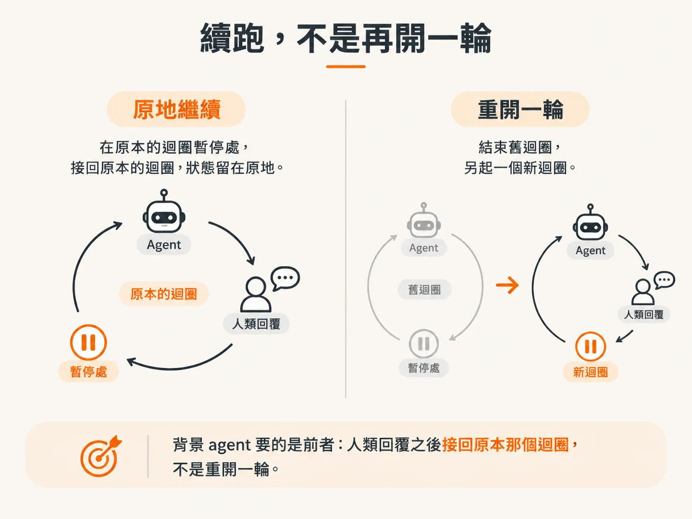
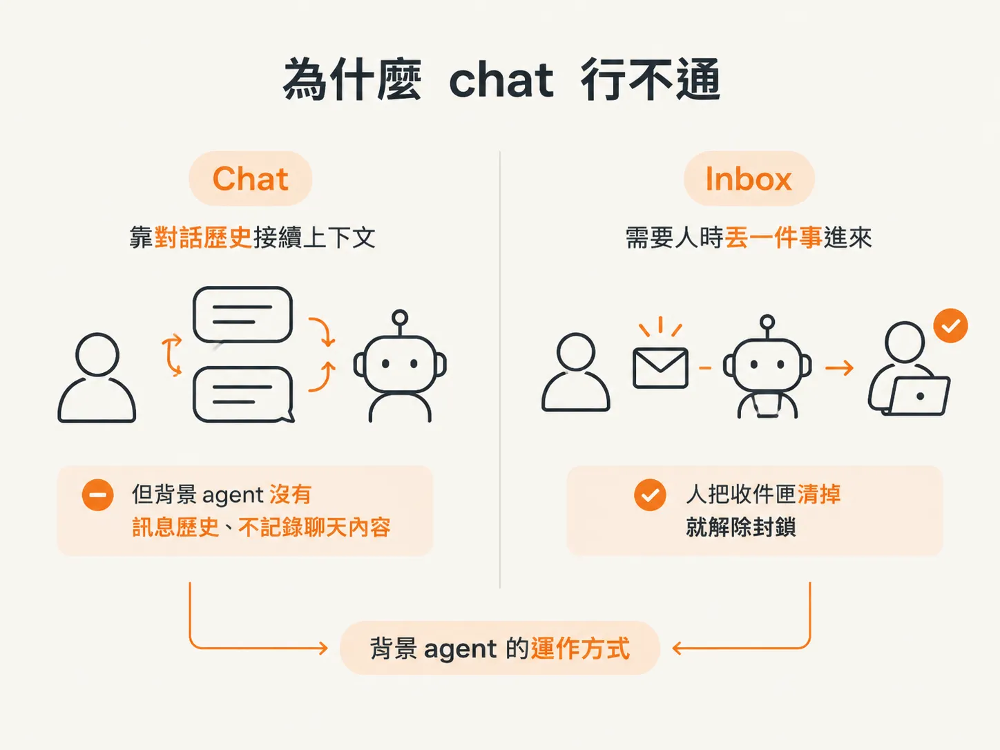
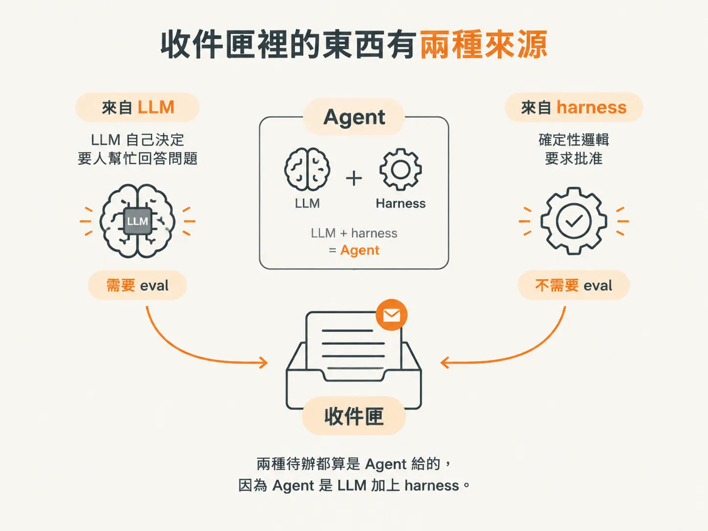

# Inbox 才是背景 agent 的介面

使用聊天型 agent 時，例如 Claude、Codex，互動通常是一句接一句：你下指令，它回覆；你按下批准，它再繼續執行。

在這種互動裡，介面就是聊天視窗。

但背景 agent 不是這樣運作的。它自己工作，你不用一直坐在電腦前等它。

這一課要談的是：當人類真的進入迴圈，背景 agent 應該使用什麼介面？

答案不是 chat，而是 **inbox，也就是收件匣**。

## HITL 不是新東西，但我們要的跟 chat agent 不一樣

你可能聽過 **human-in-the-loop（HITL，人類在迴圈裡）**。這個詞在 AI 領域有很多意思。

強化學習裡的人類回饋是另一個題目。這裡要說的是：

agent 正準備執行某個動作，卻被人類的判斷暫時擋住。

chat agent 也能做到這件事。你可以設定：「執行這個指令前，必須先問我。」

於是它會問你：「可以讓我執行嗎？Yes 還是 No？」

這等於在迴圈中間按下暫停。只要那個動作還沒完成，它就不能繼續。

但這類 coding agent 通常綁在你的電腦上。電腦一關，它就停止運作。更關鍵的是，當它回覆你「我需要你的批准才能繼續」時，你其實已經不在迴圈裡了。

原本的迴圈已經跑完一輪，它只是回傳一個請求。

我們要做得更徹底：直接進入迴圈，把迴圈暫停在原地。

## 不要讓 agent 知道「這件事需要批准」

我們希望的狀況是：**agent 根本不知道自己需要人類批准。**

當然，我們要給它「求助」的能力。它上次已經示範過自己會求救。

但不要讓它知道「我沒有權限做這件事」。這個資訊會改變它的選擇。

你不希望 agent 這樣想：

> 我很想把事情做完，但選這個工具要等人批准，而那個人回覆很慢，所以我換一個做法。

如果告訴它「這個動作需要批准」，它就可能把這件事納入決策。因此，我們要把這項資訊留在 **harness** 裡，也就是 agent 外層、由我們撰寫的程式。

agent 完全不知道它選的 action 是否需要批准。這不只是偏好問題，已經有測試顯示，模型可能會很聰明地替自己找理由：

> 我沒有問你，是因為我不需要問。理由如下。

到最後，你只能回答：「你說得沒錯，但我明明叫你不要這樣做。」

所以，最好的做法是從一開始就不要讓 agent 有機會推理這件事。

## 我要的是「續跑」，不是「再開一輪」

還有一個關鍵：我要恢復原本那個迴圈，不是讓它變成新的一輪。

我不希望 agent 先得出「我需要幫忙」的結論，等我回覆之後，再重新開始另一個迴圈。

我要的是：**留在原本的迴圈裡，暫停後再接著跑。**

這正是兩者的差別。

## 介面不是聊天，是收件匣

我認為，對需要和人類互動的背景 agent 來說，最好的介面不是 chat。

你看，在背景 agent 的世界裡，沒有任何訊息歷史。我們不記錄聊天內容，什麼都沒有。

所以 chat 行不通。

它更像一個收件匣（inbox）。我把它當成收件匣使用：

agent 自己工作，需要你的時候，就往你的收件匣丟進一件事；你把收件匣清掉，它就解除封鎖，繼續執行。

我做的背景 agent，一直都是這樣運作。

我甚至很希望有人能做出一個全球共用的 inbox。

想像一下，你手機上有一個 app，功能就是收件匣。不管你使用哪一家的 agent（OpenAI 的、付費的、本機的、購物用的，或公司的），都登入同一個 inbox。

agent 需要你的時候，就把事情丟進來；你清一清收件匣，它們就繼續工作。

這就是我們現在要做的事：

一個待辦收件匣，裡面放著 agent 卡住、正在等你處理的事情；而你的工作，就是把這些待辦清掉。

## 收件匣裡的東西有兩種來源

這些待辦有兩種來源。

第一種是：「幫我回答這個問題。」

這是 agent 自己決定要尋求人類幫忙。上一輪我們已經看過，它會做出這個選擇：選 **「I need help」** 這個 action。

我們已經給了它這項能力，只是還沒有實作。

第二種是：「我需要批准。」

這句話不是 agent 說的，是 harness 說的。

agent 不知道自己需要批准，這是我們直接寫在 harness 裡的規則。因此，你在收件匣裡收到的待辦，不一定來自 LLM，也可能來自 agent 的其他部分。

因為 agent 是 **LLM 加上 harness**。所以，收件匣裡的事情可能來自 harness，也可能來自 LLM，但兩者都可以算是 agent 給你的。

這個概念有點繞，但要分清楚：

不是每一件事都是 agent 自己決定的。有些事情是 harness 裡的**確定性邏輯**，也就是不靠模型判斷，每次都會得到相同結果的規則。

這個差別很重要：

- 一種需要 eval，也就是評估模型表現。
- 另一種不需要 eval，因為它是固定規則。

## 拿 rollback release 當第一個需要批准的動作

這次，我們使用 **rollback release** 這個 action，作為需要批准的動作。

相關 policy 其實早就寫好了：rollback 那一側已經設定需要 approval。

而且，我們沒有把這項 policy 暴露給 agent。

agent 只看得到 action 的名稱。它知道有一個叫作 **rollback release** 的 action，卻不知道這個 action 的 policy 要求批准。

## 批准不是萬靈丹

有件事要先說清楚：**approval 不是通用的安全盾牌。**

模型讀到一行不可信的 log 後，仍然可能提出錯誤的建議。

讀取 log 不需要批准；但讀完 log 之後選錯動作，是另一回事。這兩件事要分開看。

我一開始的做法是：

凡是會改變狀態，或具有寫入權限的動作，先放到批准流程後面，再盡量降低它們的風險。

反過來說，如果你監控的系統需要大量寫入，而每一次寫入都要你批准，一天就得在收件匣按二十幾次，那就表示你該花時間思考：

怎麼讓 AI 不用每次都問我，也能安全地完成工作？

接著，真的把這件事做出來。

例如：

- 做一個 rollback 機制，讓 AI 搞砸時可以快速復原。
- 把可能造成的影響範圍縮到很小。
- 採用分批發布，先發 10%，再 20%，最後 40%。

否則，你就會變成坐在電腦前不停按批准。那根本不叫背景 agent，只是回到 chat agent 的模式，等它一次次回覆你。

這樣一來，生產力根本出不來。

我個人相信，對大多數人來說，未來的工作會是盯著一個收件匣，回覆：

> 你為什麼要這樣做？

或是：

> 好啊，不過不是 12 號，是 13 號。
