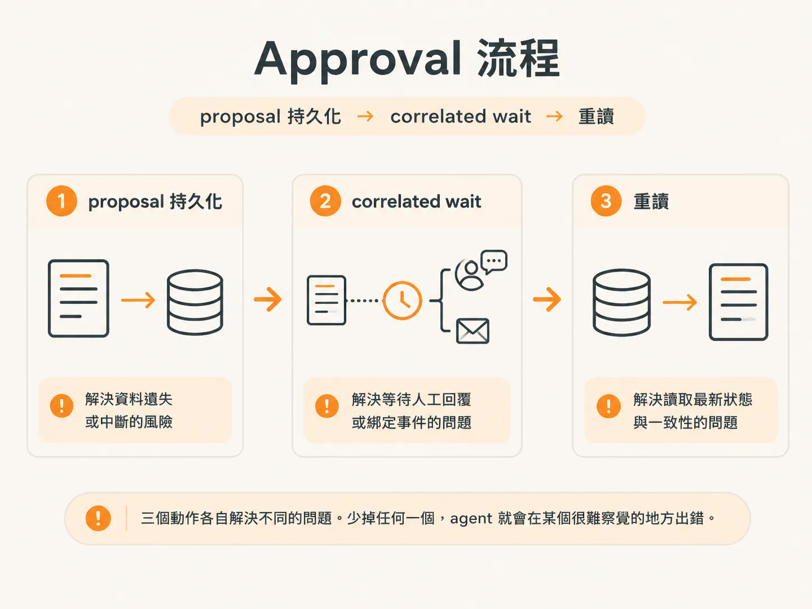
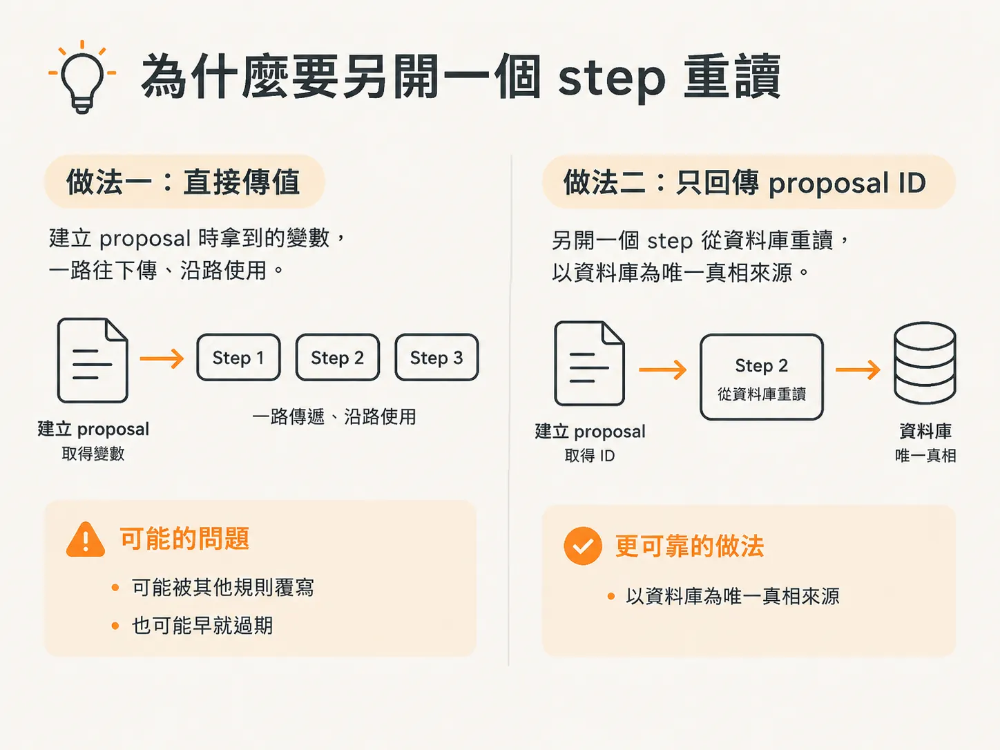
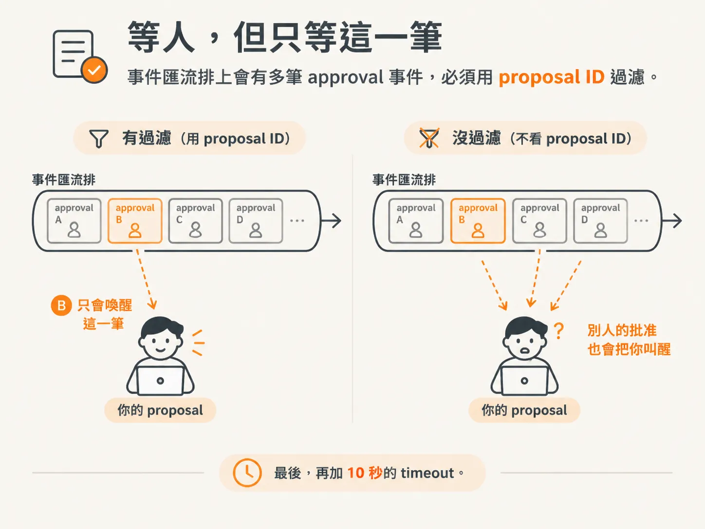
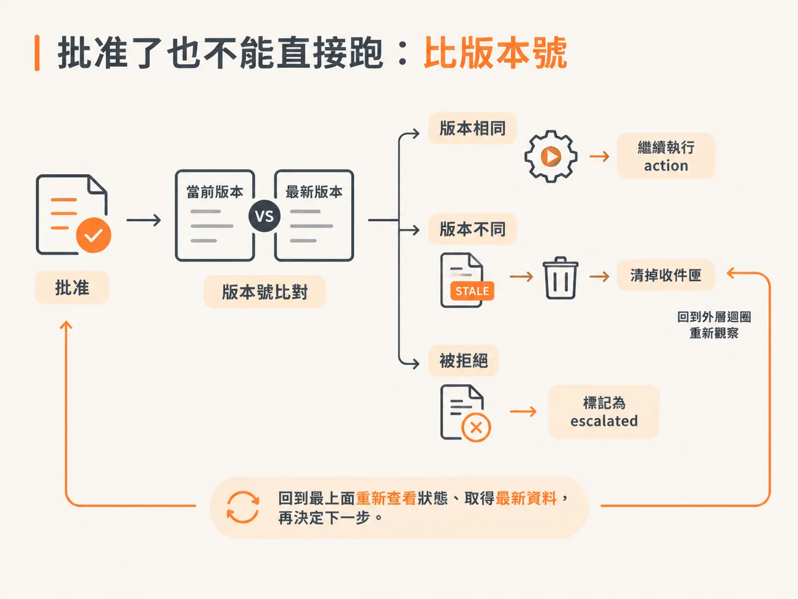

# Approval 流程：proposal 持久化 → correlated wait → 重讀

你的 agent 已經會挑選動作了。現在缺的是：收件匣裡有人按下 **approve** 之後，要怎麼繼續。

目前 approval 那條分支還是空的，什麼都沒有做。這一節要把它補起來。

整個流程只有三個動作，而且順序不能交換：

1. 先把 proposal 寫進資料庫。
2. 等待一個綁定這筆 proposal 的事件，直到有人回覆。
3. 再從資料庫重新讀取 proposal。

三個動作各自解決不同的問題。少掉任何一個，agent 就會在某個很難察覺的地方出錯。



## 三個 import，各自在防什麼

從 agent data 進來的三個東西是：

- `getProposal`
- `proposedAction`
- `staleProposal`

名字很直白，但先理解它們各自在防什麼，會比較容易看懂後面的流程。

`getProposal` 是到資料庫查詢一筆 proposal。

每次 agent 需要向外求助時，都會先把 proposal 存下來。存下來的目的很單純：之後可以回頭引用。

`proposedAction` 是「被提案的動作」。

有些 action 需要人工批准。所以即使 AI 已經決定「這就是我要做的動作」，在拿到批准以前，它都還只是一個提案，不是已經發生的事。

`staleProposal` 則處理「過期」這件事：

在 action 真正執行以前，原本的狀態有沒有改變？

## 不存下來，approve 按下去就找不到東西

儲存 proposal 最直接的理由是：當我們回到收件匣、有人按下 approve 時，系統必須有地方可以找回原本的 action。

這筆資料要記住：

- action 原本是什麼
- 要帶哪些參數
- 之後應該怎麼執行

這些狀態一定要存在某個地方，之後才能把它接到收件匣裡的某個按鈕。

你可能會想，靠 Ingest 的 state 回到原本的位置，不就好了？

技術上確實可以，但我不覺得這是好主意，因為這屬於應用邏輯。

應用邏輯應該放在自己的資料庫，讓 Ingest 專心處理 workflow 邏輯。當然，你可以偷懶、直接依賴 Ingest；但有一筆穩穩存在資料庫裡的 proposal，我會比較安心。

而且，這還有更實際的用途。

如果哪天你想做一個畫面，列出「AI 現在要求我做的所有動作」，或是想查看歷史上的 proposed actions，就需要這些資料。

如果你同時管理很多人，而每個人手上又有很多 agent，也會需要查看所有 agent 的 proposed actions。

所以，我選擇把 proposal 存起來。

## 快照只傳一個版本號

要判斷 proposal 是否過期，首先要有一份「當初狀態長什麼樣子」的資料可以比較。

做法是在建立 proposal 的時候，把狀態拍成一張快照，存進資料庫。

不過，我不會讓 agent 到處傳送整份 snapshot。

在這個假 server 裡，每次狀態改變，我都會記錄一筆資料，並把新的 snapshot 存進資料庫，同時給它一個新的 version。

因此，agent 只需要傳一個版本號。server 再用這個版本號，找到真正的快照。

換句話說，傳遞的是快照的 reference，不是快照本身。

後面批准流程會一直用到這個設計：批准之後，要重新確認狀態時，比對的就是版本號。

## 建立 proposal，然後立刻把它忘掉

進入流程後，先取得一個 proposal ID，用來追蹤這筆提案；按照慣例，也要記下目前跑到第幾輪的 cycle。

這裡會開一個 async function，因為我們要在這個 step 裡執行真正的工作。

第一件事，是呼叫 `proposedAction` 建立 proposal。

它需要這些資料：

- environment ID
- run ID
- action ID，也就是 `decision.action`，也就是我們真正想執行的事
- inputs，也就是當下的 state

這些資料送進去後，系統會建立一筆 proposal，最後回傳 `proposal.id`。

接下來是重點：

我們不把整筆 proposal 往下傳，而是再開一個叫 **get proposal** 的 step，使用剛剛拿到的 ID，回到資料庫把它抓回來。

## 為什麼要另開一個 step 重讀

你可能會問：

既然手上已經有 proposal，為什麼只回傳 ID，下一行又開一個 step 把它拿回來？直接沿用不就好了？

可以，但這是非同步流程，中間可能被覆寫。

我不知道什麼時候會有人處理這筆 proposal，所以不希望依賴任何快取。

對，我還是用 step，它本身會被快取；但我不想把這裡的變數一路帶到下一行。我希望直接從資料庫取得最新資料。

一來我不知道資料庫裡會不會有 override 或衝突；二來我要的是「資料庫作為唯一真相來源」，不是某個可能還在、也可能早就失效的快取值。

尤其這個 workflow 會執行很多次。從建立到讀取中間，proposal 可能早就變了。

這個坑我踩過很多次。寫這門課時，我又踩了一次，卡了兩個小時，完全找不到原因。

我當時太固執，不想問其他人，只想自己弄懂。結果發現，我拿到的是 stale proposal，因為我使用了上面那個變數。

再加上寫課程時常常隔幾天才繼續，等我回頭查看時，那些資料早就過期了。

你可能會想：這是 step，服務可能執行到一半就停止，之後才重新啟動。在這段期間，也可能有人處理掉 proposal，甚至把它清理乾淨。

沒錯。

所以，proposal 從建立到被讀取，中間的狀態可能完全不同。唯一能確定它現在長什麼樣子的方法，就是重新從資料庫取得，不要相信上面留下來的變數。

這跟資料庫交易的概念一樣。

在寫得正確的交易流程裡，你幾乎不會說：「我就用剛剛手上的這個值。」你會等寫入真正完成，再重新讀取結果。

這裡也是一樣：我不信任手上的值，因為我不知道建立 proposal 時發生了什麼，也不知道它是否撞上了其他規則。



## 等人，但只等這一筆

拿到 proposal 後，先把 `check` 設成 `0`，接著進入：

<!-- derived -->
```js
while (proposal.status === "pending")
```

只要 proposal 還在 pending，就繼續等待。

進入迴圈後，先執行 `check++`，再呼叫：

<!-- derived -->
```js
await step.waitForEvent("wait for human", ...)
```

同時把 `cycle` 和 `check` 帶進去，接著再從資料庫抓一次 proposal。

這裡的 `waitForEvent` 是整個流程的關鍵。

它把「等待」變成一個 durable 的暫停，而不是把執行緒卡在原地。事件名稱是 `agent.approval.decided`，代表有人按下 yes 或 no。

不過，只有事件名稱還不夠。一定要加上過濾條件：

<!-- derived -->
```js
async.data.proposalId === proposal.id
```

也就是事件裡的 proposal ID，必須等於目前手上這筆 proposal 的 ID。

為什麼一定要過濾？

因為沒有過濾的話，只要系統裡有人批准了任何一個任務，所有在等的事件都可能把它當成自己的批准，結果就是你去跑了不該跑的動作。

最後，再加上 10 秒的 timeout。



## 為什麼每一輪都要重新抓

為什麼迴圈裡還要再抓一次 proposal？

因為每次檢查時，它的狀態都可能不同。每一輪都要從資料庫取得最新資料，就像一直詢問：

> 你更新了嗎？  
> 你更新了嗎？

這個 `while` 其實不是必要的。我只是用它模擬「如果人一直沒有回覆，流程會怎麼樣」。

實務上，不一定要完全照這種方式實作。

## 批准回來了，先確認還算不算數

能走出這個等待，代表 proposal 已經收到回覆。

接著開一個叫 **reconcile human** 的 step，並把 `cycle` 和 `check` 帶進去。

然後，再抓一次最新的 proposal。

因為流程能走到這裡，代表 proposal 已經被更新；但我們還不知道回覆是 yes 還是 no，只知道它確實變過了。

如果：

<!-- derived -->
```js
proposal.status !== "approved"
```

就等待一個叫 **stop after human** 的 step，把 `cycle` 帶進去，然後把 run 的狀態設成 `escalated`。

為什麼是 `escalated`？

因為你沒有批准，但我認為這件事仍然必須完成，所以把它標記成升級處理。

它不是 `completed`，因為我們沒有執行；也不是 `failed`；更不是 `superseded`。

它代表的是：

> 我沒有其他辦法了。我告訴你我要做什麼，但你說不要，那就交給你處理。

被拒絕之後要怎麼做，可以依照自己的需求決定。

有些 agent 會把拒絕理解成：「這條路走不通，但事情還是要完成」，接著改找其他方法。

這一版比較簡單：一旦被拒絕，就放棄。

最後，把人類的決定記下來：

<!-- derived -->
```js
humanDecision = proposal.status
```

然後 return。

## 批准了也不能直接跑：比版本號

如果 proposal 獲得批准，就往下執行：

<!-- derived -->
```js
fresh = await step.run("recheck approved state")
```

這一步要確認的是：在 action 真正執行以前，狀態是否還跟原本一樣。

想像一下，也許對方花了三個星期才批准，而我們卻直接照著原本的提案執行。

如果這是一筆轉帳批准，提案送出時帳戶裡的錢綽綽有餘；等到終於批准時，餘額卻已經不夠了。

如果執行前沒有重新查詢餘額，就可能直接透支。

因此，我們要取得 agent 的最新 state，帶上 environment ID 和 run ID，然後比較：

<!-- derived -->
```js
fresh.world.version
```

是否等於這次 workflow 啟動時的 input version。

如果版本不同，就不能執行。

這時改做另一件事：開一個 **invalidate approval** step，把 `cycle` 帶進去，然後呼叫 `staleProposal`，使用 proposal ID 把它在資料庫裡標成 `stale`。

這樣一來，這筆 proposal 就從收件匣清掉了。

接著 `continue` 外層迴圈，回到最上面重新查看狀態、取得最新資料，再決定下一步。



這裡同時也說明了 staleness 的來源。

建立 proposal 時存下來的版本號，就是後面用來判斷「這筆批准還算不算數」的那把尺。

如果狀態已經改變太多，代表這可能根本不是正確的下一步。讓 agent 再跑一輪、重新觀察、重新選擇、重新送出，通常比拿著過期狀態硬執行、再祈禱它成功還安全。

這件事也可以採取更主動的做法：

每次狀態改變時，就掃描所有 pending proposal，檢查它們是否仍然有效；如果已經失效，就從收件匣清掉，讓使用者根本看不到。

結果人只會看到還有效、可以批准的動作。

兩種做法差別只在時機：一種等人按下 approve 才處理，一種在狀態一變就先清掉。

## 最後把舊的 return 拿掉

最後一步，是把原本那個 `return` 拿掉。

拿掉之後，如果 proposal 通過了 approval，而且 state 仍然是最新的，它就會繼續往下走到執行 action 的那一行，真正把動作跑起來。

回頭看整條資料流：

1. 先把 proposal 寫入資料庫。
2. 綁定事件，等待人類回覆。
3. 回到資料庫重新讀取。
4. 比對狀態版本。
5. 確認仍然有效後，才執行 action。

這三個核心動作看起來有點囉嗦，但每一個都在回答同一個問題：

> 我現在手上的這個東西，還是真的嗎？
