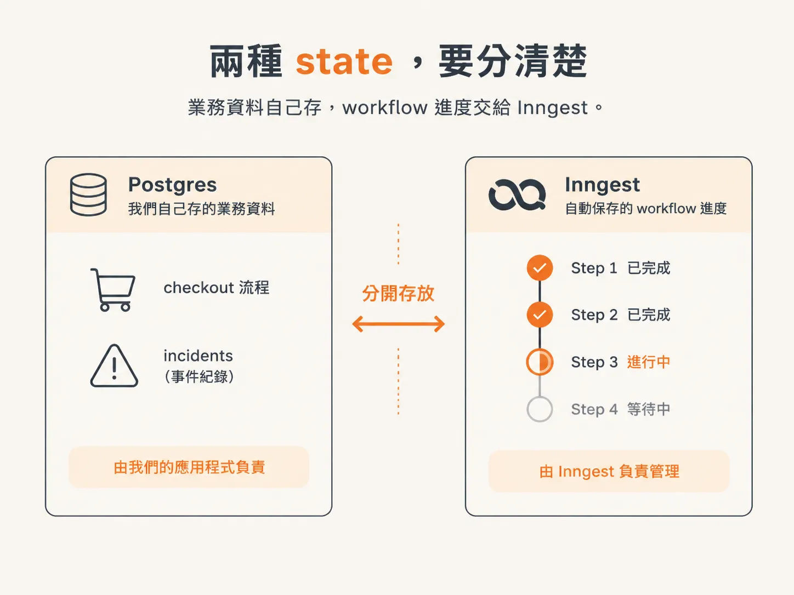
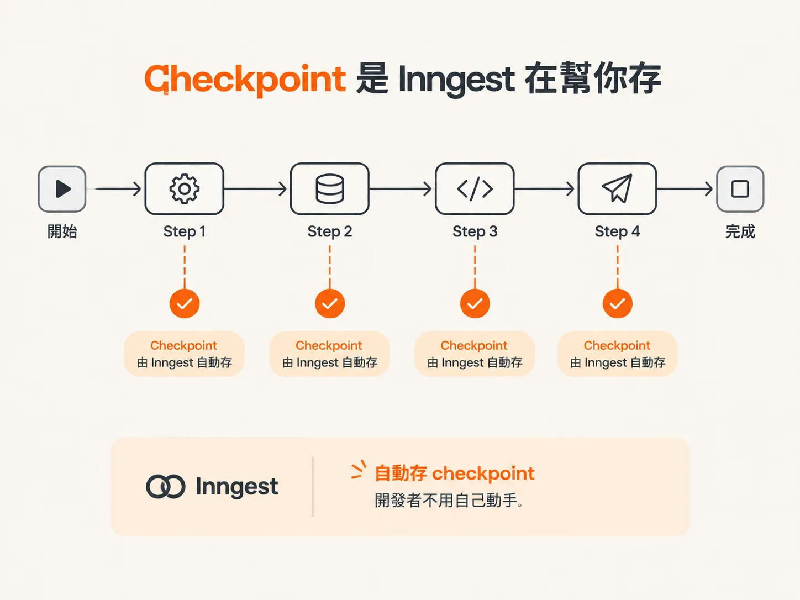
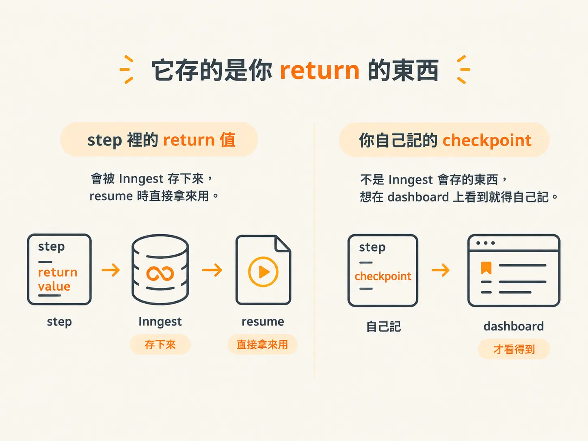

# 兩種 state：業務資料在 Postgres，step 進度在 Inngest

上一篇說 run 是 agent 被 event 叫醒的一次執行。那這個 run 跑到一半，狀態到底放在哪裡？

當 agent 跑到一半，服務突然重啟，記憶體裡的資料就會全部消失。

這時候會冒出兩個問題：

- 我的業務資料還在嗎？
- agent 又怎麼知道要從哪個 step 接著跑？

這兩個問題看起來很像，指的卻是兩種完全不同的 state，分別由不同系統負責。

## 兩種 state，要分清楚

我們有兩種不同的 state。

第一種是 agent 負責的**業務資料**，例如 checkout 流程、incidents。這些資料我們自己寫進 Postgres。

第二種是 **workflow state**，也就是哪些 step 已經完成、現在跑到哪裡。這部分交給 Inngest，我們不用自己另外存。

至於「step 的結果到底存在哪裡？之後又怎麼知道要從哪裡 resume？」，答案要分開講：workflow 的進度由 Inngest 幫我們保存與管理，業務資料則由我們自己存進 Postgres。

## Checkpoint 是 Inngest 在幫你存

每一次 run、run 裡的每一個 step，都可以想成一個 checkpoint。

workflow 裡每完成一個 step，Inngest 就會存一個 checkpoint，不用我們手動存。

我們自己只需要存和 business logic 有關的資料：這些內容由我們寫進資料庫，Inngest 不會替你存。

## 它存的是你 return 的東西

Inngest 存的是 step 的 return 值：你在 step 裡 return 什麼，這個值就會被存進對應的 workflow 和 step，resume 時再拿出來用。

但這跟我們自己在 step 裡建立 checkpoint、或想在 dashboard 上看到哪些資訊，是兩回事。

所以我們得自己建立新的 observation：AI 決定要執行某個動作時，由我們主動把這個決定記下來。
