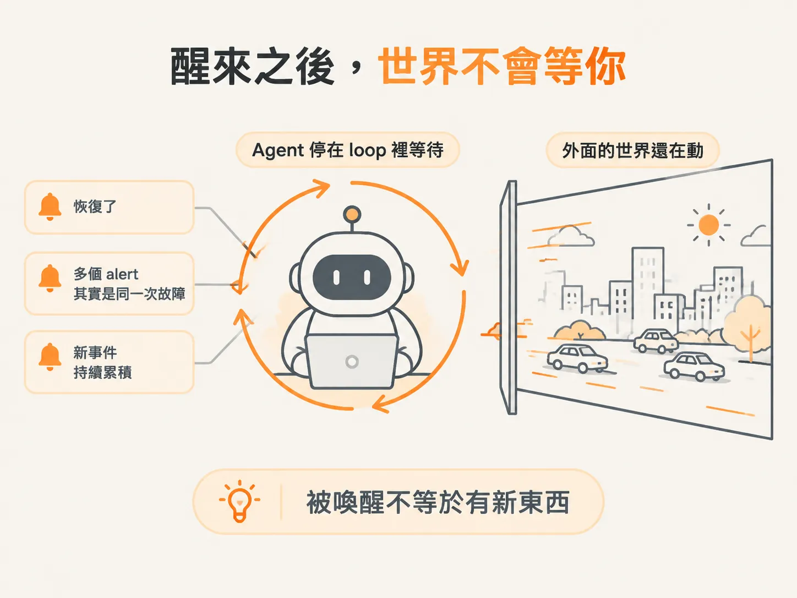
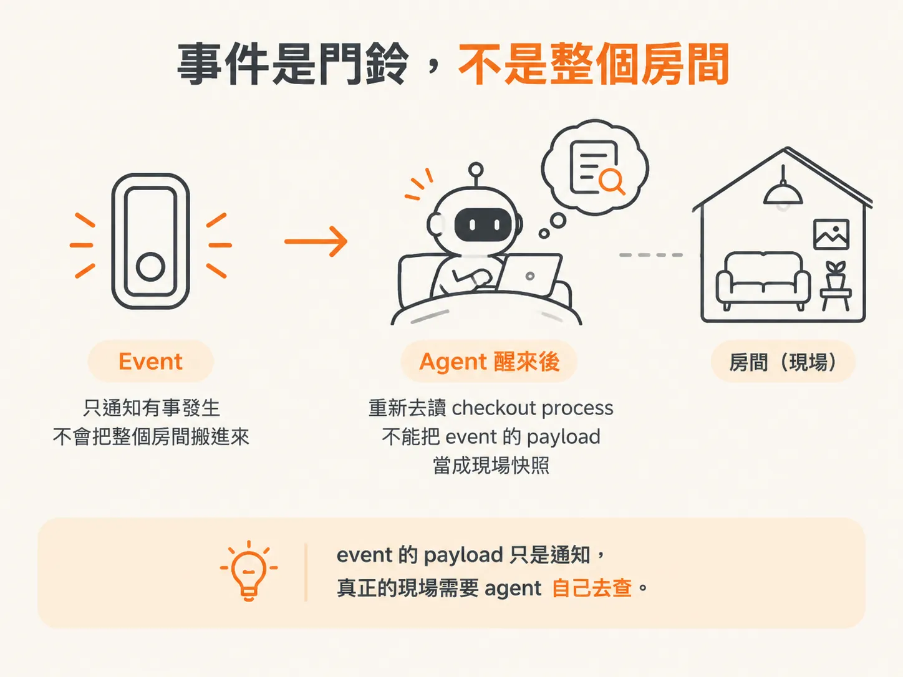
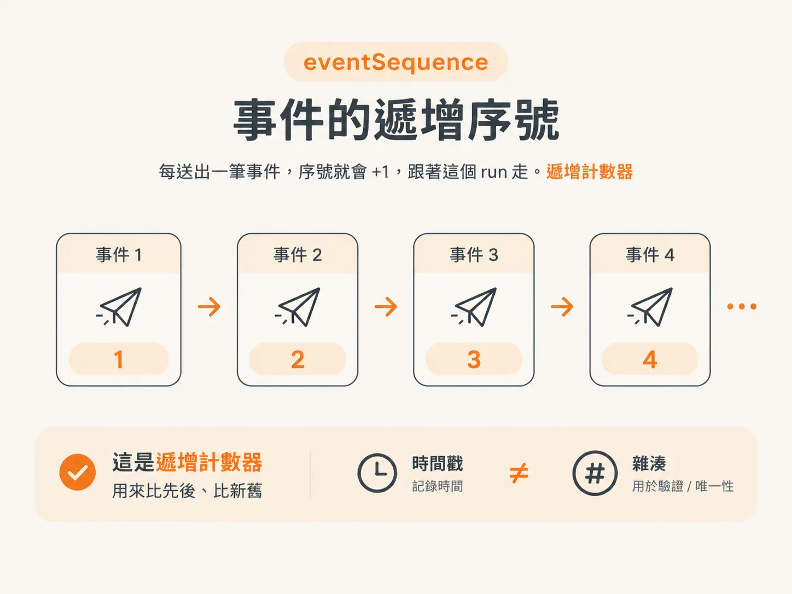
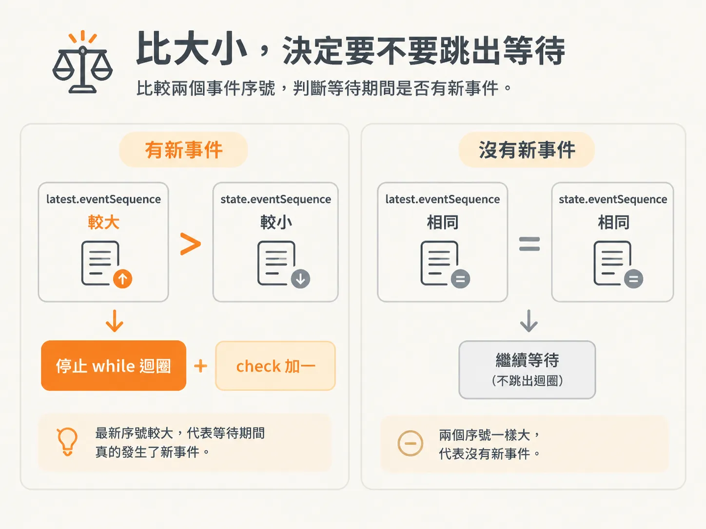

# eventSequence：醒來之後怎麼知道有新東西

你已經知道，agent 看到事件就會醒來。

但醒來之後，真正麻煩的問題才開始：這次被叫醒，是真的有新事情，還是同一件舊事又敲了一次門？

## 醒來之後，世界不會等你

世界不會等 agent 把一個 loop 跑完。

agent 閒著的時候，依賴可能已經自己恢復；好幾個 alert 也可能講的其實是同一次故障。

所以「我被喚醒了」這件事本身，判斷不了有沒有新事件。你收到的可能還是同一份舊資訊。

你需要一個可以比較的記號，才能分辨這次門鈴是新的，還是剛才那聲的迴音。



## 事件是門鈴，不是整個房間

要講這個記號之前，得先回到 event 本身的定位。

你可以把每個 event 想成門鈴，而不是整個房間。checkout process 發出訊號後，API 會把它存下來、掛到目前的 incident，接著 agent 醒來，重新去讀 checkout process。

agent 不會把 event 的 payload 當成完整快照，那只是一則事件通知，現場還是得自己去看。



資訊不完整的時候，agent 會直接說：「這裡沒有我能做的事，我需要看到更多。」

然後它回去睡，看看接下來會發生什麼。

但它睡著的這段時間裡，門鈴可能又響了好幾次。下一次醒來，要怎麼知道這些鈴聲是不是新的？

## eventSequence：一筆一筆排下來的序號

答案是一行比較：

<!-- source: sources/background-agents/20261027/18-waiting-loop.md#L25-L29 -->

```ts
latest.eventSequence > state.eventSequence
```

`eventSequence` 就是字面上的意思：服務送出的每一筆事件，都會依序取得一個序號。

每次有新事件送出，這個數字就往上加。它跟著這個 run 走，就是個遞增計數器，跟時間戳、雜湊不一樣。



比較時會用到兩個值：

- `latest.eventSequence`：目前最新那筆事件的序號。
- `state.eventSequence`：這個 run 原本進來時，記錄在 state 裡的序號。

## 比大小，決定要不要跳出等待

接著比這兩個值：

`latest.eventSequence > state.eventSequence`

如果最新序號比原本記錄的大，就代表等待期間真的發生了新事件。這時就停止 `while` 迴圈，並把 `check` 加一。



反過來，兩個序號一樣，就表示這段等待期間沒有新事件，不用為同一個門鈴再跑一輪。

agent 判斷有沒有新東西，靠的是這個遞增計數器，「我又醒了」不算證據。

這樣一來，「回去睡、等看看」就是一個可以驗證的動作：下一次醒來，比一下兩個 `eventSequence`，就知道值不值得再起來看。
