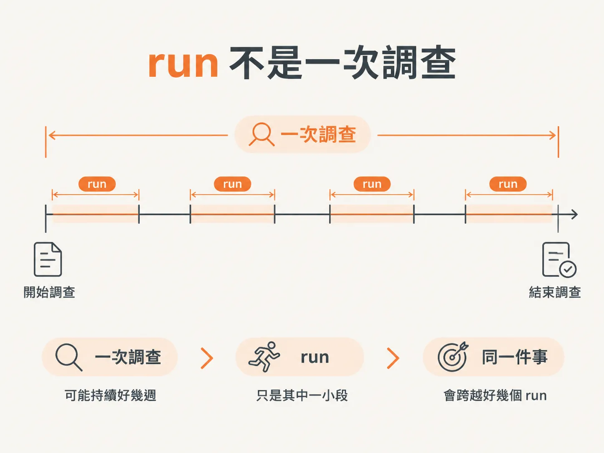
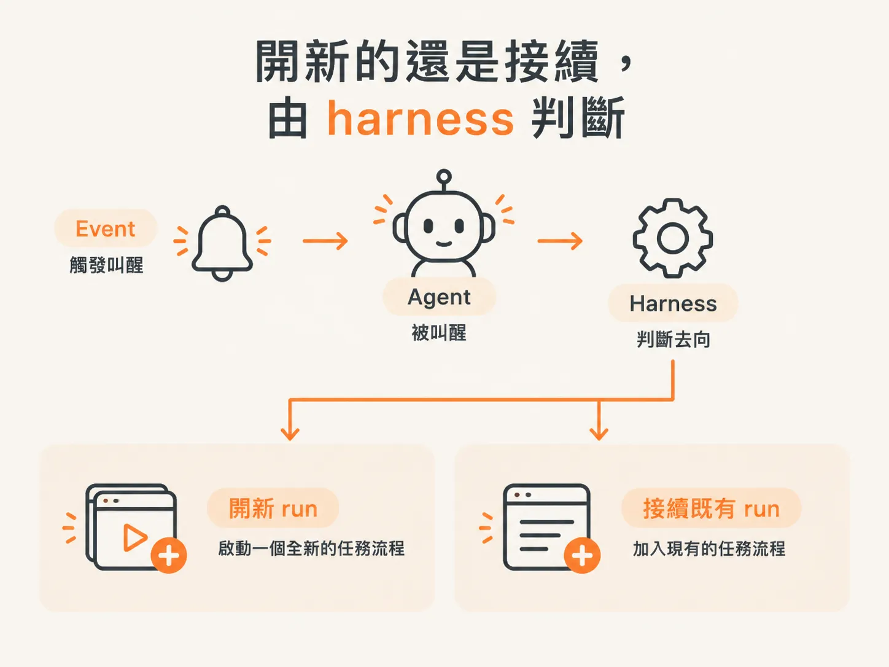
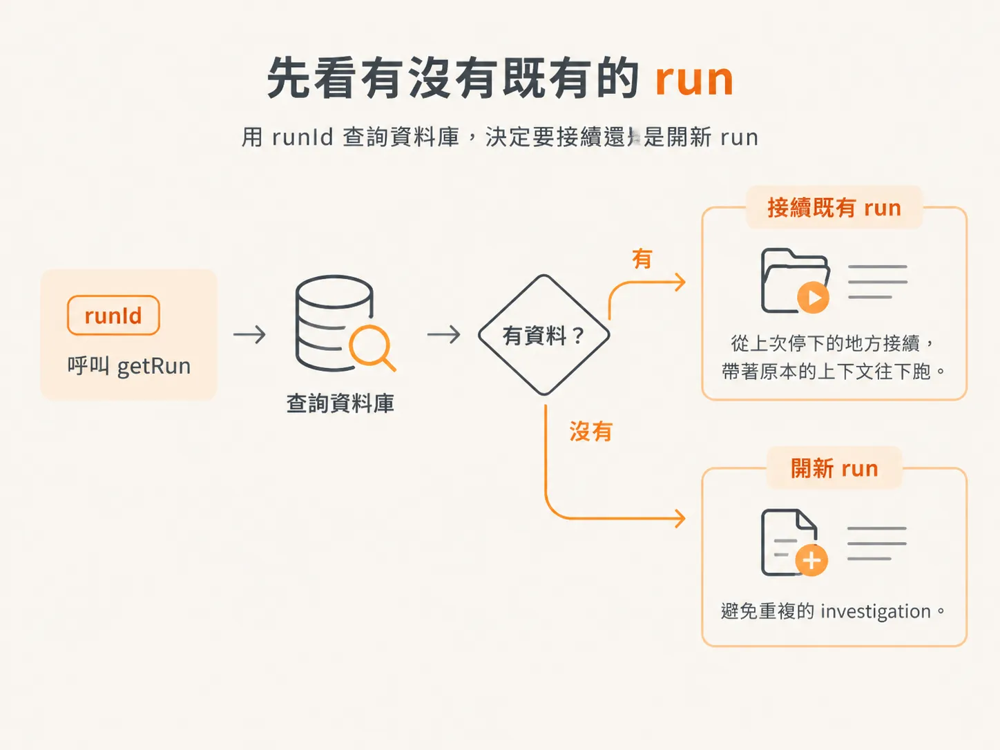

# run 是 agent 被一個 event 叫醒的一次執行

你已經會寫一支處理 incident 的 agent，接下來要讓它在關掉之後還能繼續運作。

要做到這件事，得先回答一個基本問題：

在背景 agent 的世界裡，「跑一次」到底代表什麼？

答案是 **run**。它是 agent 整個生命週期的基本單位，而且範圍比直覺想的更小、更明確。

打開 dashboard，其中一筆資料就是一個 run。你可能會直覺把它想成「一次調查」，但這兩者並不是完全對應。

一次調查可能拖上好幾週。這段期間你查的是同一件事，卻會橫跨好幾個 run；把 run 直接當成一次調查，就會誤解它的用途。

## run 代表什麼？

比較準確的說法是：

> agent 被某個 event 叫醒，並執行一次，就是一個 run。

每一次新的喚醒，都可能開一個全新的 run，因為這個 event 跟目前正在跑的 run 沒有關係；也可能直接掛到既有的 run 上。

開新的 run 還是接續舊的，由你的 harness 判斷。

## 什麼時候該開新 run？

假設上游有一個服務，會自動幫你開 incident，例如 SEV-0 或 SEV-1。agent 收到 event 時，incident 已經被分好類了。

這時你就可以判斷：

- 要開一個新的 run？
- 還是把這個 event 掛到既有的 run？

如果這只是同一件事衍生出的另一個 event，而且 incident 已經開啟，就不該再開一個新的 run。

但很多時候，你沒有這種能幫你分類的上游服務。於是每個 event 都可能直接開一個新的 run，沒有人在前面替你擋。

這件事跟 AI、跟 LLM 都沒有關係：反正到最後，LLM 都會看到這些資料。

## 要怎麼接續既有的 run？

agent 進場後先確認一件事：現在是不是已經有一個 Agent run 在跑。

你可以呼叫 `getRun`，並傳入 `runId`。如果這個 run 已經存在，就從上次停下的地方接續，帶著原本的上下文往下跑。

說穿了，這只是到資料庫確認：

這個 `runId` 已經有資料了嗎？這是一次新的呼叫，還是同一個 run 的延續？

這樣才不會開出重複的 investigation。就像你用 user ID 查使用者，這裡只是換成用 `runId` 查 run，確保同一件事不會被重複建立。

這件事和 AI、和 harness 本身都沒有關係。
