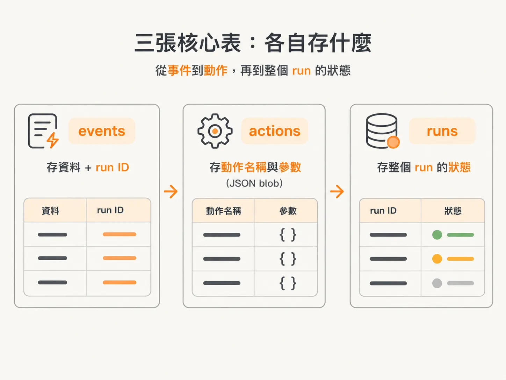
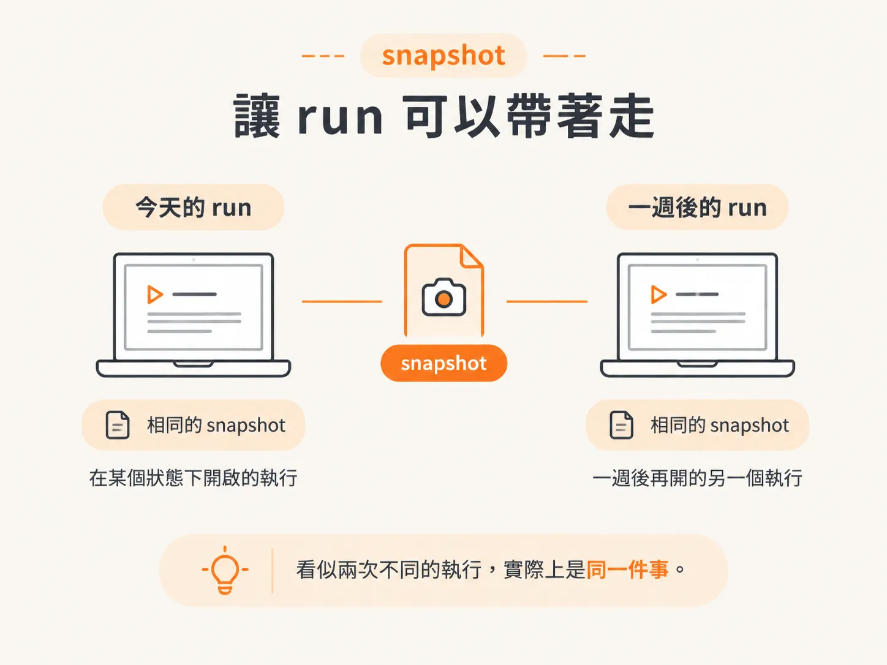
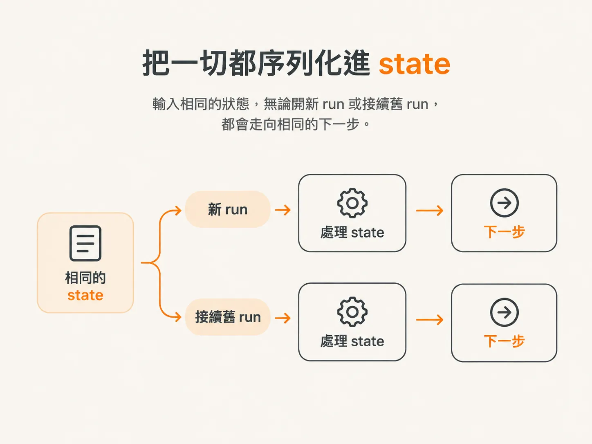

# schema 核心表：events、actions、runs

前一篇把 state 分成業務資料與 workflow 進度。為了讓兩者在斷掉之後都能接回來，這個 harness 會把所有東西都寫進資料庫。

光聽前面這樣講，很容易想像出一個龐大的 schema：幾十張資料表、滿滿的 foreign key，還有各種 enum 欄位。

實際情況剛好相反，整個設計簡單得出乎意料。

## 核心就三張表

我們實際用到的核心表，大概就這幾張：

- **events**
- **actions**
- **runs**

先看 `events` 表。它存的是事件資料，以及對應的 run ID。

每當一個事件進來，系統就記下事件內容，再標註它屬於哪一次 run。之後才能知道這筆事件是在哪一次執行裡產生的。

接著是 `actions` 表，也很單純。它存放動作名稱和動作參數。

不管 agent 最後決定呼叫哪個工具、帶了哪些參數，這些內容都會以 Postgres 裡的 JSON blob 存起來。一整包結構化資料直接放進 JSON 欄位，不必替每一種動作另外開一堆欄位。

最後是 `runs` 表。我認為這是最重要的一張表。

## 為什麼 runs 最重要？

這要從「暫停與恢復」講起。

當系統需要支援暫停與恢復，事情會變得複雜一點：你需要一份完整的 snapshot（快照），還要想辦法讓 run 可以帶著這份狀態繼續走。

今天在某個狀態下開一個 run，一週後再開一個「一模一樣」的 run。名義上是兩次不同的執行，但實際上兩者就是同一件事，因為它們的 snapshot 完全相同。

重點是：**所有用來定義一個 run 的資訊，都放在資料庫裡。**

所以，有沒有開一個新的 Inngest workflow，其實沒那麼重要。只要狀態相同，它就能從上次停下的地方接下去，即使這是一個全新的執行。

## 把一切都放進 state

再往下走一步，就是把所有東西都序列化進 state（狀態）。

出於成本考量也好，其他原因也好，你可以選擇這樣設計。我自己會盡可能把所有東西都序列化進 state，未來就不必再煩惱：

- 我要不要接回原本的 run？
- 要不要開一個新的 run？
- 還是應該重用同一個 run？

因為一切都是由我提供的 state 決定。就算重新開一個 run，本質上還是同一件事：像一個狀態機，輸入相同的狀態，就會走向相同的下一步。

這就是 `runs` 表最關鍵的地方。

它把「一個 run 是什麼」完整收進一筆可以儲存、可以帶著走，也可以精準接續的 state 裡。
