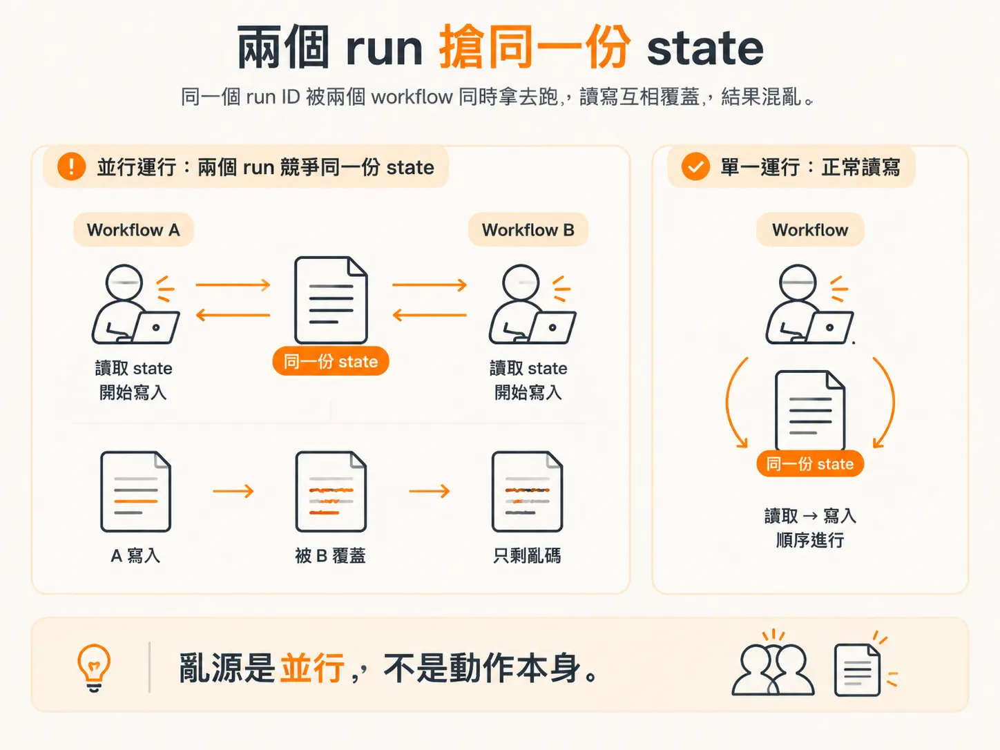
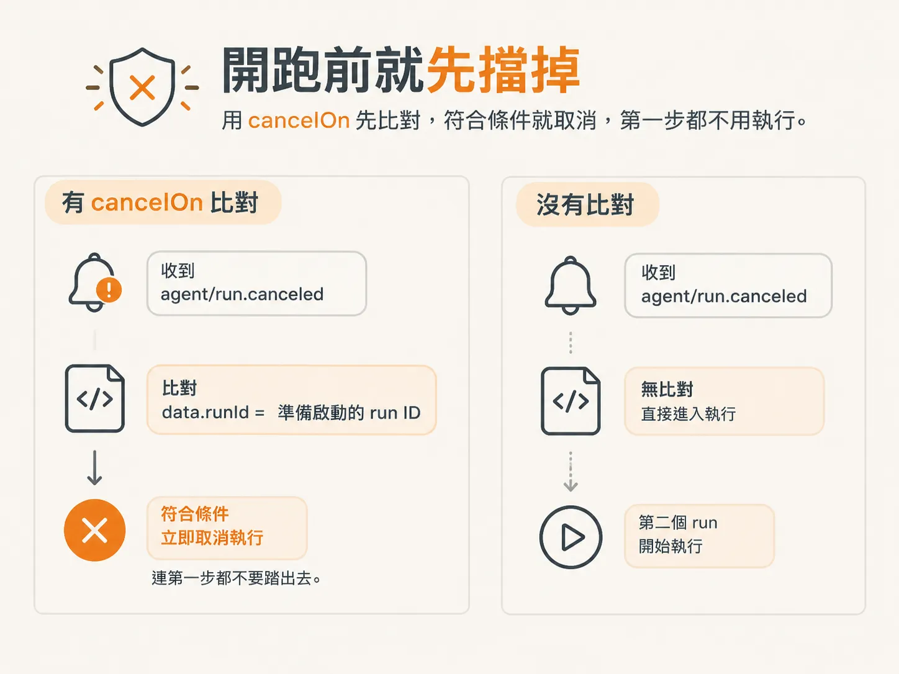
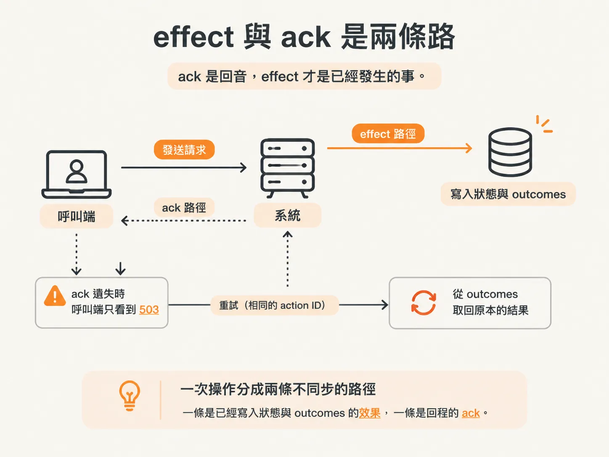

# cancelOn 與 lost-ack：收緊一致性的兩道防線

你已經把 action ID 固定下來，重試時不會讓同一件事做第二次。但實際跑起來，還有兩種情況會讓你懷疑它到底可不可靠。

第一種是同一個 run ID 同時被兩個 workflow 拿去執行。第二種是明明收到錯誤回應，事情其實已經完成了。

這兩種問題，一個發生在執行之前，一個發生在動作之後。`cancelOn` 負責處理前者；`lost-ack` 則讓你看清後者。

## 兩個 run 搶同一個 run ID

想像同一個 run ID 同時被兩個 workflow 拿去跑。兩邊都讀同一份 state，各自決定下一步，再各自把結果寫回去。

兩個 run 同時操作同一份 state，可能得到不同結論，變成 race condition，最後整個狀態就會亂掉。

這就像你和別人共用一份 Google 文件。兩個人的游標停在同一行，都想寫同一段，還同時開始打字，最後很可能只剩一堆亂碼。問題不在誰寫得比較好，而是兩邊根本不知道對方也在改。



## cancelOn：連跑都不要跑

啟動 workflow 時，可以在參數裡放一個 `cancelOn` 設定。它會接收一組 event 物件；只要符合條件，這個 workflow 就不會執行。

我們要設定的條件很窄：收到 `agent/run.canceled` 事件，而且事件 payload 裡的 `data.runId` 和準備啟動的 run ID 相同。

只要符合這個條件，就取消執行，連第一步都不要踏出去。



為什麼這麼果斷？因為系統裡已經有地方偵測到這個 run ID 正在被使用。我們不希望多個 run 共用同一個 run ID。與其讓第二個 run 跑起來再收拾後果，不如一開始就擋住它。

## lost-ack：事情做完了，回音卻掉了

第二種情況更難察覺，因為從呼叫端看起來，它和「操作失敗」幾乎一模一樣。

啟動 checkout 服務時，帶上 `--lose-next-action-response`。接著，第一次送出 `disable_feature` 或 `rollback_release` 這類操作時，服務會先完成動作，最後才回傳 503。

<!-- source: sources/background-agents/20261027/service/checkout.ts#L170-L180 -->
```ts
  outcomes.set(input.actionId, { fingerprint, result })
  if (
    loseNextActionResponse &&
    (input.name === 'disable_feature' || input.name === 'rollback_release')
  ) {
    loseNextActionResponse = false
    return response
      .status(503)
      .json({ error: 'Simulated acknowledgement lost after the operation committed' })
  }
  return response.json(result)
```

注意執行順序：`outcomes.set` 在前，`503` 在後。state 已經更新，change 記錄也已經寫入，結果同樣存進了 outcomes；這些事情全都發生在服務回傳錯誤之前。

ack 是回音，effect 才是已經發生的事。



你收到 503，很自然會以為這次操作沒有成功，於是重新送出同一個請求。這一次，服務會在 `outcomes` 裡找到相同的 action ID，直接把已儲存的結果回傳給你，不會再次執行切換動作。

<!-- source: sources/background-agents/20261027/service/checkout.ts#L131-L137 -->
```ts
  const fingerprint = JSON.stringify({ name: input.name, expectedVersion: input.expectedVersion })
  const prior = outcomes.get(input.actionId)
  if (prior) {
    if (prior.fingerprint !== fingerprint)
      return response.status(409).json({ error: 'Action ID reused with different arguments' })
    return response.json(prior.result)
  }
```

這裡有兩個細節值得記住。

第一，重試時取得的 `prior.result`，是第一次執行留下的結果。因此，呼叫端拿到的會是和原本成功時相同的內容，而不是「你重複了」之類的錯誤。

第二，如果同一個 action ID 改用了不同參數，`fingerprint` 就會對不上，服務會回傳 409。因為那已經不是同一次操作，不能直接拿舊結果帶過。

## 兩道防線的分工

`cancelOn` 擋的是同一個 run ID 出現第二個 run，處理的是並行問題：事情還沒發生，就先阻止第二個 run 執行。

`lost-ack` 示範的是另一件事：effect 和 ack 是兩條不同的路。請求可能已經生效，但回程的回音在路上遺失。因此，有沒有收到成功回應，不能當作事情有沒有發生的證據。

把這兩件事放在一起看，就會明白光有重試還不夠。要讓重試安全，得先確定沒有第二個 run 搶同一份 state，再確定重試送到的伺服器認得出這是同一個動作。

前者靠 `cancelOn`，後者靠 `outcomes` 表。

要重現這個情況，可以執行一次帶有 `--lose-next-action-response` 的服務，再把手上的請求重新送出。你會看到第二次回應是成功的，但 state 實際上只被修改了一次。
