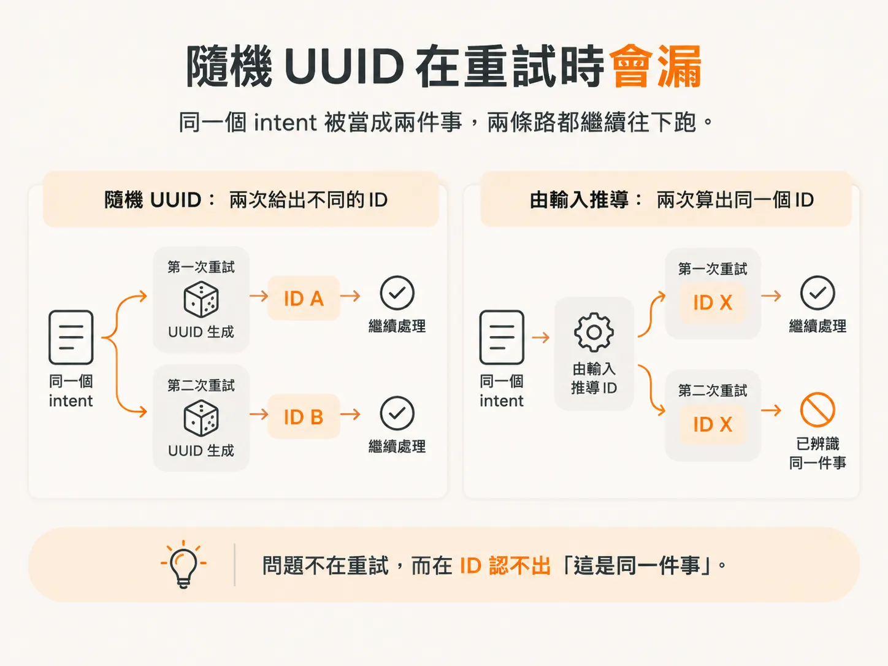
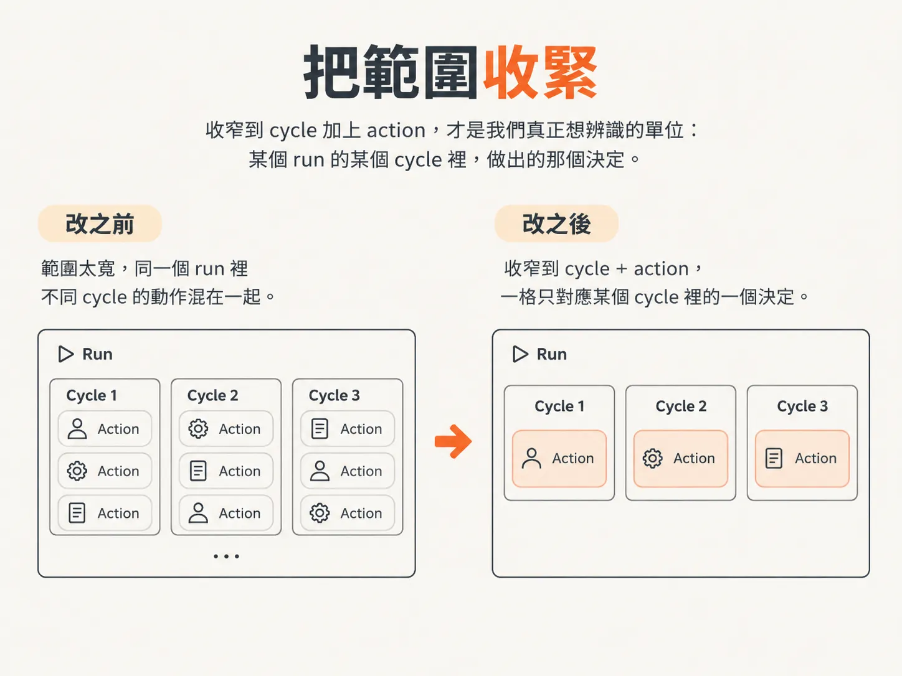
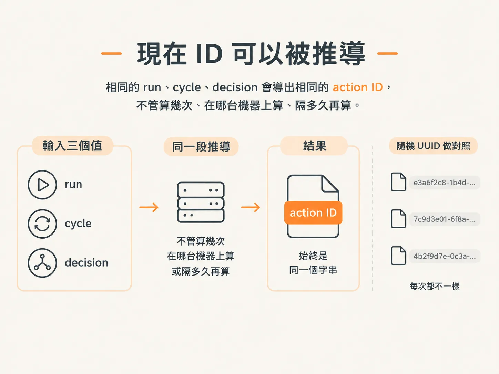

# derived action ID：從隨機 UUID 改成確定性推導

上一篇讓 effect owner 記住「key 對應的參數與結果」。但那個 key 如果每次重試都不一樣，整張對照表就查不到。這一篇要換掉 ID 的來源。

我們最早替 action 產生 ID 時，用的是隨機 UUID。當時的理由很簡單：只要每次產生的值不同，能當唯一鍵，看起來就夠用了。

但當「同一件事只能執行一次」變成要求後，這個想法就站不住腳了。

## 隨機 UUID 在重試時會漏

隨機 ID 之所以唯一，是因為每次產生的值都不一樣。正常路徑通常不會出問題，因為每個 action 真的只會建立一次。

但背景 agent 會重試，也可能重播。同一個 cycle 如果被處理兩次，隨機 UUID 就會給出兩個不同的 ID。

系統看到兩個不同的 ID，就把它們當成兩件不同的事。結果，同一個 intent 被執行兩次，而且沒有任何一層覺得奇怪。

問題不在重試，而在 ID 認不出「這是同一件事」。

## 換成 runtime 內建的 idempotency

所以我們回到程式碼，把隨機 UUID 拿掉，改用 Inngest 內建的機制來處理 idempotency，也就是避免同一件事被重複執行。

換掉的其實是 ID 的來源，函式只是表象。

現在 ID 由「這是哪一件事」決定。亂數只負責生出一個還沒出現過的字串，跟它代表哪件事、屬於哪個 cycle，一點關係都沒有。

一旦 ID 記得住自己的身分，runtime 就有東西可以拿來比對。第二次收到相同 intent 時，它就能認出這是同一件事，不必再執行一次。

## 把範圍收緊

第二個修正跟 ID 的範圍有關。原本的範圍太粗，分不出真正的執行單位。

我們把範圍改成 cycle 加上 action，切得比原本細。

範圍決定什麼算是「同一件事」。範圍太寬，兩件不同的事可能被當成一件；範圍太窄，同一件事又可能被拆成好幾件。

收窄到 cycle 加上 action，才是我們真正想辨識的單位：某個 run 的某個 cycle 裡，做出的那個決定。

## 現在 ID 可以被推導

收緊範圍之後，action ID 就真的可以被推導出來。這種特性叫 deterministic：輸入相同，結果就固定。

隨機 UUID 就沒有這個性質，它每次算出來都可能是不同的字串。

只要拿 run ID、cycle、decision 這三個值，算出來的永遠是同一個 action ID。以前做不到。

ID 的產生方式也跟著改了：從執行時生成，變成依照輸入計算。輸入固定，輸出就固定。

run、cycle、decision 都一樣的話，不管算幾次、在哪台機器上算、隔多久再算，得到的都是同一個字串。

## 重播拿到同一個 intent key

這個特性直接解決了重播問題：ID 是推導出來的，重播算出來的還是同一個 intent key，不會多出一個新身分。

這時，下游的 idempotency 檢查才真正有意義。它拿到的是上次已經見過的那個 ID。

所以重播會停在「認出這是同一件事」這一步，不會繼續往下變成第二次執行。

你要驗證的其實只有一句話：

> 同一個 run、同一個 cycle、同一個 decision，計算兩次，ID 必須一樣。

如果兩次算出的結果不同，就代表 ID 還沒有真的被推導出來，只是換了一個地方產生隨機值。
