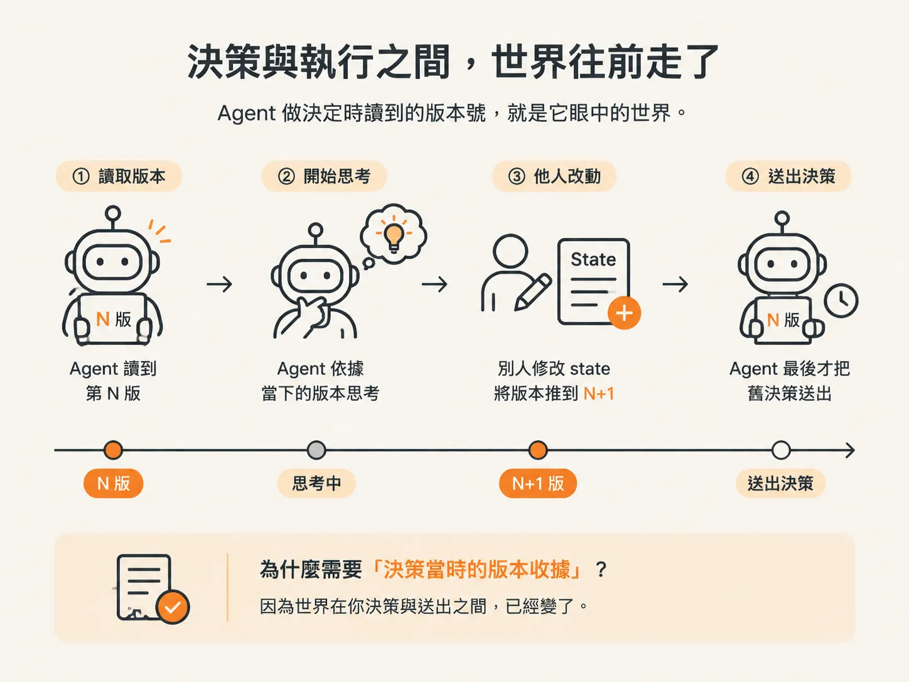
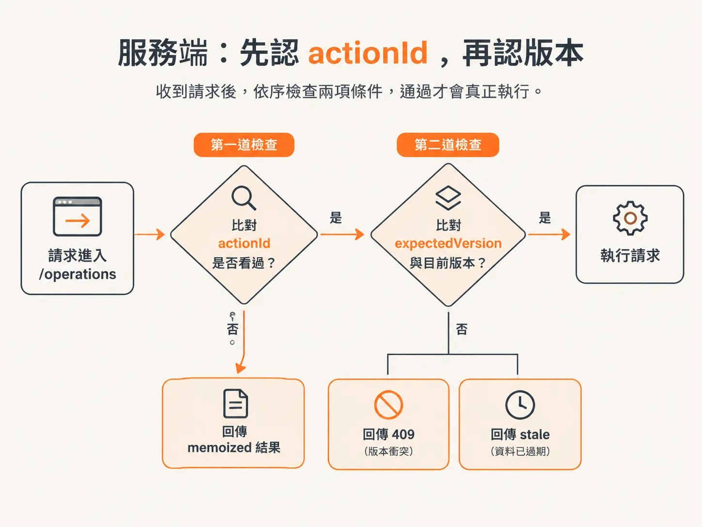
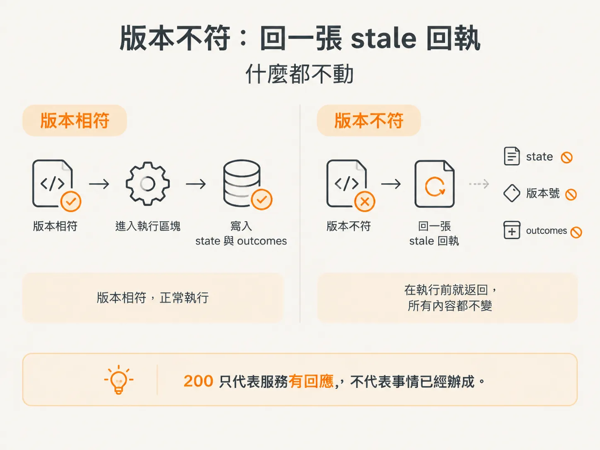
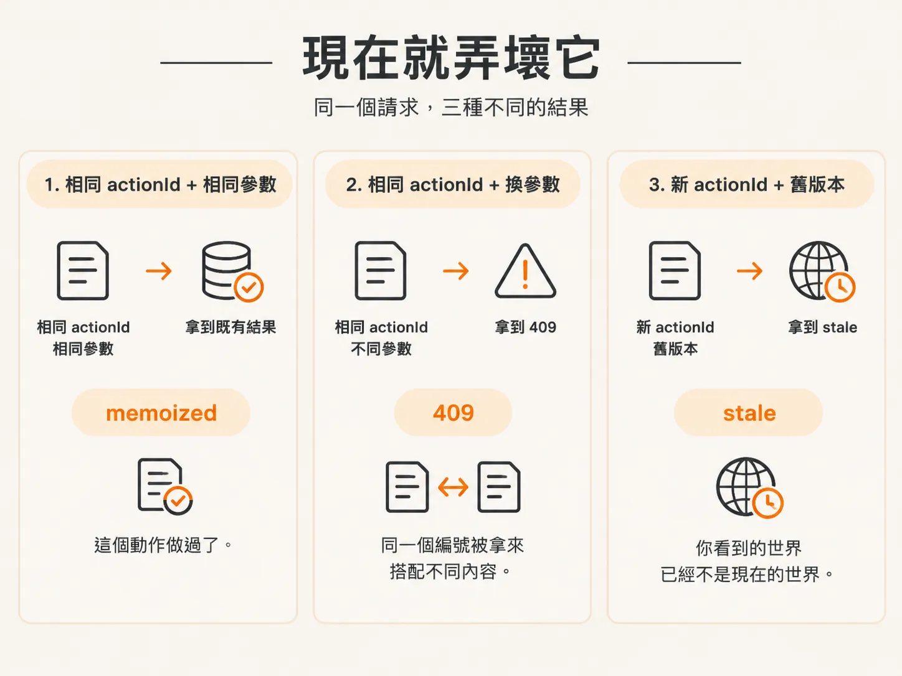

# expectedVersion：效果落地前的最後一道柵欄

你的 action 已經包在 `step.run` 裡，也帶了 idempotency key。即使重試，動作也不會執行兩次。

但這擋不住另一種失敗：**你動手的時機已經錯了**。

監控系統跳出一則告警，workflow 被喚醒，開始觀察、思考，最後決定 rollback。這段過程花了四十秒。

這四十秒裡，值班人員可能已經先按了 rollback，或另一條 workflow 已經完成同一個動作。等 agent 把決策送到服務端時，這個決策早就成了舊聞。

這次請求不會被拒絕，因為你確實只送了一次。服務照做，結果是同一件事被做了第二次。

`expectedVersion` 就是用來擋住這種情況的。

它不管「你做過了沒」，只管一件事：

> 你做決定時看到的版本，還是不是現在的版本？

先把「版本」講白。

服務的 world 裡有一份狀態，上頭掛著一個版本號。每次有人真的改動 state，服務就把版本號加一。

Agent 做決定時讀到的版本號，就是它眼中的世界。



## 決策時看到的版本，要一路帶到執行

執行 action 的請求裡，有一個欄位叫 `expectedVersion`。

這是客戶端對服務的宣告：

> 我做這個決定時，世界是第 N 版。

要填什麼，要看 policy：

- policy 是 `read` 時，`expectedVersion` 傳 `undefined`。讀取不會改變 state，用不到版本收據。
- 會改變 state 的 action，傳入 `state.world.version`，也就是 agent 做決定當下看到的版本。

服務拿這個參數來比對，不做紀錄。

服務收到請求後，要比對版本，通過了才真的執行。



## 服務端：先認 actionId，再認版本

`/operations` 這個端點裡有兩道柵欄，而且順序固定：

1. 先檢查 `actionId`
2. 再檢查版本

<!-- source: sources/background-agents/20261027/service/checkout.ts#L131-L143 -->
```ts
  const fingerprint = JSON.stringify({ name: input.name, expectedVersion: input.expectedVersion })
  const prior = outcomes.get(input.actionId)
  if (prior) {
    if (prior.fingerprint !== fingerprint)
      return response.status(409).json({ error: 'Action ID reused with different arguments' })
    return response.json(prior.result)
  }
  if (
    (input.name === 'disable_feature' || input.name === 'rollback_release') &&
    input.expectedVersion !== version
  ) {
    return response.json({ stale: true, currentVersion: version })
  }
```

`fingerprint` 是把 `name` 和 `expectedVersion` 串起來算出的指紋。

服務用它判斷：這個 `actionId` 之前是不是用同一組參數送過。

第一道柵欄處理的是重試。

同一個 `actionId` 再送一次、參數完全相同時，服務不重新執行，直接把上次存下來的結果回傳。前面講的冪等，說的就是這件事。

但如果同一個 `actionId` 搭配了不同參數，服務會回傳 409，訊息是：

`Action ID reused with different arguments`

第二道柵欄才是版本檢查。

它只會套用在兩個會改變 state 的 action：

- `disable_feature`
- `rollback_release`

`inspect_logs` 和 `inspect_changes` 都是讀取操作，不需要經過這道版本檢查。

為什麼順序很重要？

因為順序會決定你拿到哪一種回應。拿舊版本重送同一個 `actionId`，你看不到 stale，只會拿到之前存下來的 memoized 結果。

只有服務從沒看過的 `actionId`，才會進一步拿去和目前版本比對。

stale 不是「你重試太多次」的訊號，而是：

> 這是一個新的決定，但它是根據舊世界做出來的。

## 版本不符：回一張 stale 回執，什麼都不動

比對條件是：

`input.expectedVersion !== version`

只要兩者不相等，服務就會回傳：

`{ stale: true, currentVersion: version }`

然後結束處理。

注意 `return` 的位置：它在 `switch` 之前。

因此，版本不符時：

- `disable_feature` 的 state 不會被改變
- `rollback_release` 的 state 不會被改變
- `outcomes.set` 不會被呼叫

這次請求什麼都沒有留下，只留下一張回執：

> 你慢了一步，現在已經是第 N 版。

還有一個容易踩到的細節：這個回應的 status 是 200，不是錯誤碼。

所以，呼叫端不能只看「有沒有丟錯」，還必須檢查 body 裡的 `result.stale`。

200 只代表服務有回應，不代表事情已經辦成。



## 客戶端：看到 stale，就當它沒發生

workflow 收到結果後，第一件事就是檢查 `result.stale`。

如果值是 `true`，就寫一筆 stale action 到 log，然後繼續往下執行。

這筆紀錄要清楚寫出四件事：

- `decision.thought`
- `decision.action`
- 當時的 expected version，也就是 `state.world.version`
- 服務回傳的結果

另外，phase 要標成 `act`，訊息則寫成：

`action rejected because service state changed`

寫進 log，之後才查得到。

否則「agent 決定 rollback，但世界沒有改變」這件事，在系統裡不會留下任何痕跡。

也不要對 stale 盲目重試。

你用同一個 `expectedVersion` 再送一次，版本不會倒退回舊號碼，結果還是 stale。想繼續處理，就必須重新觀察、重新做決定，並帶上新的版本號。

## stale 還有第二個來源：部署後 action 不見了

除了「世界變了」，還有另一種情況也會拿到 stale：

workflow 執行到一半時，你部署了新版本，而原本要執行的 action 已經不存在。

服務等於是在說：

> 我現在沒辦法執行這個 action。從你開始決定到現在，它已經被移除了。

這種情況沒有標準答案，要看你的 workflow 打算怎麼收尾。

但有一件事一定要做：把它記錄到 log。

實務上可以這樣做：

部署前，有 30 個 workflow 正在執行。部署完成後，把這 30 個 workflow 的 log 翻一遍，確認是否出現 stale action 的紀錄。

如果有，就逐筆決定後續怎麼處理；如果沒有，就可以安心。

## 現在就弄壞它

想親眼看到這道柵欄怎麼擋下舊決策，照下面的順序操作：

1. 先 `GET /state`，把 `version` 抄下來。
2. 使用一個新的 `actionId` 送出 `disable_feature`，並帶上剛剛抄下的 `expectedVersion`。這次會真的執行，版本也會往上加。
3. 再次 `GET /state`，確認版本已經不是原本的號碼。
4. 換一個新的 `actionId`，再送一次 `disable_feature`，但故意帶上第一次抄下的舊 `expectedVersion`。你會拿到 200，body 裡是 `stale: true`，`currentVersion` 則是新的版本號。再執行一次 `GET /state`，確認 `featureEnabled` 沒有再次改變。
5. 使用第 2 步的 `actionId`，搭配完全相同的參數重送。這次不會 stale，服務會直接回傳 memoized 結果。
6. 再使用第 2 步的 `actionId`，但把 `name` 改成其他值。這次會回傳 409。

跑完這一輪，你就能分清楚三種回應：

- **memoized**：這個動作做過了。
- **409**：同一個編號被拿來搭配不同內容。
- **stale**：你看到的世界已經不是現在的世界。



還有一個實作上的陷阱要記住。

如果會改變 state 的 action 忘了帶 `expectedVersion`，比對就會變成：

`undefined !== version`

這個條件永遠成立，因此服務會直接判定為 stale。

所以，讀取操作可以省略這個欄位，但寫入操作不能省略。

這道柵欄只回答一個問題：

> 你做出決定之後，世界有沒有改變？

它不回答「這個決定對不對」，也不回答「這個版本之後還會不會再變」。

它只保證一件事：

**版本不對，效果就不會落地。**
