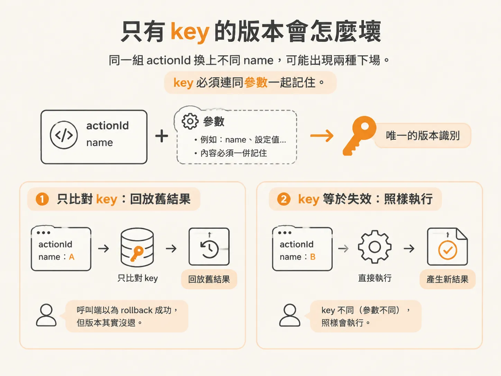
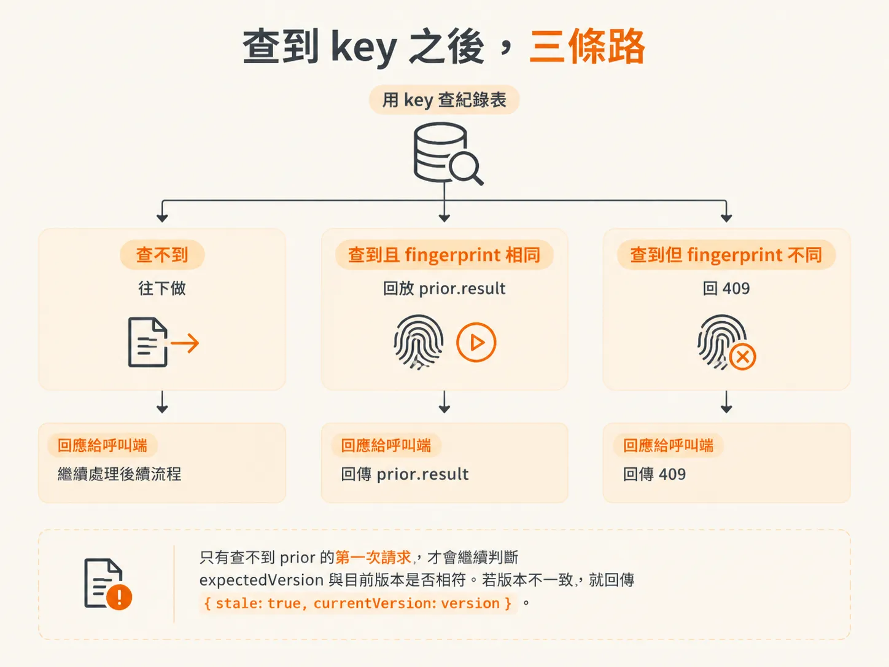
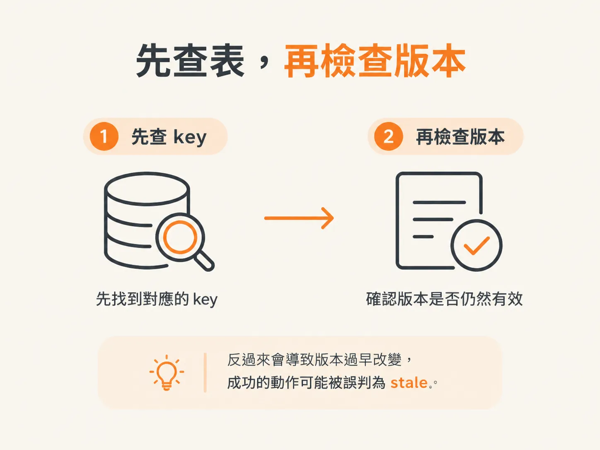
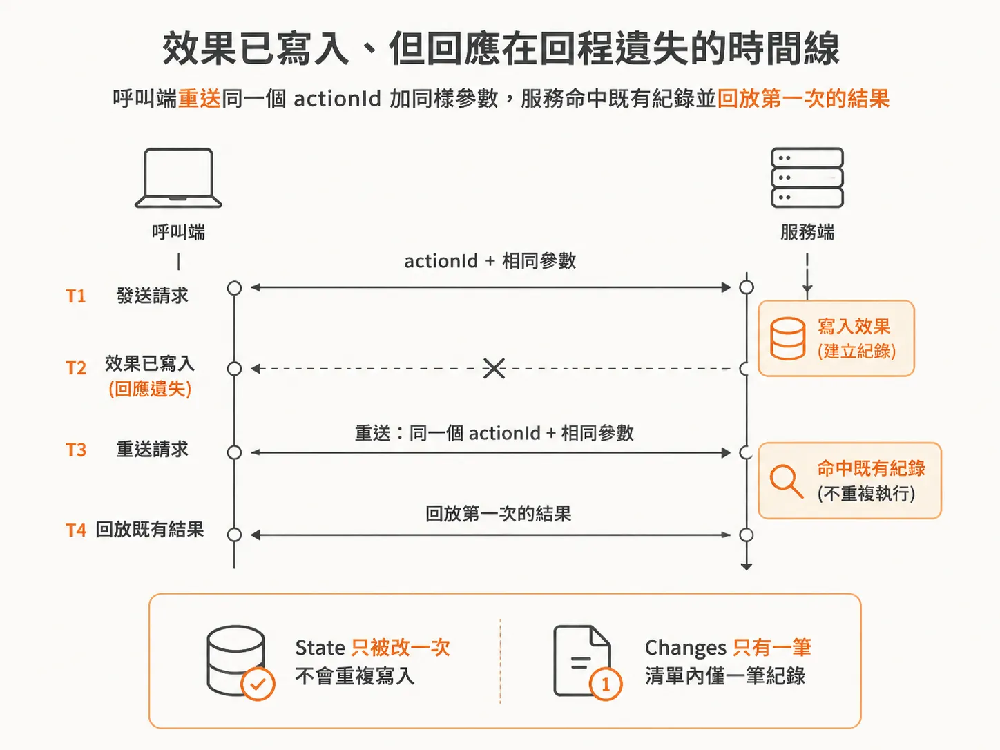

# idempotency key 綁參數：effect owner 記住結果

上一篇把問題縮到「同一個效果只發生一次」，並說我們會用 action ID 當 key。這篇要處理的是：給了 key 之後，還缺什麼。

你的 agent 送出一次 `rollback_release`。請求順利抵達服務，服務也確實把版本退回去了；但回應在回程途中遺失，agent 只收到 timeout，於是負責任地把請求再送一次。

如果第二次被當成全新的操作，版本就可能被多退一次；如果被當成原本那次操作，卻又拿不到結果。

**idempotency key** 處理的就是這種狀況：效果已經完成，回應卻沒有回來。

問題是，只給 key 還不夠。

## 只有 key 的版本會怎麼壞

你帶著 `actionId` 作為 idempotency key，服務回覆：「這個 ID 我做過了。」接著回傳 200。乍看之下很合理，直到有人拿同一個 key，搭配不同參數重新送進來。

第一次的操作是 `disable_feature`，第二次改成 `rollback_release`，但兩次使用完全相同的 `actionId`。

如果服務只比對 key，直接說「做過了，不再執行」，它可能回傳 `disable_feature` 的結果；但你這次問的是 rollback。你以為操作成功，實際上版本根本沒有退回去。

反過來也一樣。如果服務只比對 key，卻把不同參數的請求照常執行，那麼 key 就失去意義，重試也會變回重新執行。

所以 key 綁的不只是「哪一次」，還要綁「哪一次的什麼內容」。



## 記住參數與結果的對應

真正產生效果的那一方，也就是這裡的 checkout 服務，需要保存一張紀錄表。

收到 key 後，服務可以查到當時使用的參數，以及最後回傳的結果。這張表就是日後回放結果的依據。

服務會用一個 **fingerprint** 代表「這次請求的參數」。它沒有把整個 request 原封不動存起來，只把所有會影響結果的欄位串成一個字串。

`actionId` 不放進 fingerprint，因為它本來就是查表時使用的 key；`name` 和 `expectedVersion` 則要放進去，因為只要換掉其中一個，就代表另一個效果。

## 查到 key 之後，三條路

整個 handler 的核心判斷只有幾行：

<!-- source: sources/background-agents/20261027/service/checkout.ts#L131-L137 -->

```ts
const fingerprint = JSON.stringify({ name: input.name, expectedVersion: input.expectedVersion })
const prior = outcomes.get(input.actionId)
if (prior) {
  if (prior.fingerprint !== fingerprint)
    return response.status(409).json({ error: 'Action ID reused with different arguments' })
  return response.json(prior.result)
}
```

查到 `prior` 之後，只有兩條路。

- fingerprint 一樣：把 `prior.result` 原封不動回放。
- fingerprint 不一樣：回傳 409，拒絕這次請求。

回 409 而不是 400，差別在於：400 是參數格式不對，409 是同一個 ID 被拿去搭配別的參數。

同一個 key 只能代表一件事，現在卻有人拿它宣告第二件事，這是語意衝突。

只有查不到 `prior` 的第一次請求，才會繼續判斷 `expectedVersion` 與目前版本是否相符。若版本不一致，就回傳 `{ stale: true, currentVersion: version }`。



## 先查表，再檢查版本

這段程式有個容易被忽略的順序：stale 檢查排在 `prior` 之後。

順序換過來就會出錯，所以它只能長這樣。

`prior` 存在，代表這件事的決定已經完成。此時不能再拿「現在的版本」，重新判斷一個已經做完的決定。

重播時，版本可能早就變了。如果先檢查版本，就會把原本成功過的操作誤判成 stale。

所以版本檢查只留給真正第一次送進來的請求。



## 弄壞它：把回應弄掉

要驗證這套設計，最直接的方法就是把回應弄掉，觀察效果會不會重複。

`handle` 裡有一段模擬情境：效果已經 commit，但服務回傳 503，假裝 acknowledgment 在網路上遺失。

<!-- source: sources/background-agents/20261027/service/checkout.ts#L170-L180 -->

```ts
outcomes.set(input.actionId, { fingerprint, result })
if (
  loseNextActionResponse &&
  (input.name === 'disable_feature' || input.name === 'rollback_release')
) {
  loseNextActionResponse = false
  return response
    .status(503)
    .json({ error: 'Simulated acknowledgement lost after the operation committed' })
}
return response.json(result)
```

你的 agent 收到 503，於是用同一個 `actionId`，搭配相同參數重新送出請求。

這時候，`prior` 會被查到，而且 fingerprint 相同。服務回傳第一次的 `result`，不會再次修改 state。

你去查看 changes 清單，裡面只會有一筆。



這就是「effect owner 記住結果」的意思：不是要求呼叫端很乖、永遠不重試，而是就算它重試了，效果也不會多跑一次。

## 呼叫端還是會呼叫，只是拿到「做過了」

從呼叫端的角度來看，重試時它仍然會呼叫 action，也仍然會收到回應。

差別在於回應內容：可能是第一次執行時的原始結果，也可能是你定義的「這個 key 已經做過了」。

所以 idempotency 管的是效果，不是呼叫。

最省力的一條規則是：**同一個 run 永遠使用同一個 key。**

不要每次重試都重新產生一個 UUID，因為那等於每次都在宣告一件新事。只有 key 保持穩定，effect owner 才能認出：「這是同一件事。」
