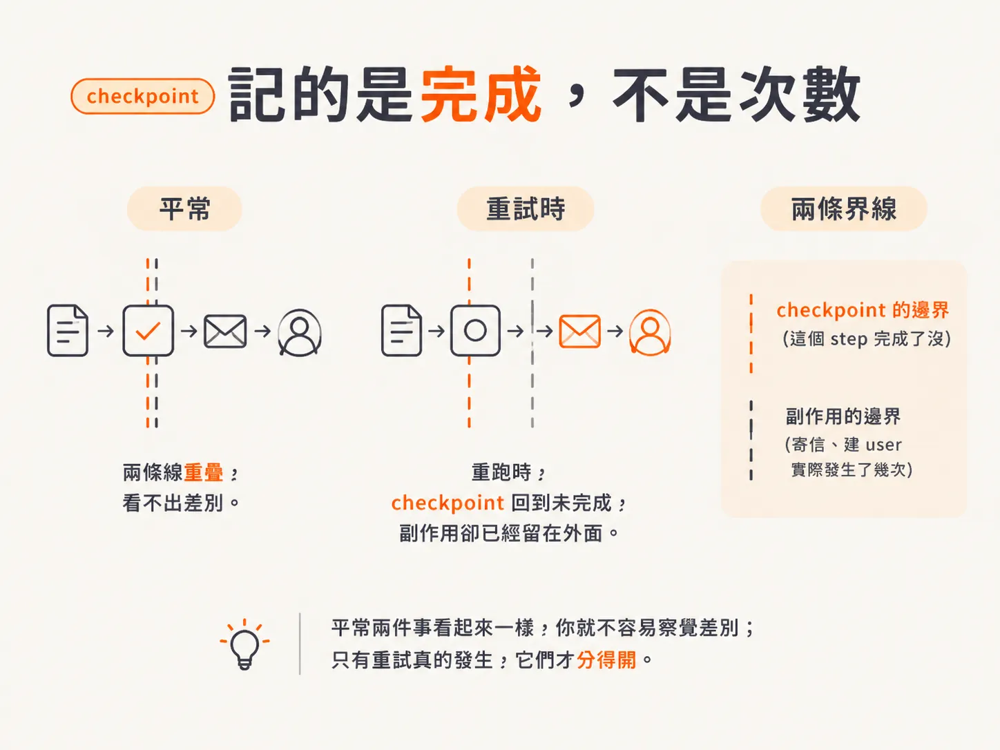
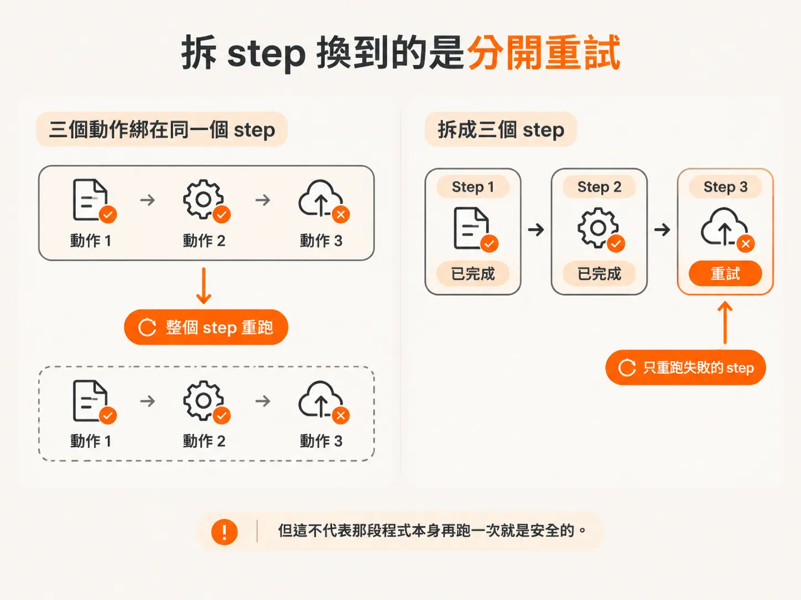
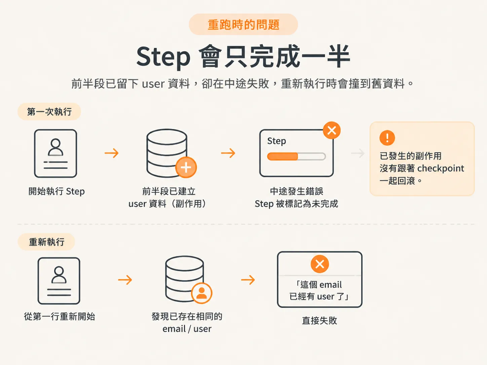
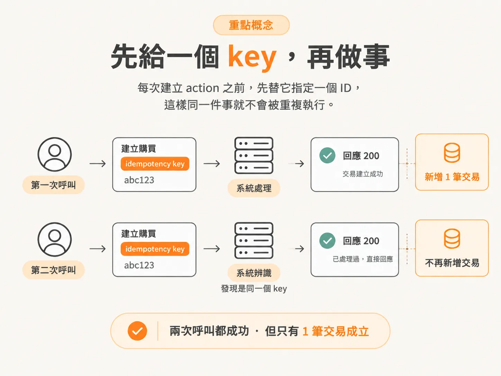

# 拆 step 還不夠：checkpoint 擋不住重複的副作用

你的 agent 已經拆成一個個 step。每個 step 有自己的名稱和邊界，失敗時也會重跑。看起來重試這件事已經解決了。

然後你在 log 裡發現，同一封信寄了兩次；或是資料庫裡出現兩個 user，只差在 email 的大小寫不同。

問題不一定是 checkpoint 壞了。

checkpoint 記錄的是「這個 step 完成了沒」，從來沒有記錄「這個 step 的副作用發生了幾次」。

平常這兩件事看起來一樣，你就不容易察覺差別；只有重試真的發生，它們才分得開。

## 拆 step 換到的是「分開重試」

先講清楚拆 step 到底換到什麼。

不要把好幾個非同步操作全塞進同一個 step，尤其是會改到外部狀態的那種。塞在一起，你想分開重試，就得自己在裡面處理交易；拆成各自的 step，就能直接拿到分開重試的效果。

失敗的時候，這個好處就很具體。

同一個 step 裡有三個動作，前兩個成功，第三個失敗。重跑這個 step 時，前兩個動作照樣會再跑一次，不會自動跳過，因為它們屬於同一個 step。

如果重跑會讓系統出問題，就該把這些動作拆成各自的 step。

拆開之後，處理的是「重試的粒度」：只重跑真正失敗的那一段，已經成功的兩個動作不會跟著再跑一次。

但這不代表那段程式本身再跑一次就是安全的。

## step 會只完成一半

拆好 step 之後，還有另一層問題。

假設一個 step 會呼叫你的 API route，裡面一大段商業邏輯，可能有 50 行程式。跑到一半出錯，step 沒完成、回傳失敗，系統就會重跑它。

聽起來好像沒問題：step 沒完成，本來就應該重跑。

但前面那 50 行可能已經建立了一個 user，或做了一堆其他事。現在整個 step 要從頭再跑一次，這個 step 就不 idempotent 了。所謂 idempotent，是「重複執行時，不會再次造成相同影響」。

重跑的結果可能是，系統發現「這個 email 已經有 user 了」，然後直接失敗。

接著你就掉進一個很討厭的迴圈。

第一次失敗時，你不知道真正原因；重跑之後又失敗，這次的錯誤訊息你反而看得懂。但它已經不是原本那個錯了，是上一次嘗試留下的殘骸。

系統並沒有回到「什麼都沒發生」的狀態，它停在「已經做了一半」。

checkpoint 在這裡幫不上忙。它只知道這個 step 沒有完成，不知道 step 內部其實已經執行到第三十行。

## idempotent 的程式長什麼樣？

同一個 step 再跑一次時，即使上一次只完成一部分，也不應該因此壞掉。

上面的例子會失敗，是因為程式把「已經做過」當成「發生錯誤」。

如果程式是 idempotent，它會判斷：

- 「user 已經存在，那就跳過。」
- 「這件事已經做過了，那就不要重做。」

接著直接從上次中斷的地方繼續執行。

差別不在於「重跑時剛好沒有出錯」，而在於程式知道自己上次已經走到哪裡。

上一次嘗試留下的狀態，對它來說是進度，不是障礙。

## Stripe 的做法：先給一個 key，再做事

Stripe 的做法很直接。

你在 Stripe 發出建立購買的 API 請求時，可以帶一個 idempotency key。下次重試帶著同一個 key，Stripe 就會去查：

「這個請求我們已經處理過了，不要再做一次。」

接著直接回你 200。

所以你的呼叫還是成功，但那個修改動作不會再發生一次。

為什麼要這麼麻煩？

因為你絕對不會希望 server 重播某個請求，或不小心把 API 呼叫兩次，結果多收客戶一次錢。

我們做的也是同一件事，只是把這個 key 叫 action ID。

每次建立 action 之前，先替它指定一個 ID，這樣同一件事就不會被重複執行。

## 兩條規則，只做到一條還不夠

在 durable execution 這一層建立系統時，有兩條規則要記住。

第一，workflow 的程式碼必須是 deterministic：每次用相同輸入重播，都要得到相同結果。`createFunction` 裡、但不在 step 裡的所有程式，都必須符合這個條件。

第二，step 本身必須是 idempotent。

假設一個 step 會執行一次 mutation，也就是修改資料或外部狀態的操作。即使我呼叫它兩次，它也不應該真的執行兩次 mutation。

拆 step 是結構上的安排，讓重播時有東西可以對照。

但「呼叫兩次，實際只做一次」是 step 裡那段程式自己的責任。你把 step 拆得再漂亮，裡面那 50 行程式沒有做到 idempotent，重跑時照樣會撞牆。

## 這是後端的大題目，但你得做

老實說，這原本不是我的專業。

這是後端領域，我不是後端工程師，只是個 generalist。題目很大，很多團隊都專門在研究這些問題。

但只要你開始和這類系統打交道，就得處理它。

所以，我們就來做。
