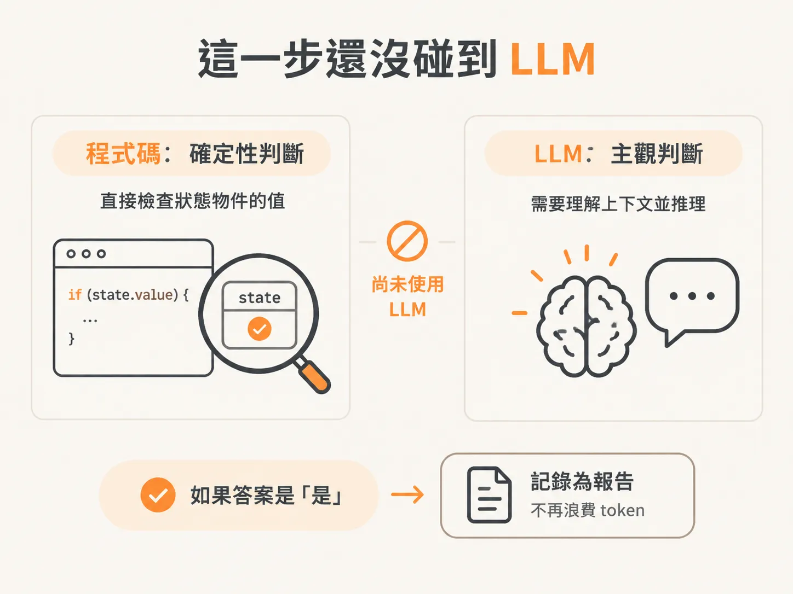
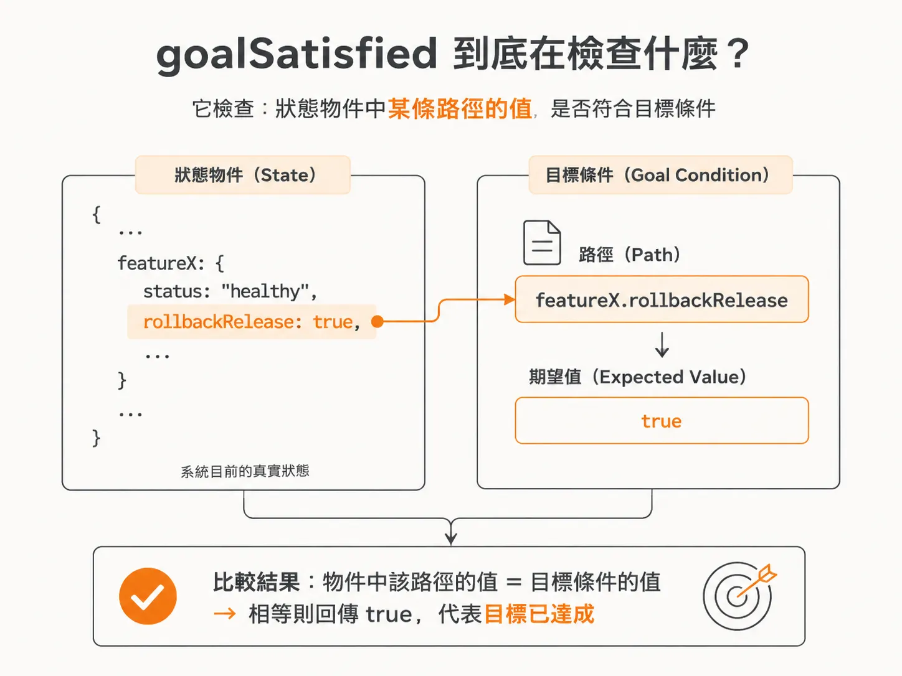
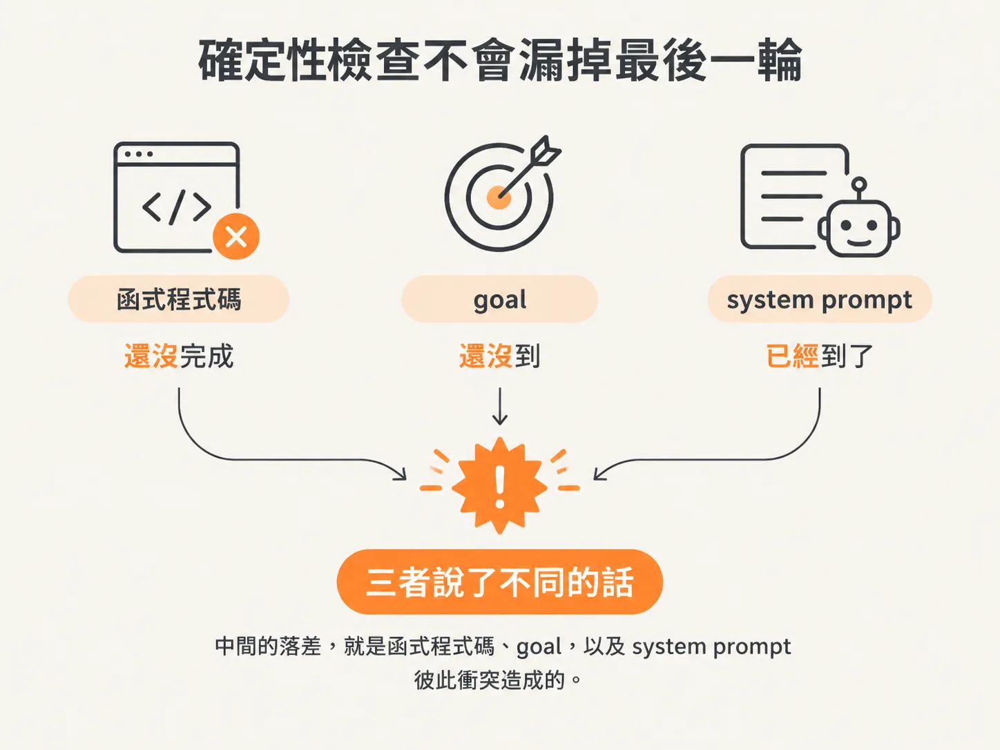

# 目標不是一句話，是機械可驗證的 GoalCondition

上一篇把 agent 做決策時看到的三樣東西（world state、run state、execution history）講完了。但還缺一樣更根本的：它到底要朝什麼目標前進，才算「做完了」？

寫 agent 時，我們很容易把「目標」想成一句話，例如：

- 讓服務恢復正常
- 把壞掉的 release 回滾

接著，再把這句話放進 system prompt，期待 LLM 自己判斷「我做到目標了嗎？」

這在聊天型 agent 裡很自然，但在背景執行的 agent harness 裡，目標是另一種東西：它應該是可以由程式機械驗證的檢查，而不是交給 LLM 主觀判斷。

## 每一圈先觀察，再判斷是否達標

在迴圈最上方，每一輪都要先觀察世界，取得最新狀態。

具體來說，就是 `await` 一個已經寫好的 helper，傳入 `environmentId` 和 `runId`，詢問它：

> 這個環境中的這個 run，目前狀態如何？

拿到狀態後，就要檢查它是否已經達到目標。

如果觀察到的狀態代表「一切正常」，那就直接結束，不需要再做任何事。

舉個具體例子。假設狀態是一個物件，裡面有一個 `server status` 欄位：

- `500` 代表服務故障
- `200` 代表服務正常

我們要做的，就是觀察這個狀態，確認它是否已經回到「一切都好」的位置。


這個 agent 的工作，是在背景持續看著世界，直到它變好。而「好」的定義，是我們事先決定的。

一旦世界符合這個定義，agent 就不需要再採取任何動作。

## 這一步還沒碰到 LLM

到目前為止，做的全部都是 harness 的工作，還沒有用到 LLM。

這只是 harness 在做確定性檢查：

> 我們已經達到目標了嗎？

如果答案是「是」，就把目前發生的事情寫成報告。這樣一來，就不必再浪費 token，讓 LLM 決定下一步要做什麼。



具體的判斷方式是：把目前的 `state` 和 `run.goalCondition` 傳進 `goalSatisfied`。

每個 run 都會帶有一個 `goalCondition`，也就是目標條件。如果 `goalSatisfied` 回傳 `true`，就表示目標已經達成。

達標後，會依序做四件事：

1. `await writeReport`，把 `goal` 和 `state` 傳進去，寫出報告。
2. `await` 更新這個 run，將同一個 ID 的 run 標記為完成。
3. 把狀態設成 `completed`，清除 `state`，並附上剛剛產生的報告。
4. 最後 `return` 這份報告。

如果之後又收到同一個 `runId` 的事件，就代表狀態出了問題。因為這個 run 已經結束了，不應該再期待它繼續收到事件。

## `goalSatisfied` 到底在檢查什麼？

有人會問：thinking function 裡的工作，是不是包含兩件事？

1. 檢查目標是否已經滿足
2. 選擇下一個動作

「檢查目標是否滿足」確實可以交給 LLM，但在這個案例裡，它是確定性檢查。

原因很簡單：`state` 是一個物件，我們可以直接查看其中的 key。而且我們是自己領域的專家，知道「好的 state」應該長什麼樣子，所以寫一個函式檢查就足夠了。

`goalSatisfied` 會接收目前的 `state` 和 `goalCondition`。

`goalCondition` 的意思是：

> 如果物件裡某一條路徑等於某個值，就算通過。

例如，條件可能是：

<!-- derived -->

```text
rollbackRelease === true
```

這表示回滾已經成功，狀態良好，可以繼續往下走。

又或者，我們想關掉某個 feature，條件是它「不再處於故障狀態」。只要物件裡的值符合這個條件，同樣代表目標已經達成。



## 確定性檢查不會漏掉最後一輪

有人可能會擔心：

> 如果目標是在最後一次迭代才達成，系統會不會沒抓到？

會抓到。

這正是確定性檢查的用途：任何被描述成「完成條件」的狀態，只要真的出現，程式就應該能明確判斷出來。判斷成功後，這個 run 就不會再繼續迴圈。

另一種情況是，確定性檢查說「還沒完成」，但 agent 往下執行後，自己判斷「已經完成」。

這其實是兩件不同的事：

- 我們定義的完成
- agent 認為的完成

中間的落差，就是函式程式碼、goal，以及 system prompt 彼此衝突造成的。



這種落差通常是開發者自己的 bug。

可能是 agent 看到的 goal 和 system prompt，跟我們用來檢查目標的確定性程式碼，根本在描述兩件不同的事。

例如：

- goal 說：還沒達成
- agent 卻說：根據你要求我做的事，已經完成了

這時候，問題不在 agent，而在於開發者沒有把這些定義對齊。你需要補上這個落差，讓程式碼、goal 和 system prompt 說的是同一件事。

但你也可能發現，這個落差沒有辦法用確定性的方式補起來。那就要回到下一個問題：

## 什麼時候把目標檢查交給 LLM？

如果「判斷目標是否達成」本身就需要推理，那就可以在這裡加入一次 LLM 呼叫。

例如，你目前不知道，或暫時不想處理「怎麼評估目前狀態才算好」。可能是：

- 還沒整理到那個程度
- 實際上很難做到
- 用程式處理的成本太高

這時候，就可以讓 LLM 負責判斷，並且替這個 LLM 撰寫 evals，確認它的判斷品質。

甚至，如果你發現自己寫不出正確的程式碼來判斷目標是否完成，但 agent 每次都能抓到、判斷也是對的，那也可以直接把目標檢查改成一次 LLM 呼叫。

這樣做還有另一個好處：你會多一個不同的評估角度。

這個 LLM 可以擁有自己的 system prompt，只關心一件事：

> 目標達成了嗎？

它不需要同時思考下一步要做什麼。問題範圍更小，判斷通常也更準確；你甚至可以為這項工作改用另一個模型。

關鍵在於，LLM 不該被到處使用，而要放在真正適合它的地方：

- 你無法用程式明確推理的地方
- 交給 LLM 判斷更合理的地方

該不該使用 LLM，沒有永遠固定的答案，必須透過實驗找出適合自己的做法。
