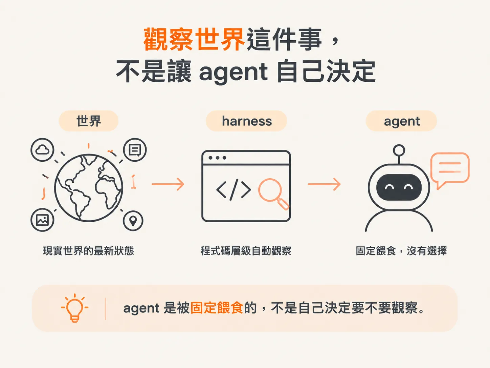
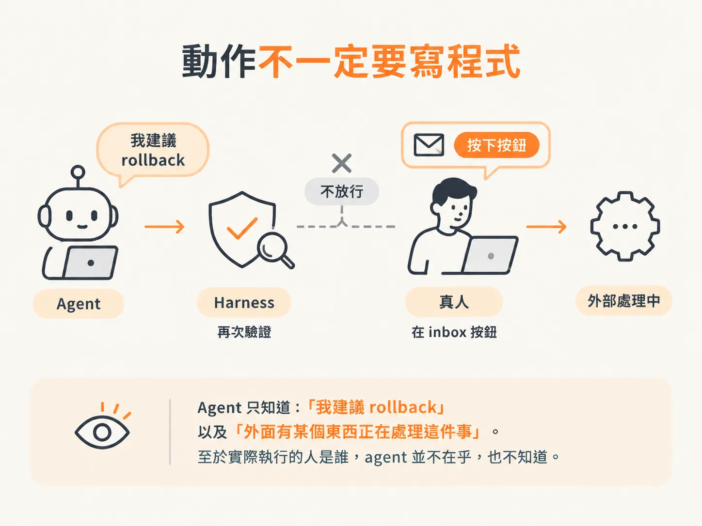
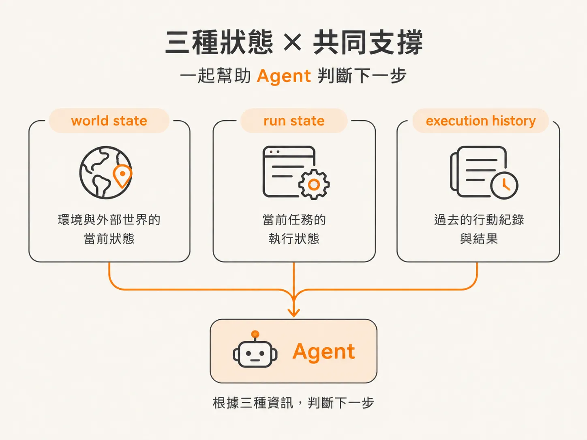

# 決策真正看到的三樣東西：world state、run state、execution history

上一篇說，agent 看到的世界是一張狀態快照，不是對話紀錄。這篇往前一步：拿到快照之後，agent 在決定「下一步要做什麼」的那一刻，手上到底有哪些資訊？

先想一個熟悉的畫面：你用過 Claude Code 之類的工具，輸入一句話，它回覆一段內容；必要時，它說「我要讀這個檔案」，接著就動手。它在動手前做決定的那一刻，到底看到了什麼？

背景 agent 每次要決定下一個動作前，都會拿到三樣東西：

- **world state**
- **run state**
- **execution history**

這些資訊不是 agent 自己挑的，而是外部程式在每一輪自動提供給它。

## 觀察世界這件事，不是讓 agent 自己決定

傳統的 tool loop 通常是這樣想：

給 agent 一堆工具，再給它一個 prompt，接著由它自己挑一個工具來使用。

但這個 harness 不一樣。

不管怎樣，我們都會自動觀察目前的世界。這不是 agent 可以選擇的事，而是在程式碼層級完成的：我們把最新狀態餵給 agent。每跑一輪 loop，就提供一份新的狀態。

agent 是被固定餵食的，不是自己決定要不要觀察。

Agent 真正要做的事只剩一件：

根據目前的狀態、我們的目標，以及過去已經採取過哪些動作，判斷下一步要做什麼。

## 動作不一定要寫程式

這些動作不一定都和程式碼有關。

有些動作是結束流程，例如：「下一步是回報我完成了。」

有些是等待更多資訊，例如：「我先暫停，等新的資料進來。」

有些是詢問人類，因為 agent 完全看不懂目前的情況。

也有些是繼續學習或調查，例如使用創造者提供的工具查看 log、進一步了解問題。

Agent 選好動作後，harness 還會再驗證一次，確認這個動作是否真的可以執行。

例如，harness 的作者可能會決定：

- 不希望 agent 執行 rollback
- 不希望 agent 重新部署
- 不希望 agent 執行可能惹麻煩或花錢的操作

因此，這些限制會直接標記在 harness 裡。

如果 agent 說：「我要 rollback。」

harness 就會檢查：rollback 是否開放給 agent？

如果沒有，就不執行。接著，系統可以改由真人在 inbox 裡按下按鈕完成 rollback。

但 agent 不會知道這個細節。它只知道：「我建議 rollback」，以及「外面有某個東西正在處理這件事」。至於實際執行的人是誰，agent 並不在乎，也不知道。

這和「讓 agent 自己判斷這件事是否該交給人處理」完全是兩回事。

如果把這個判斷交給 agent，它總有一天會說：「我自己處理有很好的理由。」而且你仔細一看，理由可能還真的很有道理。

接著，你就會一直追著它跑，像是在和一隻貓玩。

Anthropic 的 agent guidance 會把這幾類事情分開：

- **model directed actions**：由模型自己決定要做什麼。
- **predefined workflows**：事先定義好的流程。
- **harness delegated actions**：交由 harness 決定的動作。

這些控制發生在 harness 層級，而不是 agent 層級。

## 進程式碼之前，先把三種狀態講清楚

在看程式碼之前，先釐清幾個狀態。

- **World state**：伺服器與服務目前的狀態。例如服務是否健康、是否回傳 200，以及最近出現過哪些 alert。
- **Run state**：這次 investigation 目前的狀態。例如我們已經知道什麼、發生過哪些 alert，以及做過哪些事。它和 world state 是分開的。
- **Execution history**：到目前為止，系統已經採取過的所有動作。

每次決策，agent 都會根據這三種資訊判斷下一步。

## 一個 run 就是一組狀態，先查有沒有既有的 run

Run state 不是飄在空中的，它會掛在一個 **runId** 底下。

流程開始後，第一件事就是確認：是不是已經有一個 agent run 正在執行？

我們會呼叫 `getRun`，並把 `runId` 傳進去。

如果已經存在這個 run，就可以從上次停下的地方繼續，帶著原本的上下文。

這個查詢本身只是去資料庫確認幾件事：

- 這個 `runId` 是否已經有資料？
- 這是新的呼叫，還是同一個 run？
- 是否會因此重複開啟 investigation？

這件事和 AI、harness 都沒有直接關係。

它就像用 user ID 查詢使用者一樣：我們只是用 `runId` 查詢 run，確保同一個 investigation 不會被重複建立。
