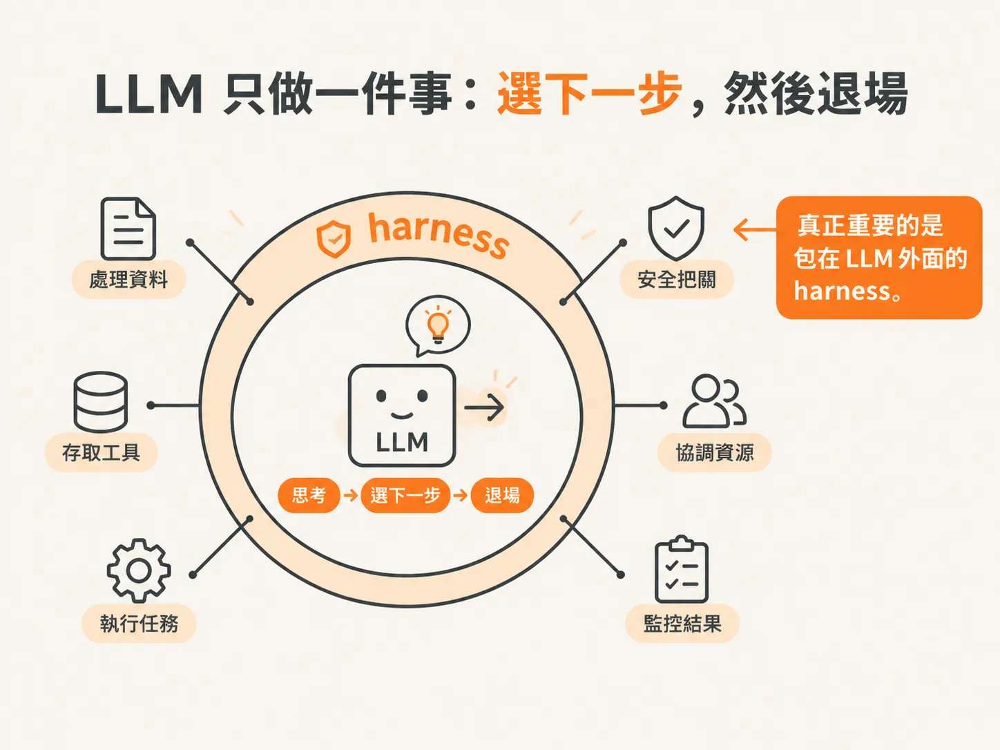
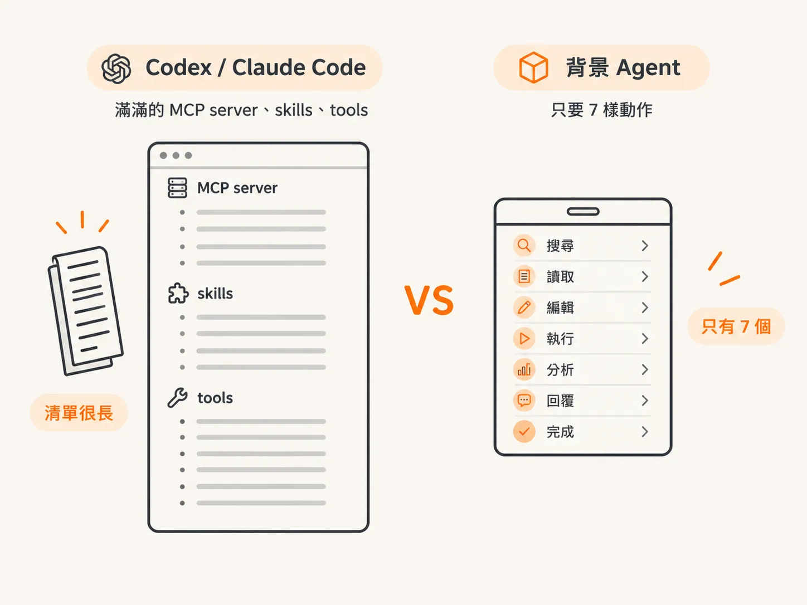
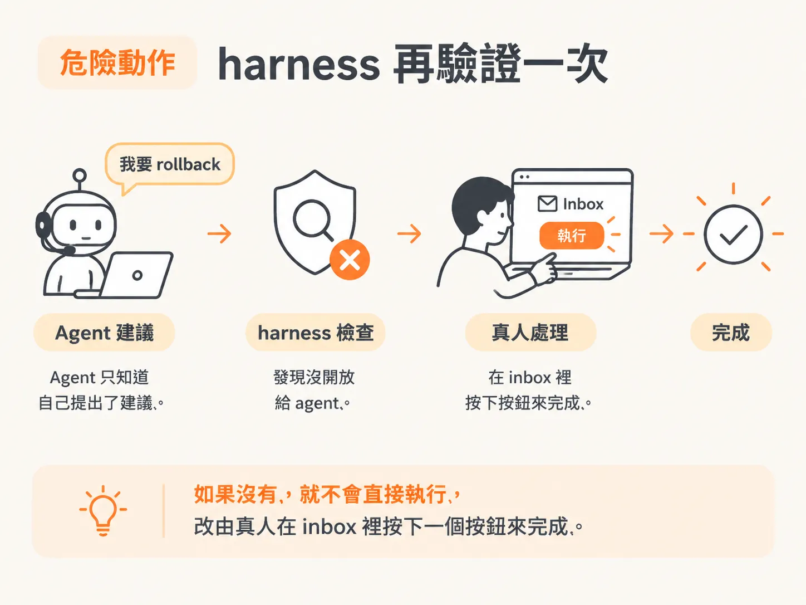
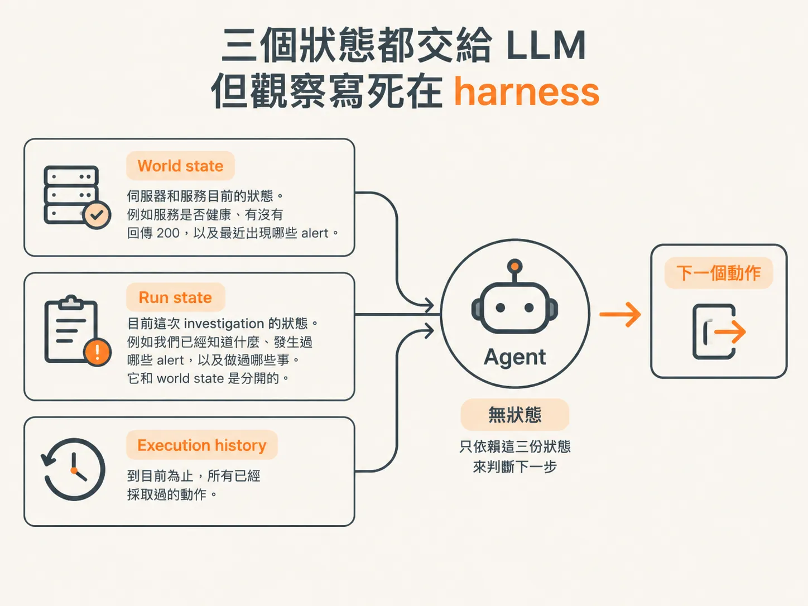

# 動作目錄為什麼很小：LLM 只選下一步，harness 把關

上一篇說，目標是機械可驗證的檢查，LLM 只在需要推理的地方出場。順著這個思路，下一個問題就來了：LLM 真正能選的動作，目錄到底有多小？

如果你用過 Codex 或 Claude Code，大概已經習慣工具多到數不完：裝一堆 MCP server、skills、tools，好像工具越多，Agent 就越厲害。

但這個背景 Agent 的工具清單小得讓人懷疑是不是漏看了什麼。從頭到尾，只有七樣。

這是刻意的設計，不是偷懶。原因有兩個：

1. LLM 沒有狀態，只負責選下一步。
2. 真正危險的動作，交給 harness 再驗證。

## LLM 只做一件事：選下一步，然後退場

有句話聽起來可能有點怪，但在這種系統裡，LLM 其實是最不重要的一塊。

它只負責一件事：思考、選下一步，然後退場。

其他事情都不用它處理。真正重要的，是包在 LLM 外面的 harness。

為什麼要這樣設計？

因為我們根本不是要做多輪對話。

如果你要建一個 chatbot，放進 `generateText` 的通常會是 `messages`，也就是一串訊息陣列。這樣使用者才能和模型一來一往地聊天。

但這個系統不是這樣。

我們沒有追蹤 `messages`，這裡根本沒有對話紀錄。每次呼叫 `chooseAction` 時，LLM 只會拿到當下提供的資訊：

- 你的目標是什麼
- 現在的世界狀態如何
- 之前做過哪些動作

就這樣。

它不知道前面發生過什麼，也沒有聊天紀錄。因此，它是完全 **stateless** 的。

「Stateless」就是「無狀態」。白話說，每次呼叫都像拿到一張白紙，不會記得上一次做過什麼。

既然 LLM 沒有狀態，它能做的事情就很單純：根據目前狀態、目標，以及過去動作的紀錄，判斷下一步要做什麼。

它只需要判斷「下一步」，不必了解整個系統，也不負責實際執行。

## 工具清單小到七樣

既然 LLM 只負責選下一步，動作目錄自然不需要很大。

我們的工具清單其實只有七項，Agent 可以：

- 檢查 log
- 檢查變更
- 停用某個功能
- 回復某個版本
- 等待
- 求助
- 最後說「我完成了」

就這些，沒有很誇張。

如果你用過 Codex 或 Claude Code，可能已經裝了一堆 MCP server、skills 和 tools。跟那些工具清單相比，這裡的目錄幾乎像便利商店的小抽屜。

而且，這些動作不一定都和程式碼有關。

有些是終止型動作，例如：「下一步是說我完成了。」

有些代表需要更多資訊，所以先暫停、等待新的狀態。

有些則是遇到完全看不懂的事情，必須向人求助。

也有些是「我需要再調查一下」，因此使用 harness 作者提供的工具去查看 log、檢查變更。

## 危險動作：harness 再驗證一次

Agent 選好動作之後，harness 會再驗證一次，確認這個動作是否真的可以執行。

舉例來說，身為 harness 的作者，你可能會想：

「我不希望 Agent 做 rollback，也不希望它重新部署，更不希望它自行執行任何可能惹麻煩或花錢的事。」

因此，我們會在 harness 裡把這些動作標記起來。

假設 Agent 說：「我要 rollback。」

harness 就會檢查：

「Rollback 有開放給 Agent 嗎？」

如果沒有，就不會直接執行，改由真人在 inbox 裡按下一個按鈕來完成。

但 Agent 不知道這件事。

Agent 只知道自己「建議要 rollback」，不知道最後是誰實際執行。它只知道外面有某個東西正在處理，至於那個東西是不是人，Agent 並不在乎。

所以，動作目錄小的另一個原因是：

真正危險、可能花錢或惹麻煩的動作，根本不會放進 Agent 的目錄。

這些動作會交給 harness 把關。Agent 只能提出建議，最後再由真人在 inbox 裡按鈕執行。

## 為什麼不讓 LLM 自己判斷？

你可能會想：

「為什麼不乾脆讓 Agent 自己判斷，這件事到底該不該找人？」

問題就在這裡：讓 Agent 自己判斷要不要找人，和直接把規則放在 harness 裡，是完全不同的事。

我可以保證，讓它自己判斷的話，它總有一天會判斷錯。

不管你使用哪個模型，總有一天它會說：

「我自己來是有充分理由的，原因是……」

而且你仔細一看，還真的覺得很有道理。

例如它可能說：

「因為那時候大家都在睡覺。」

你就會想：「好啦，我懂，這確實有道理。」

接著，你再補一個 prompt：

「如果大家都在睡覺，就不要這樣做，改成那樣。」

然後下一次，它又會找到另一個聽起來合理的理由。

你就這樣永遠追著它跑，像是在和一隻貓玩。

所以，Anthropic 的 agent guidance 會區分幾種不同的動作：

- **model directed actions**：讓模型自行決定要做什麼。
- **predefined workflows**：事先定義好的流程。
- **harness delegated actions**：交給 harness 決定的動作。

這些判斷發生在 harness 層級，不是 Agent 層級。

## 三個狀態都交給 LLM，但觀察寫死在 harness

在進入程式碼之前，先把幾個狀態講清楚。

這三種資訊都會用來幫助 Agent 判斷下一步：

- **World state**：伺服器和服務目前的狀態。例如服務是否健康、有沒有回傳 200，以及最近出現哪些 alert。
- **Run state**：目前這次 investigation 的狀態。例如我們已經知道什麼、發生過哪些 alert，以及做過哪些事。它和 world state 是分開的。
- **Execution history**：到目前為止，所有已經採取過的動作。

還有一點很關鍵：

「觀察世界」這件事，是寫死在 harness 裡的，不是讓 Agent 自己決定要不要做。

每一次 Loop，我們都會提供新的狀態。換句話說，Agent 固定會被餵進這些資訊。

Agent 唯一要做的，就是根據收到的狀態，判斷下一個動作。

繞了一圈，結論還是同一句：

動作目錄之所以很小，是因為 LLM 沒有狀態，只負責選下一步；真正危險的動作，則交給 harness 再驗證。

這不是把 Agent 的能力砍掉，而是把它放在真正擅長的位置上。
