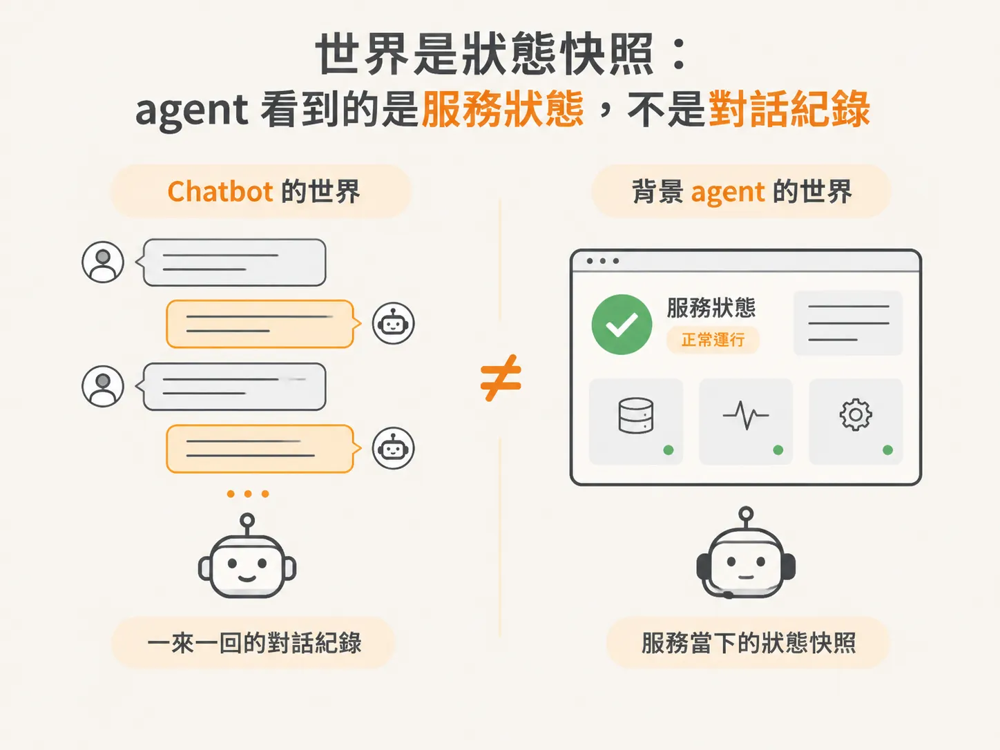
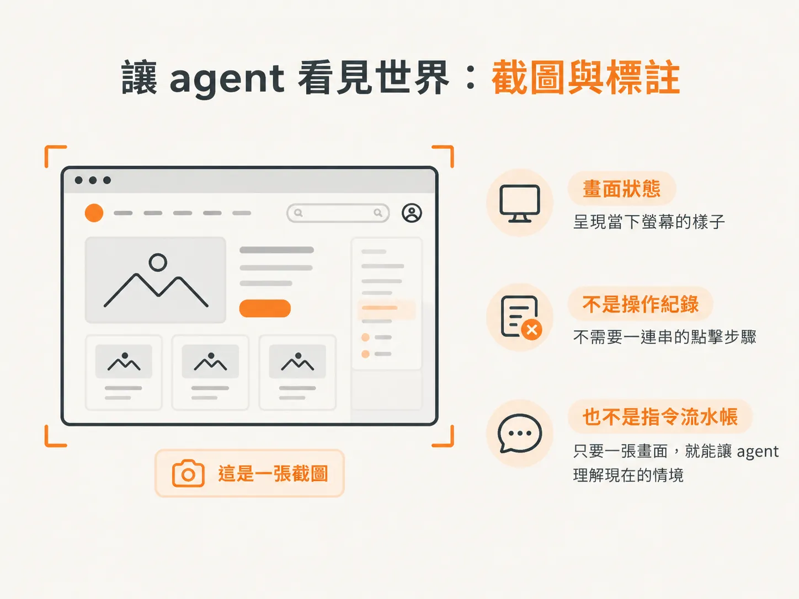
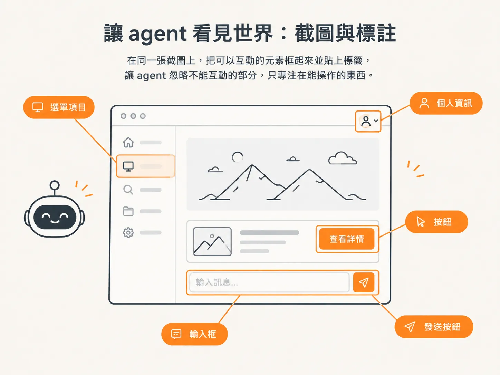
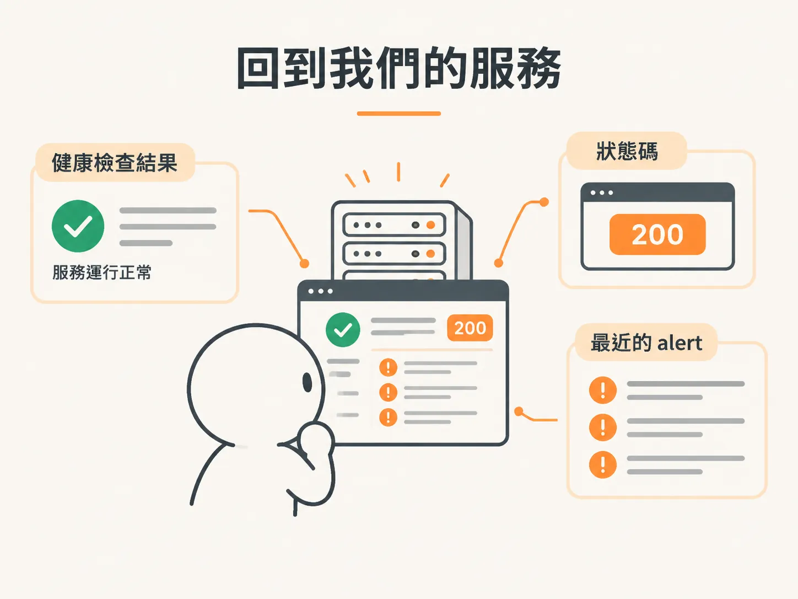

# 世界是狀態快照：agent 看到的是服務狀態，不是對話紀錄

你可能很熟悉這種畫面：和 chatbot 對話，你說一句、它回一句，螢幕上逐漸堆出一串對話紀錄。看起來，agent 的「記憶」就是這段對話。

但背景 agent 不是這樣運作的。它看到的世界，是自己負責監控的那個服務的當下狀態，而不是任何一段對話紀錄。

先繞一點路。

有一群科學家相信，要走到 AGI 或 ASI，關鍵不只是繼續替 next token predictor 堆算力、換更好的演算法，而是要讓人工系統真正理解自己所處的世界。

他們觀察到，會生成影片的模型，產出的畫面常常怪怪的，因為模型不懂物理，不知道物體接在一起應該是什麼樣子，也不理解動能和運動。

因此，這群人主張：除非能做出理解世界的 agent，否則就不會有真正的智慧。

我們沒有要走那條路。不過，「世界」這個詞很好用。

對負責觀察服務的 agent 來說，它的世界就是這個服務的狀態。它能看到、也需要知道的，就是所有和這個服務有關的資訊。

而且，這些系統有時候聰明到，只要把它所在的世界展示給它，再提供工具和目標，它也許就能自己找出辦法，讓問題回到正軌。

前提只有一個：它得看見全貌。

## 讓 agent 看見世界：截圖與標註

「把世界展示給 agent 看」聽起來很抽象，但其實有一個很具體的例子：browser agent 和 computer use。

browser agent 是幫你瀏覽網頁、到處點擊的 agent；computer use 則是讓 agent 直接在電腦上使用滑鼠操作。

要提升這類 agent 的表現，最有效的方法之一，就是讓它看到自己眼前的畫面。

做法很簡單：截一張圖，把瀏覽器畫面或桌面畫面交給它。這張截圖，就是那一刻螢幕的狀態快照——不是操作紀錄，也不是一串指令的流水帳，而是「現在畫面長這樣」。

更進一步，你還可以在截圖上加註：把可以操作的東西框起來、貼上標籤，讓 agent 忽略不能互動的部分，只專注在真正能操作的元素上。

這就是把世界展示給 agent 看。

展示數位世界很簡單，展示真實的物理世界就難多了。

## 回到我們的服務

回到背景 agent。agent 看到的世界，就是伺服器的狀態。

這個服務現在健康嗎？我們是不是拿到 200？最近進來的 alert 有哪些？

如果我們能想辦法把這些狀態整理成快照，交給 agent，再讓它決定下一步，就能做出一個幾乎像人一樣的東西。
