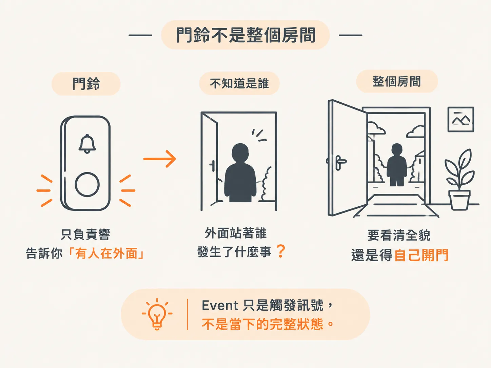
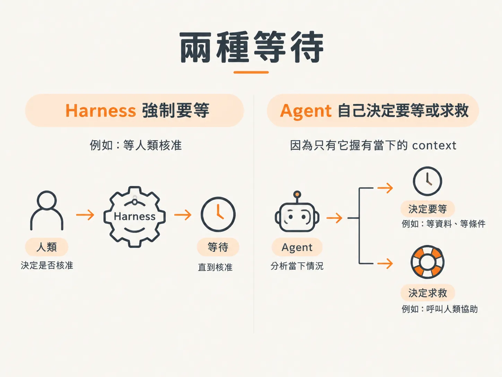
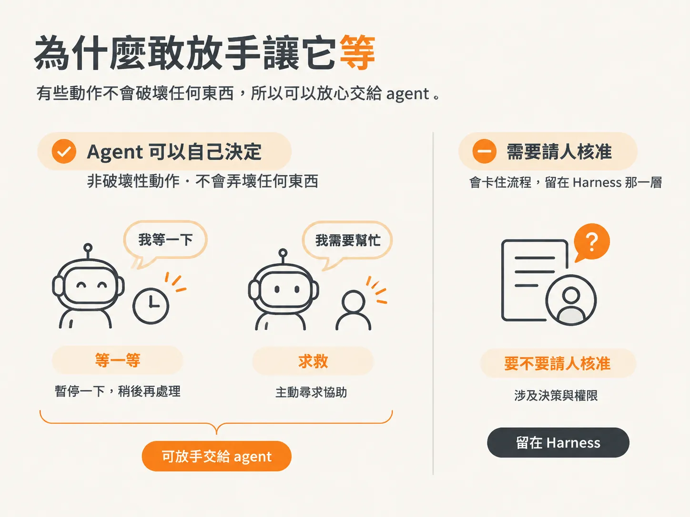

# 事件是門鈴，不是快照：醒來先重讀現況

監控 alert 跳出來，你點進去時，狀況可能早就變了。

你看到的那則通知，記錄的是「幾分鐘前的世界」，不一定等於現在。agent 也一樣：它本來在等事件，事件一到就醒來；但醒來那一刻，外面的世界可能早就不是它睡著前的樣子。

世界不會等 agent 把一個 loop 跑完。依賴可能在 agent 閒著時自己恢復，好幾個 alert 可能其實都在講同一次故障。

所以 agent 醒來後的第一件事，是重新讀取現況，先確認現在是什麼狀況，再決定下一步。

## 門鈴不是整個房間

你可以把每個 event 想成門鈴，而不是整個房間。

門鈴只負責響，告訴你「有人在外面」。至於外面站著誰、發生了什麼事，它一句都沒說；要看清全貌，還是得自己開門。

例如 checkout process 發出訊號後，API 會把它存下來，掛到目前的 incident 上；接著 agent 被喚醒，重新讀取一次 checkout process。

它不會把 event 的 payload 當成當下狀況的完整快照。那只是一個事件，不是全貌。

所以 agent 看到事件會醒來；但如果發現資訊不夠，它可能會說：「這裡沒有我能做的事，我需要看到更多資訊。」然後回去等待，看看接下來會發生什麼。

## 兩種等待

那麼，「回去等待」這個動作，是誰決定的？

這裡要分成兩種情況：一種是 Harness 強制要求等待，另一種是 agent 自己推理後決定等待。

我們應該讓模型有「選擇等待」的能力，就像人也會先等一等，看事情怎麼發展。

當然，Harness 之後也可能強制等待，例如等人類核准。但有些時候，等待是 agent 自己推理出來的結論。這種判斷沒辦法用 Harness 的固定規則取代，因為我們沒讀過那些 log，也沒像 agent 一樣跑完所有 tool call。

有些情況該由 Harness 等；有些情況得讓 agent 自己決定什麼時候等、什麼時候求救，因為只有它握有當下的完整 context。

不提供這些工具，這些判斷又該怎麼用確定的規則完成？

## 為什麼敢放手讓它等

我們目前有一些 policy，能處理 approval 這類需要等待的情況。

但對於「還不存在的資料」，我們沒辦法事先寫好 policy。這些資料得等 agent 讀完現況、做完推理，我們才知道該怎麼處理。

這件事是非破壞性的：agent 說「我需要幫忙」或「我等一下」，不會弄壞任何東西。所以我願意把這個權限交給它。

但「要不要請人核准」，我就不會讓 agent 自己決定。這類決定應該留在 Harness 這一層。

界線可以這樣看：

- **等一等、求救**：這些是不會破壞系統的決定，可以交給 agent。
- **要不要等待人類點頭**：這會卡住流程，應該留在 Harness。
