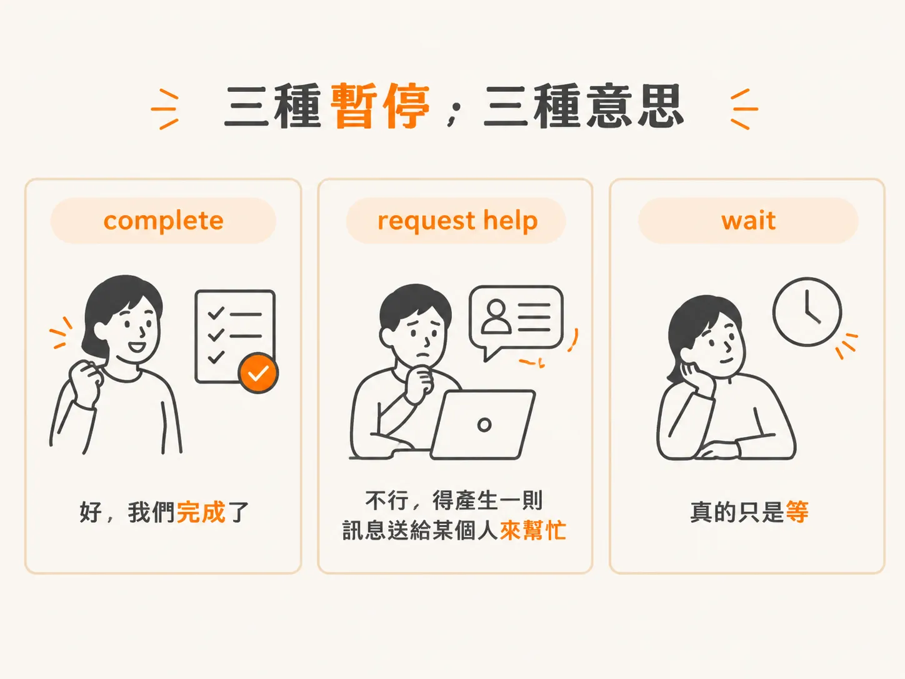
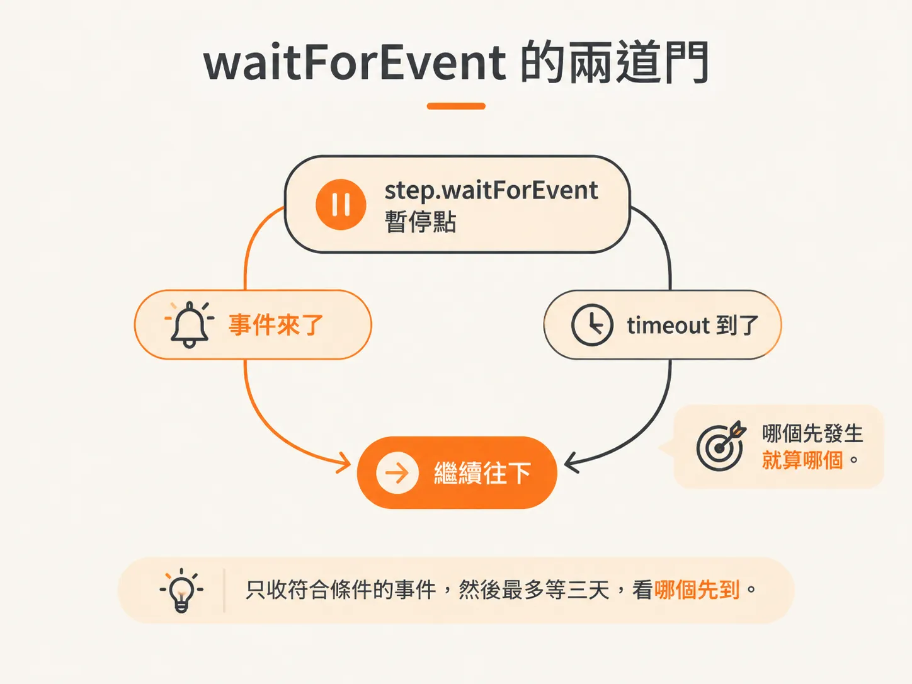
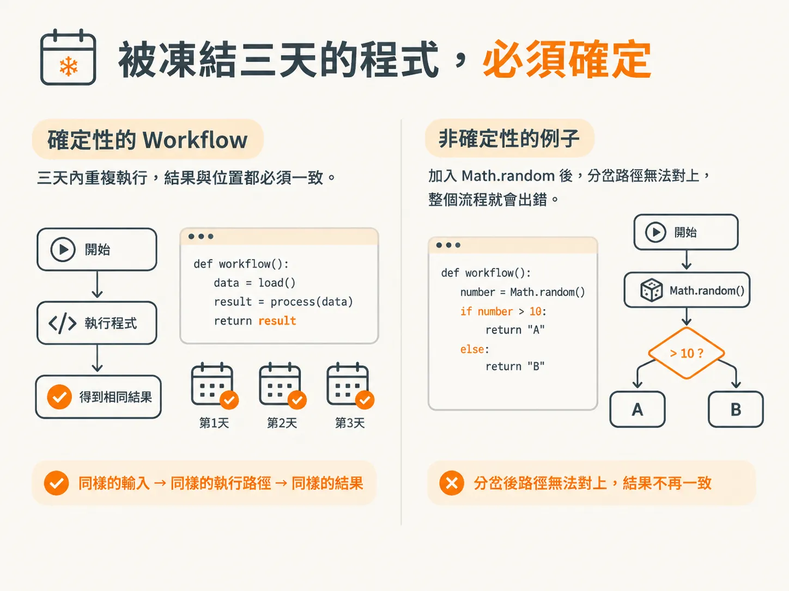
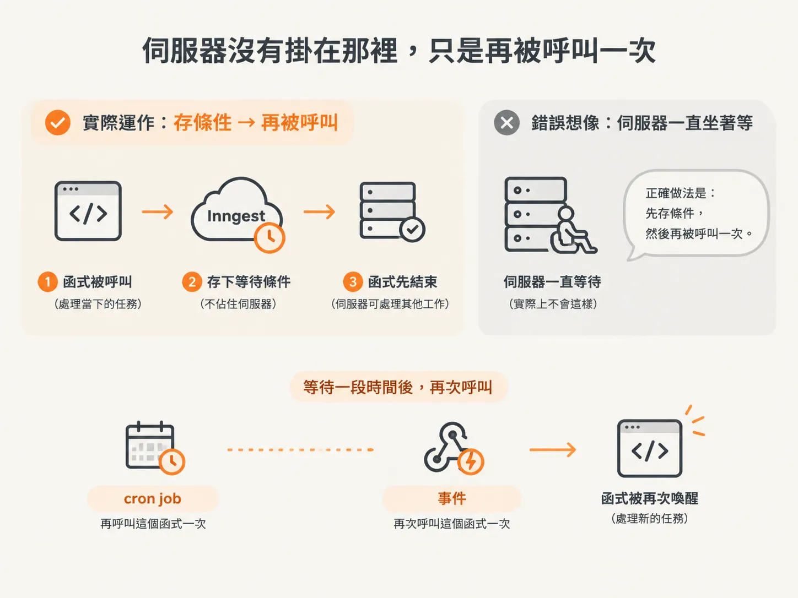

# 三種暫停，與 waitForEvent 的契約

上一篇把等待的來源分成 harness 強制與 agent 自己判斷兩種。這一篇要處理後者：當 agent 決定停下來等，程式到底該怎麼寫？

「等」看起來很簡單，麻煩的是這個字混著好幾種不同的意思。

## 三種「等」，其實不是同一件事

**wait 的意思是「不要繼續，但也不要結束」**，是一種中間狀態。

但是三種情況的「等」，內容並不一樣：

- 如果是 **complete**，那個等其實是在說：「好，我們完成了。」
- 如果是 **request help**，那個等是在說：「不行，我們得產生一則訊息，送給某個人來幫忙。」
- 如果是單純的 **wait**，那就真的只是等。

所以先定義這幾種暫停各代表什麼，再決定怎麼等。

這一篇要談的是第三種：真的只是等待的 **wait**。



## 真正要等，用 step.waitForEvent

當你真的要等，就要使用 **`step.waitForEvent`**。

寫法和 `step.run` 不同：這裡不呼叫 `step.run`，而是呼叫 `step.waitForEvent`，給它一個 step 名稱，再加上你要等的事件名稱。

接著，有兩個條件會決定它什麼時候繼續：

- 事件來了
- timeout 到了

哪一個先發生，就以哪一個為準。

中間還可以放一個 **filter**。例如要求 `data.completion ID` 等於 `generated topics ID`。

意思是我只聽這個事件，而且只有 data 符合條件時才處理；不符合的就略過。

所以這段程式就是：只收符合條件的事件，然後最多等三天，看哪個先到。



## 它怎麼告訴你「等到了沒」

`step.waitForEvent` 後面的程式，在事件進來或 timeout 發生之前，一行都不會執行。

哪個先成立，這個變數就會被填進結果：

- 有事件進來時，結果是事件本身。
- timeout 發生時，則不會有結果。

如果沒有結果，就走你為「等不到」準備的那條路；有結果就繼續往下。

<!-- derived -->
```ts
const result = await step.waitForEvent("wait-for-onboarding", {
  event: "app/onboarding.completed",
  timeout: "3d",
  if: "event.data.completionId == async.data.generatedTopicsId",
});

if (!result) {
  // timeout 先到了：沒收到事件，做你「等不到」時想做的事
}
```

## 整段都會被凍結，所以必須是確定性的

這段程式看起來只是普通的 JavaScript，但整段都會被凍結；在這個例子裡，最長可能三天。

這就是為什麼 workflow 必須是確定性的。

這三天內如果它因為任何原因又被執行一次，就得回到一模一樣的位置：

- 不能產生新的 step 結果。
- 不能產生新的 mutation，因為你的 run 不具備冪等性。
- 不能走出新的路徑。

例如不能在 workflow 裡寫 `Math.random`，再靠 `if number > 10` 決定走哪一條路。這樣一來，一致性就沒了，整個流程也跟著毀掉。

所以控制流和 workflow 最上層的程式碼，都必須是確定性的。



## 它沒有真的把伺服器掛在那裡

這段程式看起來像是從上到下一行一行執行。你可以把它想成 `async await`，理論上它甚至可以等待一年。

但它並不是真的把程式暫停在那裡。

如果你在 server function 裡這樣寫，這個函式會先結束，不會把 call stack 一直吊在伺服器上。後面的程式只是暫時不算，因為流程被擋住，得先等其中一個條件成立。

實際運作起來是這樣：Inngest 幫你存一個等待條件；事件回來時再更新它，這個更新就是喚醒函式的 trigger。

換句話說，你是在說：

> 這個 workflow 要嘛三天後執行，要嘛等這件事發生時執行。

觸發來源只有兩種：

- cron job 再呼叫這個函式一次
- 事件再次呼叫這個函式一次



看起來很神奇，實際上就是這兩件事而已。
