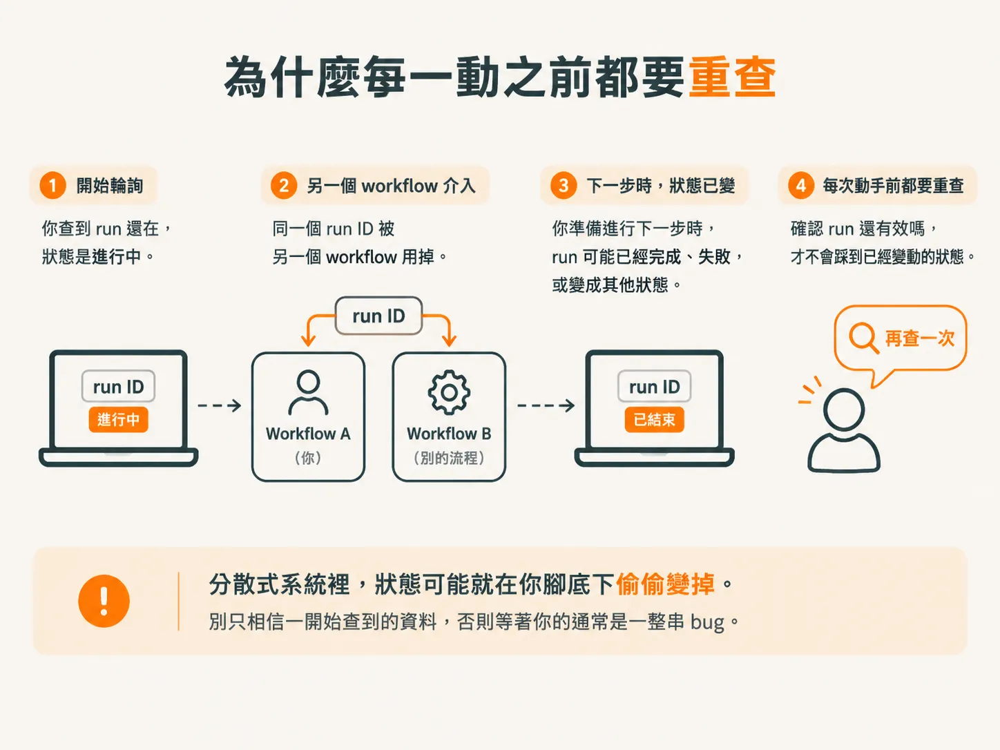
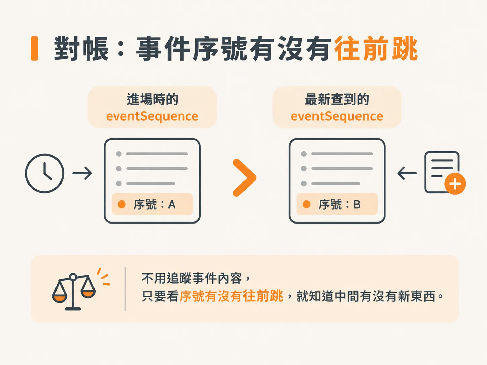
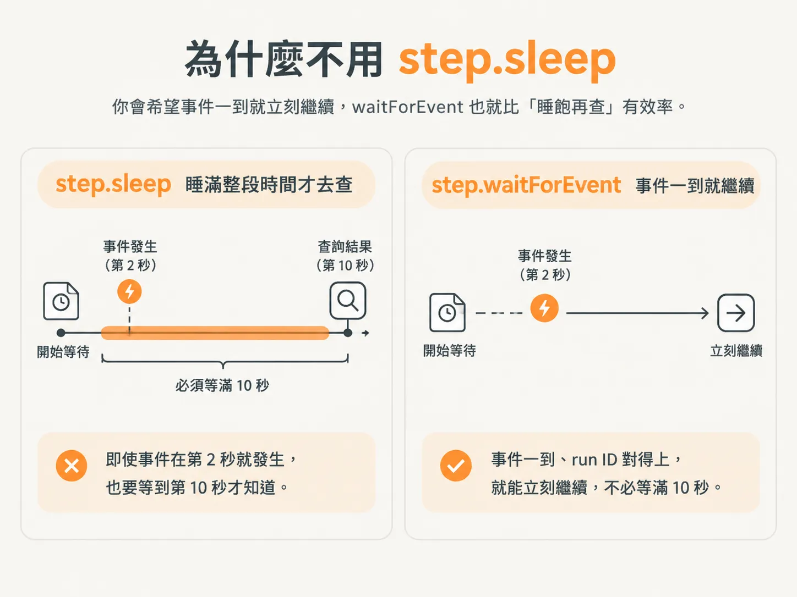

# 等待迴圈：用 eventSequence 對帳

前一個 step 讓 agent 做出「我需要等」的決定，暫停調查，等事情有新進展再繼續。

但「等」不是坐著發呆。你得一輪一輪地巡查，每巡一次就對一次帳，確認事件序號有沒有往前跳。

這個反覆巡查的動作，就是等待迴圈。

## 每一輪先讀事件序列

進入迴圈後，第一件事是讀取事件序列。

你會把 `cycle` 這個游標帶進去，拿回一個 `latest`。`cycle` 是外層迴圈使用的游標，代表目前看到哪一筆事件。

在這一層等待迴圈裡，還會另外記錄一個 `check`，專門計算「這是第幾次巡查」，每一輪巡一次，看看有沒有新事件進來。

讀完事件後，下一步是取得「目前的 run」。

你手上的 run ID 是進入流程時拿到的資料，可能已經過時。因此要呼叫 `getRun`，把 run ID 傳進去，確保拿到的是當下最新的狀態。

## 動手前先確認這個 run 還活著

拿到 `latest` 後，第一個判斷和前面一樣：如果這個 run 已經走到終點，就什麼都不要做。

這裡要特別注意，判斷的對象是 `latest.status`，不是進入流程時的 `run.status`。

白話說，如果正在輪詢的 run 已經是 `completed`、`failed`、`canceled`、`escalated`，或因其他原因變成 `superseded`，就直接停下來，不要繼續等待。

## 為什麼每一動之前都要重查

整個系統採用非同步運作，所以這種「還在不在」的檢查會寫很多次。

同一個 run ID 可能同時被另一個 workflow 使用，甚至已經被另一個流程收掉。你開始輪詢時它可能還存在，但走到下一步時，狀態已經完全不同。

所以，每次準備動手前，都要重新問一次：這個 run 還有效嗎？

這不是單純的 request-response 模型。在分散式系統裡，狀態可能就在你腳底下偷偷變掉。你不能只相信一開始查到的資料，否則等著你的通常是一整串 bug。



## 對帳：事件序號有沒有往前跳

確認 run 還有效後，才輪到真正的判斷：

<!-- derived -->
```ts
latest.eventSequence > state.eventSequence
```

`eventSequence` 就是「事件序號」。服務每送出一筆事件，就依序給它一個號碼。

你手上有兩個數字：

- **進場時的序號**：`state.eventSequence`
- **現在查到的最新序號**：`latest.eventSequence`

如果最新序號比原本的大，代表你等待的這段期間有新事件發生。這時就停止目前的 `while` 迴圈，並把 `check` 加一。

這種比法就像對帳：不用追蹤每一筆事件的內容，只要看序號有沒有往前跳，就知道中間有沒有新東西進來。



## 有新事件，就進入等待

序號往前跳，就代表有新事件進來了。

接著是 harness 裡的邏輯：事件還會持續進來，所以你要等的是下一個事件。

具體寫法是：

<!-- derived -->
```ts
await step.waitForEvent(...)
```

你可以把這個 step 命名為 `wait for service`，並把 `cycle` 和 `check` 一起帶進去，方便之後追蹤流程。

`waitForEvent` 會接收一個物件。第一個問題是：我們要等哪一種事件？

答案是 `incident/updated`。這只是你們自行定義的事件名稱，想叫什麼都可以；中間的斜線只是官方建議的命名慣例，也不是強制規定。

第二個問題是：這個事件是不是屬於「我們目前這個 run」？

因此，`if` 裡會寫：

<!-- derived -->
```ts
async.data.runId === runId
```

文件對 `async` 的說明可能有點繞，可以先把它理解成「這一筆事件帶進來的資料」。

你要比較的是事件資料裡的 run ID，和目前手上的 run ID 是否相同。只有相同時，這個事件才是你要等待的事件。

最後，再設定一個 10 秒的 timeout。

也就是說，接下來 10 秒內，只要 `incident` 被更新，而且 run ID 對得上，就繼續往下一步；如果 10 秒到了，也同樣往下一步。

你可以把它想成一個帶條件的 `setTimeout`：一邊計時，一邊順便聽有沒有符合條件的事件。

## 為什麼不用 `step.sleep`

你可能會問：為什麼不直接使用 `step.sleep` 等 10 秒？

可以，`step.sleep` 確實能做出類似的效果。但睡完之後，你還是得想辦法確認事件是否真的發生。

通常的做法是先假設有一個 event store，睡滿 10 秒後再查一次，確認這段時間內有沒有 `incident` 被更新，以及 run ID 是否正確。

這樣不是不能用，只是你只能在 10 秒後才知道結果。

如果事件在第 2 秒就發生，你還是得等到第 10 秒才會發現。

10 秒在調查流程裡或許不算久，但如果等待時間變成 30 分鐘呢？你不會想先睡滿 30 分鐘，醒來後才查一次。

你會希望事件一到就立刻繼續，`waitForEvent` 也就比「睡飽再查」有效率。



## 收尾：回到外層迴圈

等待完成後，執行 `continue`，回到外層迴圈，繼續下一輪。

最後，還要把下面這段判斷拿掉：

<!-- derived -->
```ts
decision.action === "requestHelp"
```

原因是上面已經處理過同樣的邏輯。前面判斷完了，這裡就不用再寫一次。

順帶一提，作者提到 TypeScript 把型別都標好之後，整個流程舒服很多。他也很感謝那些願意把型別寫好的人，只是最好不要是他自己。
