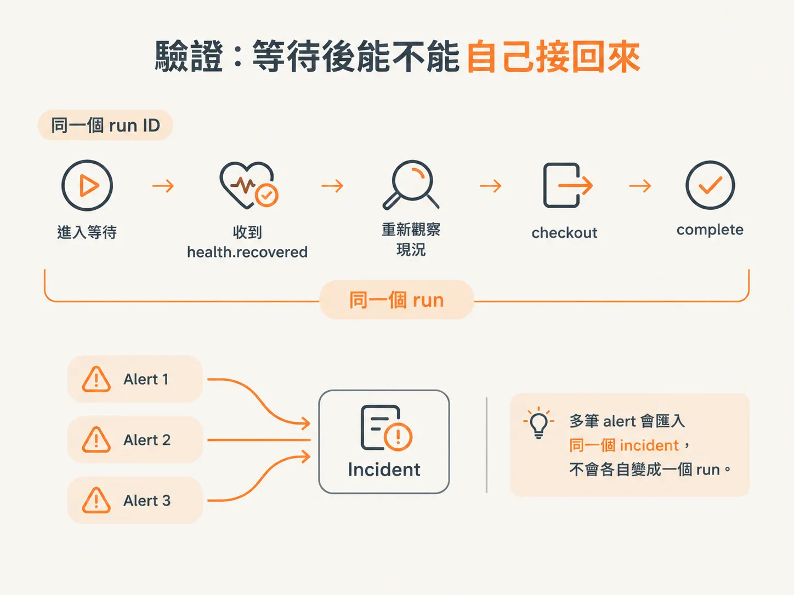
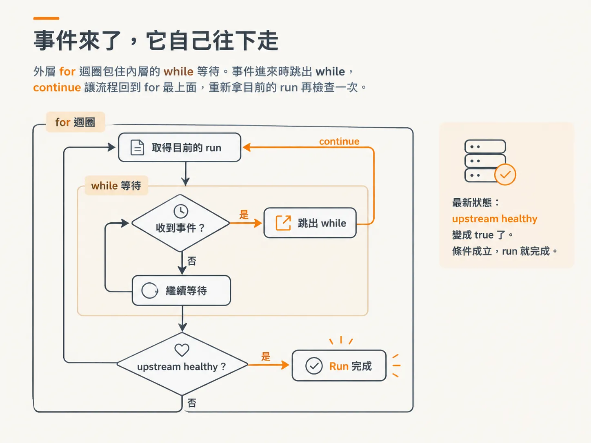
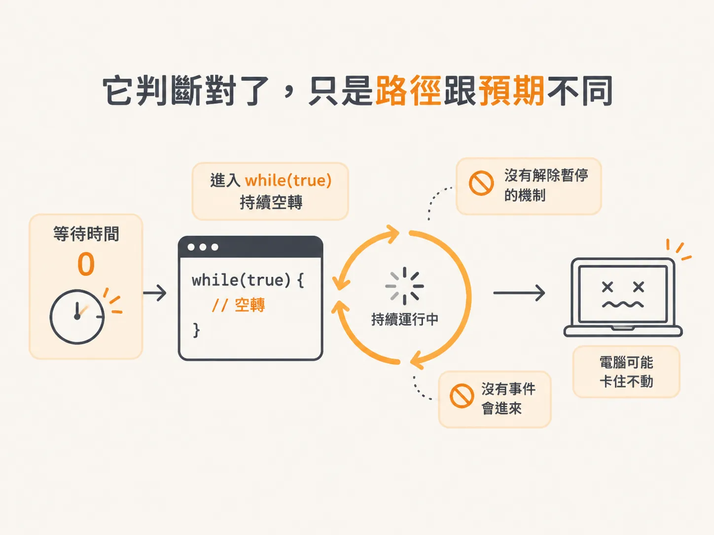
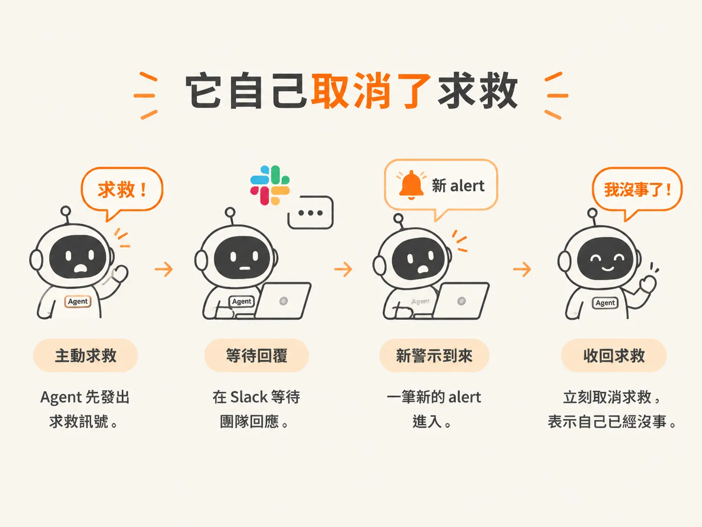

# 醒來之後：continue 接回與自行求救

前面我們已經寫好等待迴圈：agent 會暫停、等待事件，重新讀取 run 狀態，再決定下一步。

但程式寫好，不代表真的能跑完。這一課我們實際執行一次，看它醒來之後能不能自己接回流程，最後完成 run。

## 這次要驗證的是「等待之後能不能自己接回來」

要測的是一條「延遲恢復的故障」（fault with delayed recovery）：先讓上游壞掉，過一陣子再讓它自己恢復。

預期是同一個 run ID 先進入等待，收到 `health.recovered` 事件後重新看一次狀態，接著 checkout，最後完成 run。

從頭到尾都應該是同一個 run，不會中途再開一個新的。

另外還有一件事要驗證：用 `-3` 一次送出多筆 alert 時，這些 alert 應該掛在同一個 incident 上，而不是各自開出 3 個 run。

想看看它出錯時的樣子，也可以把恢復時間設成 0 毫秒，看那個 run 怎麼卡住。這部分留到後面再說。

## 它停了下來，而且開口求救

程式一跑起來，agent 果然停在等待的那一行。

接著發生了一件比較意外的事：它開口求救了。

回頭看，它求救的理由其實很充分：那是一個它沒有任何工具可以介入的上游依賴，本來就不是它該處理的問題；而且它被交代過，需要幫忙就要開口，所以它就開口了。

## 事件來了，它自己往下走

然後，我們等的事件出現了。

你在畫面上看不到事件本身，因為它是從 server 端送進來的；但 `health.recovered` 就是我們要等的那一個。

這裡有兩個長得不太一樣的事件：

- 作者自己寫的假 server 送出的事件，名稱用點號。
- ingest 那一側的事件，名稱裡有斜線。

兩者其實是同一件事，只是名稱要對得起來。

上游依賴恢復了，checkout 也跟著恢復。

事件進來之後，作者讓 agent resume；它繼續執行，下一行就是 `continue`。

要注意，這裡的 `continue` 指的是外層的 `for` 迴圈，不是剛剛那個 `while`。

這時 agent 已經跳出 `while`，但還在 `for` 裡面，所以會回到 `for` 最上面，重拿一次目前的 run，再檢查一遍。

這次讀到的是最新狀態：`upstream healthy` 變成 `true` 了。條件成立，run 就完成。

## 它判斷對了，只是路徑跟預期不同

老實說，它的表現比作者預期得更好。

前面提過，它求救是有理由的：那是它沒有工具可以介入的上游依賴，也不是它該負責的問題。

它本來會在那裡等 10 秒，甚至可能無限等下去，因為我們根本沒實作 help，也沒有任何東西會讓它繼續往下走。

嚴格說起來，它會卡死在那裡。

作者在筆記裡也寫了怎麼把它弄壞：把等待時間設成 0 毫秒。

這樣做不會讓它順利通過：程式沒有實作解除暫停的機制，也沒有事件會進來，它只會卡在一個 `while (true)` 裡，無法離開。

所以不要真的這樣跑。作者認為這可能會讓整台電腦 freeze 掉，不過這也就是「把它弄壞」的方法。

## 最有趣的是它自己取消了求救

它先喊救命，然後等 Slack 回覆；等著等著，新的 alert 進來了，它馬上改口：

「喔，等等，沒事了，我好了。」

它就這樣自己取消了求救。

## 重點：這整段跟 LLM 一點關係都沒有

剛才那整段流程，一行 AI 相關的程式碼都沒動到。從第一課到現在，AI 那部分的程式碼始終沒變。

這裡處理的是 harness：包在 AI 外面的那些程式。

這也說明了作者為什麼不打算深入講 LLM：它本身只有四行程式碼，之後也不會再改。真正要花力氣的是外面那一整套控制它的流程。

LLM 本身沒有這些機制，單靠它做不完這裡的工作。
