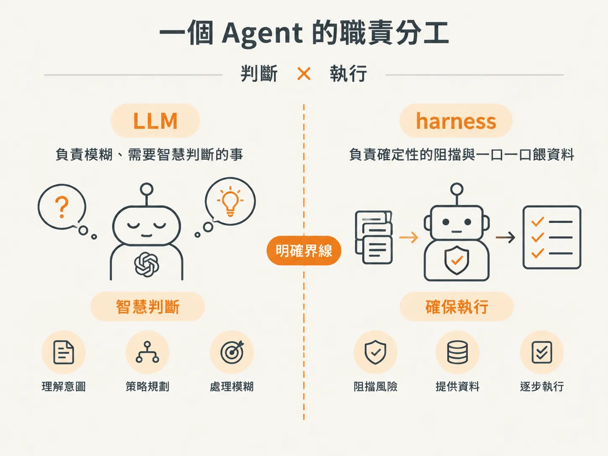
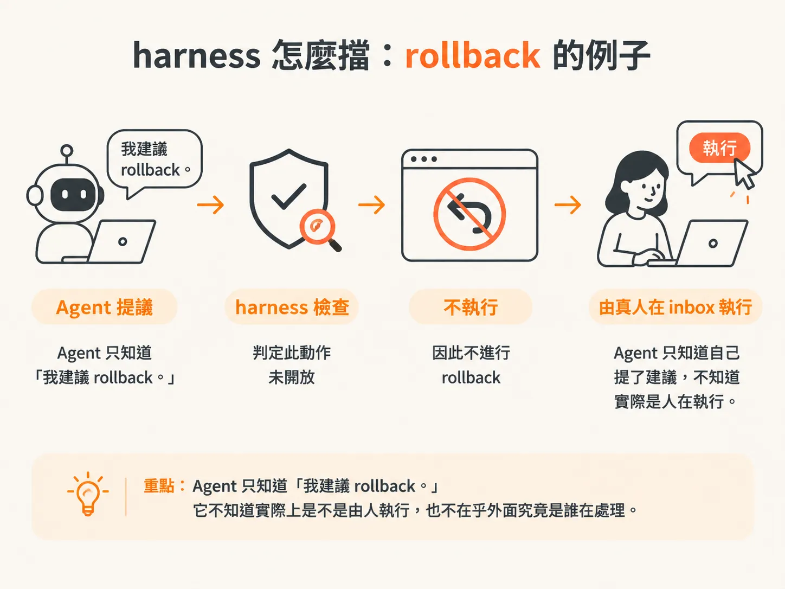
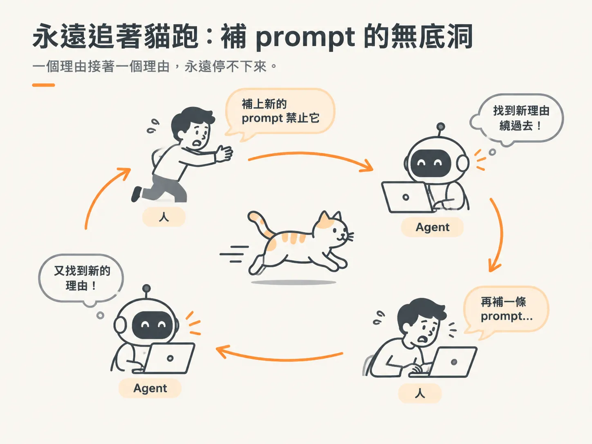
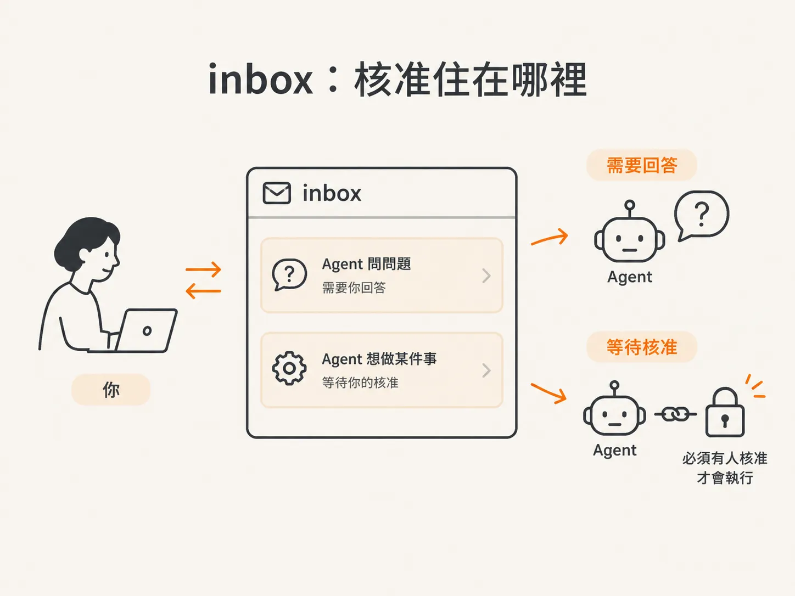
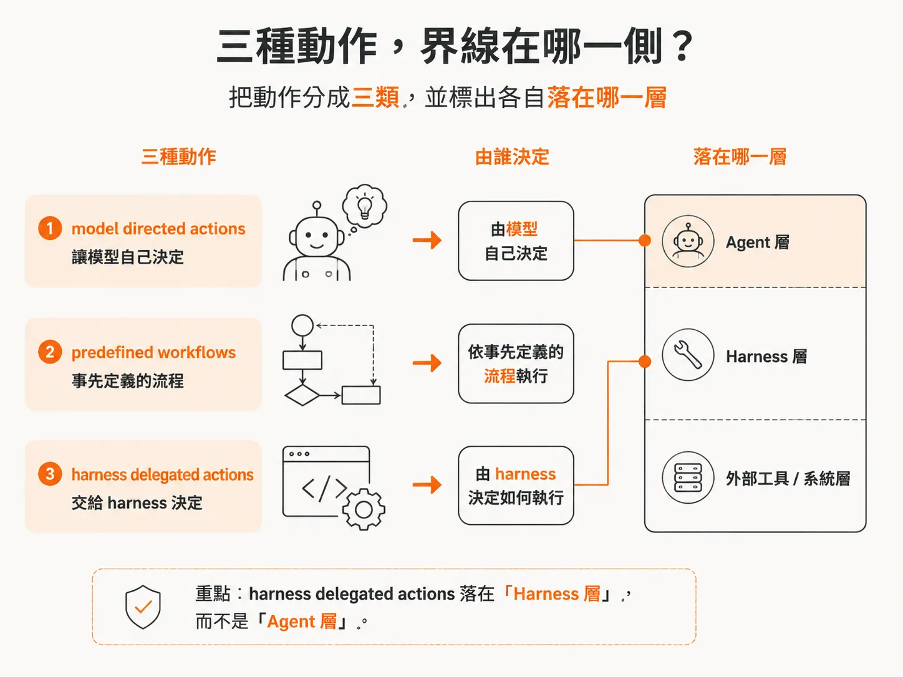

# 為什麼「需不需要核准」不能交給 LLM

上一篇的結論是：background agent 會在沒有人下指令時，自己處理事情。但這帶出一個問題：它自己動手時，權限從哪裡來、誰負責把關？

使用聊天型 coding agent 時，你可能已經習慣一件事：  
只要你沒有下指令，它就什麼都不做。

大多數這類工具也會提供一組設定，讓你決定它擁有多少權限：要全自動執行，還是每使用一個 tool 都要停下來詢問？你也可以把某些 tool 放進 allow list，另一些放進 block list。

但現在要做的東西不一樣了。

這個 Agent 會在背景執行，有自己的目標，也會回應事件。這種使用方式叫做 fire and forget：你下達指令後就離開，可能人已經在夏威夷的海灘上。

問題也跟著來了：

**誰有權限做什麼？又要怎麼確保這份「權限契約」一直被遵守？**

最不該做的，就是只對 Agent 說：「做這件事之前，請先問我。」

如果你把「這件事需不需要核准」的判斷交給 LLM，就等於把門鎖交給一個偶爾會看錯東西的人。LLM 會 hallucinate，也就是產生幻覺：煞有其事地講出根本不存在的內容。

既然它可能在其他事情上產生幻覺，為什麼不會在「需不需要核准」這件事上出錯？

它當然也會。

所以要先把兩件事分開：

- **LLM 負責**：模糊、需要智慧判斷的事情。
- **harness 負責**：具備 deterministic（確定性）的阻擋與執行，把事情擋在 Agent 之外，只有需要時才一口一口餵給它。

把「我要 LLM 做的事」跟「我要 harness 做的事」切開。

這條界線，就是接下來要建立的東西；而且大部分內容都會落在 harness 這一側。

## harness 怎麼阻擋動作？

先談「觀察」。

在傳統的 tool loop 裡，我們通常會說：「這裡有一堆工具和一個 prompt，你自己挑一個來用。」

但在這個 harness 裡，不管 Agent 想不想看，它都會自動觀察目前的世界。這不是 Agent 可以自行選擇的事情，而是直接寫死在程式碼層級：

每一次 loop，harness 都會把新的狀態餵給 Agent。  
Agent 是被強迫餵食的。

Agent 要做的，是根據目前狀態、目標，以及過去做過哪些動作的歷史，判斷下一步該做什麼。

動作選定後，harness 會再驗證一次，確認這個動作是否真的能執行。

舉例來說，身為 harness 的作者，你可能不希望 Agent 執行 rollback、重新部署，或做出其他可能惹麻煩、花錢的事情。因此，你會在 harness 裡把這些動作標記起來。

如果 Agent 說：「我要 rollback。」

harness 就會檢查：

**rollback 有開放給 Agent 嗎？**

如果沒有，那就不執行，改成讓真人在 inbox 裡按下按鈕來完成這個動作。

但 Agent 不知道這件事。

Agent 只知道：「我建議 rollback。」它不知道實際上是不是由人執行，也不在乎外面究竟是誰在處理。

這跟「讓 Agent 自己判斷這件事該不該找人」完全是兩回事。

如果讓 Agent 自己判斷，它不可能每次都判斷正確。不管你使用哪個模型，總有一天它會說：

「我自己來是有充分理由的，原因是……」

而且你仔細一看，還真的覺得有道理。比如說：

「那個時候大家都在睡覺。」

你可能就會說：「好啦，聽起來有道理。」

接著，你再補一條 prompt：

「如果大家都在睡覺，不要這樣做，改成那樣。」

但模型下一次又可能找到另一個理由繞過去。你只好再補一條規則。

你就這樣永遠追著它跑，像在跟貓玩。

## inbox：核准到底住在哪裡？

那個「有人按下按鈕」的地方，長什麼樣子？

就是 inbox，也就是我們和 Agent 互動的介面。

目前有兩種情況會出現在這裡：問問題，以及要求核准。

- **問問題**：Agent 正在做某件事，但缺少背景資訊，或對情況不確定，因此需要你回答。
- **要核准**：Agent 覺得某件事應該執行，但 harness 把它鎖在「必須有人核准」這一關後面。因此，它會一直待在 inbox，直到你按下核准。

## 三種動作，界線在哪一側？

要把這些動作說清楚，可以借用 Anthropic 的 agent guidance 分類：

- **model directed actions**：讓模型自己決定要做什麼。
- **predefined workflows**：事先定義好的流程。
- **harness delegated actions**：交給 harness 決定的動作。

「需不需要核准」這件事，屬於 **harness delegated actions**。

這些事情發生在 harness 層級，而不是 Agent 層級。

所以答案很清楚：

**不要把「需不需要核准」交給 LLM。**

應該交給 harness，用確定性的方式阻擋。模糊判斷與確定性執行之間的界線，就畫在這裡。
