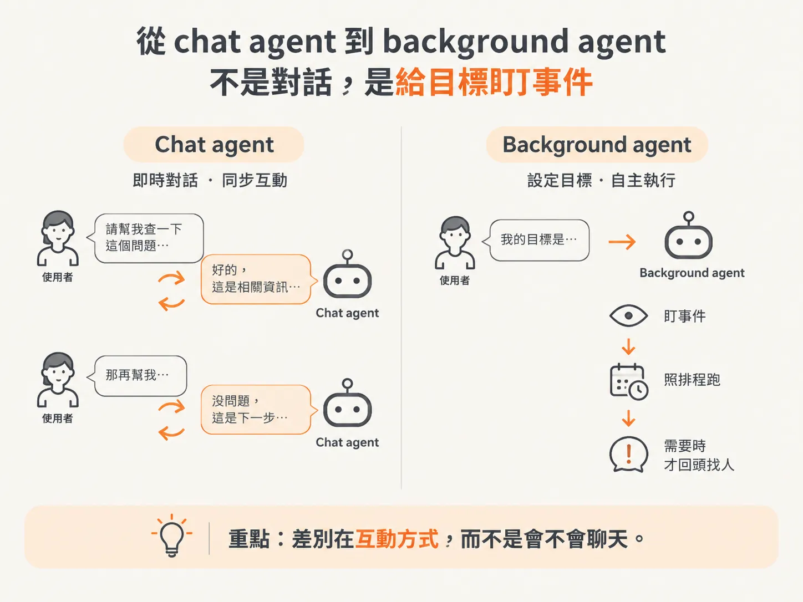
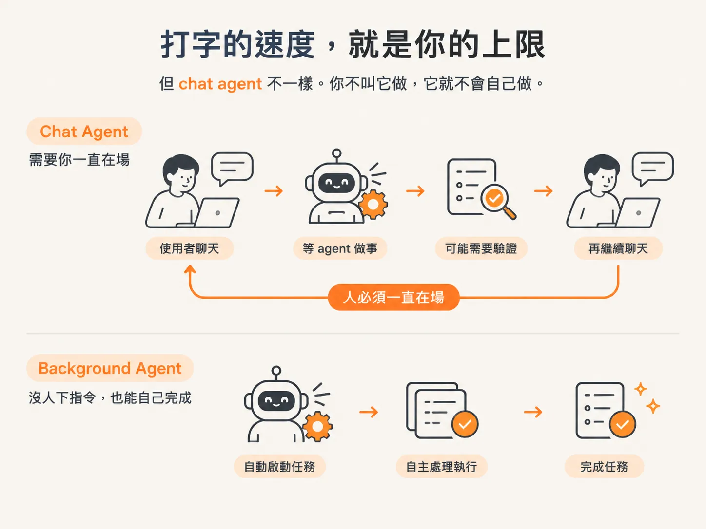
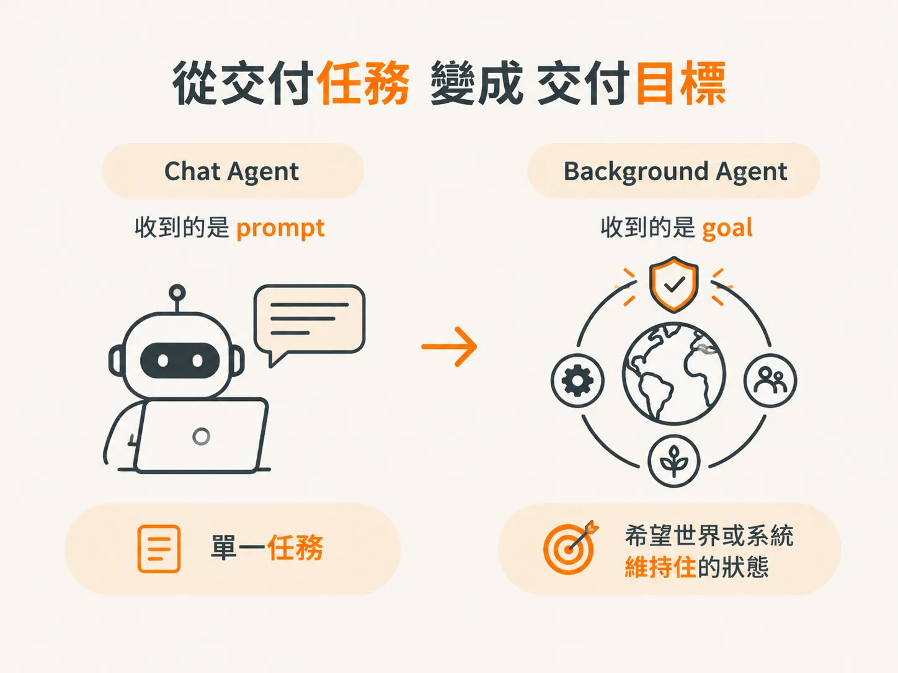
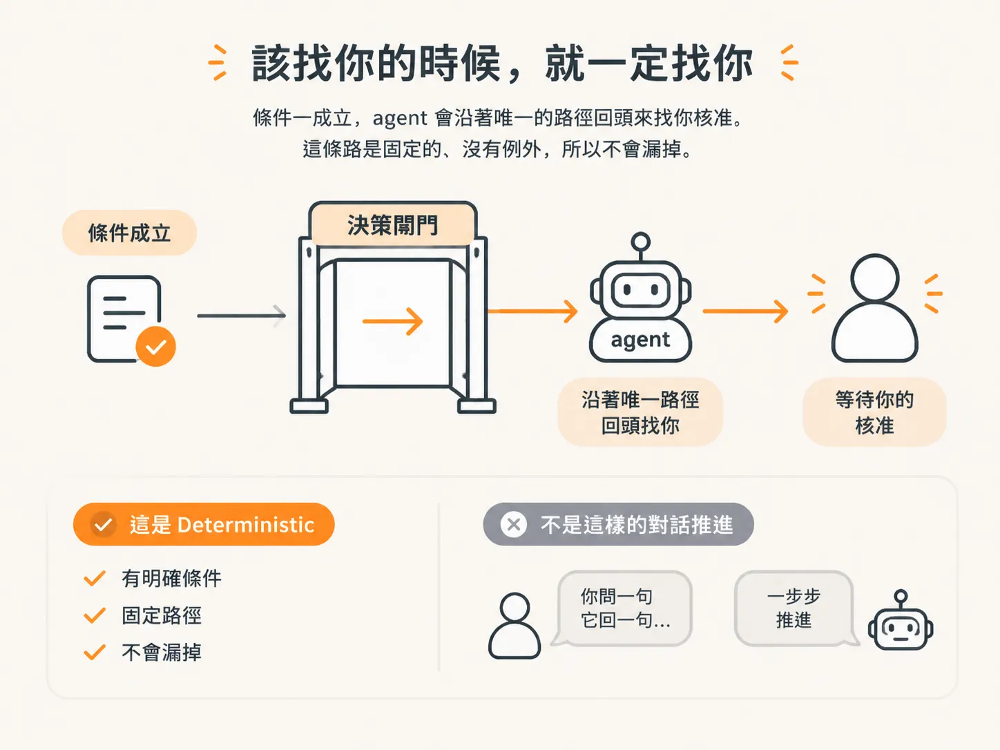

# 從 chat agent 到 background agent：不是對話，是給目標盯事件

如果你用過 ChatGPT 或 Claude，那你用的其實是 **chat agent**，也就是聊天型、對話式的 agent。

你打字，它回答；你再打字，它再回答。這種 agent 好用又有效率。只是，**background agent 並不是要取代 chat agent**。

想像另一種情況：你想要一個有智慧的系統，幫你盯著事件、照排程執行，或是在沒有人下指令時，自己把事情處理好。

你只要給它一個目標，它就持續工作，直到目標達成。需要幫助時，它會主動回頭找你；需要你核准時，它會停下來等你。

這就是 **background agent**。

它和 chat agent 的差別，不在於「誰比較會聊天」，而在於互動方式完全不同：

- chat agent 是你給 **prompt**，然後等它回覆。
- background agent 是你給 **goal**，然後放手讓它持續盯著事情發展。

先把這個差別弄清楚，因為接下來整門課要做的，都是後者。

## 打字的速度，就是你的上限

坐在電腦前和 chat agent 對話，就算是像 Codex 這種會寫程式的工具，表現很棒、速度也快，但你的上限，仍然是你打字、下 prompt 的速度。

而且，你還是得看它的輸出，仍然被綁在整個流程裡。

這是一個同步的過程：

你聊天，然後等 agent 做事；接著你可能驗證，也可能不驗證，但你就是得等。

它不是 **fire and forget**。這個詞的意思是：下了指令後，就放手讓系統自己跑完。

但 chat agent 不一樣。你不叫它做，它就不會自己做。

我知道有些 app，像 Codex，可以設定排程，也可以每隔一段時間觸發。這已經有一點 background agent 的味道，但還不完全是。

如果你真的想大幅提升生產力，最好的情況是：

**這件事根本不需要你做，但它還是完成了。**

你不是親自動手的人，事情卻照樣被完成；你也不用另外告訴它什麼時候該做。

## 你給的是目標，不是 prompt

給 chat agent 的，通常是 **prompt**：一個任務，或一件單一的事情。

但給 background agent 的，可以只是一個 **goal**，也就是目標。

你可以告訴它：

「你的目標，是讓系統維持在這個狀態。」

或者：

「你的目標，是持續監控這個東西。」

這比較像，你心裡先有一個願景：世界、環境，或某個系統應該長什麼樣子。

background agent 的工作，就是實現這個願景，採取一切必要行動，讓這個狀態持續成立。

它就像是在一個指定的狀態裡維持平衡，確保那個狀態一直成立。

你當然也可以給 chat agent 一個 goal，例如：「去網路上幫我買一些東西。」

但你會發現，background agent 的差別在於，它更能持續運作，也更有韌性。

## 它可能是 loop、process，也可能是被事件叫醒

background agent 有很多種叫法，每個人對它的理解也不太一樣。

有人認為，它是一個無止境的 **loop**，像 Kubernetes operator 一樣，隔一段時間就重新檢查一次：把目前狀況和目標互相比對，如果有落差，就動手補上。

也有人認為，agent 就是一個執行特定工作的 **process**。

還有人覺得，agent 像是被另一個 agent，或另一個介面觸發的東西。比如在 Codex 裡開一個 subagent，讓它在背景寫程式。

Mark 提過一個很好的說法：

agent 負責處理工作，而 background agent 則是在外部世界發生某個事件時，被啟動的系統。

background agent 可以由外部事件啟動，這正是接下來我們要做的事；但它不一定非得採用這種方式。

## 該找你的時候，就一定找你

還有一件事，會讓 background agent 和 chat agent 徹底分開：**這些保證是寫死的。**

你可以直接在系統裡規定：

只要某個條件成立，它就**一定**要來找你。

不是由 agent 自己判斷要不要找，也不是看它當下心情或對話脈絡決定。因此，這件事不會被漏掉。

這些動作是 **deterministic** 的，也就是結果和觸發條件都被明確寫在系統裡。

它不是「你問一句、它回一句」那種靠對話一步步推進的方式。

## 你想要的是：一組知道什麼時候該做事的人

真正的高生產力，其實就像你身邊有一組人：

他們很會把自己的工作做好，也知道什麼時候該出手。你不需要一直告訴他們何時做、要怎麼做。

background agent 有潛力變成這個樣子。

它現在還沒有完全做到，但基本骨架已經存在，接下來要看你怎麼把它發展到那個程度。

這個骨架包括 **harness**、**infrastructure**，以及你過去寫過的傳統 agent。

把這三者組合起來，就能做出一個可以無限期運作、能夠自我修復，而且不需要你一直守在旁邊盯著，也能完成大量工作的系統。
