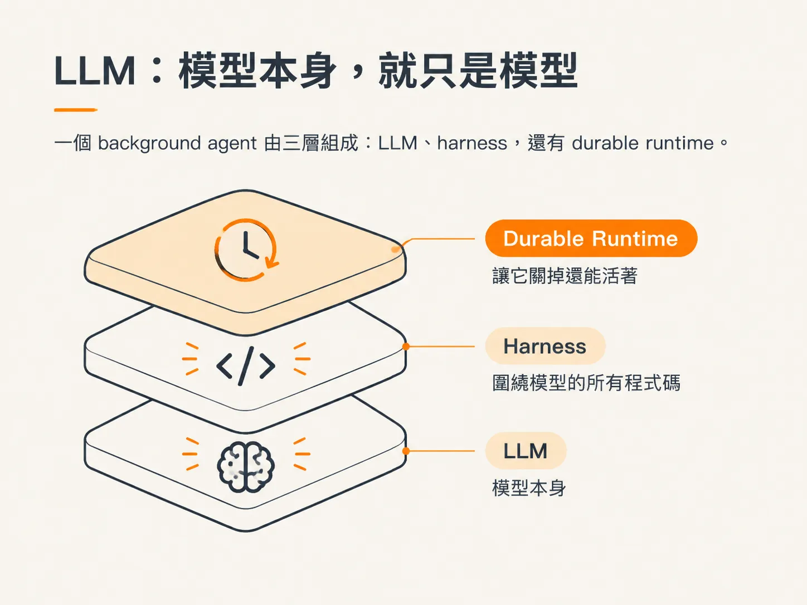
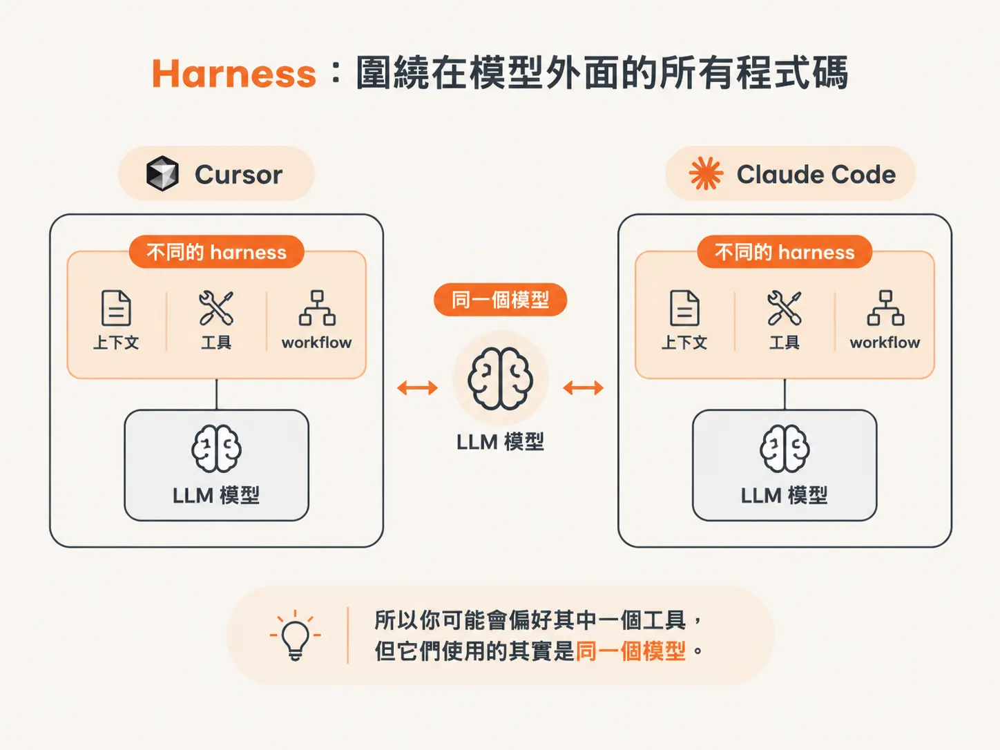
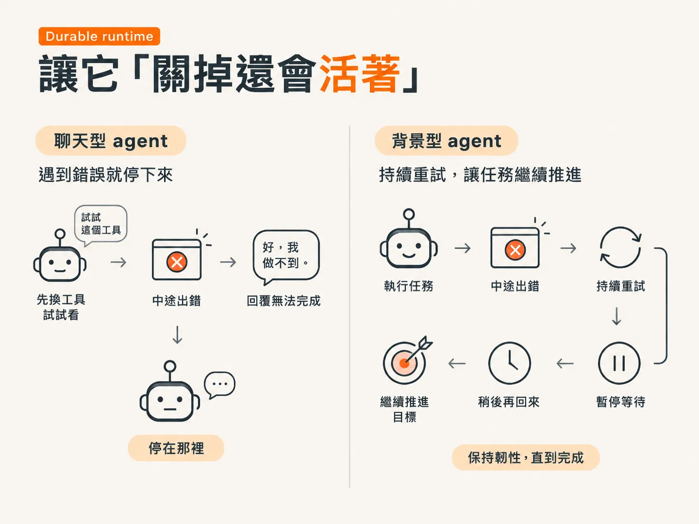

# 三個組成：LLM + harness + durable runtime

上一篇把 background agent 的整體印象講完了，最後停在一個骨架：harness、infrastructure，再加上你過去寫過的傳統 agent。這一篇把它拆開看，最簡單的分法，是三個部分疊在一起：

1. **LLM**
2. **Harness**
3. **Durable runtime**

## LLM：模型本身，就只是模型

LLM 就是那個模型本身。你給它 prompt，它預測一些內容回覆你，僅此而已。

它不會自己記得上一輪對話，也不會真的替你完成事情。很多時候，我們以為自己正在「使用一個 agent」，實際上只是把 prompt 丟給模型，再拿到一段回覆。

這沒有什麼不好，但你要知道它的界線：

- 模型本身不提供記憶
- 不提供工具
- 也不會自己啟動、持續執行

要拆解一個 background agent，最簡單的方式，就是把它看成三個組成疊在一起：LLM、harness，還有 durable runtime。

## Harness：圍繞在模型外面的所有程式碼

Harness 指的是圍繞在 LLM 外面的所有程式碼。它負責提供上下文、工具，以及執行流程，所有讓模型能「做事」的部分，都在這裡。

如果你希望 agent 記住對話、實際使用工具，甚至像現在這樣在背景獨立執行，這些都屬於 harness 的範圍。

最直接的例子是：同一個模型 Opus 5.5，放在 Cursor 和 Claude Code 裡，差別在哪裡？

模型是同一個。真正不同的，是 Cursor 的 harness 和 Claude Code 的 harness。兩者雖然都連到同一個模型，但周圍的程式碼不同，包括允許模型如何選擇工具、如何整理上下文，也都可能不一樣。

所以你可能會偏好其中一個工具，但它們使用的其實是同一個模型。

這也是為什麼，你現在使用的工具，幾乎不可能只是單純在「跟 LLM 說話」。

## Durable runtime：讓它「關掉還會活著」

LLM 加上 harness，已經能讓 agent 記住事情、使用工具、執行任務。

但這還不足以解釋 background agent 最特別的地方：即使你沒有盯著它，它仍然可以持續運作。

這靠的是第三個組成：**durable runtime**。

想像你請一個 coding agent 做事。它開始執行後，途中卻發生問題：API 呼叫失敗、連線逾時，或某個結果和預期不同。

一般的聊天型 agent 會怎麼做？它可能先換一個工具試試看，但最後很可能只回你一句：「好，我做不到。」然後就停在那裡，事情也不會繼續發展。

Background agent 則不一樣。它更有韌性，會盡可能繼續把目標往前推。

它可以重試，也可以暫停，等到需要時再回來處理，不一定要立刻向人求助。對長時間執行的任務來說，這比只能同步等待回覆的工具更能撐下去。

Durable runtime 就是支撐這些能力的基礎設施。它讓 agent 可以長時間運作、自我修復，也能在暫停後回到原本的工作。

你關掉視窗、離開座位，agent 不會因此消失。它仍然可以等待事件、按照排程待命；時間到了，或某個條件成立，就繼續往下執行。

這就是「關掉還會活著」的意思。

不是因為模型突然變得比較聰明，而是因為模型外面有 durable runtime 撐住整個執行過程。

最後要記住，background agent 並不是要取代所有 chat agent。你不會拿它去替換每一個聊天型 agent，這樣也不合理。

它是另一種工具，適合用在這些情境：需要持續盯著事件、按照排程執行，或是在沒有人下指令時，自己處理事情。
