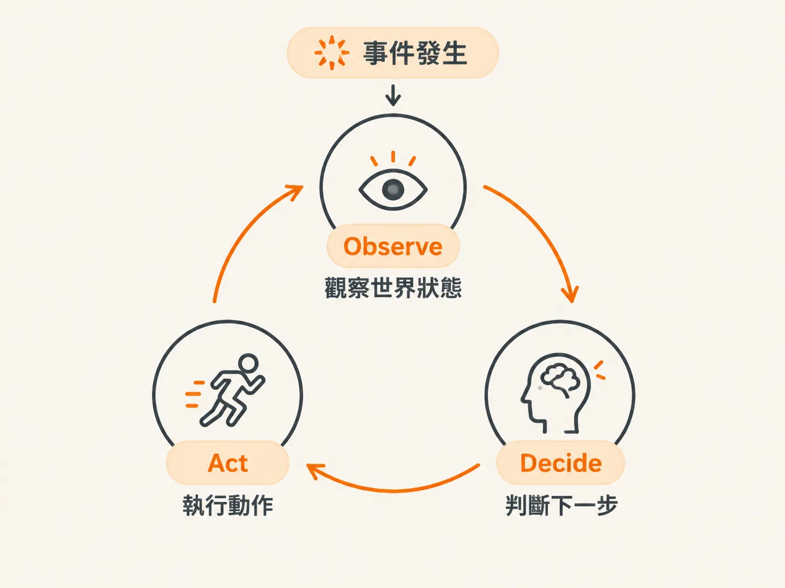
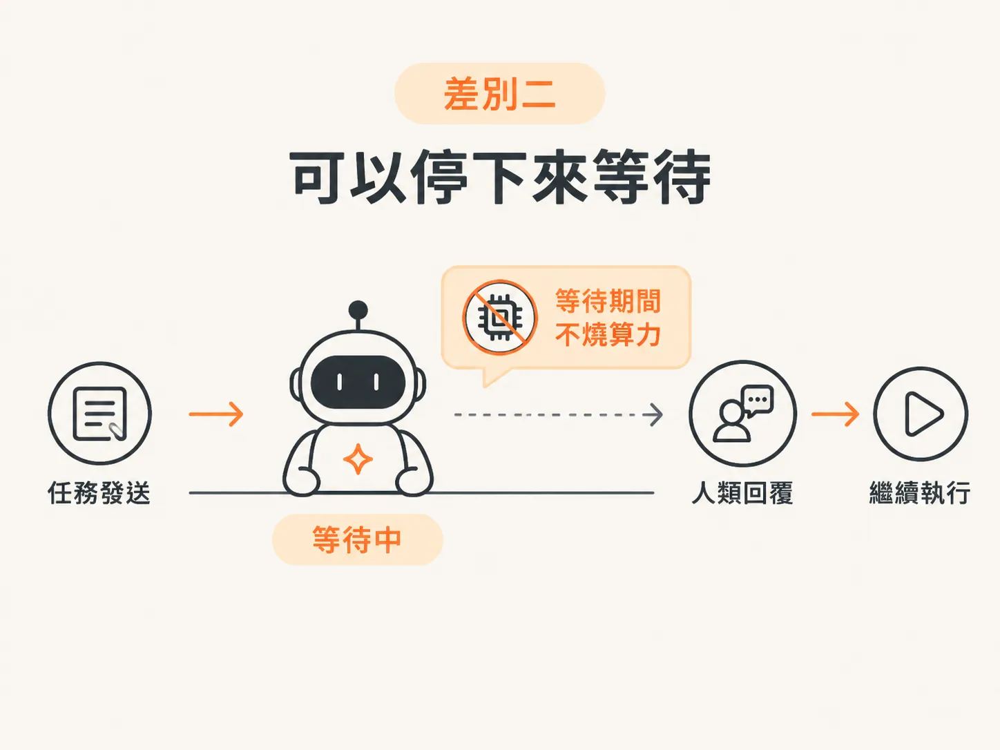
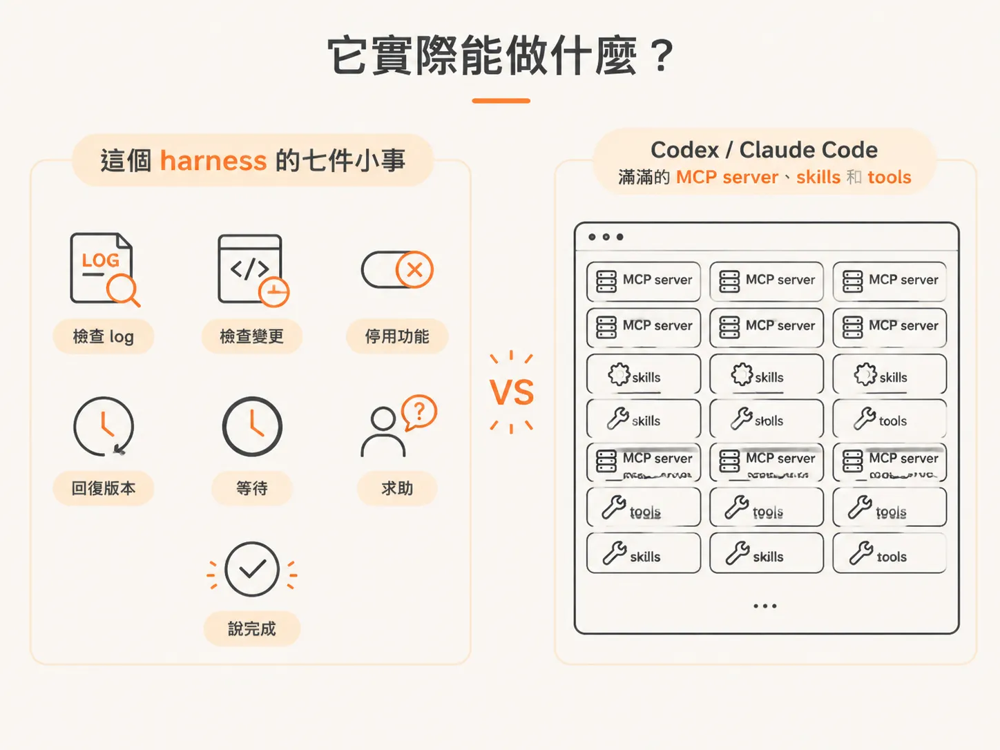

# Harness 的核心：observe-decide-act 迴圈

上一篇把「需不需要核准」的界線畫清楚了：模糊判斷交給 LLM，確定性阻擋交給 harness。這一篇看 harness 具體怎麼跑。

你可能用過 Claude Code 或 Codex 這類 coding agent。

你傳一則訊息給它，它執行一輪、回覆你，接著 process 就結束了。就算你把電腦關掉，它也會跟著停止，沒辦法真的暫停，等你回來後再繼續。

這篇文章要介紹的 harness，運作方式跟它很像，但有一個核心差別：它會圍繞著 **observe-decide-act** 迴圈持續運作。

## observe、decide、act 三個步驟

講到 harness，我們先從 observe-decide-act 迴圈開始。顧名思義，它分成三個步驟：

1. **Observe（觀察）**：事件發生時，Agent 先觀察我們提供的世界狀態。
2. **Decide（判斷）**：判斷下一步該做什麼。
3. **Act（行動）**：真的去做那件事，然後再回到迴圈。

這跟現在幾乎所有 Agent 的運作方式都很像。隨便拿一個內建 tool loop 的 Agent SDK，大概就是這樣執行，跟標準做法沒什麼差別。

如果你研究過 Agent 或 harness 的架構，會發現這類「思考框架」非常多，例如 chain of thought、tree of thought、ReAct。

這裡的 ReAct 不是 React JS，而是另一種東西。除此之外，還有許多研究論文都在持續優化這類架構。

## 差別一：完全不做 tool calling

雖然整體看起來和標準做法很像，但其中有幾個小差異，會帶來很大的不同。

第一個差別是：這個 harness 完全不做 **tool calling**。

我們還是讓 Agent 能夠挑選要執行的動作，只是這件事不是透過模型層級的 tool calling 來完成。

## 差別二：可以停下來等待

第二個差別和「背景執行」有關。

因為這個 harness 在背景執行，有自己的架構，而且我們希望掌握某些權限，所以可以讓 background agent 暫停並等待。

現在大多數 coding agent 沒辦法這樣做。它頂多傳一則訊息給你，接著 process 就結束了；你把電腦關掉，它也會停止。

想像一下：一個 coding agent 部署在伺服器上，執行到一半需要你的回覆，但你三天都沒有回應。

你不會期待那段算力一直開著、連線一直維持，或等你回來時系統狀態還完全沒有改變。

所以，我們希望 Agent 可以像人一樣等待。

想像同事在 Slack 問你問題。他卡住之後，就坐在那裡等你回覆；等你回來回答，他才繼續工作。

而在等待期間，什麼都不會發生，也不會有機器持續消耗算力。

## 它實際能做什麼？

Agent 能做的事，其實只有一份很短的工具清單。它可以：

- 檢查 log
- 檢查變更
- 停用某個功能
- 回復某個版本
- 等待
- 求助
- 最後說「我完成了」

就這些，沒有很誇張。

如果你用過 Codex 或 Claude Code，可能已經裝了一堆 MCP server、skills 和 tools。和那樣的工具集合相比，這個 harness 的能力非常精簡。

我們不會加入那些工具，因為它們不是這裡的重點。而且，這裡的大部分內容本來就是模擬的。

## 參考：ReAct 論文

前面提到的 ReAct，是一種比較早期的 Agent 思考框架。

這是它在 2022 年發表的研究論文。現在回頭看，可能會覺得那已經是很久以前的事，但其實也才 4 年。只是在 AI 的世界裡，4 年常常讓人覺得像過了 30 年。

這篇論文很值得讀。你可以點選 view PDF 或 view HTML，看看研究者如何替 LLM 設計這類思考框架，讓它更有效地完成任務。

它和我們現在要做的迴圈非常相似。

這些內容是下一節會碰到的主題。現在先建立一個整體概念就好。
