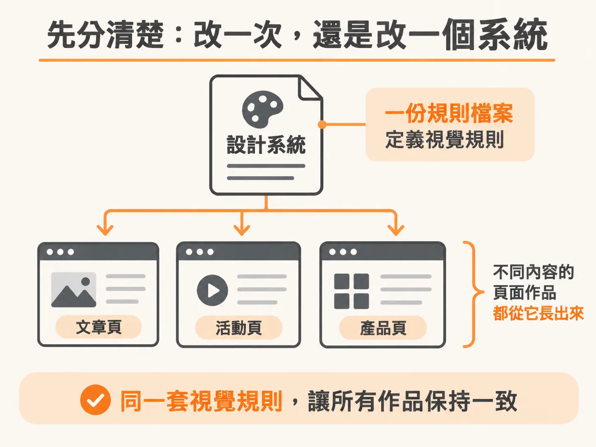
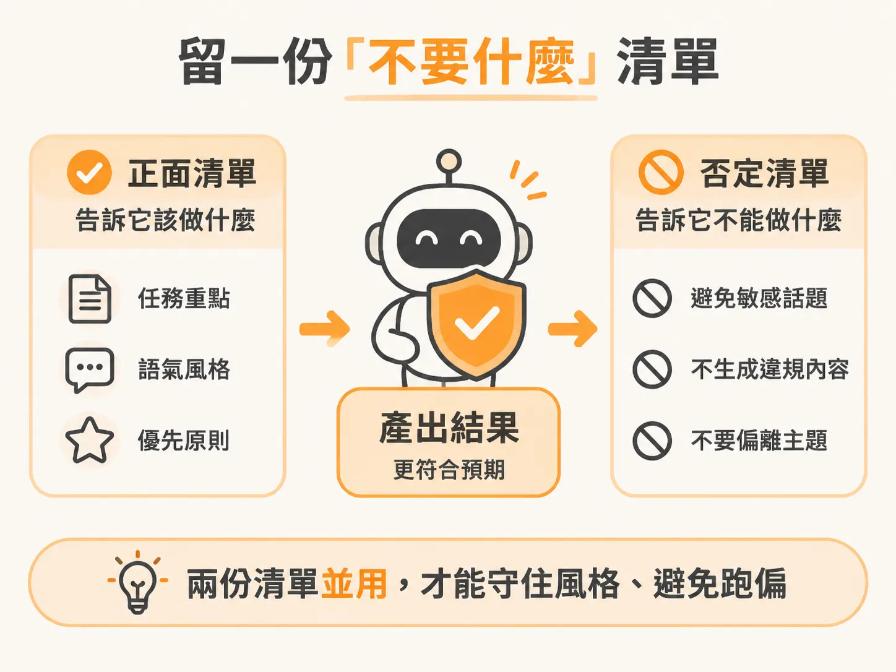

# 把品味鎖進 Design System X：一個 prompt 洗掉 AI 味

上一課的區塊清單 approved，agent 也照著做出一頁式前端了。但你打開一看，功能沒問題，外觀卻很眼熟：紫藍漸層、圓角卡片、發光標題。別人請它做的網站，好像也長這樣。

問題不一定出在你寫錯 prompt，而是你還沒告訴它「你的風格」是什麼。這一課要做的，就是把你的視覺規則寫成一個檔案，以後只要一句話，就能套用到新作品上。

## 先分清楚：改一次，還是改一個系統

改一頁很快；要讓每個作品都長得像同一個品牌，就得靠設計系統。

這裡說的設計系統（design system），其實不複雜：把決定好的顏色、字體、間距和元件整理成固定規則，讓之後的作品都照著做。說穿了，它就是一份檔案，沒什麼設計師才懂的暗號。

課程把「品味是你的優勢」說得很直接：有了設計系統，你就能少做那種一看就像 AI 生出來的漸層網站。品味也不全是感覺。你能不能說清楚「這個顏色用在哪裡、那種字重不要出現」，同樣是其中一部分。

設計系統省力的地方就在這裡：規則寫好一次，之後的作品就沿用同一套視覺語言，不必每頁重講一遍。



## 先用 /robo 看一次：一個 prompt 換掉整張臉

動手之前先看一次成品，你才知道要往哪個方向做。

/robo 是課程提供的現成設計系統，可以直接拿來測試，再改成自己的品牌風格。示範方式很簡單：找一個普通頁面，輸入一句 prompt，就能替它換一張臉。

在自己的 Claude Code 裡輸入「用 /robo 重繪這個頁面」，再指向一個現有的頁面檔案。它不會重寫內容，而是替換頁面的視覺語言。你看到的是同一段文案、同一個版面骨架，但顏色、字體、間距和按鈕都變了。

重點是親眼看一次「同一份內容，兩種長相」。看過之後，你講風格就不會只剩形容詞，可以指著畫面說出哪裡變了。


## 自己做一把：把基礎美學加上品牌色

看懂示範後，換你動手。你要做的不是一個網站，而是一個 skill。

課程的做法是：選一種基礎美學（base aesthetic），再配上一組品牌色（brand colour palette），組成自己的 Design System X。之後只要輸入 `/design-system-x`，它就會照你的視覺語言製作你指定的內容。

課程提供的 prompt 如下：

<!-- source: sources/claude-code-master/20261028/7-Volume F - Taste and Design/3-Module F3 - Awesome Design Systems/index.html#L94-L98 -->
```text
Make a skill called /design-system-x, so any time i say /design-system-x you build whatever i ask in our visual language

here's the reference design system to base it on: [PASTE DESIGN SYSTEM]

and here's the colour palette: [PASTE COLOUR PALETTE]

write all of that down inside the skill as locked rules, not vague vibes: the exact colours with their codes and what each one is for, the fonts with their exact weights and where each is used, spacing, corner styles, shadows, and how buttons and cards look

include a small copy-paste starter block - the fonts import and the base styles - so every new build starts from the same foundation

add a "what this style is NOT" list at the bottom - the fonts, colours, and effects to never use - so the style can't drift over time
```

你要填入兩個空格：參考的設計系統，以及品牌色票。課程另外準備了兩份素材庫供你挑選：一份收錄 35 套完整、風格差異很大的網站系統；另一份是品牌配色參考，包含 Apple、Airbnb、Uber 等例子。挑一套設計系統，再配上一組色彩，就是你的起點。

## 鎖住規則，不要只寫「氣質」

這個 prompt 最重要的一句是：**把規則寫清楚、固定下來，不要只寫模糊的感覺**（locked rules, not vague vibes）。

差別在哪裡？「現代、乾淨、有質感」這些形容詞，每個人想像的畫面都不同。模型最後只能猜，做出一個折衷的平均值。具體規則則不一樣，因為它們可以檢查。

至少要寫清楚五類：

- **顏色：**列出每個色碼，並說明用途。主色用在標題還是按鈕？底色是純白，還是帶灰？
- **字體：**列出字型、精確字重，以及各字重的用途。標題用哪一種，內文用哪一種？
- **間距：**說明段落與段落、區塊與區塊之間要留多少空間。
- **形狀：**訂下圓角大小，以及陰影的樣式。
- **元件：**說清楚按鈕和卡片要長什麼樣。

寫到這個程度，模型就不用猜你的品味，只要照著規則做。

prompt 還要求準備一小段 starter block，也就是可以直接複製的起始程式碼，裡面放字體匯入方式和基礎樣式。這樣每個新作品都能從同一塊地基開始，不必每次重新摸索。


## 留一份「不要什麼」清單

就算規則寫得很細，風格還是可能慢慢走樣。做法是在 skill 最底下，加上一份否定清單。

prompt 的要求很明確：列出這種風格永遠不要用的字體、顏色和效果，避免它隨時間偏離原本的方向。

這份清單特別實用，因為 AI 有自己的預設習慣。你沒有明講，它就可能回到熟悉的平均值。把「不要紫藍漸層」「不要發光邊框」寫清楚，才不會每次都被拉回同一種常見風格。

正面清單告訴它該做什麼，否定清單告訴它不能做什麼。兩份都備齊，風格才守得住。



## 它會越用越完整

第一版不會完美，這很正常。設計系統不是寫完就封存的規格，而是可以慢慢累積的工具。

課程提到，這套系統可以持續加入動畫和模組化元件；用得越多，就能涵蓋越多需求。每做出一個新的區塊，只要把它的樣式補進 skill，下次就能直接沿用。

所以，不必一開始就寫好一整本設計規範。先訂下顏色、字體和間距，做出第一個頁面。之後每次覺得「這個地方做對了」，就把規則補回檔案。用一個月，那份檔案就會越來越像你的品味。

## 你現在可以做的三件事

第一步，用 `/robo` 重繪一個手邊現有的頁面，先看見「同一份內容，兩種長相」。

第二步，挑一套參考系統和一組品牌色，把 prompt 貼進 Claude Code，請它建立 `/design-system-x`。

第三步，打開剛產生的 skill 檔案，檢查有沒有色碼、字重、間距、圓角、陰影、按鈕、卡片，以及最底下的「不要什麼」清單。少了哪一項，就補上哪一項。

補完後，再請它做一個頁面。你會發現 AI 味淡了。這跟換模型無關，是你終於把品味寫成它看得懂的規則。
